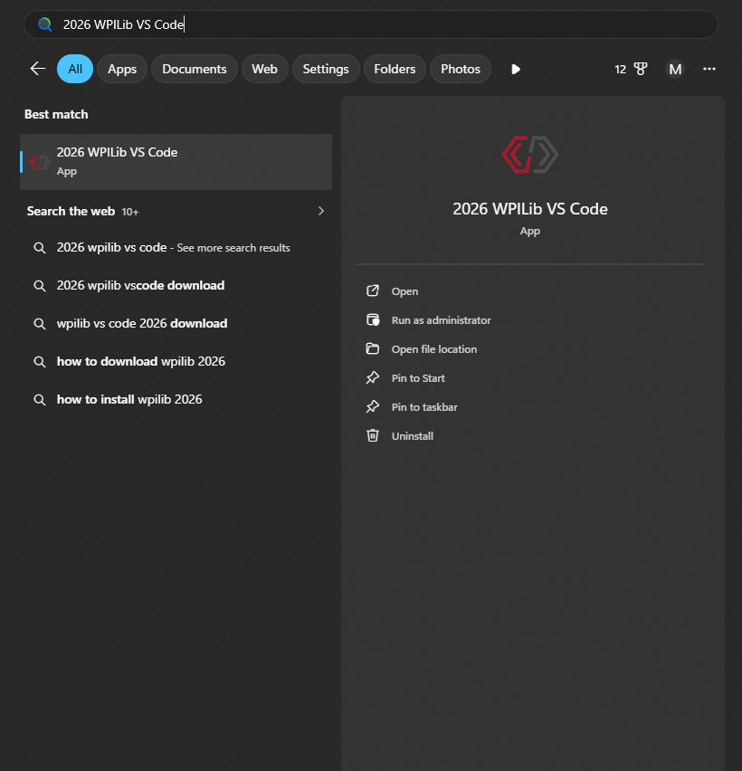
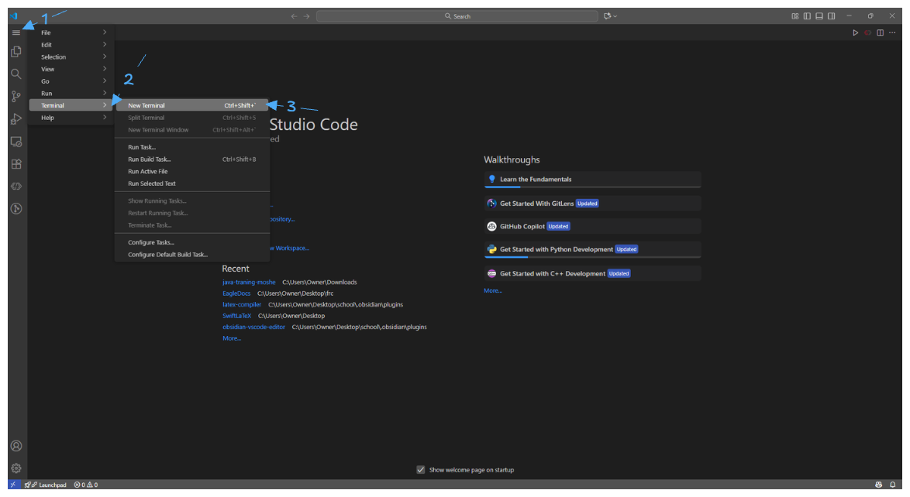
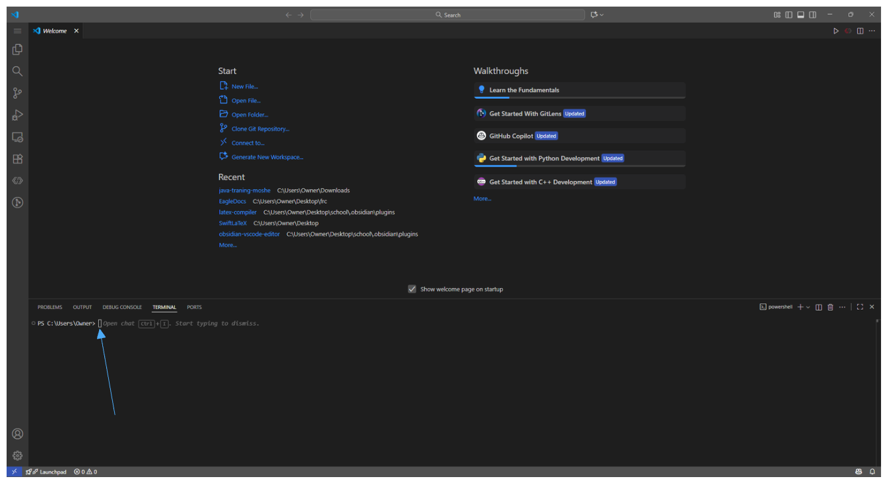

import SetupChecklist from '@site/src/components/SetupChecklist';

# בודקים שהמחשב מוכן

לפני שמורידים משהו, נבדוק מה כבר מותקן. אם משהו חסר, יש קישור ישיר לשלב המתאים במדריך ההתקנה.

ההוראות כאן מיועדות ל־**Windows**. במחשב עם macOS או Linux פנו למנטור והתאימו איתו את ההתקנה לפי המדריך הרשמי.

## 1. מחפשים את סביבת התכנות

1. לחצו על מקש **Windows** במקלדת כדי לפתוח את תפריט ההתחלה.
2. הקלידו בחיפוש: `2026 WPILib VS Code`.
4. אם התוכנה נמצאה, לחצו עליה כדי לפתוח אותה.



*המחשה של מה לחפש; העיצוב עשוי להשתנות בין מחשבים.*

:::tip חשוב לבחור את השנה המתאימה
בהכשרה הזו משתמשים ב־**WPILib 2026**. VS Code רגיל או WPILib משנה קודמת אינם תחליף להתקנה הזאת. קיצור דרך עם 2026 הוא בדיקה ראשונית; נבדוק גם שהתוכנה נפתחת וש־Java פועלת.
:::

לא נמצאה התוכנה? כנראה חסרה ההתקנה או קיצור הדרך. עברו ל־[התקנת WPILib](../installation/installation.md#install-wpilib). אם אתם יודעים שהיא מותקנת, בקשו מהמנטור לעזור למצוא אותה לפני התקנה נוספת.

## 2. פותחים טרמינל בתוך VS Code

**טרמינל** הוא אזור שבו אפשר לתת למחשב הוראות באמצעות פקודות כתובות. אנחנו נשתמש בו כדי לבדוק ש־Java מותקנת ועובדת.

כדי לפתוח את הטרמינל:

1. בתפריט העליון של VS Code לחצו על **Terminal**.
2. בחרו **New Terminal**.
3. בתחתית המסך ייפתח אזור חדש, בדרך כלל בשם **PowerShell**.

אפשר גם לפתוח את הטרמינל בעזרת קיצור המקלדת **Ctrl + Shift + `**.



כך אמור להיראות הטרמינל:



שימו לב לשורה שמסתיימת בסימן `>`. זה המקום שבו נכתוב את הפקודות שלנו.

:::tip
הנתיב שמופיע בטרמינל (למשל `PS C:\Users\Student>`) יכול להיות שונה בכל מחשב. זה תקין לחלוטין!
:::

## 3. בודקים ש־Java מותקנת

כדי שנוכל לתכנת את הרובוט, המחשב צריך לדעת להריץ תוכניות שכתובות בשפת Java.

**JDK (Java Development Kit)** הוא אוסף כלים שמאפשר לנו לפתח ולהריץ תוכניות Java. מתקין WPILib כולל JDK משלו.

בואו נבדוק ש־Java עובדת!

1. לחצו בתוך הטרמינל שפתחנו.
2. הקלידו את הפקודה הבאה:

```powershell
java --version
```

3. לחצו על **Enter**.

אם הכול עובד, אתם אמורים לראות משהו דומה לזה:

```text
openjdk 17.0.15 2025-04-15
OpenJDK Runtime Environment ...
OpenJDK 64-Bit Server VM ...
```

המספרים והטקסט יכולים להיות שונים אצלכם, וזה בסדר. מה שחשוב הוא שהמחשב מציג את גרסת ה־Java שמותקנת.

**מזל טוב! הצלחתם להריץ את הפקודה הראשונה שלכם בטרמינל! 🎉**

### מה עושים אם מופיעה שגיאה?

אם מופיעה הודעה כמו:

```text
java : The term 'java' is not recognized ...
```

זה אומר שהטרמינל לא מצליח למצוא את Java.

זה לא בהכרח אומר שהיא לא מותקנת! WPILib מגיע עם Java משלו, אבל היא לא תמיד זמינה דרך הפקודה `java` בטרמינל.

במקרה כזה, עברו ל־[איתור Java והתקנה במקרה הצורך](../installation/installation.md#install-java).

:::info חשוב לדעת
הבדיקה הזו מוודאת שהטרמינל יודע למצוא Java, אבל לא בהכרח את הגרסה שבה WPILib משתמש.

בהמשך ניצור פרויקט Java ונריץ את התוכנית הראשונה שלנו. זו תהיה הבדיקה הסופית שהכול מוכן להכשרה.
:::

## 4. בודקים את Git

Git עוזר לנו לשמור היסטוריה של שינויים בקוד ולעבוד יחד בצוות.

### בודקים ש־Git מותקן - בכל מחשב

את הבדיקה הזאת עושים גם במחשב אישי וגם במחשב של הקבוצה.

העתיקו את השורה הבאה לטרמינל ולחצו **Enter**:

```powershell
git --version
```

אם מופיעה שורה שמתחילה ב־`git version`, Git זמין. מספר הגרסה יכול להיות שונה בין מחשבים.

אם כתוב שהפקודה לא מוכרת (`not recognized`), עברו ל־[התקנת Git](../installation/installation.md#install-git).

אם התקנתם את Git כש־VS Code היה פתוח, סגרו את כל חלונות התוכנה ופתחו אותה מחדש לפני הבדיקה.

### בודקים את השם והאימייל - במחשב אישי בלבד

:::info משתמשים במחשב של הקבוצה או במחשב משותף?
**דלגו על שאר הסעיף והמשיכו לרשימת הבדיקה שבסוף הדף.**

אין צורך להריץ את הפקודות שלמטה או לשנות את השם והאימייל שמוגדרים במחשב. בהמשך, כשנעבוד עם Git בפרויקט שלכם, נגדיר את הפרטים לפרויקט בלבד לפי הצורך.
:::

אם זה **המחשב האישי שלכם**, הריצו את שתי השורות הבאות, כל אחת בנפרד, עם **Enter** אחריה:

```powershell
git config --global --get user.name
git config --global --get user.email
```

אמורים להופיע השם והאימייל שלכם.

אם לא מופיע דבר, או שמופיעים פרטים של מישהו אחר, עברו ל־[הגדרת הפרטים שלכם ב־Git](../installation/installation.md#git-identity).
## סיימנו להכין את המחשב

סמנו את הסעיפים שהשלמתם. הסימונים נשמרים בדפדפן הזה, כך שאפשר לצאת להוראות ההתקנה ולחזור. אם זה מחשב משותף וכבר מופיעים סימונים של מישהו אחר, לחצו על **ניקוי הסימונים**.

<SetupChecklist>

### [יוצרים את פרויקט ה־Java הראשון ←](../../java/00-first-project/index.md)

</SetupChecklist>