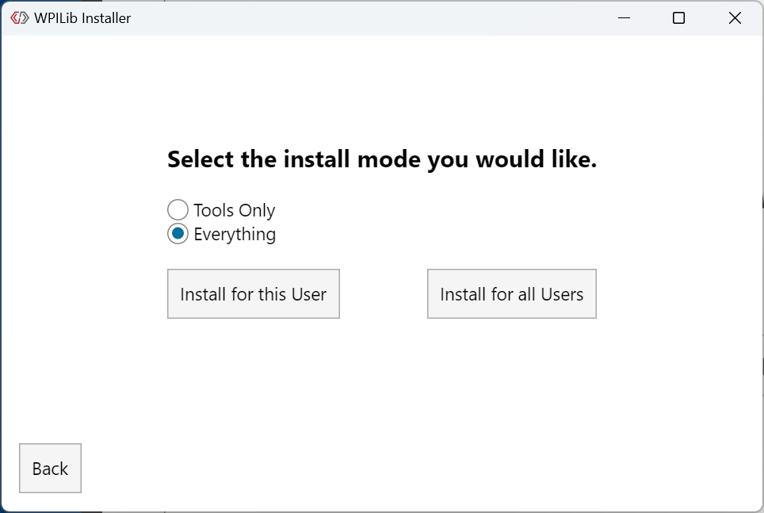
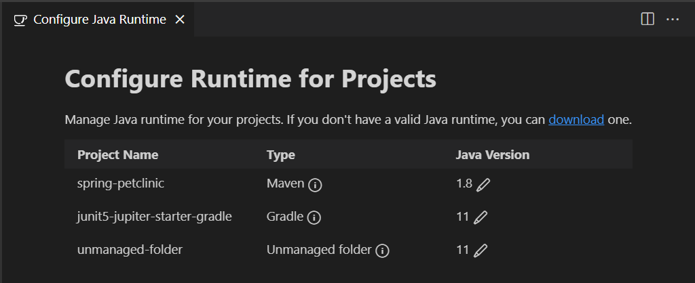
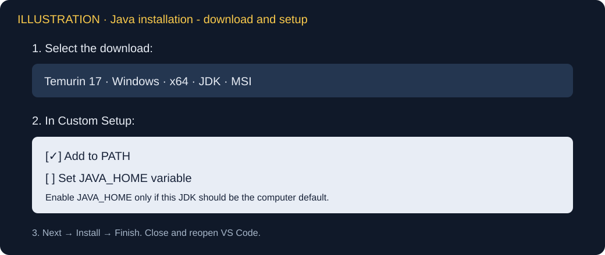

# מתקינים את סביבת העבודה

כאן מתקינים את התוכנות שנשתמש בהן בהכשרה: **WPILib VS Code**, כלי הפיתוח של **Java**. מתחילים מ־ WPILib, כי הוא כבר כולל את רוב מה שצריך.

ההוראות מיועדות ל־**Windows במחשב x64**, ובהכשרה הזו משתמשים ב־**2026**. אם יש לכם macOS, Linux או מחשב Windows עם מעבד ARM, פנו למנטור לפני בחירת ההורדה.

| מה חסר? | לאן לעבור? |
| --- | --- |
| WPILib VS Code 2026 | [התקנת WPILib](#install-wpilib) |
| פקודות Java בתוך VS Code | [תמיכה ב־Java](#java-support) |
| JDK | [איתור או התקנת Java](#install-java) |

## התקנת WPILib {#install-wpilib}

### מורידים את המתקין

1. פתחו את [מדריך ההתקנה הרשמי של WPILib](https://docs.wpilib.org/en/stable/docs/zero-to-robot/step-2/wpilib-setup.html).
2. מצאו את אזור **Downloading** ואת הורדת **Windows** של גרסת **2026**. המדריך הרשמי כולל גם תמונות של כל מסכי ההתקנה.
3. אפשר להגיע ישירות ל־[דף ההפצה של WPILib 2026.2.1 ב־GitHub](https://github.com/wpilibsuite/allwpilib/releases/tag/v2026.2.1), ולבחור שם את הורדת Windows. זה דף הגרסה המתאימה להכשרה; אל תבחרו גרסת Beta או גרסה של שנה אחרת.
4. המתינו עד שההורדה תסתיים. הקובץ גדול, ולכן ההורדה יכולה לקחת זמן.

אין צורך בחשבון GitHub כדי להוריד את המתקין. הקובץ עבור Windows הוא קובץ שמסתיים ב־`.iso`.

### פותחים את המתקין

1. פתחו את **סייר הקבצים** ועברו לתיקיית **הורדות / Downloads**.
2. לחצו עם הכפתור הימני על קובץ ה־ISO ובחרו **Mount / טען**. ב־Windows 11 ייתכן שצריך קודם לבחור **Show more options / הצג אפשרויות נוספות**.
3. ייפתח כונן חדש עם תוכן הקובץ. פתחו בתוכו את `WPILibInstaller.exe`.
4. אם Windows מציג הודעת הגנה, ודאו שהקובץ הוא זה שהורדתם מהמקור הרשמי. במחשב של הקבוצה פנו למנטור אם נדרש אישור להפעלה.


*צילום מהתיעוד הרשמי. תפריט Windows שלכם עשוי להיראות אחרת.*

אם האפשרות Mount חסרה, השתמשו בפתרון החילוץ שמופיע במדריך הרשמי או פנו למנטור.

### בוחרים התקנה מלאה

1. במסך הראשון לחצו **Start**.
2. במסך האפשרויות בחרו **Everything** - ההתקנה המלאה.
3. במחשב אישי בחרו **Install for this User**. במחשב של הקבוצה המנטור יחליט אם להתקין לכל המשתמשים.
4. במסך הורדת VS Code בחרו **Download for this computer only**.
5. בסיום ההורדה לחצו **Next**, המתינו לסיום ההתקנה ולחצו **Finish**.




*בחרו התקנה מלאה והורדה למחשב הזה. המסכים עשויים להשתנות מעט בין גרסאות.*

### פותחים את התוכנה הנכונה

לחצו על מקש Windows וחפשו `WPILib VS Code 2026`. פתחו את העותק הזה גם אם כבר מותקן אצלכם VS Code רגיל.

WPILib מתקין סביבת עבודה נפרדת לכל שנה, כולל Java. אין צורך להסיר עותקים של שנים קודמות.

## תמיכה ב־Java בתוך VS Code {#java-support}

1. פתחו **WPILib VS Code 2026**.
2. לחצו `Ctrl + Shift + X` כדי לפתוח את רשימת התוספים (**Extensions**).
3. חפשו `Language Support for Java` ובדקו שהתוסף של **Red Hat** מותקן ומופעל. חפשו גם `Debugger for Java` של **Microsoft**.
4. חפשו `Project Manager for Java` של **Microsoft**. התוסף הזה מוסיף את האפשרות ליצור פרויקט Java רגיל. אם חסר, לחצו **Install**. אם מותקן אך כבוי, לחצו **Enable**.
5. אם תוספי השפה או ניפוי השגיאות חסרים אחרי התקנת Everything, בקשו מהמנטור לבדוק את ההתקנה לפני התקנת גרסאות אחרות.

אין צורך להתקין חבילת תוספים נוספת אם התוספים הנדרשים כבר קיימים. פתחו שוב **View → Command Palette**, וחפשו `Java: Configure Java Runtime`.

## איתור Java והתקנה במקרה הצורך {#install-java}

### קודם מחפשים את Java של WPILib

WPILib כולל **JDK**. לפני שמתקינים עוד אחד:

1. פתחו את סייר הקבצים.
2. בדקו אם קיימת תיקיית `jdk` בתוך `C:\Users\Public\wpilib\2026`.
3. אם לא, פתחו את תיקיית המשתמש שלכם ובדקו בתוך `wpilib\2026`. המיקום תלוי באופן ההתקנה; המנטור יכול לעזור למצוא אותו.
4. בתוך תיקיית `jdk` אמורה להיות תיקיית `bin` ובה `java.exe` ו־`javac.exe`.
5. ב־VS Code פתחו **View → Command Palette → Java: Configure Java Runtime**. אחרי יצירת פרויקט התרגול, באזור בחירת ה־JDK לפרויקטים ללא כלי בנייה בחרו את ה־JDK שמצאתם. אם אינו מופיע ברשימה, השתמשו בהוראות [בחירת Java לפרויקט התרגול](#java-project-path) שלמטה.



*בוחרים את Java שמתאימה לפרויקט. המספרים בתמונה הם דוגמאות מהתיעוד, ולא הגרסאות שצריך להתקין.*

### אם באמת חסר JDK

אפשר להפעיל מחדש את מתקין WPILib ולהשלים את ההתקנה. אם המנטור בחר להתקין Java בנפרד לצורך תרגול Java רגיל:

1. פתחו את [הורדות Eclipse Temurin](https://adoptium.net/temurin/releases/?version=17).
2. בחרו **Version: 17**, מערכת **Windows**, ארכיטקטורת **x64**, וסוג חבילה **JDK**.
3. הורידו את קובץ ה־**MSI**, לא את קובץ ה־ZIP ולא חבילת JRE.
4. פתחו את הקובץ מתיקיית Downloads. לחצו **Next** ואשרו את תנאי הרישיון כדי להמשיך.
5. במסך **Custom Setup** השאירו את האפשרות להוסיף את Java ל־**PATH**. כך ניתן למצוא אותה גם באמצעות פקודות.
6. אם המנטור בחר ב־JDK הזה כברירת המחדל במחשב, הפעילו גם **Set JAVA_HOME variable** דרך הסמל שליד האפשרות, ובחרו שתותקן בכונן המקומי. אחרת השאירו את JAVA_HOME הקיים.
7. לחצו **Next → Install → Finish**. אם נדרשת הרשאת מנהל במחשב של הקבוצה, היעזרו במנטור.
8. סגרו את כל חלונות VS Code ופתחו מחדש את WPILib VS Code 2026.
9. פתחו **Terminal → New Terminal**. הקלידו כל שורה בנפרד ולחצו Enter:

```powershell
java --version
javac --version
```



*המחשה של הבחירות; זו אינה תמונת מסך של המתקין.*

שתי הפקודות אמורות להציג גרסה. אם הן לא מוכרות או מראות Java אחרת, חזרו לבחירה דרך **Java: Configure Java Runtime** עם המנטור. לא צריך לשנות ידנית משתני מערכת כדי להתחיל ללמוד.

:::note גרסת Java לפרויקט והגרסה של תוסף השפה
בהכשרה נשתמש ב־Java שמתאימה לסביבת WPILib 2026. תוסף השפה עצמו עשוי להזדקק ל־JDK חדש יותר אם עודכן. אם מופיעה דרישה כזאת, פנו למנטור כדי להתאים את התוסף וה־JDK; לא מחליפים אוטומטית את גרסת Java של פרויקט הרובוט.
:::

### אם VS Code לא מצא את Java של פרויקט התרגול {#java-project-path}

השלב הזה נחוץ רק אם איתרתם JDK אבל VS Code לא מציג אותו לבחירה. בצעו אותו אחרי [יצירת פרויקט התרגול](../../java/00-first-project/index.md), לפני ההרצה הראשונה.

1. בסייר הקבצים פתחו את תיקיית `jdk` שמצאתם - **לא** את `bin` שבתוכה. לחצו בשורת הכתובת העליונה והעתיקו את הנתיב עם `Ctrl + C`.
2. ב־VS Code, כשפרויקט `JavaTraining` פתוח, לחצו `Ctrl + Shift + E` כדי לראות את קבצי הפרויקט.
3. לחצו עם הכפתור הימני באזור רשימת הקבצים ובחרו **New Folder**. קראו לה `.vscode`. אם היא כבר קיימת, השתמשו בה.
4. לחצו עם הכפתור הימני על `.vscode`, בחרו **New File** וקראו לקובץ `settings.json`.
5. בקובץ חדש וריק הדביקו את ההגדרה הבאה. החליפו את הערך של `path` בנתיב שהעתקתם, וכתבו בו `/` במקום כל `\`:

```json
{
  "java.configuration.runtimes": [
    {
      "name": "JavaSE-17",
      "path": "C:/Users/Public/wpilib/2026/jdk",
      "default": true
    }
  ]
}
```

6. הנתיב בדוגמה מתאים להתקנה במיקום הזה בלבד. אם התקנתם למשתמש הנוכחי או התקנתם Temurin, השתמשו בנתיב האמיתי במחשב שלכם. ודאו שה־JDK שבחרתם הוא Java 17.
7. שמרו עם `Ctrl + S`, פתחו **View → Command Palette** והפעילו `Developer: Reload Window`.
8. פתחו שוב `Java: Configure Java Runtime` ובדקו שהפרויקט משתמש ב־JDK שבחרתם.

אם `settings.json` כבר קיים ומכיל הגדרות, היעזרו במנטור לשילוב ההגדרה בתוכו. ההגדרה המקומית הזאת שייכת לפרויקט התרגול; בפרויקט רובוט עם Gradle גרסת Java נקבעת גם בהגדרות הבנייה שלו.

## סיימנו להתקין

### [חוזרים לבדיקת המחשב ←](../check-setup/check-setup.mdx)

הבדיקות הצליחו? [ממשיכים ליצירת הפרויקט הראשון](../../java/00-first-project/index.md).
