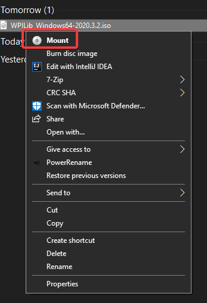
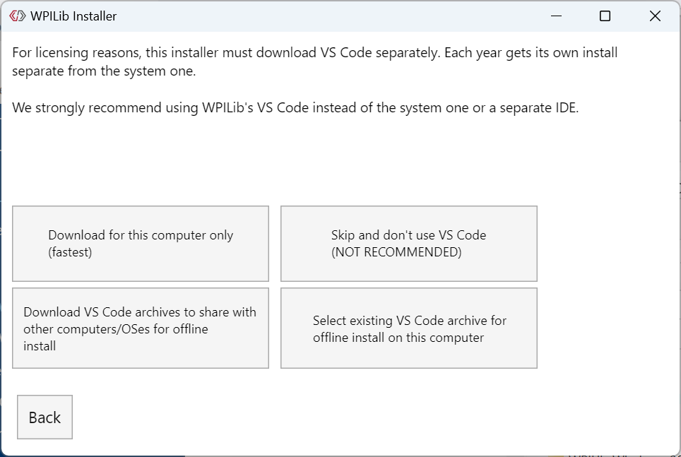

# מתקינים את סביבת העבודה

נתקין את **WPILib VS Code 2026**, התוכנה שבה נכתוב ונריץ את הקוד שלנו. **ההתקנה כוללת גם את Java**, כך שאין צורך להתקין אותה בנפרד.

ההוראות כאן מיועדות למחשב **Windows עם מעבד x64**. אם יש לכם מחשב מסוג אחר, בקשו מהמנטור עזרה בהתקנה.

## 1. מורידים את WPILib {#install-wpilib}

1. פתחו את [דף ההורדה של WPILib 2026.2.1](https://github.com/wpilibsuite/allwpilib/releases/tag/v2026.2.1).
2. גללו לכותרת **Downloads** ולחצו על **Windows**.
3. המתינו לסיום ההורדה. הקובץ גדול, ולכן זה יכול לקחת זמן.

שם הקובץ הוא `WPILib_Windows-2026.2.1.iso`. אין צורך בחשבון GitHub כדי להוריד אותו.

## 2. פותחים את המתקין

1. פתחו את תיקיית **הורדות / Downloads** בסייר הקבצים.
2. לחצו עם הכפתור הימני על הקובץ שהורדתם ובחרו **Mount / טען**.
3. בכונן שנפתח, פתחו את `WPILibInstaller.exe`.

## 3. מתקינים

1. לחצו **Start**.
2. בחרו **Everything** כדי להתקין את כל מה שנצטרך.
3. במחשב אישי לחצו **Install for this User**. במחשב משותף בקשו מהמנטור לבחור את אפשרות ההתקנה המתאימה.

4. במסך הבא לחצו **Download for this computer only**.
5. כשההורדה מסתיימת, לחצו **Next**.
6. המתינו לסיום ההתקנה ולחצו **Finish**.

## 4. פותחים את WPILib VS Code

לחצו על מקש **Windows**, חפשו `WPILib VS Code 2026` ופתחו את התוכנה.

גם אם כבר מותקן במחשב VS Code רגיל, בהכשרה נשתמש ב־**WPILib VS Code 2026**.

## 5. מוסיפים את התוסף ליצירת פרויקט Java {#java-support}

התוסף **Project Manager for Java** מאפשר לנו ליצור את פרויקט התרגול שלנו מתוך VS Code.

1. בתוך **WPILib VS Code 2026**, לחצו `Ctrl + Shift + X` כדי לפתוח את רשימת התוספים (**Extensions**).
2. בתיבת החיפוש הקלידו `Project Manager for Java`.
3. בחרו את התוסף של **Microsoft** ולחצו **Install**.

אם התוסף כבר מותקן, אפשר להמשיך. אם מופיע כפתור **Enable**, לחצו עליו כדי להפעיל אותו.

:::tip נתקעתם באחד השלבים?
הראו למנטור את המסך שבו נעצרתם. נעזור לכם להשלים את ההתקנה ולהתחיל ללמוד.
:::

## סיימנו להתקין

חזרו לבדיקה שבה נעצרתם, כדי לוודא שהמחשב מוכן ולהמשיך משם.

### [חוזרים לבדיקת המחשב ←](../check-setup/check-setup.mdx)

[מדריך ההתקנה הרשמי של WPILib](https://docs.wpilib.org/en/stable/docs/zero-to-robot/step-2/wpilib-setup.html)
