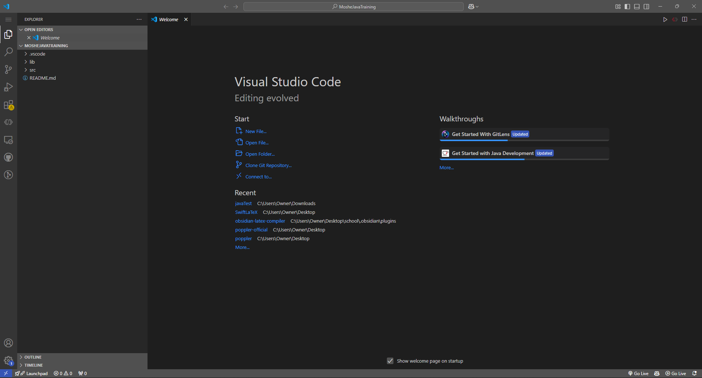
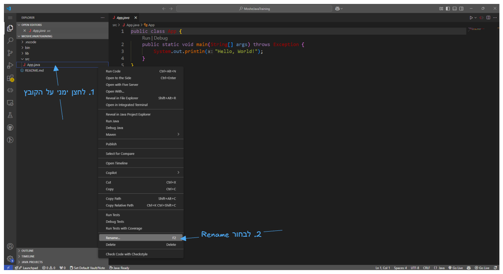
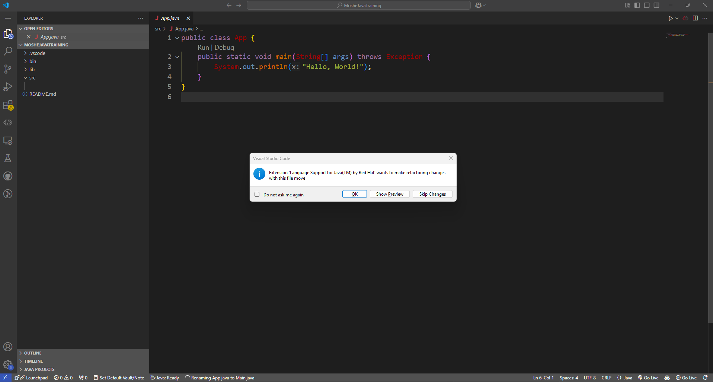

# יוצרים ומריצים פרויקט ראשון

הגיע הזמן לכתוב קוד! ניצור פרויקט קטן ונריץ הודעה משלנו. עדיין לא צריך להבין את כל חלקי הקוד - נלמד אותם בהכשרה.

לפני שמתחילים, השלימו את [בדיקת המחשב](../../getting-started/check-setup/check-setup.mdx).

## 1. מכינים מקום לפרויקטים

1. פתחו את **סייר הקבצים**.
2. עברו לתיקייה שבה תרצו לשמור את העבודה שלכם, למשל **Documents / מסמכים**.
3. לחצו עם הכפתור הימני באזור ריק ובחרו **New → Folder / חדש → תיקייה**.
4. קראו לתיקייה `FRC-Training`.

זו תהיה התיקייה שבה נשמור את פרויקטי התרגול. לכל תלמיד יהיה פרויקט משלו, עם השם שלו, כדי שיהיה קל למצוא את העבודה גם במחשב משותף.

## 2. יוצרים פרויקט Java {#creating-project}

1. פתחו **WPILib VS Code 2026**.
2. פתחו את [חלון הפקודות](../../getting-started/working-in-vscode.mdx#command-palette) (`Ctrl + Shift + P`).
3. בחלונית למעלה הקלידו `Java: Create Java Project`.
4. לחצו על הפקודה המתאימה. אם חסרה, חזרו ל־[התקנת התמיכה ב־Java](../../getting-started/installation/installation.md).
5. ברשימת סוגי הפרויקטים בחרו **No build tools**.
6. בחלון בחירת התיקייה, מצאו את `FRC-Training`, בחרו אותה ואשרו. זו התיקייה שבתוכה ייווצר הפרויקט.
7. כשמתבקשים להקליד שם לפרויקט, כתבו את השם שלכם באנגלית ואחריו `JavaTraining`, בלי רווחים. למשל, משה יכתוב `MosheJavaTraining`. לחצו Enter. אם כבר קיימת תיקייה בשם הזה ששייכת לתלמיד אחר, הוסיפו גם את שם המשפחה שלכם באנגלית.
8. אם נפתח חלון חדש, המשיכו לעבוד בו. אם נשאלתם האם לסמוך על הקבצים בתיקייה, אשרו עבור הפרויקט שיצרתם בעצמכם.
9. המתינו עד ש־Java תסיים לטעון את הפרויקט. הפעם הראשונה יכולה לקחת קצת זמן.


*בתמונה מופיעות אפשרויות נוספות. בפרויקט התרגול שלנו בוחרים No build tools.*

:::info פרויקט התרגול שלנו
זה פרויקט Java רגיל ללימוד יסודות השפה. בחרנו סוג פשוט כדי להתמקד בכתיבת הקוד ובהרצתו. בהמשך [ניצור מאגר רובוט מהתבנית של הקבוצה ונשכפל אותו למחשב](../../robot/01-getting-started/02-template-repository.mdx). זה יהיה פרויקט נפרד, עם הגדרות וספריות ייעודיות.
:::

## 3. מוצאים את קובץ הקוד

ב־[Explorer - רשימת הקבצים של הפרויקט](../../getting-started/working-in-vscode.mdx#files) - נמצא את קובץ הקוד הראשון שלנו.

פתחו את התיקייה `src` באמצעות החץ שלידה, ואז לחצו על הקובץ `App.java`.

התיקייה `src` היא המקום שבו נכתוב את קובצי הקוד שלנו. ייתכן שיופיעו גם תיקיות אחרות - כרגע אין צורך לשנות אותן.



### משנים את שם הקובץ

בדוגמאות שבהכשרה נשתמש בשם `Main.java`. נשנה עכשיו את שם הקובץ כדי שיהיה תואם:

1. לחצו עם הכפתור הימני על `App.java`.
2. בחרו **Rename**.
3. הקלידו `Main` ככה ששם הקובץ המלא יהיה `Main.java` ולחצו **Enter**.



אם מופיעה ההודעה שבתמונה הבאה, לחצו **OK** כדי לאשר את עדכון הקוד בעקבות שינוי השם.



פתחו את `Main.java`. הקוד אמור להיראות כך:

```java
public class Main {
    public static void main(String[] args) throws Exception {
        System.out.println("Hello, World!");
    }
}
```

אם בשורה הראשונה עדיין כתוב `public class App`, החליפו את `App` ב־`Main`.

לחצו `Ctrl + S` כדי לשמור.

שם הקובץ הוא `Main.java`, ולכן גם השם בשורה הראשונה צריך להיות `Main`, עם אות גדולה בתחילת השם.

כרגע מספיק לדעת שהשורה עם `System.out.println` מציגה את הטקסט שבמרכאות. את שאר חלקי הקוד נלמד בהמשך - אין צורך להבין הכול עכשיו.

## 4. מריצים את התוכנית

1. מעל השורה שמתחילה ב־`public static void main` אמורים להופיע הקישורים **Run | Debug**.
2. לחצו **Run**.
3. בתחתית המסך ייפתח הטרמינל. חפשו את ההודעה:

```text
Hello, World!
```

ייתכן שיופיעו גם פקודות ושורות נוספות. זה בסדר - כרגע חפשו רק את ההודעה `Hello, World!`.

:::tip הצלחתם!
יצרתם פרויקט משלכם והרצתם את התוכנית הראשונה שלכם! בשיעור הבא נתחיל לכתוב קוד בעצמנו בתוך הפרויקט הזה.
:::
## אם משהו לא עובד

| מה רואים? | מה עושים? |
| --- | --- |
| אין פקודה ליצירת פרויקט | בדקו ש־Project Manager for Java מותקן ומופעל |
| אין Run מעל main | המתינו לטעינת Java, בדקו את התוספים וודאו שפתחתם את כל תיקיית הפרויקט דרך File → Open Folder |
| מופיעה בקשה ל־JDK | עברו ל־[הוראות בחירת Java לפרויקט](../../getting-started/installation/installation.md) |
| השם Main מסומן כשגיאה | ודאו ששם הקובץ הוא Main.java וששם המחלקה הוא Main |
| מופיעה שגיאה אחרת | השוו לקוד המלא: סוגריים, מרכאות ונקודה־פסיק חשובים. אם עדיין נתקעתם, הראו למנטור את ההודעה |

## איך חוזרים לפרויקט בפעם הבאה?

לפי [ההוראות לפתיחת פרויקט קיים](../../getting-started/working-in-vscode.mdx#open-project), פתחו את התיקייה שלכם בתוך `FRC-Training`, למשל `MosheJavaTraining`. לאחר מכן פתחו את `src/Main.java`.

**שמרו את הפרויקט - נמשיך להשתמש בו בתרגילי Java לאורך ההכשרה.**
