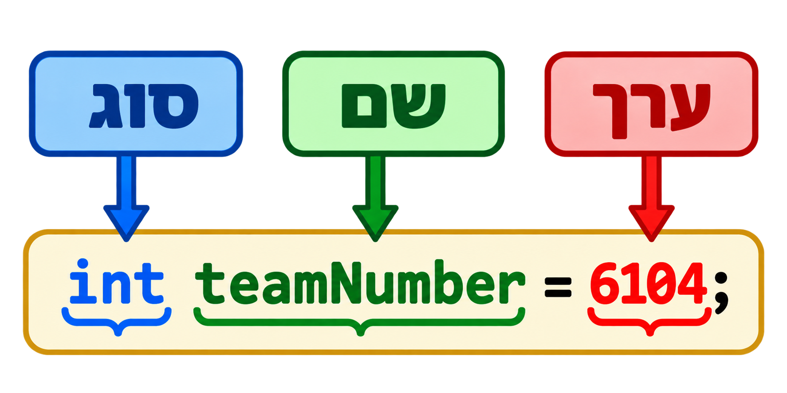

import ExerciseHelp from '@site/src/components/ExerciseHelp';

בשיעור הזה נלמד איך לשמור ערכים בקוד, לשנות אותם ולהשתמש בהם.

בקוד של רובוט כמעט כל דבר נשמר במשתנים:

- מהירות של מנוע
- מיקום של מנגנון
- מספר הכדורים שנורו
- האם המצלמה מזהה מטרה?

## מה זה משתנה?

משתנה הוא מקום שבו התוכנית יכולה לשמור ערך ולתת לו שם.

במקום לזכור שהמספר `6104` מייצג את מספר הקבוצה שלנו, אפשר לשמור אותו במשתנה בשם `teamNumber`:

```java
int teamNumber = 6104;
```

כאשר נגדיר משתנה ב-Java, הצורה הכללית שלו תיראה כך:



לכל משתנה יש שלושה חלקים עיקריים:

- **סוג (`type`)** - איזה סוג מידע המשתנה יכול לשמור.
- **שם (`name`)** - השם שבו נשתמש כדי לגשת למשתנה.
- **ערך (`value`)** - המידע שנשמר בתוך המשתנה.

לדוגמה:

```java
int teamNumber = 6104;
```

כאן:

- `int` הוא סוג המשתנה.
- `teamNumber` הוא שם המשתנה.
- `6104` הוא הערך שלו.

## למה בכלל צריך משתנים?

נניח שאנחנו רוצים להדפיס את מספר הקבוצה כמה פעמים:

```java
System.out.println(6104);
System.out.println(6104);
System.out.println(6104);
```

זה עובד, אבל אם מספר הקבוצה היה משתנה היינו צריכים לעבור ולשנות אותו בכל מקום.

במקום זאת אפשר לעשות:

```java
int teamNumber = 6104;

System.out.println(teamNumber);
System.out.println(teamNumber);
System.out.println(teamNumber);
```

עכשיו הערך נמצא במקום אחד בלבד.

אם נשנה:

```java
int teamNumber = 6105;
```

כל המקומות שמשתמשים ב-`teamNumber` יקבלו את הערך החדש.

## סוגי משתנים בסיסיים

ב-Java יש כמה סוגי נתונים שנשתמש בהם הרבה.

### `int` - מספר שלם

```java
int teamNumber = 6104;
int gamePieceCount = 8;
int motorCount = 4;
```

`int` משמש למספרים שלמים, כלומר ללא נקודה עשרונית.

### `double` - מספר עשרוני

```java
double motorSpeed = 0.5;
double distance = 2.35;
```

`double` מאפשר לשמור מספרים עם חלק עשרוני.

למשל, מהירות מנוע יכולה להיות `0.5`, ולכן `int` לא יתאים כאן.

### `boolean` - אמת או שקר

```java
boolean seesTarget = true;
boolean hasgamePiece = false;
```
  
ל-`boolean` יכולים להיות רק שני ערכים:

```java
true
false
```

הוא שימושי מאוד לדברים כמו:

- האם חיישן מופעל?
- האם הרובוט מחזיק gamePiece?
- האם המצלמה רואה מטרה?
- האם האוטונומי הסתיים?

### `String` - טקסט

```java
String teamName = "Desert Eagles";
String robotName = "Eagle";
```

טקסט נכתב בתוך מרכאות `" "`.

:::note
שימו לב ש-`String` מתחיל באות גדולה, בניגוד ל-`int`, `double` ו-`boolean`.

נבין בהמשך למה.
:::

## שינוי ערך של משתנה

משתנה יכול לקבל ערך חדש לאחר שיצרנו אותו.

לדוגמה:

```java
int gamePieceCount = 5;

gamePieceCount = 8;
```

בהתחלה הערך של `gamePieceCount` הוא `5`.

לאחר השורה:

```java
gamePieceCount = 8;
```

הערך הקודם מוחלף, ועכשיו `gamePieceCount` מכיל `8`.

שימו לב שלא כתבנו שוב `int`.

כותבים את סוג המשתנה רק כאשר **יוצרים** אותו:

```java
int gamePieceCount = 5;
```

לאחר מכן משתמשים רק בשם שלו:

```java
gamePieceCount = 8;
```

## שימוש במשתנה

אפשר להשתמש בערך של משתנה בדיוק כמו שהיינו משתמשים בערך עצמו.

לדוגמה:

```java
int gamePieceCount = 8;

System.out.println(gamePieceCount);
```

התוצאה תהיה:

```text
8
```

אפשר גם להשתמש במשתנים בחישובים:

```java
int gamePieceCount = 8;
int addedgamePiece = 3;

int totalgamePiece = gamePieceCount + addedgamePiece;

System.out.println(totalgamePiece);
```

התוצאה:

```text
11
```

## שמות של משתנים

כדאי לתת למשתנים שמות שמתארים מה הם שומרים.

עדיף:

```java
double motorSpeed = 0.5;
```

ולא:

```java
double x = 0.5;
```

ב-Java נהוג להשתמש בשיטת כתיבה שנקראת **camelCase**.

המילה הראשונה מתחילה באות קטנה, וכל מילה נוספת מתחילה באות גדולה:

```java
teamNumber
motorSpeed
gamePieceCount
distanceFromTarget
```

## תרגול

### תרגיל 1 - יצירת משתנים

צרו את המשתנים הבאים:

- `teamNumber` שמכיל `6104`
- `motorSpeed` שמכיל `0.75`
- `seesTarget` שמכיל `true`
- `teamName` שמכיל `"Desert Eagles"`

<ExerciseHelp
  hints={[
    "לכל משתנה צריך לבחור טיפוס נתונים שמתאים לערך שהוא שומר. חשבו אילו מהערכים הם מספרים שלמים, מספרים עשרוניים, ערכים בוליאניים או טקסט.",
    "השתמשו בטיפוסים int, double, boolean ו-String. כל אחד מהם מתאים לאחד מהמשתנים בתרגיל.",
    "זכרו את מבנה ההגדרה: טיפוס נתונים, שם המשתנה, סימן השמה וערך. טקסט נכתב בתוך מרכאות, ואילו מספרים וערכים בוליאניים נכתבים ללא מרכאות."
  ]}
  solution={`int teamNumber = 6104;
double motorSpeed = 0.75;
boolean seesTarget = true;
String teamName = "Desert Eagles";`}
/>

### תרגיל 2 - מצאו את הטעות

איזו שורה לא תקינה? נסו להבין למה לפני שאתם מריצים.

```java
int gamePieceCount = 8;
double motorSpeed = 0.6;
boolean seesTarget = "true";
String robotName = "Eagle";
```

<ExerciseHelp
  hints={[
    "בדקו את טיפוס הנתונים של כל משתנה והשוו אותו לערך שמכניסים אליו. האם כולם מתאימים?",
    "התמקדו בשורה שמגדירה את seesTarget. מה ההבדל בין ערך בוליאני לבין טקסט?",
    "מרכאות הופכות את true למחרוזת מסוג String. משתנה boolean צריך לקבל ערך בוליאני ולא מחרוזת."
  ]}
  solution={`int gamePieceCount = 8;
double motorSpeed = 0.6;
boolean seesTarget = true;
String robotName = "Eagle";`}
/>

השורה השגויה היא:

```java
boolean seesTarget = "true";
```

הערכים `true` ו-`false` נכתבים ללא מרכאות כאשר משתמשים בטיפוס `boolean`.

### תרגיל 3 - שינוי ערך

מה יודפס בסוף?

```java
int gamePieceCount = 5;

gamePieceCount = 10;
gamePieceCount = 3;

System.out.println(gamePieceCount);
```

נסו לענות לפני שאתם מריצים.

<ExerciseHelp
  hints={[
    "עקבו אחר הערך של gamePieceCount שורה אחר שורה. מה קורה כאשר משייכים ערך חדש למשתנה שכבר קיים?",
    "השמה חדשה מחליפה את הערך הקודם של המשתנה. הערך המקורי לא נשמר אוטומטית.",
    "המשתנה מתחיל ב-5, אחר כך משתנה ל-10, ולבסוף מקבל ערך חדש. איזה ערך נמצא בו בזמן ההדפסה?"
  ]}
  solution={`3`}
/>

### תרגיל 4 - כתבו לבד

כתבו תוכנית ששומרת:

- את מספר הקבוצה שלכם
- את שם הקבוצה
- מהירות מנוע כלשהי
- האם הרובוט מופעל

ולאחר מכן מדפיסה את כל המשתנים.

<ExerciseHelp
  hints={[
    "התחילו בהגדרת ארבעה משתנים. חשבו איזה טיפוס נתונים מתאים לכל אחד מהם.",
    "מספר הקבוצה הוא int, שם הקבוצה הוא String, מהירות המנוע היא double, ומצב ההפעלה של הרובוט הוא boolean.",
    "כדי להדפיס משתנה משתמשים ב-System.out.println. אפשר להעביר לפונקציה את שם המשתנה ישירות, בלי מרכאות. זכרו להדפיס את כל ארבעת המשתנים."
  ]}
  solution={`int teamNumber = 6104;
String teamName = "Desert Eagles";
double motorSpeed = 0.75;
boolean robotEnabled = true;

System.out.println(teamNumber);
System.out.println(teamName);
System.out.println(motorSpeed);
System.out.println(robotEnabled);`}
multipleSolutions={true}
/>
