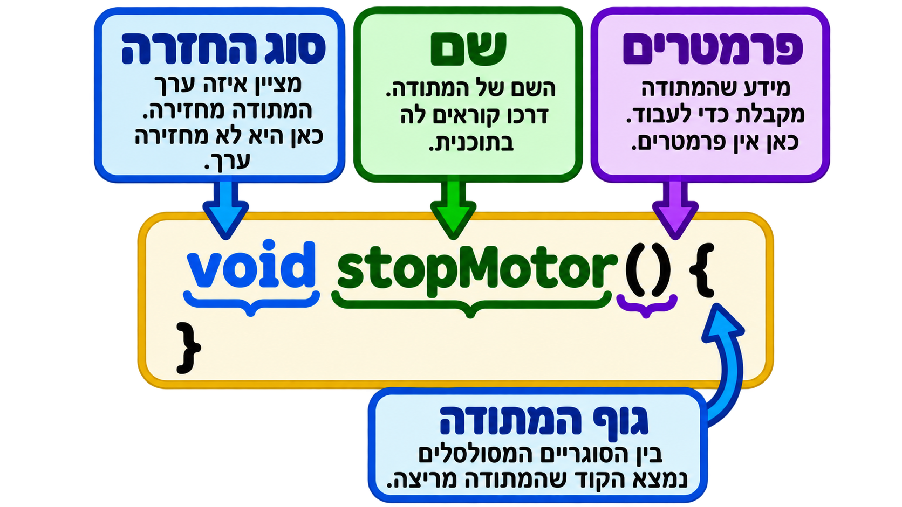
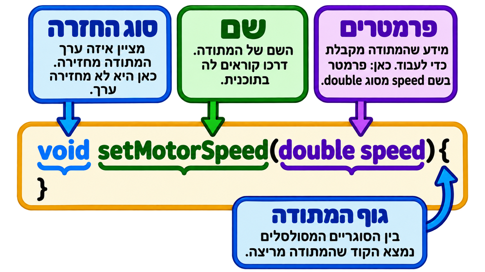
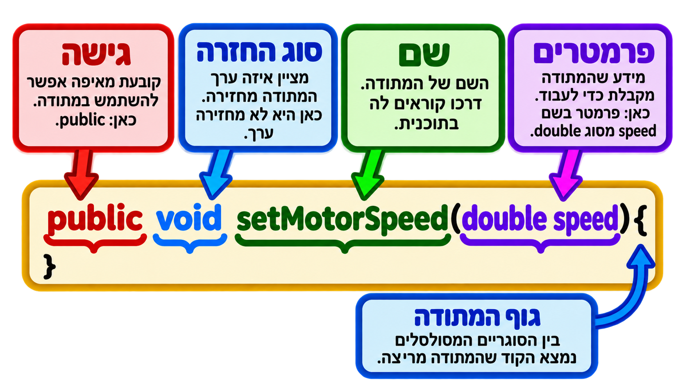
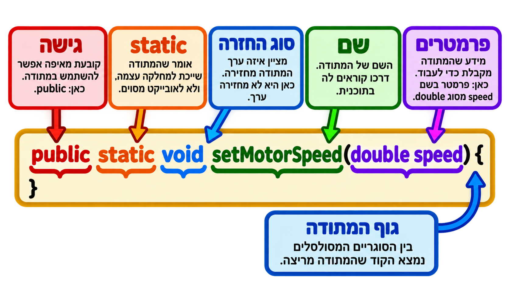

עד עכשיו למדנו לעבוד עם משתנים, לבצע חישובים ולכתוב תנאים.

עכשיו נלמד איך לחלק את הקוד לחלקים קטנים וברורים יותר בעזרת **פונקציות**.

:::note
ב-Java פונקציות שנמצאות בתוך מחלקה נקראות בדרך כלל **מתודות (Methods)**.

בהכשרה נשתמש לפעמים במילה "פונקציה" ולפעמים "מתודה", אבל הכוונה היא לאותו רעיון.
:::

## מה זו פונקציה?

פונקציה היא קטע קוד שקיבל שם, ואפשר להריץ אותו מתי שרוצים.

לדוגמה:

```java
void sayHello() {
    System.out.println("Hello");
}
```

יצרנו פונקציה בשם:

```text
sayHello
```

כאשר הפונקציה תרוץ, היא תדפיס:

```text
Hello
```

חשוב להבין: עצם זה שכתבנו את הפונקציה לא אומר שהיא תרוץ.

כדי להריץ אותה צריך **לקרוא לה**:

```java
sayHello();
```

---

## מבנה של פונקציה

לדוגמה:

```java
void sayHello() {
    System.out.println("Hello");
}
```

הפונקציה מורכבת מכמה חלקים.


 

בדוגמה הזו:

```java
void
```

הוא סוג ההחזרה.

```java
sayHello
```

הוא שם הפונקציה.

```java
()
```

הוא המקום שבו יכולים להיות פרמטרים.

ובתוך:

```java
{
    ...
}
```

נמצא הקוד שהפונקציה מריצה.

## שם של פונקציה

כמו במשתנים, גם לפונקציות כדאי לתת שמות שמתארים בצורה ברורה מה הן עושות.

לדוגמה:

```java
sayHello()
```

```java
printNumber()
```

```java
calculateDistance()
```

```java
isPositive()
```

ב-Java נהוג להשתמש ב-`camelCase`.

לדוגמה:

```java
printMotorSpeed()
```

ולא:

```java
PrintMotorSpeed()
```

או:

```java
print_motor_speed()
```

שם טוב עוזר להבין מה הפונקציה עושה גם בלי לקרוא את כל הקוד שבתוכה.

## `void`

נסתכל על הפונקציה:

```java
void sayHello() {
    System.out.println("Hello");
}
```

המילה:

```java
void
```

אומרת שהפונקציה **לא מחזירה ערך**.

היא פשוט מבצעת פעולה.

לדוגמה:

```java
void printReady() {
    System.out.println("Ready");
}
```

כאשר נקרא:

```java
printReady();
```

יודפס:

```text
Ready
```

אבל הפונקציה לא מחזירה לנו ערך שאפשר לשמור בתוך משתנה.

## פרמטרים

לפעמים אנחנו רוצים לתת לפונקציה מידע שהיא תשתמש בו.

לדוגמה:

```java
void printSpeed(double speed) {
    System.out.println(speed);
}
```

הפונקציה מקבלת מספר מסוג `double` ושומרת אותו זמנית בתוך המשתנה:

```java
speed
```

עכשיו אפשר לקרוא לפונקציה כך:

```java
printSpeed(0.5);
```

או:

```java
printSpeed(0.8);
```

או:

```java
printSpeed(1.0);
```

הערך שנשלח לפונקציה נכנס למשתנה `speed`.

---



## מהו פרמטר?

בהגדרה:

```java
void printSpeed(double speed) {
    System.out.println(speed);
}
```

החלק:

```java
double speed
```

נקרא **פרמטר**.

הוא אומר לפונקציה:

- איזה סוג מידע היא מקבלת.
- איך יקראו למידע הזה בתוך הפונקציה.

בדוגמה הזו:

```java
double
```

הוא סוג הנתונים.

ו:

```java
speed
```

הוא שם הפרמטר.

## Argument

כאשר קוראים לפונקציה:

```java
printSpeed(0.75);
```

הערך:

```java
0.75
```

נקרא **Argument**.

כלומר:

```java
void printSpeed(double speed)
```

`speed` הוא הפרמטר.

ובקריאה:

```java
printSpeed(0.75);
```

`0.75` הוא הערך שאנחנו שולחים לפונקציה.

לא קריטי לזכור עכשיו את ההבדל בין המילים, אבל כדאי להכיר אותן.

## כמה פרמטרים

פונקציה יכולה לקבל יותר מפרמטר אחד.

לדוגמה:

```java
void printNumbers(int first, int second) {
    System.out.println(first);
    System.out.println(second);
}
```

אפשר לקרוא לה כך:

```java
printNumbers(10, 20);
```

אז:

```text
first = 10
second = 20
```

הסדר חשוב.

אם נכתוב:

```java
printNumbers(20, 10);
```

אז:

```text
first = 20
second = 10
```

## החזרת ערך

פונקציות לא חייבות רק לבצע פעולה.

הן יכולות גם **להחזיר תשובה**.

לדוגמה:

```java
int getNumber() {
    return 5;
}
```

כאן הפונקציה מחזירה ערך מסוג:

```java
int
```

והערך שהיא מחזירה הוא:

```java
5
```

אפשר להשתמש בה כך:

```java
int number = getNumber();
```

עכשיו הערך של:

```java
number
```

יהיה:

```text
5
```

## `return`

המילה:

```java
return
```

מחזירה ערך מתוך הפונקציה.

לדוגמה:

```java
int add(int a, int b) {
    return a + b;
}
```

אפשר לקרוא לפונקציה כך:

```java
int result = add(4, 3);
```

הפונקציה מחשבת:

```text
4 + 3
```

ומחזירה:

```text
7
```

לכן:

```java
result
```

יקבל את הערך:

```text
7
```

---
## סוג ההחזרה

הסוג שנמצא לפני שם הפונקציה אומר איזה סוג ערך היא מחזירה.

לדוגמה:

```java
int add(int a, int b) {
    return a + b;
}
```

הפונקציה מחזירה:

```java
int
```

דוגמה עם `double`:

```java
double divide(double a, double b) {
    return a / b;
}
```

ודוגמה עם `boolean`:

```java
boolean isPositive(int number) {
    return number > 0;
}
```

## פונקציה שמחזירה `boolean`

אפשר להשתמש בפונקציה שמחזירה `boolean` ישירות בתוך תנאי.

לדוגמה:

```java
boolean isPositive(int number) {
    return number > 0;
}
```

ואז:

```java
if (isPositive(5)) {
    System.out.println("Positive");
}
```

הפונקציה:

```java
isPositive(5)
```

מחזירה:

```text
true
```

ולכן ה-`if` ירוץ.

## `return` עוצר את הפונקציה

ברגע ש-Java מגיעה ל-`return`, הפונקציה מסתיימת.

לדוגמה:

```java
boolean isValidSpeed(double speed) {
    if (speed > 1) {
        return false;
    }

    return true;
}
```

אם:

```java
speed > 1
```

הפונקציה תגיע ל:

```java
return false;
```

ותסתיים מיד.

היא לא תמשיך ל:

```java
return true;
```

## פונקציה יכולה להשתמש בפונקציה אחרת

אפשר לקרוא לפונקציה מתוך פונקציה אחרת.

לדוגמה:

```java
int add(int a, int b) {
    return a + b;
}
```

ואפשר ליצור פונקציה נוספת:

```java
void printSum(int a, int b) {
    System.out.println(add(a, b));
}
```

כאשר נקרא:

```java
printSum(5, 3);
```

הפונקציה:

```java
add(5, 3)
```

תחזיר:

```text
8
```

ואז `printSum` תדפיס:

```text
8
```

## למה להשתמש בפונקציות?

פונקציות עוזרות לנו:

- לא לחזור על אותו קוד שוב ושוב.
- לחלק קוד גדול לחלקים קטנים.
- לתת שמות לפעולות.
- להפוך את הקוד לקריא יותר.
- להשתמש שוב באותה פעולה עם ערכים שונים.

לדוגמה, במקום לכתוב:

```java
System.out.println(10 + 5);
```

ואחר כך:

```java
System.out.println(20 + 7);
```

אפשר ליצור:

```java
int add(int a, int b) {
    return a + b;
}
```

ואז:

```java
System.out.println(add(10, 5));
System.out.println(add(20, 7));
```

## `public` ו-`private`

לפעמים נראה פונקציות שנכתבות כך:

```java
public void sayHello() {
    System.out.println("Hello");
}
```

או:

```java
private void printMessage() {
    System.out.println("Message");
}
```

המילים:

```java
public
```

ו:

```java
private
```

נקראות **רמת גישה**.

הן קובעות מאיפה אפשר להשתמש בפונקציה.

בשלב הזה מספיק לדעת:

- `public` - אפשר לגשת לפונקציה ממקומות נוספים.
- `private` - אפשר להשתמש בה רק מתוך אותה מחלקה.

נבין את המשמעות של זה בצורה טובה יותר כשנלמד מחלקות.

---



## `static`

לפעמים נראה גם:

```java
static void sayHello() {
    System.out.println("Hello");
}
```

המילה:

```java
static
```

אומרת שהפונקציה שייכת למחלקה עצמה ולא לאובייקט מסוים.

בשלב הזה אין צורך להבין את כל המשמעות של זה.

נשתמש ב-`static` בעיקר בתרגילים פשוטים שבהם אנחנו עובדים מתוך:

```java
public static void main(String[] args)
```

לדוגמה:

```java
public class Main {

    public static void main(String[] args) {
        sayHello();
    }

    static void sayHello() {
        System.out.println("Hello");
    }
}
```

כאן גם `main` וגם `sayHello` הן `static`, ולכן אפשר לקרוא ל:

```java
sayHello();
```

ישירות מתוך `main`.

בהמשך, כשנלמד מחלקות ואובייקטים, נבין טוב יותר מתי להשתמש ב-`static`.

---



## דוגמה מלאה

הנה תוכנית פשוטה שמשתמשת בכמה פונקציות:

```java
public class Main {

    public static void main(String[] args) {
        sayHello();

        printNumber(10);

        int result = add(4, 3);
        System.out.println(result);
    }

    static void sayHello() {
        System.out.println("Hello");
    }

    static void printNumber(int number) {
        System.out.println(number);
    }

    static int add(int a, int b) {
        return a + b;
    }
}
```

התוצאה תהיה:

```text
Hello
10
7
```

## תרגול

### תרגיל 1 - קריאה לפונקציה

נתונה הפונקציה:

```java
void sayHello() {
    System.out.println("Hello");
}
```

איך קוראים לה?

<details>
<summary>פתרון</summary>

```java
sayHello();
```

</details>

---

### תרגיל 2 - פרמטר

נתונה הפונקציה:

```java
void printNumber(int number) {
    System.out.println(number);
}
```

כתבו שורה שקוראת לפונקציה עם הערך:

```text
15
```

<details>
<summary>פתרון</summary>

```java
printNumber(15);
```

</details>

---

### תרגיל 3 - מה יודפס?

```java
void printValue(double value) {
    System.out.println(value);
}

printValue(0.75);
```

<details>
<summary>פתרון</summary>

```text
0.75
```

</details>

---

### תרגיל 4 - מה מוחזר?

```java
int add(int a, int b) {
    return a + b;
}

int result = add(5, 4);
```

מה יהיה הערך של:

```java
result
```

<details>
<summary>פתרון</summary>

```text
9
```

</details>

---

### תרגיל 5 - כתבו פונקציה

כתבו פונקציה בשם:

```java
printReady
```

שלא מקבלת פרמטרים ומדפיסה:

```text
Ready
```

<details>
<summary>פתרון</summary>

```java
void printReady() {
    System.out.println("Ready");
}
```

</details>

---

### תרגיל 6 - פונקציה עם פרמטר

כתבו פונקציה בשם:

```java
printSpeed
```

שמקבלת:

```java
double speed
```

ומדפיסה אותו.

<details>
<summary>פתרון</summary>

```java
void printSpeed(double speed) {
    System.out.println(speed);
}
```

</details>

---

### תרגיל 7 - פונקציה שמחזירה ערך

כתבו פונקציה בשם:

```java
multiply
```

שמקבלת שני מספרים מסוג `int` ומחזירה את המכפלה שלהם.

<details>
<summary>פתרון</summary>

```java
int multiply(int a, int b) {
    return a * b;
}
```

</details>

---

### תרגיל 8 - פונקציה שמחזירה `boolean`

כתבו פונקציה בשם:

```java
isGreaterThanTen
```

שמקבלת מספר מסוג `int` ומחזירה:

```text
true
```

אם המספר גדול מ-`10`.

<details>
<summary>פתרון</summary>

```java
boolean isGreaterThanTen(int number) {
    return number > 10;
}
```

</details>

---

### תרגיל 9 - חברו הכול יחד

כתבו את שלוש הפונקציות הבאות:

1. `printHello` - לא מקבלת פרמטרים ומדפיסה `"Hello"`.
2. `printNumber` - מקבלת `int` ומדפיסה אותו.
3. `add` - מקבלת שני `int` ומחזירה את הסכום שלהם.

לאחר מכן השתמשו בהן מתוך `main`.

<details>
<summary>פתרון</summary>

```java
public class Main {

    public static void main(String[] args) {
        printHello();

        printNumber(10);

        int result = add(5, 3);
        System.out.println(result);
    }

    static void printHello() {
        System.out.println("Hello");
    }

    static void printNumber(int number) {
        System.out.println(number);
    }

    static int add(int a, int b) {
        return a + b;
    }
}
```

</details>

## סיכום

בשיעור הזה למדנו:

- מהי פונקציה.
- איך מגדירים פונקציה.
- איך קוראים לפונקציה.
- מהו `void`.
- מה הם פרמטרים.
- מהו Argument.
- איך פונקציה מחזירה ערך.
- איך משתמשים ב-`return`.
- איך פונקציה מחזירה `int`, `double` או `boolean`.
- מה הם `public` ו-`private`.
- מה המשמעות הבסיסית של `static`.
- איך פונקציות עוזרות לחלק את הקוד לחלקים קטנים וברורים.