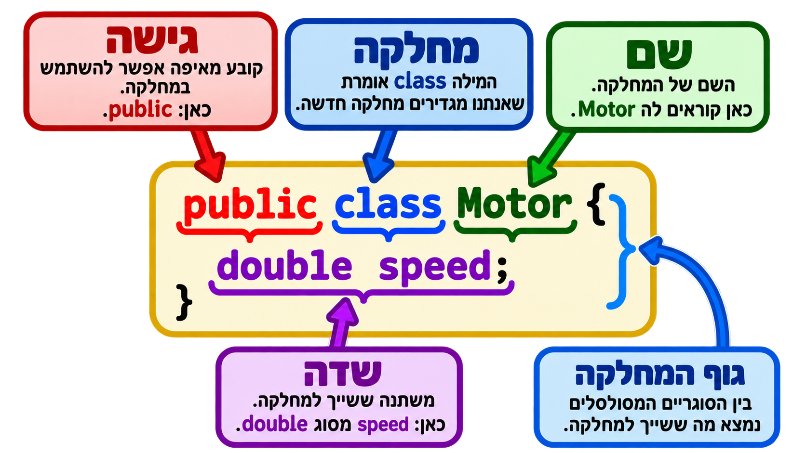
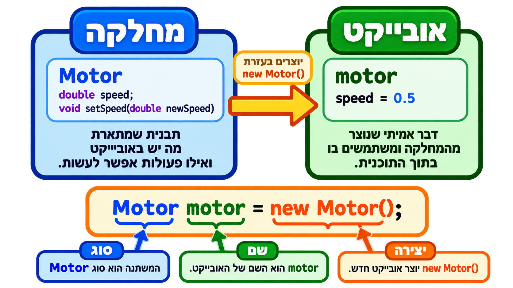
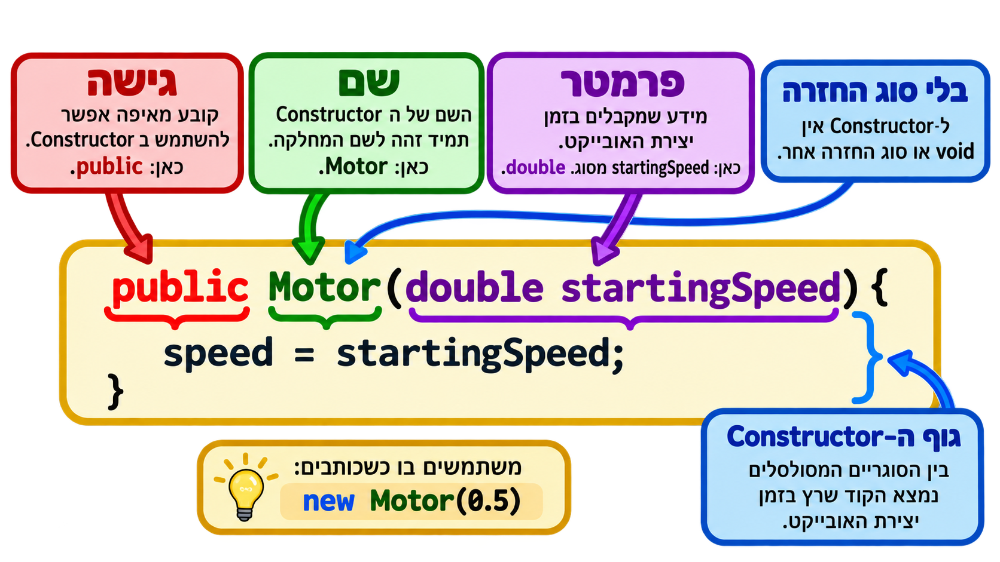

עד עכשיו כל הקוד שלנו היה יחסית קטן.

כתבנו משתנים, תנאים ופונקציות, אבל בתוכניות אמיתיות אנחנו לא רוצים לשים את כל הקוד בתוך קובץ אחד.

ב-Java אנחנו מחלקים את התוכנית ל**מחלקות**.

## מהי מחלקה?

מחלקה (**Class**) היא תבנית שמתארת דבר מסוים בתוכנית.

לדוגמה, אם אנחנו רוצים לייצג מנוע, אפשר ליצור מחלקה בשם:

```java
Motor
```

המחלקה יכולה לשמור מידע על המנוע ולכלול פעולות שאפשר לבצע עליו.

לדוגמה:

```java
public class Motor {

    double speed;

    void setSpeed(double newSpeed) {
        speed = newSpeed;
    }
}
```

כאן המחלקה `Motor` מתארת מנוע שיש לו:

- מהירות בשם `speed`.
- פעולה בשם `setSpeed`.

אבל חשוב:

**מחלקה היא רק התבנית.**

עדיין לא יצרנו מנוע אמיתי בתוכנית.

---

## יצירת קובץ חדש למחלקה

ב-Java בדרך כלל כל מחלקה נמצאת בקובץ משלה.

אם אנחנו רוצים ליצור מחלקה בשם:

```java
Motor
```

ניצור קובץ חדש בשם:

```text
Motor.java
```

:::warning
שם הקובץ ושם המחלקה צריכים להיות זהים.

אם המחלקה נקראת:

```java
public class Motor
```

שם הקובץ צריך להיות:

```text
Motor.java
```
:::

לדוגמה, הפרויקט שלנו יכול להיראות כך:

```text
src/
└─ main/
   └─ java/
      ├─ Main.java
      └─ Motor.java
```

בקובץ `Motor.java` נכתוב:

```java
public class Motor {

}
```

ובקובץ `Main.java` יישאר הקוד שממנו אנחנו מריצים את התוכנית:

```java
public class Main {

    public static void main(String[] args) {

    }
}
```

עכשיו יש לנו שתי מחלקות שונות בשני קבצים שונים.

## שדות

מחלקה יכולה לשמור מידע.

המשתנים שנמצאים בתוך מחלקה, אבל מחוץ למתודות, נקראים **שדות** (`Fields`).

לדוגמה:

```java
public class Motor {

    double speed;

}
```

`speed` הוא שדה של המחלקה `Motor`.

כל אובייקט מסוג `Motor` שניצור יקבל `speed` משלו.

---


 

## מתודות בתוך מחלקה

מחלקה יכולה גם להכיל מתודות.

לדוגמה:

```java
public class Motor {

    double speed;

    void setSpeed(double newSpeed) {
        speed = newSpeed;
    }

    void printSpeed() {
        System.out.println(speed);
    }
}
```

עכשיו `Motor` יודע:

- לשמור מהירות.
- לשנות את המהירות.
- להדפיס את המהירות.

שימו לב שעכשיו הקוד הזה:

```java
speed = newSpeed;
```

כן הגיוני.

`speed` הוא שדה ששייך ל-`Motor`.

## מהו אובייקט?

המחלקה היא רק התיאור.

כדי להשתמש בה, צריך ליצור **אובייקט**.

לדוגמה:

```java
Motor motor = new Motor();
```

השורה הזו יוצרת אובייקט חדש מסוג `Motor`.

אפשר לחשוב על זה כך:

```text
Motor
```

היא התבנית.

ו:

```text
motor
```

הוא מנוע מסוים שיצרנו מהתבנית.

---



## פירוק השורה

נסתכל על:

```java
Motor motor = new Motor();
```

אפשר לחלק אותה לכמה חלקים.

```text
Motor       motor       =       new Motor();
  ↑           ↑                    ↑
 סוג       שם המשתנה           יצירת אובייקט
```

`Motor` הוא סוג המשתנה.

`motor` הוא השם שנתנו לאובייקט.

ו:

```java
new Motor()
```

יוצר אובייקט חדש מסוג `Motor`.

## שימוש באובייקט

אחרי שיצרנו אובייקט:

```java
Motor motor = new Motor();
```

אפשר להשתמש בדברים ששייכים אליו בעזרת נקודה:

```java
motor.setSpeed(0.5);
```

הנקודה:

```java
.
```

אומרת:

> השתמש במשהו ששייך לאובייקט הזה.

לדוגמה:

```java
motor.printSpeed();
```

מריץ את המתודה `printSpeed` של `motor`.

## דוגמה מלאה

### `Motor.java`

```java
public class Motor {

    double speed;

    void setSpeed(double newSpeed) {
        speed = newSpeed;
    }

    void printSpeed() {
        System.out.println(speed);
    }
}
```

### `Main.java`

```java
public class Main {

    public static void main(String[] args) {
        Motor motor = new Motor();

        motor.setSpeed(0.5);
        motor.printSpeed();
    }
}
```

התוצאה:

```text
0.5
```

עכשיו אפשר לראות למה אנחנו לא צריכים `static` במתודות של `Motor`.

אנחנו לא קוראים:

```java
setSpeed(0.5);
```

אלא:

```java
motor.setSpeed(0.5);
```

המתודה שייכת לאובייקט `motor`.

## כמה אובייקטים מאותה מחלקה

אפשר ליצור יותר מאובייקט אחד מאותה מחלקה.

```java
Motor leftMotor = new Motor();
Motor rightMotor = new Motor();
```

עכשיו יש לנו שני אובייקטים שונים.

אפשר לעשות:

```java
leftMotor.setSpeed(0.5);
rightMotor.setSpeed(0.8);
```

לכל אחד יש `speed` משלו.

לכן:

```java
leftMotor.printSpeed();
rightMotor.printSpeed();
```

ידפיס:

```text
0.5
0.8
```

שינוי של אובייקט אחד לא משנה את השני.

## Constructor

לפעמים אנחנו רוצים לתת לאובייקט מידע כבר ברגע שיוצרים אותו.

בשביל זה משתמשים ב-**Constructor**.

לדוגמה:

```java
public class Motor {

    double speed;

    public Motor(double startingSpeed) {
        speed = startingSpeed;
    }
}
```

שימו לב:

```java
public Motor(...)
```

נראה קצת כמו מתודה, אבל אין לו סוג החזרה.

אין:

```java
void
```

או:

```java
int
```

השם שלו תמיד זהה לשם המחלקה:

```text
Motor
```

## שימוש ב-Constructor

אם המחלקה שלנו היא:

```java
public class Motor {

    double speed;

    public Motor(double startingSpeed) {
        speed = startingSpeed;
    }
}
```

ניצור אותה כך:

```java
Motor motor = new Motor(0.5);
```

הערך:

```java
0.5
```

נכנס לפרמטר:

```java
startingSpeed
```

ואז:

```java
speed = startingSpeed;
```

לכן האובייקט מתחיל עם:

```text
speed = 0.5
```

---



## Constructor עם כמה פרמטרים

אפשר להעביר יותר מערך אחד.

לדוגמה:

```java
public class Motor {

    String name;
    double speed;

    public Motor(String motorName, double startingSpeed) {
        name = motorName;
        speed = startingSpeed;
    }
}
```

עכשיו אפשר ליצור:

```java
Motor motor = new Motor("Left Motor", 0.5);
```

ואז:

```text
name = "Left Motor"
speed = 0.5
```

## `this`

לפעמים לפרמטר ולשדה אנחנו רוצים לתת את אותו השם.

לדוגמה:

```java
public class Motor {

    double speed;

    public Motor(double speed) {
        this.speed = speed;
    }
}
```

יש כאן שני דברים בשם `speed`.

```java
this.speed
```

אומר:

> השדה `speed` ששייך לאובייקט הזה.

וה-`speed` בצד ימין הוא הפרמטר שקיבלנו.

כלומר:

```java
this.speed = speed;
```

אומר:

> שמור את הפרמטר `speed` בתוך השדה `speed` של האובייקט.

נראה את `this` הרבה בקוד Java.

## `public` ו-`private`

עכשיו אפשר להבין טוב יותר למה למדנו `public` ו-`private`.

לדוגמה:

```java
public class Motor {

    private double speed;

    public void setSpeed(double speed) {
        this.speed = speed;
    }

    public double getSpeed() {
        return speed;
    }
}
```

השדה:

```java
private double speed;
```

הוא `private`.

זה אומר שקוד מחוץ למחלקה לא אמור לגשת אליו ישירות.

במקום:

```java
motor.speed = 0.5;
```

נשתמש ב:

```java
motor.setSpeed(0.5);
```

וכדי לקבל את המהירות:

```java
double speed = motor.getSpeed();
```

זו דרך נפוצה מאוד לכתוב מחלקות.

## למה להשתמש ב-`private`?

נניח שכל אחד יכול לשנות את השדה ישירות:

```java
motor.speed = 500;
```

יכול להיות שזה בכלל ערך לא חוקי.

אם השדה `private`, אפשר לשלוט בדרך שבה משנים אותו:

```java
public void setSpeed(double speed) {
    if (speed <= 1 && speed >= -1) {
        this.speed = speed;
    }
}
```

עכשיו המחלקה עצמה אחראית לשמור על הערכים שלה.

## שדות ומתודות יחד

מחלקה פשוטה יכולה להיראות כך:

```java
public class Motor {

    private String name;
    private double speed;

    public Motor(String name) {
        this.name = name;
        speed = 0;
    }

    public void setSpeed(double speed) {
        this.speed = speed;
    }

    public double getSpeed() {
        return speed;
    }

    public void printInfo() {
        System.out.println(name);
        System.out.println(speed);
    }
}
```

ואז מתוך `Main.java`:

```java
public class Main {

    public static void main(String[] args) {
        Motor motor = new Motor("Motor 1");

        motor.setSpeed(0.7);

        motor.printInfo();
    }
}
```

## למה מחלקות חשובות ברובוט?

ברובוט יש הרבה חלקים שונים.

לדוגמה:

```text
Drivetrain
Elevator
Arm
Intake
Vision
```

במקום שכל הקוד יהיה בתוך קובץ אחד ענקי, אפשר ליצור מחלקה לכל מערכת.

לדוגמה:

```text
src/
└─ main/
   └─ java/
      ├─ Main.java
      ├─ Drivetrain.java
      ├─ Elevator.java
      ├─ Arm.java
      └─ Intake.java
```

כל מחלקה אחראית על המידע והפעולות שקשורים אליה.

לדוגמה, `Elevator` יכול לשמור:

```java
private double position;
```

ולהכיל מתודות כמו:

```java
public void setPosition(double position)
```

```java
public double getPosition()
```

בהמשך נראה איך הרעיון הזה מתחבר למבנה של פרויקט FRC אמיתי.

## מחלקה לעומת אובייקט

חשוב להבדיל בין שני המושגים.

**מחלקה** היא התבנית:

```java
Motor
```

**אובייקט** הוא משהו שיצרנו מהתבנית:

```java
Motor leftMotor = new Motor();
Motor rightMotor = new Motor();
```

יש מחלקה אחת:

```text
Motor
```

אבל יצרנו ממנה שני אובייקטים שונים:

```text
leftMotor
rightMotor
```

## `static` לעומת אובייקט

עכשיו אפשר גם להבין יותר טוב את `static`.

מתודה רגילה:

```java
public void printSpeed() {
    System.out.println(speed);
}
```

שייכת לאובייקט.

לכן צריך:

```java
motor.printSpeed();
```

לעומת זאת, מתודה שהיא:

```java
public static void sayHello() {
    System.out.println("Hello");
}
```

שייכת למחלקה עצמה.

ולכן אפשר לקרוא לה דרך שם המחלקה:

```java
Example.sayHello();
```

ברוב הקוד שנכתוב עבור מנגנונים ברובוט נרצה לעבוד עם **אובייקטים**, ולא להפוך הכול ל-`static`.
## תרגול

בפרק הזה נחבר כמעט את כל מה שלמדנו עד עכשיו:

- משתנים
- תנאים
- מתודות
- פרמטרים
- `return`
- `public` ו-`private`
- Constructors
- `new`
- עבודה עם כמה קבצים
- אובייקטים בתוך אובייקטים

המטרה היא להתחיל לבנות קוד שמרגיש יותר כמו קוד אמיתי של רובוט.

---

## תרגיל 1 — מחלקת Motor

צרו קובץ חדש בשם:

```text
Motor.java
```

### א. יצירת המחלקה

צרו מחלקה בשם:

```java
Motor
```

### ב. הוספת שדה

הוסיפו שדה:

```java
private double speed;
```

### ג. Constructor

צרו Constructor שמתחיל את המהירות ב-`0`.

### ד. שינוי מהירות

צרו מתודה:

```java
public void setSpeed(double speed)
```

שתשמור את המהירות החדשה.

### ה. קבלת מהירות

צרו מתודה:

```java
public double getSpeed()
```

שתחזיר את המהירות.

### ו. שימוש מתוך `Main`

בתוך:

```text
Main.java
```

צרו:

```java
Motor motor = new Motor();
```

שנו את המהירות ל-`0.6` והדפיסו אותה.

<details>
<summary>פתרון</summary>

`Motor.java`:

```java
public class Motor {

    private double speed;

    public Motor() {
        speed = 0;
    }

    public void setSpeed(double speed) {
        this.speed = speed;
    }

    public double getSpeed() {
        return speed;
    }
}
```

`Main.java`:

```java
public class Main {

    public static void main(String[] args) {
        Motor motor = new Motor();

        motor.setSpeed(0.6);

        System.out.println(motor.getSpeed());
    }
}
```

</details>

---

## תרגיל 2 — שני מנועים

עכשיו נשתמש באותה מחלקה כדי ליצור שני מנועים שונים.

### א. יצירת האובייקטים

צרו:

```java
Motor leftMotor
```

ו:

```java
Motor rightMotor
```

### ב. מהירויות שונות

תנו ל-`leftMotor` מהירות:

```text
0.4
```

ול-`rightMotor` מהירות:

```text
0.7
```

### ג. הדפסה

הדפיסו את המהירות של שניהם.

### ד. חשבו לפני שמריצים

מה יקרה אם תשנו רק את:

```java
leftMotor
```

האם המהירות של `rightMotor` תשתנה גם?

<details>
<summary>פתרון</summary>

```java
Motor leftMotor = new Motor();
Motor rightMotor = new Motor();

leftMotor.setSpeed(0.4);
rightMotor.setSpeed(0.7);

System.out.println(leftMotor.getSpeed());
System.out.println(rightMotor.getSpeed());
```

התוצאה:

```text
0.4
0.7
```

כל אובייקט שומר שדות משלו.

</details>

---

## תרגיל 3 — מחלקת Sensor

צרו קובץ חדש:

```text
Sensor.java
```

### א. שדה

צרו:

```java
private boolean active;
```

### ב. Constructor

החיישן צריך להתחיל כ:

```java
false
```

### ג. Setter

צרו:

```java
public void setActive(boolean active)
```

### ד. Getter

צרו:

```java
public boolean isActive()
```

### ה. בדיקה

בתוך `Main` צרו חיישן, שנו אותו ל-`true`, והדפיסו את הערך.

<details>
<summary>פתרון</summary>

`Sensor.java`:

```java
public class Sensor {

    private boolean active;

    public Sensor() {
        active = false;
    }

    public void setActive(boolean active) {
        this.active = active;
    }

    public boolean isActive() {
        return active;
    }
}
```

`Main.java`:

```java
Sensor sensor = new Sensor();

sensor.setActive(true);

System.out.println(sensor.isActive());
```

</details>

---

## תרגיל 4 — Intake

עכשיו נחבר כמה מחלקות יחד.

צרו קובץ:

```text
Intake.java
```

ה-`Intake` יכיל:

```java
private Motor motor;
private Sensor sensor;
```

### א. Constructor

ב-Constructor צרו:

```java
motor = new Motor();
sensor = new Sensor();
```

### ב. הפעלת המנגנון

צרו:

```java
public void run()
```

שתגדיר את מהירות המנוע ל-`0.7`.

### ג. עצירת המנגנון

צרו:

```java
public void stop()
```

שתגדיר את המהירות ל-`0`.

### ד. בדיקת Game Piece

צרו:

```java
public boolean hasGamePiece()
```

שתחזיר את הערך של החיישן.

### ה. עדכון אוטומטי

צרו מתודה:

```java
public void update()
```

אם החיישן פעיל:

```text
stop
```

אחרת:

```text
run
```

<details>
<summary>פתרון</summary>

```java
public class Intake {

    private Motor motor;
    private Sensor sensor;

    public Intake() {
        motor = new Motor();
        sensor = new Sensor();
    }

    public void run() {
        motor.setSpeed(0.7);
    }

    public void stop() {
        motor.setSpeed(0);
    }

    public boolean hasGamePiece() {
        return sensor.isActive();
    }

    public void update() {
        if (hasGamePiece()) {
            stop();
        } else {
            run();
        }
    }
}
```

</details>

---

## תרגיל 5 — העברת אובייקטים ל-Constructor

עד עכשיו `Intake` יצר בעצמו את ה-`Motor` וה-`Sensor`.

עכשיו נשנה את זה.

### א. שינוי Constructor

במקום:

```java
public Intake() {
    motor = new Motor();
    sensor = new Sensor();
}
```

ה-Constructor יקבל:

```java
Motor motor
```

ו:

```java
Sensor sensor
```

### ב. שמירת האובייקטים

שמרו אותם בשדות בעזרת `this`.

### ג. שימוש מתוך Main

בתוך `Main` צרו:

```java
Motor intakeMotor = new Motor();
Sensor intakeSensor = new Sensor();
```

ואז:

```java
Intake intake = new Intake(intakeMotor, intakeSensor);
```

### ד. בדיקה

שנו את `intakeSensor` ל-`true`.

קראו:

```java
intake.update();
```

ואז הדפיסו את מהירות `intakeMotor`.

מה אתם מצפים לראות?

<details>
<summary>פתרון</summary>

`Intake.java`:

```java
public class Intake {

    private Motor motor;
    private Sensor sensor;

    public Intake(Motor motor, Sensor sensor) {
        this.motor = motor;
        this.sensor = sensor;
    }

    public void run() {
        motor.setSpeed(0.7);
    }

    public void stop() {
        motor.setSpeed(0);
    }

    public boolean hasGamePiece() {
        return sensor.isActive();
    }

    public void update() {
        if (hasGamePiece()) {
            stop();
        } else {
            run();
        }
    }
}
```

`Main.java`:

```java
Motor intakeMotor = new Motor();
Sensor intakeSensor = new Sensor();

Intake intake = new Intake(intakeMotor, intakeSensor);

intakeSensor.setActive(true);

intake.update();

System.out.println(intakeMotor.getSpeed());
```

התוצאה:

```text
0.0
```

`Intake` מחזיק את אותם אובייקטים שיצרנו ב-`Main`.

</details>

---

## תרגיל 6 — Drivetrain

צרו קובץ:

```text
Drivetrain.java
```

המחלקה תכיל שני מנועים:

```java
private Motor leftMotor;
private Motor rightMotor;
```

### א. Constructor

צרו את שני המנועים בתוך ה-Constructor.

### ב. נסיעה

צרו:

```java
public void drive(double leftSpeed, double rightSpeed)
```

שתגדיר מהירות לכל מנוע.

### ג. עצירה

צרו:

```java
public void stop()
```

שתגדיר את שני המנועים ל-`0`.

### ד. Getter

צרו:

```java
public double getLeftSpeed()
```

ו:

```java
public double getRightSpeed()
```

### ה. בדיקה

בתוך `Main`:

```java
Drivetrain drivetrain = new Drivetrain();
```

קראו:

```java
drivetrain.drive(0.5, 0.8);
```

והדפיסו את שתי המהירויות.

<details>
<summary>פתרון</summary>

```java
public class Drivetrain {

    private Motor leftMotor;
    private Motor rightMotor;

    public Drivetrain() {
        leftMotor = new Motor();
        rightMotor = new Motor();
    }

    public void drive(double leftSpeed, double rightSpeed) {
        leftMotor.setSpeed(leftSpeed);
        rightMotor.setSpeed(rightSpeed);
    }

    public void stop() {
        leftMotor.setSpeed(0);
        rightMotor.setSpeed(0);
    }

    public double getLeftSpeed() {
        return leftMotor.getSpeed();
    }

    public double getRightSpeed() {
        return rightMotor.getSpeed();
    }
}
```

</details>

---

## תרגיל 7 — Robot

עכשיו ניצור מחלקה שמכילה כמה מערכות.

צרו קובץ:

```text
Robot.java
```

המחלקה תכיל:

```java
private Drivetrain drivetrain;
private Intake intake;
```

### א. Constructor

צרו `Drivetrain`.

עבור ה-`Intake`, צרו:

```java
Motor intakeMotor = new Motor();
Sensor intakeSensor = new Sensor();
```

והשתמשו בהם כדי ליצור `Intake`.

### ב. נהיגה

צרו:

```java
public void drive(double leftSpeed, double rightSpeed)
```

שתעביר את הערכים ל-`Drivetrain`.

### ג. עדכון Intake

צרו:

```java
public void updateIntake()
```

שתקרא:

```java
intake.update();
```

### ד. עצירת רובוט

צרו:

```java
public void stop()
```

שתעצור את ה-`Drivetrain`.

<details>
<summary>פתרון</summary>

```java
public class Robot {

    private Drivetrain drivetrain;
    private Intake intake;

    public Robot() {
        drivetrain = new Drivetrain();

        Motor intakeMotor = new Motor();
        Sensor intakeSensor = new Sensor();

        intake = new Intake(intakeMotor, intakeSensor);
    }

    public void drive(double leftSpeed, double rightSpeed) {
        drivetrain.drive(leftSpeed, rightSpeed);
    }

    public void updateIntake() {
        intake.update();
    }

    public void stop() {
        drivetrain.stop();
    }
}
```

</details>

---

## תרגיל 8 — פרויקט רובוט מלא

עכשיו צרו פרויקט עם הקבצים:

```text
src/
└─ main/
   └─ java/
      ├─ Main.java
      ├─ Robot.java
      ├─ Drivetrain.java
      ├─ Intake.java
      ├─ Motor.java
      └─ Sensor.java
```

### א. Motor

צריך לכלול:

```java
setSpeed
getSpeed
```

### ב. Sensor

צריך לכלול:

```java
setActive
isActive
```

### ג. Drivetrain

צריך לכלול:

```java
drive
stop
getLeftSpeed
getRightSpeed
```

### ד. Intake

צריך להכיל:

```java
Motor
Sensor
```

ולתת:

```java
run
stop
hasGamePiece
update
```

### ה. Robot

צריך להכיל:

```java
Drivetrain
Intake
```

ולתת:

```java
drive
updateIntake
stop
```

### ו. Main

בתוך `Main`:

```java
Robot robot = new Robot();
```

לאחר מכן:

```java
robot.drive(0.6, 0.6);
robot.updateIntake();
robot.stop();
```

---

## תרגיל 9 — מצאו את הטעויות

### א.

```java
public class Motor {

    private double speed;

    public void setSpeed(double speed) {
        speed = speed;
    }
}
```

מה הבעיה?

### ב.

```java
public class Motor {

    public void Motor() {
        System.out.println("Created");
    }
}
```

למה זה לא Constructor?

### ג.

בקובץ:

```text
Drivetrain.java
```

כתוב:

```java
public class Drive {

}
```

מה הבעיה?

### ד.

מה ההבדל בין:

```java
Motor motor;
```

לבין:

```java
Motor motor = new Motor();
```

<details>
<summary>פתרון</summary>

### א.

צריך:

```java
this.speed = speed;
```

### ב.

בגלל שיש:

```java
void
```

זו מתודה רגילה ולא Constructor.

Constructor צריך להיות:

```java
public Motor() {
    System.out.println("Created");
}
```

### ג.

שם הקובץ צריך להתאים לשם המחלקה הציבורית.

או:

```text
Drive.java
```

או:

```java
public class Drivetrain
```

### ד.

```java
Motor motor;
```

יוצר משתנה שיכול להחזיק `Motor`, אבל עדיין לא יוצר אובייקט.

```java
Motor motor = new Motor();
```

גם מגדיר את המשתנה וגם יוצר אובייקט חדש.

</details>

---

## תרגיל 10 — אתגר מסכם

בנו מערכת חדשה בשם:

```java
Arm
```

בלי להשתמש בפתרון קיים מהתרגילים.

המערכת צריכה להשתמש ב:

```java
Motor
Sensor
```

### דרישות

1. ל-`Arm` יהיה `Motor`.
2. ל-`Arm` יהיה `Sensor`.
3. ה-Constructor יקבל את שניהם כפרמטרים.
4. תהיה מתודה:

```java
public void move(double speed)
```

5. אם החיישן פעיל והמהירות חיובית, המנוע צריך לעצור.
6. אחרת המנוע יקבל את המהירות שנשלחה.
7. תהיה מתודה:

```java
public double getSpeed()
```

8. צרו `Arm` בתוך `Main`.
9. הפעילו אותו עם כמה ערכים שונים.
10. שנו את מצב החיישן ובדקו איך ההתנהגות משתנה.

<details>
<summary>פתרון אפשרי</summary>

`Arm.java`:

```java
public class Arm {

    private Motor motor;
    private Sensor sensor;

    public Arm(Motor motor, Sensor sensor) {
        this.motor = motor;
        this.sensor = sensor;
    }

    public void move(double speed) {
        if (sensor.isActive() && speed > 0) {
            motor.setSpeed(0);
        } else {
            motor.setSpeed(speed);
        }
    }

    public double getSpeed() {
        return motor.getSpeed();
    }
}
```

`Main.java`:

```java
public class Main {

    public static void main(String[] args) {
        Motor armMotor = new Motor();
        Sensor armSensor = new Sensor();

        Arm arm = new Arm(armMotor, armSensor);

        arm.move(0.5);
        System.out.println(arm.getSpeed());

        armSensor.setActive(true);

        arm.move(0.5);
        System.out.println(arm.getSpeed());

        arm.move(-0.5);
        System.out.println(arm.getSpeed());
    }
}
```

</details>

---

## לפני שממשיכים, בדקו את עצמכם

לפני שממשיכים לפרק הבא, ודאו שאתם יכולים להסביר בעצמכם:

- מה ההבדל בין מחלקה לאובייקט?
- מה עושה `new`?
- למה `Motor motor` לא יוצר עדיין אובייקט?
- מה עושה Constructor?
- למה Constructor לא מקבל `void`?
- מה ההבדל בין שדה לפרמטר?
- מה עושה `this.speed = speed`?
- למה משתמשים ב-`private`?
- איך קוראים למתודה של אובייקט?
- איך יכולים להיות שני אובייקטים מאותה מחלקה עם ערכים שונים?
- איך מחלקה אחת יכולה להחזיק אובייקט ממחלקה אחרת?
- מה קורה כש-`Robot` מחזיק `Drive`, ו-`Drive` מחזיק `Motor`?
- למה מחלקות שונות נמצאות בדרך כלל בקבצים שונים?

אם אחד מהדברים האלה עדיין לא ברור, כדאי לחזור לתרגילים לפני שממשיכים להורשה.
## סיכום

בשיעור הזה למדנו:

- מהי מחלקה.
- איך יוצרים קובץ `.java` חדש למחלקה.
- למה שם הקובץ צריך להתאים לשם המחלקה.
- מהו שדה.
- מהו אובייקט.
- איך יוצרים אובייקט בעזרת `new`.
- איך משתמשים ב-`.` כדי לגשת למתודות.
- איך יוצרים כמה אובייקטים מאותה מחלקה.
- מהו Constructor.
- איך משתמשים ב-`this`.
- למה משתמשים ב-`public` ו-`private`.
- מה ההבדל בין מחלקה לאובייקט.
- מה ההבדל הבסיסי בין מתודה רגילה ל-`static`.