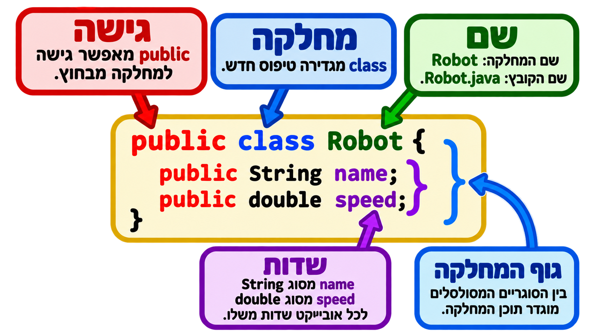
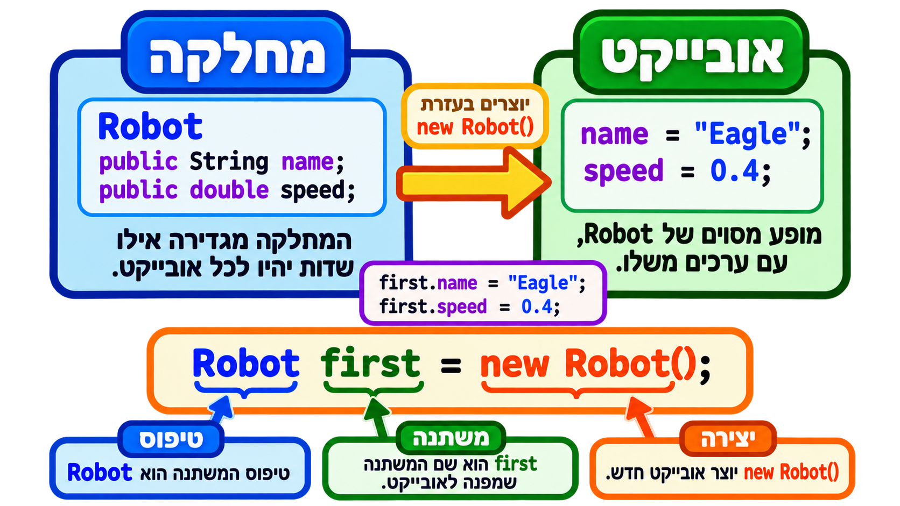

import ExerciseHelp from '@site/src/components/ExerciseHelp';

זה החלק הראשון מתוך חמישה. בחלק הזה נלמד איך להגדיר מחלקה, ליצור ממנה אובייקטים ולשמור בכל אחד מהם מידע משלו.

:::info איך עובדים במסלול?
קוראים קטע קצר, מריצים את הדוגמה ופותרים את התרגיל שאחריו. נסו קודם בעצמכם; אם נתקעתם, פתחו רמז אחד בכל פעם. לפני פתיחת פתרון, נסו להסביר מה בדיוק לא ברור לכם.

שמרו את `Robot.java`: נשפר את אותה מחלקה בחלקים הבאים. בדוגמאות קצרות שבהן כתוב ״בתוך main״, מחליפים רק את תוכן המתודה `main`.
:::

## למה להגדיר מחלקה?

נניח שאנחנו רוצים לייצג שני רובוטים:

```java
String firstName = "Eagle";
double firstSpeed = 0.4;
String secondName = "Falcon";
double secondSpeed = 0.7;
```

זה אפשרי, אבל הקשר בין השם למהירות תלוי בשמות שבחרנו למשתנים. ואם נוסיף עוד רובוטים ועוד מידע, נצטרך הרבה משתנים נפרדים.

**מחלקה (Class) מגדירה טיפוס חדש.** היא מתארת איזה מידע ואילו פעולות יהיו לאובייקטים מהטיפוס הזה. כרגע נתחיל רק עם המידע: שם ומהירות.

## יוצרים קובץ ומגדירים שדות

צרו `Robot.java` באותה תיקייה שבה נמצא `Main.java`, למשל `src/main/java` בפרויקט ההכשרה שלכם. השאירו את שני הקבצים באותה תיקייה וללא הכרזת `package` בתרגול הזה.

בקובץ `Robot.java` כתבו:

```java
public class Robot {
    public String name;
    public double speed;
}
```

**שדה (Field) הוא משתנה שמוגדר בגוף המחלקה, מחוץ למתודות.** כאן הגדרנו שני שדות: `name` מטיפוס `String` ו־`speed` מטיפוס `double`. לכל אובייקט שניצור מהמחלקה הזאת יהיו שדות משלו.

:::note מה עושים עם public?
כרגע כתבו `public` כמו בדוגמה. על השדות הוא מאפשר לנו לקרוא ולשנות אותם מתוך `Main`. בחלק הרביעי נלמד מתי כדאי להגביל את הגישה הזאת.
:::

מחלקה שמוגדרת `public` צריכה להיות בקובץ ששמו זהה לשם המחלקה: `Robot` בקובץ `Robot.java`. שימו לב גם לאותיות הגדולות והקטנות.

 


### תרגיל 1: מה לא נכון בקובץ?

בקובץ `Robot.java` מופיע:

```java
public class Robots {
    public String name;
}
```

<ExerciseHelp
  hints={["השוו את שם הקובץ לשם שכתוב אחרי class.", "שם המחלקה הציבורית צריך להתאים לשם הקובץ, כולל אותיות גדולות וקטנות."]}
  solution={`public class Robot {
    public String name;
}`}
  solutionLanguage="java"
/>

## מחלקה מתארת; new יוצר

הגדרת `Robot` לא יוצרת אוטומטית רובוט לשימוש בתוכנית. **אובייקט (Object) הוא מופע מסוים של המחלקה.** אפשר ליצור אחד כך, בתוך `main`:

```java
Robot first = new Robot();
```

| חלק בשורה | משמעות |
| --- | --- |
| `Robot` בצד שמאל | טיפוס המשתנה |
| `first` | שם המשתנה שדרכו נשתמש באובייקט |
| `new Robot()` | יצירת אובייקט חדש מסוג `Robot` |
| `=` | שמירת ההפניה לאובייקט במשתנה |

אין צורך כרגע להעמיק במילה ״הפניה״. חשוב לדייק: `first` הוא שם המשתנה, והאובייקט הוא הדבר שיצרנו באמצעות `new`. המחלקה היא הטיפוס, לא רובוט מסוים.

הסוגריים ב־`new Robot()` הם חלק מהתחביר. בחלק השלישי נראה איך מעבירים בתוכם מידע בזמן יצירת האובייקט.




### תרגיל 2: מה חסר?

בתוך `main` כתוב:

```java
Robot robot;
robot.speed = 0.5;
```

<ExerciseHelp
  hints={["הפרידו בין הכרזה על משתנה לבין יצירת הדבר שנשתמש בו.", "חפשו את המילה שמופיעה בדוגמת היצירה אבל חסרה כאן."]}
  solution={`Robot robot = new Robot();
robot.speed = 0.5;
// Robot robot; רק מכריזה על משתנה מקומי.
// אי אפשר להשתמש בו לפני שהושם בו ערך.`}
  solutionLanguage="java"
/>

## משתמשים בנקודה כדי להגיע לשדה

```java
Robot first = new Robot();
first.name = "Eagle";
first.speed = 0.4;

System.out.println(first.name);
System.out.println(first.speed);
```

הנקודה ב־`first.speed` אומרת: השתמשו בשדה `speed` של האובייקט שאליו `first` מפנה.

כאן `first.speed = 0.4;` משנה שדה, ואילו `System.out.println(first.speed);` קורא את הערך שלו ומדפיס אותו.

הפלט:

```text
Eagle
0.4
```

זו דוגמה מלאה ל־`Main.java` שתוכלו להריץ לצד `Robot.java`:

```java
public class Main {
    public static void main(String[] args) {
        Robot first = new Robot();
        first.name = "Eagle";
        first.speed = 0.4;

        System.out.println(first.name);
        System.out.println(first.speed);
    }
}
```

בכל דוגמה קצרה בהמשך, הקוד שמפעיל אובייקטים נמצא **בתוך `main`**, לא ישירות בגוף המחלקה `Main`.

## שני אובייקטים, מידע נפרד

```java
Robot first = new Robot();
Robot second = new Robot();

first.name = "Eagle";
first.speed = 0.4;
second.name = "Falcon";
second.speed = 0.7;

first.speed = 0.2;
```

שתי קריאות נפרדות ל־`new` יצרו שני אובייקטים נפרדים. אחרי הקוד הזה:

| המשתנה שדרכו ניגשים לאובייקט | `name` | `speed` |
| --- | --- | --- |
| `first` | `"Eagle"` | `0.2` |
| `second` | `"Falcon"` | `0.7` |

שינוי המהירות דרך `first` לא שינה את המהירות של האובייקט שנוצר עבור `second`.

### תרגיל 3: מה יודפס?

לפני ההרצה כתבו את שתי שורות הפלט הצפויות והסבירו למה.

```java
Robot first = new Robot();
Robot second = new Robot();
first.speed = 0.3;
second.speed = 0.8;
first.speed = first.speed + 0.2;

System.out.println(first.speed);
System.out.println(second.speed);
```

<ExerciseHelp
  hints={["עקבו בנפרד אחרי speed של כל אובייקט.", "באיזה אובייקט משתמשת השורה שמוסיפה 0.2?"]}
  solution={`0.5
0.8`}
  solutionLanguage="text"
/>

### תרגיל 4: מה לא נכון בגישה לשדה?

בתוך `main` כתוב:

```java
Robot robot = new Robot();
speed = 0.6;
System.out.println(robot.speed);
```

<ExerciseHelp
  hints={["היכן הגדרנו את speed: ב־Main או ב־Robot?", "צריך לציין של איזה אובייקט רוצים לשנות את השדה."]}
  solution={`robot.speed = 0.6;
// speed הוא שדה של אובייקט Robot.`}
  solutionLanguage="java"
/>

### תרגיל 5: בונים לבד

השתמשו ב־`Robot.java` שהגדרנו. בתוך `main`:

1. צרו שני אובייקטים חדשים מסוג `Robot`.
2. תנו להם שמות שונים ומהירויות `0.2` ו־`0.6`.
3. הדפיסו את השם והמהירות של כל אחד.
4. שנו רק את מהירות הראשון ל־`0.9`.
5. הדפיסו שוב את שתי המהירויות והסבירו את ההבדל.

<ExerciseHelp
  hints={["כמה פעמים תצטרכו להשתמש ב־new כדי ליצור שני אובייקטים?", "אחרי היצירה, שייכו כל השמה למשתנה המתאים בעזרת נקודה.", "בדקו ששורת השינוי האחרונה משתמשת רק במשתנה של הרובוט הראשון."]}
  solution={`// בתוך main
Robot first = new Robot();
Robot second = new Robot();
first.name = "Eagle";
first.speed = 0.2;
second.name = "Falcon";
second.speed = 0.6;

System.out.println(first.name);
System.out.println(first.speed);
System.out.println(second.name);
System.out.println(second.speed);

first.speed = 0.9;
System.out.println(first.speed);  // 0.9
System.out.println(second.speed); // 0.6`}
  solutionLanguage="java"
  multipleSolutions={true}
/>

### אתגר: טיפוס משלכם

צרו `Student.java` עם השדות הציבוריים `String name` ו־`int score`. ב־`main` צרו שני תלמידים, תנו לכל אחד מידע אחר ושנו רק את הציון של השני.

<ExerciseHelp
  hints={["התחביר זהה לזה של Robot; רק שמות השדות והטיפוסים משתנים.", "הגדירו את המחלקה בקובץ נפרד, ואת האובייקטים צרו בתוך main."]}
  solution={`// Student.java
public class Student {
    public String name;
    public int score;
}

// בתוך main שב־Main.java
Student first = new Student();
Student second = new Student();
first.name = "Noa";
first.score = 80;
second.name = "Dan";
second.score = 70;
second.score = 90;
System.out.println(first.score);  // 80
System.out.println(second.score); // 90`}
  solutionLanguage="java"
  multipleSolutions={true}
/>

## לפני שממשיכים: בדיקה בלי רמזים

צרו מחלקה `Lamp` עם שדה ציבורי `boolean on`. צרו שתי מנורות חדשות, הפעילו רק אחת והדפיסו את מצב שתיהן. כתבו במפורש את המצב של כל מנורה לפני ההדפסה.

הסבירו למדריך או לחבר:

- מהי המחלקה ומהם האובייקטים בתוכנית שלכם?
- באיזו שורה נוצר כל אובייקט?
- למה שינוי המנורה הראשונה לא שינה את השנייה?

אם קשה לכם לבצע או להסביר זאת, חזרו לדוגמת שני הרובוטים לפני ההמשך.
