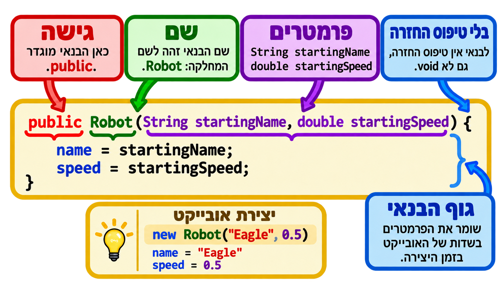

import ExerciseHelp from '@site/src/components/ExerciseHelp';

אנחנו כבר יודעים ליצור אובייקט ולפעול עליו. עכשיו נרצה שהוא יקבל את המידע ההתחלתי שלו **בזמן היצירה**.

## 1. הבעיה: יוצרים ואז משלימים

עד עכשיו כתבנו בתוך `main`:

```java
Robot robot = new Robot();
robot.name = "Eagle";
robot.speed = 0.5;
```

מה יקרה אם נשכח את אחת ההשמות?

בשדות של אובייקט, Java מספקת ערכי התחלה אם לא קבענו אחרים: שדה `double` מתחיל ב־`0.0`, שדה `boolean` ב־`false`, ושדה מסוג `String` ב־`null` - כלומר, עדיין אין בו הפניה למחרוזת. זה אינו הטקסט `"null"`.

לכן יצירת `Robot` אינה מבטיחה שכבר נתנו לו שם. נרצה דרך לרכז את האתחול במקום אחד.

:::note שדה לעומת משתנה מקומי
כללי ערכי ההתחלה האלה מתייחסים לשדות. משתנה מקומי בתוך מתודה חייב לקבל ערך לפני שמשתמשים בו; Java לא משלימה עבורו אוטומטית את אותו הדבר.
:::

## 2. הפתרון: בנאי

**בנאי (Constructor) הוא קוד שמופעל כחלק מיצירת אובייקט.** הוא מאפשר לנו להגדיר את המצב ההתחלתי שלו.

הוסיפו ל־`Robot.java`, בתוך המחלקה אבל מחוץ למתודות:

```java
public Robot(String startingName, double startingSpeed) {
    name = startingName;
    speed = startingSpeed;
}
```

הבנאי שומר את הפרמטר `startingName` בשדה `name`, ואת הפרמטר `startingSpeed` בשדה `speed`. המתודות מהחלק הקודם נשארות במחלקה.

בתוך `main` יוצרים עכשיו כך:

```java
Robot robot = new Robot("Eagle", 0.5);
robot.printStatus();
```

| הערך בקריאה | נכנס לפרמטר | נשמר בשדה |
| --- | --- | --- |
| `"Eagle"` | `startingName` | `name` |
| `0.5` | `startingSpeed` | `speed` |

סדר הפרמטרים והטיפוסים חשובים, כמו בקריאה למתודה. אחרי היצירה הרובוט כבר מחזיק שם ומהירות.

## 3. איך מזהים בנאי?

```java
public Robot(String startingName, double startingSpeed) {
    name = startingName;
    speed = startingSpeed;
}
```

- השם זהה בדיוק לשם המחלקה: `Robot`.
- אין טיפוס החזרה: לא `double`, לא `Robot` וגם לא `void`.
- משתמשים בו כחלק מביטוי יצירה, למשל `new Robot("Eagle", 0.5)`.

לעומת זאת, `public void stop()` היא מתודה רגילה: היא לא מופעלת אוטומטית בזמן היצירה.



### תרגיל 1: למה זו לא הגדרת בנאי?

במחלקה כתוב:

```java
public void Robot(String startingName, double startingSpeed) {
    name = startingName;
    speed = startingSpeed;
}
```

תקנו את ההגדרה. האם היא, כפי שנכתבה, מאפשרת `new Robot("Eagle", 0.5)`?

<ExerciseHelp
  hints={["מה מופיע כאן לפני שם המחלקה שלא אמור להופיע בבנאי?", "void הופך את ההגדרה למתודה רגילה בשם Robot, לא לבנאי."]}
  solution={`public Robot(String startingName, double startingSpeed) {
    name = startingName;
    speed = startingSpeed;
}
// לפני התיקון זו הייתה מתודה רגילה.
// אם אין בנאי אחר עם הפרמטרים האלה, new Robot("Eagle", 0.5) לא מתקמפל.`}
  solutionLanguage="java"
/>

### תרגיל 2: אילו קריאות מתאימות?

נניח שהבנאי היחיד במחלקה הוא `Robot(String startingName, double startingSpeed)`. בדקו כל שורה בנפרד:

```java
Robot first = new Robot("Eagle", 0.5);
Robot second = new Robot(0.5, "Falcon");
Robot third = new Robot("Hawk");
Robot fourth = new Robot();
```

אילו שורות יתקמפלו? תקנו את האחרות באמצעות הבנאי הקיים.

<ExerciseHelp
  hints={["התאימו את מספר הערכים, הסדר והטיפוס לרשימת הפרמטרים.", "הבנאי מצפה תחילה ל־String ואז ל־double."]}
  solution={`Robot first = new Robot("Eagle", 0.5); // כבר תקין
Robot second = new Robot("Falcon", 0.5);
Robot third = new Robot("Hawk", 0.0);
Robot fourth = new Robot("Owl", 0.0);
// במקור רק השורה הראשונה מתאימה לבנאי היחיד.`}
  solutionLanguage="java"
  multipleSolutions={true}
/>

## 4. this: האובייקט שעליו עובדים עכשיו

לפעמים נרצה להשתמש באותם שמות לפרמטרים ולשדות:

```java
public Robot(String name, double speed) {
    this.name = name;
    this.speed = speed;
}
```

`this` מתייחס לאובייקט הנוכחי. בבנאי זה האובייקט שנמצא בתהליך יצירה.

בשורה `this.speed = speed;`:

| הביטוי | למה הוא מתייחס? |
| --- | --- |
| `this.speed` | השדה של האובייקט |
| `speed` | הפרמטר של הבנאי, כי יש פרמטר באותו שם |

כלומר: **שמרו בשדה של האובייקט את הערך שהתקבל בפרמטר.**

גם הגרסה עם `startingSpeed` תקינה. `this` אינו חובה בכל השמה לשדה, אבל הוא מאפשר להבדיל בין שדה לפרמטר כאשר השמות זהים. הוא שימושי גם במתודות רגילות.

### תרגיל 3: הקוד מתקמפל, אבל מה הוא שומר?

```java
public class Robot {
    public String name;
    public double speed;

    public Robot(String name, double speed) {
        name = name;
        speed = speed;
    }
}
```

בתוך `main` יוצרים `new Robot("Eagle", 0.75)` ומדפיסים את השדות. מה יודפס? תקנו את הבנאי.

<ExerciseHelp
  hints={["כאשר יש פרמטר ושדה באותו שם, למה מתייחס השם בלי this?", "ההשמות הנוכחיות משייכות כל פרמטר לעצמו. השדות נשארים עם ערכי ההתחלה."]}
  solution={`// לפני התיקון: הדפסת name תציג null והדפסת speed תציג 0.0.
public Robot(String name, double speed) {
    this.name = name;
    this.speed = speed;
}
// אחרי התיקון: Eagle ואז 0.75.`}
  solutionLanguage="java"
/>

## 5. מה קרה ל־new Robot()?

אם לא מגדירים **שום בנאי**, Java מספקת למחלקה בנאי ברירת מחדל ללא פרמטרים. כך יכלנו להשתמש ב־`new Robot()` בחלקים הקודמים.

**ברגע שמגדירים בנאי כלשהו, Java אינה מוסיפה אוטומטית בנאי ללא פרמטרים.** לכן, אחרי הוספת הבנאי עם השם והמהירות, צריך לעדכן את הקריאות ב־`Main`.

אפשר לכתוב בעצמנו בנאי ללא פרמטרים, בנוסף לבנאי שכבר כתבנו:

```java
public Robot() {
    name = "Unnamed";
    speed = 0;
}
```

אז שתי צורות היצירה יהיו אפשריות:

```java
Robot first = new Robot("Eagle", 0.5);
Robot second = new Robot();
```

אין כאן שתי מחלקות: יש שני בנאים באותה מחלקה. Java בוחרת לפי הפרמטרים שהעברנו. בנאי ללא פרמטרים שכתבנו בעצמנו אינו הבנאי שהקומפיילר מספק כשלא כתבנו בנאים כלל.

### תרגיל 4: מה יודפס?

נניח שקיימים שני הבנאים התקינים שהצגנו. משתמשים בהם כך:

```java
Robot first = new Robot("Eagle", 0.25);
Robot second = new Robot();
first.accelerate(0.25);
first.printStatus();
second.printStatus();
```

כתבו את ארבע שורות הפלט, לפי הסדר.

<ExerciseHelp
  hints={["קבעו קודם את המצב ההתחלתי לפי הבנאי שבו משתמשים.", "לאחר היצירה רק first מקבל קריאה ל־accelerate."]}
  solution={`Eagle
0.5
Unnamed
0.0`}
  solutionLanguage="text"
/>

### תרגיל 5: משלימים בנאי

השלימו במחלקת `Motor` את הבנאי הבא. שם הפרמטר חייב להישאר `speed`:

```java
public class Motor {
    public double speed;

    public Motor(double speed) {
        // השלימו
    }
}
```

בתוך `main`, צרו מנוע במהירות `0.5` והדפיסו את השדה שלו.

<ExerciseHelp
  hints={["הפרמטר והשדה בעלי אותו שם. איך מציינים את השדה במפורש?", "ב־Main, העבירו ערך בין הסוגריים של new Motor(...)."]}
  solution={`// Motor.java
public class Motor {
    public double speed;

    public Motor(double speed) {
        this.speed = speed;
    }
}

// בתוך main
Motor motor = new Motor(0.5);
System.out.println(motor.speed); // 0.5`}
  solutionLanguage="java"
/>

### תרגיל 6: בונים לבד

עדכנו את `Robot` מהחלק הקודם:

1. הוסיפו בנאי שמקבל `String name` ו־`double speed` ושומר אותם בשדות בעזרת `this`.
2. השאירו את המתודות שכבר כתבתם.
3. ב־`Main` צרו שני רובוטים חדשים עם שמות ומהירויות שונים באמצעות הבנאי.
4. הדפיסו את מצב שניהם, עצרו אחד והדפיסו שוב.

בתרגיל הזה אין צורך בבנאי ללא פרמטרים. עדכנו את הקריאות הישנות ל־`new Robot()`.

<ExerciseHelp
  hints={["הבנאי קובע את המצב ההתחלתי; המתודות עדיין משמשות לפעולות אחרי היצירה.", "הוסיפו בנאי בתוך המחלקה, לא בתוך מתודה קיימת.", "בתוך main, החליפו יצירה והשמות נפרדות בשורה אחת עם שם ומהירות."]}
  solution={`// Robot.java
public class Robot {
    public String name;
    public double speed;

    public Robot(String name, double speed) {
        this.name = name;
        this.speed = speed;
    }

    public void accelerate(double amount) {
        speed = speed + amount;
    }

    public void doubleSpeed() {
        speed = speed * 2;
    }

    public void stop() {
        speed = 0;
    }

    public void printStatus() {
        System.out.println(name);
        System.out.println(speed);
    }

    public double getSpeed() {
        return speed;
    }

    public boolean isMoving() {
        return speed != 0;
    }
}

// Main.java - קובץ נפרד
public class Main {
    public static void main(String[] args) {
        Robot first = new Robot("Eagle", 0.5);
        Robot second = new Robot("Falcon", 0.75);
        first.printStatus();
        second.printStatus();
        first.stop();
        first.printStatus();  // Eagle ואז 0.0
        second.printStatus(); // Falcon ואז 0.75
    }
}`}
  solutionLanguage="java"
  multipleSolutions={true}
/>

### אתגר: שתי דרכי יצירה

הוסיפו בנאי `Robot(String name)` שמקבל רק שם ומתחיל במהירות אפס. השאירו גם את הבנאי שמקבל שם ומהירות. בדקו ב־`Main` את שני הבנאים.

<ExerciseHelp
  hints={["הבנאי החדש עדיין צריך לקבוע את שני השדות, אף שהוא מקבל רק ערך אחד.", "את name קבלו מהפרמטר; ל־speed תנו ערך קבוע."]}
  solution={`// הוסיפו בתוך Robot, לצד הבנאי הקיים
public Robot(String name) {
    this.name = name;
    speed = 0;
}

// בתוך main
Robot first = new Robot("Eagle");
Robot second = new Robot("Falcon", 0.5);
first.printStatus();  // Eagle ואז 0.0
second.printStatus(); // Falcon ואז 0.5`}
  solutionLanguage="java"
  multipleSolutions={true}
/>

## לפני שממשיכים: בדקו את עצמכם

חזרו ל־`Lamp.java` מהחלק הראשון.

הוסיפו בנאי שמקבל `boolean on` ושומר את הערך בשדה באמצעות `this`. צרו מנורה דולקת ומנורה כבויה והדפיסו את מצבן.

הסבירו:

- למה לא כותבים `void` בבנאי?
- מה ההבדל בין `on` ל־`this.on` בתוך הבנאי?
- האם `new Lamp()` יתקמפל אם זה הבנאי היחיד?

<ExerciseHelp
  hints={[
    "שם הבנאי חייב להיות זהה לשם המחלקה, ולא כותבים לו טיפוס החזרה.",
    "this.on מתייחס לשדה של האובייקט, ואילו on לבדו בתוך הבנאי מתייחס לפרמטר.",
    "אחרי שהגדרתם בנאי שמקבל פרמטר, צריך להעביר לו ערך בעת יצירת האובייקט."
  ]}
  solution={`// Lamp.java
public class Lamp {
    public boolean on;

    public Lamp(boolean on) {
        this.on = on;
    }
}

// בתוך Main
Lamp first = new Lamp(true);
Lamp second = new Lamp(false);

System.out.println(first.on);  // true
System.out.println(second.on); // false

// בנאי אינו מתודה רגילה ואין לו טיפוס החזרה.
// this.on הוא השדה; on הוא הפרמטר.
// new Lamp() לא יתקמפל,
// כי הבנאי היחיד דורש boolean.`}
  solutionLanguage="java"
/>