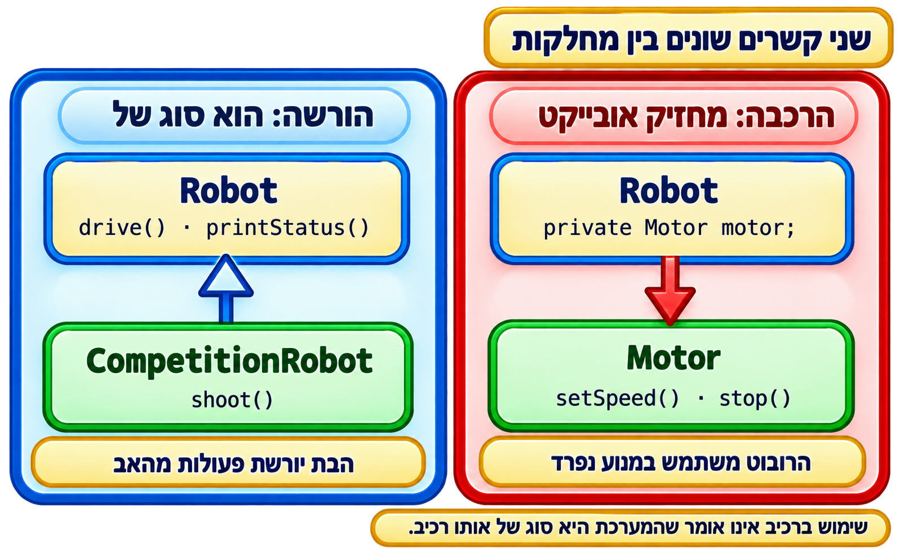
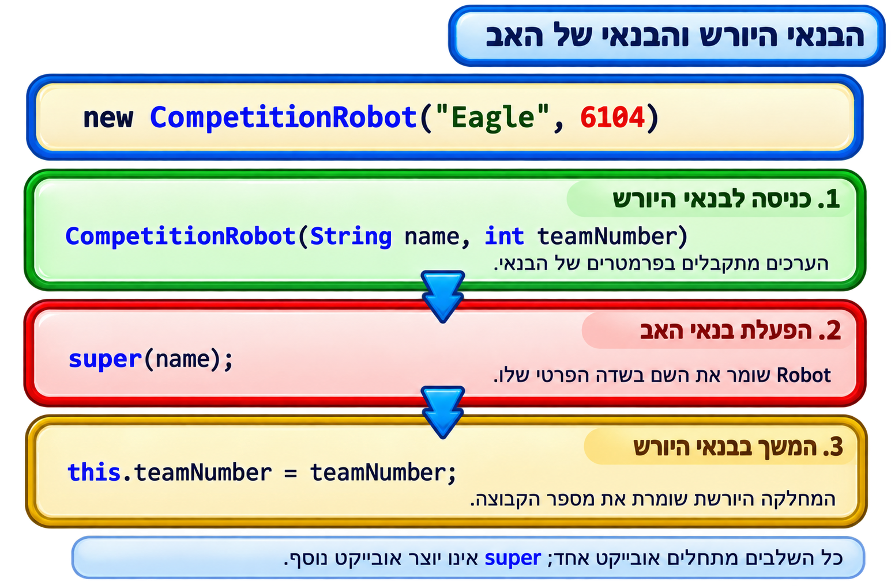

import ExerciseHelp from '@site/src/components/ExerciseHelp';

כבר למדנו לבנות מחלקות עם שדות, מתודות ובנאים, ולחבר ביניהן. עכשיו נלמד איך להגדיר **סוג מיוחד של מחלקה קיימת**.

**בסוף השיעור תוכלו לכתוב מחלקה יורשת, לאתחל אותה ולהוסיף או להתאים פעולות.** פתרו את התרגילים בזמן הקריאה, לא רק בסוף.

:::info[אותה סביבת עבודה, מודל נוסף]
המשיכו באותו פרויקט Java. בתוך `src` צרו תיקייה בשם `inheritance`. כל מחלקה בשיעור תהיה בקובץ משלה בתיקייה הזאת, עם `package inheritance;` בשורה הראשונה, כפי שעשינו עם חבילת `mechanisms` בתרגיל המסכם.

כך נשמור את הרובוט והמנוע שכבר בנינו, ונוכל להתמקד כאן במודל שמדפיס טקסט. צרו גם `src/inheritance/Main.java` עם אותה מעטפת `public class Main` ו־`public static void main(String[] args)` שאתם מכירים. הריצו באמצעות Run מעל `main` בקובץ הזה; בבחירת מחלקה בחרו `inheritance.Main`.

המתודות כאן מדפיסות בלבד ואינן מפעילות חומרה. הקבצים בחבילות האחרות נשארים זמינים להרצה בנפרד.
:::

## 1. מתי הורשה מתאימה?

נרצה לייצג רובוט רגיל וגם רובוט תחרותי. לשניהם יש שם ופעולת נסיעה. לרובוט התחרותי יש גם מספר קבוצה ופעולת ירי.

אפשר להעתיק את השם והנסיעה לשתי מחלקות, אבל אז צריך לעדכן שני מקומות כשמשנים את ההתנהגות המשותפת.

**הורשה (Inheritance) מאפשרת להגדיר מחלקה שמתבססת על מחלקה אחרת.** בדוגמה שלנו, `CompetitionRobot` הוא סוג של `Robot`.

זה קשר שונה מהקשר שבנינו בפרויקט הקודם: רובוט **מחזיק** מנוע, אבל הוא אינו סוג של מנוע.



### תרגיל 1: הוא סוג של, או מחזיק?

לכל זוג, קבעו אם מתאים קשר הורשה או שדה שמחזיק אובייקט. הסבירו במילים:

1. רובוט תחרותי ורובוט.
2. רובוט ומנוע.
3. מערכת קליטה וחיישן.
4. תלמיד ותלמיד בבית ספר.

בסעיף האחרון, האם באמת צריך שתי מחלקות שונות בתוכנית, או שהשמות מתארים את אותו רעיון? לא כל ניסוח מצדיק הורשה.

<ExerciseHelp
  hints={["השלימו משפט: ״א הוא סוג של ב״ או ״א משתמש בב״.", "מערכת שמשתמשת ברכיב אינה בהכרח סוג של אותו רכיב. גם קשר מילולי לא מחייב שתי מחלקות."]}
  solution={`1. בדוגמה שלנו: CompetitionRobot הוא סוג של Robot, ולכן הורשה מתאימה.
2. Robot מחזיק Motor; מתאים שדה מסוג Motor, לא extends Motor.
3. מערכת קליטה משתמשת בחיישן; מתאים שדה מסוג Sensor.
4. בלי הבדל ממשי בדרישות, אפשר להסתפק במחלקה Student אחת.`}
  solutionLanguage="text"
  multipleSolutions={true}
/>

## 2. מחלקת הבסיס

צרו `Robot.java`:

```java
package inheritance;

public class Robot {
    private String name;

    public Robot(String name) {
        this.name = name;
    }

    public String getName() {
        return name;
    }

    public void drive() {
        System.out.println("Driving: " + name);
    }

    public void printStatus() {
        System.out.println("Robot: " + name);
    }
}
```

זו מחלקה רגילה, עם שדה פרטי ומתודות ציבוריות. בתוך `main` אפשר להשתמש בה כך:

```java
Robot robot = new Robot("Eagle");
robot.drive();
robot.printStatus();
```

הפלט:

```text
Driving: Eagle
Robot: Eagle
```

## 3. extends: הגדרת המחלקה היורשת

צרו `CompetitionRobot.java`:

```java
package inheritance;

public class CompetitionRobot extends Robot {
    public CompetitionRobot(String name) {
        super(name);
    }

    public void shoot() {
        System.out.println("Shooting: " + getName());
    }
}
```

`extends Robot` אומר ש־`CompetitionRobot` יורשת מ־`Robot`. ל־`Robot` נקרא **מחלקת בסיס או אב**, ול־`CompetitionRobot` **מחלקה יורשת או בת**.

הבנאי כאן כולל שורה חדשה, `super(name)`. כרגע מספיק לדעת שהיא מעבירה את השם לבנאי של `Robot`; מיד נפרק את התהליך.

בתוך `main`:

```java
CompetitionRobot robot = new CompetitionRobot("Eagle");
robot.drive();
robot.shoot();
```

הפלט:

```text
Driving: Eagle
Shooting: Eagle
```

לא כתבנו `drive` בתוך `CompetitionRobot`: המתודה הציבורית זמינה באמצעות ההורשה. `shoot` היא פעולה חדשה שהוספנו במחלקה היורשת.

**יוצרים אובייקט אחד מסוג `CompetitionRobot`.** ההורשה אינה יוצרת בתוכו אובייקט `Robot` נפרד כמו השדה `Motor` מהפרויקט הקודם.

### תרגיל 2: מה יודפס?

השתמשו בגרסאות המחלקות הנוכחיות:

```java
CompetitionRobot first = new CompetitionRobot("Eagle");
CompetitionRobot second = new CompetitionRobot("Falcon");
first.drive();
second.shoot();
first.printStatus();
```

כתבו את הפלט והסבירו באיזו מחלקה הוגדרה כל מתודה.

<ExerciseHelp
  hints={["drive ו־printStatus לא הוגדרו מחדש במחלקה היורשת.", "עקבו גם אחרי האובייקט שנבחר לפני הנקודה: לכל אחד שם משלו."]}
  solution={`Driving: Eagle
Shooting: Falcon
Robot: Eagle

drive ו־printStatus הוגדרו ב־Robot; shoot הוגדרה ב־CompetitionRobot.`}
  solutionLanguage="text"
/>

## 4. בנאים ו־super

בנאים **אינם עוברים בירושה**. המחלקה היורשת מגדירה בנאים משלה, והם משתמשים בבנאי של מחלקת האב כדי לאתחל את המידע שהאב אחראי עליו.

נוסיף מספר קבוצה ונעדכן את הבנאי ב־`CompetitionRobot`. החליפו את הבנאי הקודם; השאירו את `shoot`:

```java
private int teamNumber;

public CompetitionRobot(String name, int teamNumber) {
    super(name);
    this.teamNumber = teamNumber;
}
```

ועכשיו יוצרים כך:

```java
CompetitionRobot robot = new CompetitionRobot("Eagle", 6104);
```

`super(name)` מפעיל את הבנאי `Robot(String name)` על אותו אובייקט שנמצא בתהליך יצירה. אחרי שהוא מסתיים, ממשיכים לשמירת מספר הקבוצה.



בדוגמאות שלנו נכתוב את `super(...)` בתחילת הבנאי. בפרויקט ההכשרה ב־Java 17 זו חייבת להיות ההוראה הראשונה בבנאי. הקריאה אינה יצירת אובייקט נוסף ואינה קריאה למתודה רגילה בשם `Robot`.

אם לא כותבים קריאה מפורשת, Java מנסה לקרוא ל־`super()` ללא פרמטרים. ב־`Robot` שלנו **אין בנאי ללא פרמטרים**, ולכן כאן צריך `super(name)`.

### תרגיל 3: מה לא נכון בבנאי?

```java
public CompetitionRobot(String name, int teamNumber) {
    this.teamNumber = teamNumber;
}
```

למה הקוד לא מתקמפל עם `Robot` שלנו? תקנו אותו בלי לשנות את מחלקת האב.

<ExerciseHelp
  hints={["איזה בנאי Java תנסה להפעיל אם לא כתבתם super במפורש?", "Robot דורשת String בבנאי; בבנאי היורש כבר קיבלנו שם שאפשר להעביר."]}
  solution={`public CompetitionRobot(String name, int teamNumber) {
    super(name);
    this.teamNumber = teamNumber;
}`}
  solutionLanguage="java"
/>

## 5. private נשאר private

ב־`Robot` השדה `name` פרטי. המחלקה היורשת אינה יכולה לגשת אליו ישירות:

```java
// דוגמה שגויה בתוך CompetitionRobot
System.out.println(name);
```

אבל היא יכולה להשתמש במתודה הציבורית `getName()`. השם עדיין נשמר באובייקט, והקוד של `Robot` מנהל את הגישה אליו.

אין צורך להוסיף עוד שדה `name` למחלקה היורשת: זה ייצור מידע נוסף שעלול להתנתק מהשם שהאב שומר.

:::note[ומה עם protected?]
`protected` היא הרשאה שמאפשרת גישה גם למחלקות יורשות וגם למחלקות באותה חבילה. כרגע אין צורך להשתמש בה: נשאיר את השדות `private` ונשתמש בפעולות שהאב חושף.
:::

### תרגיל 4: מה לא נכון בפעולה החדשה?

בתוך `CompetitionRobot` נכתב:

```java
public void celebrate() {
    System.out.println("Winner: " + name);
}
```

תקנו בלי לשנות את ההרשאה של `name` ובלי להוסיף שדה נוסף.

<ExerciseHelp
  hints={["איזו מתודה ציבורית של האב כבר מחזירה את השם?", "המתודה הזאת זמינה גם מתוך המחלקה היורשת."]}
  solution={`public void celebrate() {
    System.out.println("Winner: " + getName());
}`}
  solutionLanguage="java"
/>

## 6. דריסת מתודה: מתאימים פעולה קיימת

נרצה ש־`printStatus()` ברובוט תחרותי תציג גם את מספר הקבוצה. אפשר **לדרוס (Override)** מתודה שהתקבלה מהאב: להגדיר במחלקה היורשת מתודה עם אותה חתימה.

הוסיפו ל־`CompetitionRobot`:

```java
@Override
public void printStatus() {
    super.printStatus();
    System.out.println("Team: " + teamNumber);
}
```

`@Override` מבקשת מהקומפיילר לבדוק שזו אכן דריסה של מתודה קיימת. אם נטעה בשם או בפרמטרים, נקבל שגיאה במקום ליצור בטעות פעולה אחרת.

`super.printStatus()` מפעיל את המימוש של האב. אחריו אנחנו מוסיפים את המידע המיוחד למחלקה היורשת. זו קריאה למתודה, בשונה מ־`super(name)` שמפעילה בנאי.

כשקוראים:

```java
CompetitionRobot robot = new CompetitionRobot("Eagle", 6104);
robot.printStatus();
```

מקבלים:

```text
Robot: Eagle
Team: 6104
```

אם לא נקרא ל־`super.printStatus()`, המימוש שלנו יחליף את הדפסת האב בלי להריץ אותה אוטומטית. בשיעור הבא נראה איך בחירת המתודה פועלת גם דרך משתנה מטיפוס האב.

### תרגיל 5: האם זו דריסה?

```java
@Override
public void printStatus(String title) {
    System.out.println(title);
}
```

ב־`Robot` קיימת רק `public void printStatus()` ללא פרמטרים. למה יש שגיאה? תקנו כך שהמתודה תדרוס את הפעולה הקיימת ותדפיס שם ומספר קבוצה.

<ExerciseHelp
  hints={["השוו לא רק את השם, אלא גם את רשימת הפרמטרים.", "מתודה עם פרמטר נוסף אינה דריסה של המתודה ללא פרמטרים."]}
  solution={`@Override
public void printStatus() {
    super.printStatus();
    System.out.println("Team: " + teamNumber);
}
// בלי @Override, printStatus(String title) יכולה להיות מתודה נוספת,
// אבל היא עדיין לא תדרוס את printStatus() של האב.`}
  solutionLanguage="java"
/>

### תרגיל 6: הקריאה נכנסת ללולאה

```java
@Override
public void printStatus() {
    printStatus();
    System.out.println("Team: " + teamNumber);
}
```

הקוד מתקמפל, אבל הקריאה למתודה נכשלת בזמן ריצה. למה? תקנו כך שההדפסה של האב תתבצע פעם אחת.

<ExerciseHelp
  hints={["בתוך המתודה הזאת, לאיזו מתודה תפנה printStatus() בלי super?", "המתודה קוראת לעצמה שוב ושוב. צריך לבחור במפורש את מימוש האב."]}
  solution={`@Override
public void printStatus() {
    super.printStatus();
    System.out.println("Team: " + teamNumber);
}
// הקריאה העצמית בגרסה השגויה גורמת בסופו של דבר ל־StackOverflowError.`}
  solutionLanguage="java"
/>

## 7. תרגול עצמאי: מחברים הכול

כתבו את `CompetitionRobot` המלאה לפי הדרישות:

1. יורשת מ־`Robot` ושומרת שדה פרטי `int teamNumber`.
2. הבנאי מקבל שם ומספר קבוצה, ומאתחל גם את החלק של האב.
3. `shoot()` מדפיסה `Shooting: ` ואחריו את השם.
4. `printStatus()` דורסת את פעולת האב ומדפיסה גם שם וגם מספר קבוצה.
5. ב־`Main`, צרו שני רובוטים תחרותיים עם שמות ומספרי קבוצה שונים. הפעילו `drive`, `shoot` ו־`printStatus` ובדקו שכל אובייקט מציג את המידע שלו.

`Robot.java` נשאר כפי שהוגדר בתחילת השיעור. עדכנו את כל הקריאות הישנות לבנאי היורש כך שיכללו גם מספר קבוצה.

<ExerciseHelp
  hints={["כתבו קודם בנאי ובדקו את האתחול, ורק אחר כך הוסיפו את הפעולות.", "אל תעתיקו את name ואת drive למחלקה היורשת. השתמשו במה שכבר מוגדר באב.", "getName נותנת גישה לשם; super.printStatus מפעילה את הדפסת האב."]}
  solution={`package inheritance;

public class CompetitionRobot extends Robot {
    private int teamNumber;

    public CompetitionRobot(String name, int teamNumber) {
        super(name);
        this.teamNumber = teamNumber;
    }

    public void shoot() {
        System.out.println("Shooting: " + getName());
    }

    @Override
    public void printStatus() {
        super.printStatus();
        System.out.println("Team: " + teamNumber);
    }
}

// Main.java - קובץ נפרד
package inheritance;

public class Main {
    public static void main(String[] args) {
        CompetitionRobot first = new CompetitionRobot("Eagle", 6104);
        CompetitionRobot second = new CompetitionRobot("Falcon", 1234);
        first.drive();
        first.shoot();
        first.printStatus();
        second.drive();
        second.shoot();
        second.printStatus();
    }
}`}
  solutionLanguage="java"
  multipleSolutions={true}
/>

## בדיקת סיום

צרו `TrainingRobot` שיורשת מ־`Robot`:

- הבנאי יקבל שם ויעביר אותו לבנאי האב.
- `printStatus()` תפעיל קודם את הדפסת האב ואחריה תדפיס `Mode: training`.
- ב־`Main` צרו אובייקט, הפעילו עליו `drive()` ו־`printStatus()`.

הסבירו למה לא צריך להגדיר שוב את השדה `name` או את המתודה `drive`. מה ההבדל בין `super(name)` לבין `super.printStatus()`?

שמרו את `Robot`, את `CompetitionRobot` ואת `TrainingRobot`. הן יהיו הבסיס לשיעור הפולימורפיזם.

<ExerciseHelp
  hints={[
    "השתמשו ב־extends Robot כדי לרשת מהמחלקה Robot.",
    "הבנאי של המחלקה היורשת צריך לקרוא ל־super(name) כפעולה הראשונה שלו.",
    "השתמשו ב־@Override וב־super.printStatus() כדי להוסיף הדפסה בלי לשכפל את הקוד של האב."
  ]}
  solution={`// TrainingRobot.java
public class TrainingRobot extends Robot {

    public TrainingRobot(String name) {
        super(name);
    }

    @Override
    public void printStatus() {
        super.printStatus();
        System.out.println("Mode: training");
    }
}

// בתוך Main
TrainingRobot robot = new TrainingRobot("Eagle");
robot.drive();
robot.printStatus();

// TrainingRobot יורשת את drive מ־Robot.
// השדה name כבר מוגדר במחלקת האב,
// ואין צורך להגדיר אותו מחדש.

// super(name) קורא לבנאי של Robot.
// super.printStatus() קורא למתודה של Robot.`}
  solutionLanguage="java"
  multipleSolutions={true}
/>