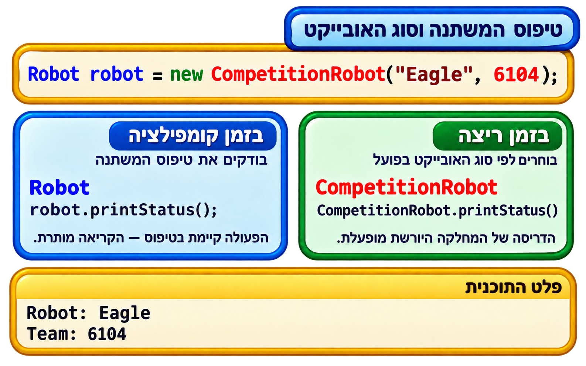

import ExerciseHelp from '@site/src/components/ExerciseHelp';

בשיעור ההורשה יצרנו מחלקות שמתבססות על `Robot` ודרסנו את `printStatus()`. עכשיו נלמד להשתמש באובייקטים מהמחלקות האלה דרך הטיפוס המשותף `Robot`.

**בסוף השיעור תוכלו להסביר אילו פעולות מותר לקרוא דרך משתנה, ואיזה מימוש ירוץ בפועל.**

## 1. המחלקות שעליהן עובדים

המשיכו באותו פרויקט Java, בתוך `src/inheritance`. כל קובץ חדש מתחיל ב־`package inheritance;`; מריצים את `inheritance.Main`. השתמשו בגרסה הסופית של `CompetitionRobot`, עם שם ומספר קבוצה, וב־`TrainingRobot` מבדיקת הסיום. כאן הגרסה של `TrainingRobot` לצורך בדיקת הפרויקט:

```java
package inheritance;

public class TrainingRobot extends Robot {
    public TrainingRobot(String name) {
        super(name);
    }

    @Override
    public void printStatus() {
        super.printStatus();
        System.out.println("Mode: training");
    }
}
```

`Robot` מגדירה `getName()`, `drive()` ו־`printStatus()`. `CompetitionRobot` מוסיפה `shoot()` ודורסת `printStatus()`. גם `TrainingRobot` דורסת `printStatus()`, אבל מדפיסה מידע אחר.

## 2. טיפוס המשתנה וסוג האובייקט

עד עכשיו יצרנו כך:

```java
CompetitionRobot robot = new CompetitionRobot("Eagle", 6104);
```

אפשר גם לכתוב:

```java
Robot robot = new CompetitionRobot("Eagle", 6104);
```

השורה תקינה כי `CompetitionRobot` היא סוג של `Robot`.

| מה בודקים? | בשורה הזאת |
| --- | --- |
| מהו טיפוס המשתנה? | `Robot`, כפי שהוכרז בצד שמאל |
| מאיזו מחלקה נוצר האובייקט? | `CompetitionRobot`, כפי שכתוב אחרי `new` |
| כמה אובייקטים נוצרו? | אחד |

האובייקט **לא הפך לרובוט רגיל** ולא הועתק לאובייקט חדש. המשתנה מחזיק הפניה לאותו רובוט תחרותי שנוצר.



## 3. שאלה ראשונה: האם מותר לקרוא למתודה?

הקומפיילר בודק את טיפוס המשתנה. דרך משתנה שהוכרז `Robot` אפשר לקרוא לפעולות הזמינות בטיפוס `Robot`:

```java
Robot robot = new CompetitionRobot("Eagle", 6104);
robot.drive();
robot.printStatus();
System.out.println(robot.getName());
```

אבל הקריאה הזאת לא תתקמפל:

```java
// דוגמה שגויה: shoot אינה מוגדרת ב־Robot
robot.shoot();
```

זה נכון גם כשהאובייקט הוא רובוט תחרותי. המשתנה הוכרז `Robot`, והטיפוס הזה אינו מבטיח פעולת `shoot()`.

אם צריך להשתמש בפעולה הייחודית, אפשר לבחור מראש משתנה מהטיפוס המתאים:

```java
CompetitionRobot competition = new CompetitionRobot("Eagle", 6104);
competition.shoot();
```

אין צורך כרגע בהמרות טיפוס או ב־`instanceof` כדי להבין את הרעיון.

### תרגיל 1: מה מתקמפל?

אחרי `Robot robot = new CompetitionRobot("Eagle", 6104);`, בדקו כל שורה בנפרד:

```java
robot.drive();
robot.printStatus();
robot.shoot();
System.out.println(robot.getName());
```

אל תנסו עדיין לנבא איזה טקסט יודפס; קודם בדקו אם מותר לקרוא לפעולה דרך טיפוס המשתנה.

<ExerciseHelp
  hints={["הסתכלו על Robot בצד שמאל, ולא רק על CompetitionRobot בצד ימין.", "אילו מתודות קיימות ב־Robot?"]}
  solution={`robot.drive();                         // תקין
robot.printStatus();                   // תקין
// robot.shoot();                      // לא מתקמפל דרך משתנה Robot
System.out.println(robot.getName());   // תקין`}
  solutionLanguage="java"
/>

## 4. שאלה שנייה: איזה מימוש ירוץ?

אחרי שהקריאה נמצאה תקינה, Java בוחרת בזמן ריצה את המימוש של **מתודת האובייקט** לפי המחלקה של האובייקט בפועל.

```java
Robot robot = new CompetitionRobot("Eagle", 6104);
robot.printStatus();
```

למרות שטיפוס המשתנה הוא `Robot`, המתודה שנבחרת היא `CompetitionRobot.printStatus()`. היא קוראת למימוש האב ואז מדפיסה את מספר הקבוצה:

```text
Robot: Eagle
Team: 6104
```

לעומת זאת, `robot.drive()` משתמשת במימוש של `Robot`, כי `CompetitionRobot` לא דרסה את הפעולה הזאת.

**פולימורפיזם (Polymorphism)** מאפשר להשתמש בטיפוס משותף, כאשר אובייקטים שונים מספקים מימושים שונים לאותה פעולה.

:::note שני כללים שצריך להפריד
**טיפוס המשתנה** קובע אילו קריאות זמינות בקוד. **סוג האובייקט בפועל** קובע איזה מימוש של מתודה שנדרסה ירוץ.

בשיעור הזה עובדים עם מתודות רגילות של אובייקטים. אל תיישמו את כלל בחירת המימוש הזה אוטומטית על שדות או על מתודות `static`.
:::

### תרגיל 2: מה יודפס?

```java
Robot first = new Robot("Basic");
Robot second = new CompetitionRobot("Eagle", 6104);
Robot third = new TrainingRobot("Practice");

first.printStatus();
second.printStatus();
third.printStatus();
```

לשלושת המשתנים אותו טיפוס. למה הפלט אינו באותו מבנה?

<ExerciseHelp
  hints={["לכל קריאה בדקו איזו מחלקה מופיעה בביטוי new שיצר את האובייקט.", "כל אחת מהמחלקות היורשות קוראת קודם ל־super.printStatus() ומוסיפה שורה משלה."]}
  solution={`Robot: Basic
Robot: Eagle
Team: 6104
Robot: Practice
Mode: training`}
  solutionLanguage="text"
/>

### תרגיל 3: מה לא נכון בהסבר?

תלמיד טוען:

> ״כתוב `Robot` בתחילת השורה, אז Java תמיד תפעיל את `Robot.printStatus()`, ולא את הדריסה.״

השתמשו בדוגמה של `second` מהתרגיל הקודם כדי להסביר מה הוא ערבב בין שני הכללים.

<ExerciseHelp
  hints={["Robot בצד שמאל חשוב, אבל לא לצורך כל החלטה.", "הפרידו בין בדיקת קיומה של הפעולה לבין בחירת המימוש."]}
  solution={`Robot הוא טיפוס המשתנה, ולכן הקומפיילר בודק שיש בו printStatus().
האובייקט בפועל הוא CompetitionRobot, ולכן בזמן ריצה נבחרת הדריסה שלו.
מתוך הדריסה, super.printStatus() קוראת במפורש למימוש האב.`}
  solutionLanguage="text"
/>

## 5. אותו אובייקט דרך שני משתנים

```java
CompetitionRobot competition = new CompetitionRobot("Eagle", 6104);
Robot robot = competition;
```

נוצר כאן **אובייקט אחד בלבד**: יש רק קריאה אחת ל־`new`. שני המשתנים מפנים אליו, אך הוכרזו בטיפוסים שונים.

`competition.shoot()` תקין. `robot.shoot()` לא מתקמפל. לעומת זאת, גם `competition.printStatus()` וגם `robot.printStatus()` מפעילות את הדריסה של אותו אובייקט.

### תרגיל 4: האם זו המרה שמותרת אוטומטית?

בדקו כל שורה בנפרד:

```java
Robot first = new CompetitionRobot("Eagle", 6104);
CompetitionRobot second = new Robot("Basic");
```

איזו שורה תקינה? למה הקשר אינו עובד אוטומטית בשני הכיוונים?

<ExerciseHelp
  hints={["כל רובוט תחרותי בדוגמה הוא Robot. האם כל Robot הוא בהכרח רובוט תחרותי?", "ב־new Robot(\"Basic\") נוצר אובייקט שאין לו בהכרח המאפיינים והפעולות של CompetitionRobot."]}
  solution={`Robot first = new CompetitionRobot("Eagle", 6104); // תקין
// CompetitionRobot second = new Robot("Basic");  // לא מתקמפל

// אם רוצים רובוט תחרותי, יוצרים אובייקט מהמחלקה המתאימה:
CompetitionRobot second = new CompetitionRobot("Falcon", 1234);`}
  solutionLanguage="java"
/>

## 6. למה זה שימושי? מתודה אחת לכמה סוגים

נרצה להדפיס מידע על כל רובוט בלי לכתוב מתודת הדפסה נפרדת לכל מחלקה.

ב־`Main`, **מחוץ ל־`main` אבל בתוך המחלקה**, אפשר להוסיף:

```java
public static void showRobot(Robot robot) {
    robot.printStatus();
}
```

זו מתודת עזר רגילה שמקבלת פרמטר מטיפוס `Robot`. היא `static` כדי שנוכל לקרוא לה ישירות מתוך `main`, כמו במתודות העזר שכבר למדנו. המתודה `printStatus()` שאנחנו מפעילים בתוכה היא עדיין מתודה של אובייקט.

בתוך `main`:

```java
Robot basic = new Robot("Basic");
CompetitionRobot competition = new CompetitionRobot("Eagle", 6104);
TrainingRobot training = new TrainingRobot("Practice");

showRobot(basic);
showRobot(competition);
showRobot(training);
```

אין בתוך `showRobot` תנאי ששואל ״האם זה רובוט תחרותי?״. היא משתמשת בפעולה המשותפת, וכל אובייקט מספק את המימוש שלו.

### תרגיל 5: למה הקוד הזה לא מתקמפל?

```java
public static void showRobot(Robot robot) {
    robot.printStatus();
    robot.shoot();
}
```

מישהו מסביר: ״אבל אני שולח למתודה רק `CompetitionRobot`, אז זה צריך לעבוד.״ הסבירו למה הטענה לא מספיקה ותקנו את המתודה כך שתתאים לכל `Robot`.

<ExerciseHelp
  hints={["הקומפיילר בודק את גוף המתודה לפי טיפוס הפרמטר שהוגדר בה.", "המתודה מבטיחה לקבל Robot כלשהו, כולל כזה שאינו יודע לירות."]}
  solution={`public static void showRobot(Robot robot) {
    robot.printStatus();
}
// הפרמטר הוא Robot. אי אפשר לקרוא דרכו ל־shoot שאינה מוגדרת בטיפוס הזה.`}
  solutionLanguage="java"
/>

## 7. תרגול עצמאי: תוכנית משותפת

השתמשו בשלוש המחלקות ששמרתם:

1. ב־`Main` כתבו `showRobot(Robot robot)` כפי שהוצג.
2. צרו אובייקט מכל סוג וקראו ל־`showRobot` עבור כל אחד.
3. הוסיפו מתודת עזר `testDrive(Robot robot)` שקוראת ל־`drive()` ואז ל־`printStatus()`.
4. הפעילו אותה על רובוט תחרותי ועל רובוט אימונים.
5. כתבו את הפלט הצפוי לפני ההרצה והסבירו למה `drive` משותפת, אבל `printStatus` שונה.

אין צורך להוסיף `if`, המרות טיפוס או מתודות חדשות במחלקות הרובוטים.

<ExerciseHelp
  hints={["העבודה החדשה נמצאת ב־Main; המחלקות כבר מגדירות את ההתנהגות הדרושה.", "בשתי מתודות העזר הפרמטר יכול להיות Robot, כי שתי הפעולות קיימות בטיפוס הזה.", "הדריסה נבחרת גם כשהקריאה נמצאת בתוך מתודה שקיבלה פרמטר מהטיפוס המשותף."]}
  solution={`// Main.java - לצד Robot, CompetitionRobot ו־TrainingRobot
package inheritance;

public class Main {
    public static void main(String[] args) {
        Robot basic = new Robot("Basic");
        CompetitionRobot competition = new CompetitionRobot("Eagle", 6104);
        TrainingRobot training = new TrainingRobot("Practice");

        showRobot(basic);
        showRobot(competition);
        showRobot(training);
        testDrive(competition);
        testDrive(training);
    }

    public static void showRobot(Robot robot) {
        robot.printStatus();
    }

    public static void testDrive(Robot robot) {
        robot.drive();
        robot.printStatus();
    }
}`}
  solutionLanguage="java"
  multipleSolutions={true}
/>

הפלט הצפוי לתוכנית הזאת:

```text
Robot: Basic
Robot: Eagle
Team: 6104
Robot: Practice
Mode: training
Driving: Eagle
Robot: Eagle
Team: 6104
Driving: Practice
Robot: Practice
Mode: training
```

## בדיקת סיום

צרו `InspectionRobot` שיורשת מ־`Robot`. היא תקבל שם בבנאי ותדרוס `printStatus()` כך שתדפיס את הדפסת האב ואחריה `Mode: inspection`.

שלחו אובייקט שלה ל־`showRobot` הקיימת, **בלי לשנות את `showRobot`**. בדקו שהשורה החדשה מודפסת.

לאחר מכן הסבירו את השורה:

```java
Robot robot = new InspectionRobot("Check");
```

- מהו טיפוס המשתנה?
- מאיזו מחלקה נוצר האובייקט?
- למה מותר לקרוא ל־`printStatus()`?
- איזה מימוש של המתודה יופעל?
- האם נוצר כאן אובייקט אחד או שניים?

<ExerciseHelp
  hints={[
    "InspectionRobot יורשת מ־Robot, בדיוק כמו המחלקות היורשות שבניתם קודם.",
    "השתמשו ב־@Override וב־super.printStatus() כדי להוסיף את השורה החדשה.",
    "showRobot מקבלת Robot, ולכן היא יכולה לקבל גם אובייקט ממחלקה שיורשת ממנו.",
    "בקריאה למתודה שנדרסה, Java מפעילה את המימוש של מחלקת האובייקט בפועל."
  ]}
  solution={`// InspectionRobot.java
public class InspectionRobot extends Robot {

    public InspectionRobot(String name) {
        super(name);
    }

    @Override
    public void printStatus() {
        super.printStatus();
        System.out.println("Mode: inspection");
    }
}

// בתוך Main
InspectionRobot inspection = new InspectionRobot("Check");
showRobot(inspection);

// אין צורך לשנות את showRobot.

// הסבר:
// Robot הוא טיפוס המשתנה.
// InspectionRobot היא המחלקה שממנה נוצר האובייקט.
// מותר לקרוא ל־printStatus כי היא קיימת ב־Robot.
// בפועל יופעל המימוש של InspectionRobot.
// נוצר אובייקט אחד של InspectionRobot,
// ולא אובייקט נוסף של Robot.`}
  solutionLanguage="java"
  multipleSolutions={true}
/>