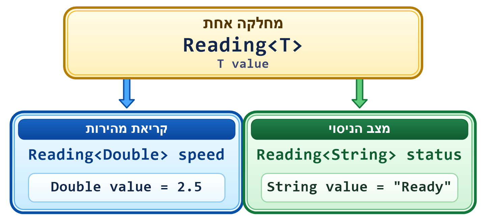

import ExerciseHelp from '@site/src/components/ExerciseHelp';
import LessonVideos from '@site/src/components/LessonVideos';

<LessonVideos
  english={{href: "https://www.youtube.com/watch?v=H9vc4gTtGGA", channel: "Bro Code"}}
/>

## 1. למה צריך מחלקה גנרית?

נניח שאנחנו כותבים תוכנית שמתעדת תוצאות מניסוי. כל קריאה שומרת ערך אחד, ואפשר לקרוא אותו בהמשך דרך `getValue()`. מהירות נרצה לשמור כמספר עשרוני (`double`), למשל `2.5` מטר לשנייה, ואת מצב הניסוי נרצה לשמור כטקסט (`String`), למשל `"Ready"`. כך נוכל לחשב ממוצע מהירויות ולהציג את מצב הניסוי במילים.

אם נקבע את טיפוס השדה (סוג הנתון שהוא שומר) בתוך המחלקה, נצטרך מחלקה לכל סוג נתון שנרצה לשמור. כך ייראו המחלקות לקריאת מהירות ולקריאת מצב הניסוי.

```java
class SpeedReading {
    private final double value;

    public SpeedReading(double value) {
        this.value = value;
    }

    public double getValue() {
        return value;
    }
}

class StatusReading {
    private final String value;

    public StatusReading(String value) {
        this.value = value;
    }

    public String getValue() {
        return value;
    }
}
```

בשתי המחלקות הבנאי שומר את הערך באותה דרך, ו־`getValue()` מחזירה אותו באותה דרך. אם נרצה לשמור גם תוצאה של בדיקה כ־`boolean`, נצטרך לשכפל את המבנה פעם שלישית. אם נוסיף לכל קריאה שדה של תאריך המדידה, נצטרך לעדכן את שלוש המחלקות.

### תרגיל 1 - מה משתנה בין המחלקות?

דמיינו שאתם מוסיפים מחלקה בשם `TargetReading` ששומרת אם המצלמה זיהתה מטרה (`boolean`). סמנו בדוגמה את שלושת המקומות שבהם תצטרכו לכתוב `boolean`. אילו שורות יישארו זהות גם במחלקה החדשה?

<ExerciseHelp
  hints={["עקבו אחרי הערך מהפרמטר בבנאי, דרך השדה, ועד לתוצאה של getValue()."]}
  solution="boolean יופיע בטיפוס של השדה, בטיפוס הפרמטר של הבנאי ובטיפוס ההחזרה של getValue(). השורות this.value = value ו־return value יישארו זהות."
  solutionLanguage="text"
/>

## 2. בוחרים את טיפוס השדה כשיוצרים אובייקט

בשיעור על משתנים ראינו שלמשתנה יש **שם**, **טיפוס (סוג)** ו**ערך**. כשכותבים `double speed = 2.5;`, השם הוא `speed`, הטיפוס הוא `double` והערך הוא `2.5`.

גם שדה הוא משתנה. במחלקה רגילה כמו `SpeedReading`, לכל אובייקט יש עותק משלו של `value`, ולכן אובייקט אחד יכול לשמור `2.5` ואחר יכול לשמור `3.0`. הטיפוס של השדה נקבע במחלקה, אז בשני האובייקטים הוא `double`.

במחלקה גנרית נשאיר גם את **הבחירה בטיפוס** פתוחה. נכתוב את המחלקה פעם אחת, ונשתמש בשם `T` במקום הטיפוס הקבוע. כשיוצרים קריאה, בוחרים איזה טיפוס ישמש בתור `T` ומעבירים לבנאי ערך שמתאים לו. כך אובייקט אחד יכול לשמור טקסט ואובייקט אחר מאותה מחלקה יכול לשמור מספר. הבחירה קובעת את טיפוס השדה עבור אותה קריאה לאורך השימוש בה.



בסוגריים הזוויתיים כותבים טיפוס של אובייקט. לכן לקריאת המהירות נבחר במחלקה `Double`, שעוטפת ערך מסוג `double`. בדוגמה הבאה נוסיף גם קריאת זמן באלפיות שנייה ונבחר ב־`Integer`, שעוטפת ערך מסוג `int`. כשנעביר לבנאי את `2.5` או את `1200`, Java תעטוף את המספר אוטומטית בטיפוס המתאים.

## 3. מממשים את המחלקה ומשתמשים בה

באותו פרויקט Java, צרו את התיקייה `src/generics` ואת הקובץ `Reading.java` בתוכה.

```java
package generics;

public class Reading<T> {
    private final T value;

    public Reading(T value) {
        this.value = value;
    }

    public T getValue() {
        return value;
    }
}
```

הסימון `<T>` אחרי שם המחלקה מגדיר **פרמטר של טיפוס**. אותה בחירה ב־`T` חלה על שלושת המקומות שמצאתם בתרגיל הראשון. למשל, עבור `Reading<String>` הבנאי מקבל `String`, השדה שומר `String` ו־`getValue()` מחזירה `String`.

באותה תיקייה צרו את `GenericsDemo.java`. לחצו על Run מעל `main`. הפלט יהיה `Ready`, אחריו `2.5` ואז `1200`, כל אחד בשורה משלו.

```java
package generics;

public class GenericsDemo {
    public static void main(String[] args) {
        Reading<String> status = new Reading<String>("Ready");
        Reading<Double> speed = new Reading<Double>(2.5);
        Reading<Integer> elapsed = new Reading<Integer>(1200);

        String message = status.getValue();
        Double metersPerSecond = speed.getValue();
        Integer milliseconds = elapsed.getValue();

        System.out.println(message);
        System.out.println(metersPerSecond);
        System.out.println(milliseconds);
    }
}
```

בצד שמאל, `Reading<Double> speed` מגדיר את טיפוס המשתנה. בצד ימין, `new Reading<Double>(2.5)` יוצר את האובייקט. בתוך `<>` מופיע טיפוס השדה ובתוך `()` מופיע הערך שיישמר בו. אפשר לקצר ל־`new Reading<>(2.5)`, כי Java מסיקה את הטיפוס מההכרזה על המשתנה.

### תרגיל 2 - בודקים התאמה בין טיפוס לערך

הוסיפו ל־`main` קריאת מהירות נוספת ששומרת `3.0` והדפיסו את שתי המהירויות. אחר כך נסו כל אחת מהשורות הבאות בנפרד. לפני שתריצו, הסבירו איזה טיפוס Java מצפה לקבל ואיזה טיפוס ניתן בפועל. תקנו את השורות כך שהזמן יישאר מספר שלם והמהירות תישאר מספר עשרוני.

```java
Reading<Integer> lapTime = new Reading<>("850");
Integer currentSpeed = speed.getValue();
```

<ExerciseHelp
  hints={["ערך במירכאות הוא String.", "הטיפוס בתוך Reading קובע גם את טיפוס ההחזרה של getValue()."]}
  solution={`Reading<Double> secondSpeed = new Reading<>(3.0);
System.out.println(speed.getValue());
System.out.println(secondSpeed.getValue());
Reading<Integer> lapTime = new Reading<>(850);
Double currentSpeed = speed.getValue();`}
  solutionLanguage="java"
/>

## 4. מגבילים את בחירת הטיפוס {/* #type-bounds */}

נרצה לחשב ממוצע של שתי מדידות מאותו טיפוס. כדי לחלק ולקבל תוצאה עשרונית, צריך להמיר כל ערך ל־`double`. בתוך `Reading<T>` הקומפיילר יודע רק שהערך הוא מטיפוס `T`. גם `String` מותר כאן, ולכן Java לא מאפשרת לקרוא ל־`doubleValue()` על הערך.

בשיעור על הורשה ראינו שמחלקה יורשת מקבלת פעולות ממחלקת הבסיס שלה. `Integer` ו־`Double` שתיהן יורשות מ־`Number`, שמגדירה את המתודה `doubleValue()`. כשכותבים `T extends Number`, Java מאפשרת לבחור ב־`Number` או במחלקה שיורשת ממנה. כך הקומפיילר יודע שלכל ערך מטיפוס `T` יש את המתודה הזאת.

צרו קובץ נוסף בשם `NumericReading.java` באותה תיקייה. `NumericReading<T>` יורשת מ־`Reading<T>`, כך שהיא משתמשת בבנאי של מחלקת הבסיס לשמירת הערך וב־`getValue()` לקריאתו.

```java
package generics;

public class NumericReading<T extends Number> extends Reading<T> {
    public NumericReading(T value) {
        super(value);
    }

    public double averageWith(NumericReading<T> other) {
        return (getValue().doubleValue() + other.getValue().doubleValue()) / 2.0;
    }
}
```

למילה `extends` יש כאן שני תפקידים. בתוך הסוגריים הזוויתיים היא מגבילה את הבחירה ב־`T` למשפחת `Number`. אחרי הסוגריים היא מציינת ש־`NumericReading` יורשת מ־`Reading` ומשתמשת באותה בחירה של `T`. הפרמטר `other` משתמש גם הוא באותו `T`, ולכן קריאת זמן שנוצרה כ־`NumericReading<Integer>` תוכל לקבל ב־`averageWith()` קריאה נוספת מסוג `NumericReading<Integer>`.

הוסיפו את השורות הבאות ל־`main` והריצו. הממוצע שיודפס הוא `1200.5` אלפיות שנייה.

```java
NumericReading<Integer> firstTime = new NumericReading<>(1000);
NumericReading<Integer> secondTime = new NumericReading<>(1401);
System.out.println(firstTime.averageWith(secondTime));
```

### תרגיל 3 - מחשבים ממוצע מהירויות

1. צרו שתי קריאות `NumericReading` למהירויות `2.5` ו־`3.0` מטר לשנייה. השתמשו ב־`averageWith()` כדי להדפיס את הממוצע, ובדקו שקיבלתם `2.75`.
2. נסו ליצור `NumericReading<String>` עם הערך `"Ready"`. קראו את הודעת הקומפיילר והסבירו איזו מגבלה הופרה. תקנו את השורה כך שהטקסט יישמר בקריאה שמתאימה לו.

<ExerciseHelp
  hints={["למהירות עשרונית בחרו ב־Double. בדקו איזו מחלקה עדיין מקבלת String."]}
  solution={`NumericReading<Double> firstSpeed = new NumericReading<>(2.5);
NumericReading<Double> secondSpeed = new NumericReading<>(3.0);
System.out.println(firstSpeed.averageWith(secondSpeed)); // 2.75
Reading<String> experimentStatus = new Reading<>("Ready");`}
  solutionLanguage="java"
/>

הקומפיילר דוחה את `NumericReading<String>` כי `String` לא יורשת מ־`Number`. ב־`Reading<String>` הבחירה ב־`String` תקינה, ולכן אפשר להשתמש באותה מחלקת בסיס גם לקריאות טקסט וגם לקריאות מספריות.
