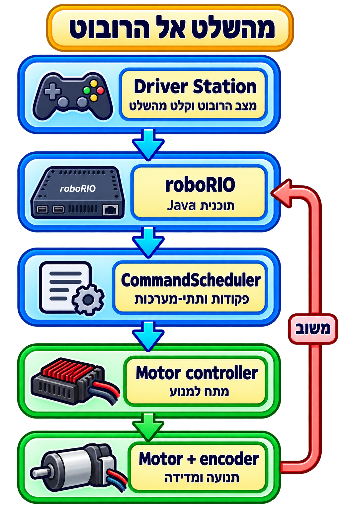

לפני שנכתוב התנהגות משלנו, נכיר את חלוקת האחריות בתוכנית: מי מקבלת קלט, מי מחליטה מה לבצע ומי שולחת בקשות למנועים. הגרפיקה מציגה את הקשר בין החלקים; אחריה נפתח את הקוד ונראה איך הוא רץ.

## מתחילים מהכניסה לתוכנית

הגרפיקה מציגה את חלוקת האחריות. עכשיו נעקוב אחרי מה שקורה בפועל, מהפעלת התוכנית ועד לתנועה של מנוע. נתחיל במקום שכבר מוכר משיעורי Java: `main`.

פתחו **View → Explorer**, הרחיבו `src/main/java/frc/robot`, ופתחו את `Main.java`. אפשר גם ללחוץ Ctrl + P ולהקליד את שם הקובץ.

| קובץ                   | השאלה שנענה עליה                                |
| ---------------------- | ----------------------------------------------- |
| `Main.java`            | מאיפה התוכנית מתחילה?                           |
| `Robot.java`           | מי קורא למתודות ומתי, ואיך העבודה חוזרת?        |
| `RobotContainer.java`  | איפה יוצרים את המערכות ומחברים את השלט?         |
| תת־מערכת שנוסיף        | איך שולחים בקשה למנוע ורואים תנועה?             |
| פקודות וחיבורי כפתורים | איך מפעילים ועוצרים פעולה בזמן שהתוכנית ממשיכה? |

אין צורך להבין עכשיו את כל הקבצים בפרויקט. המשיכו ל[מ־Main לתוכנית שנשארת פעילה](./02-robot-lifecycle.mdx), והשאירו את העורך פתוח כדי לעקוב בקוד.
