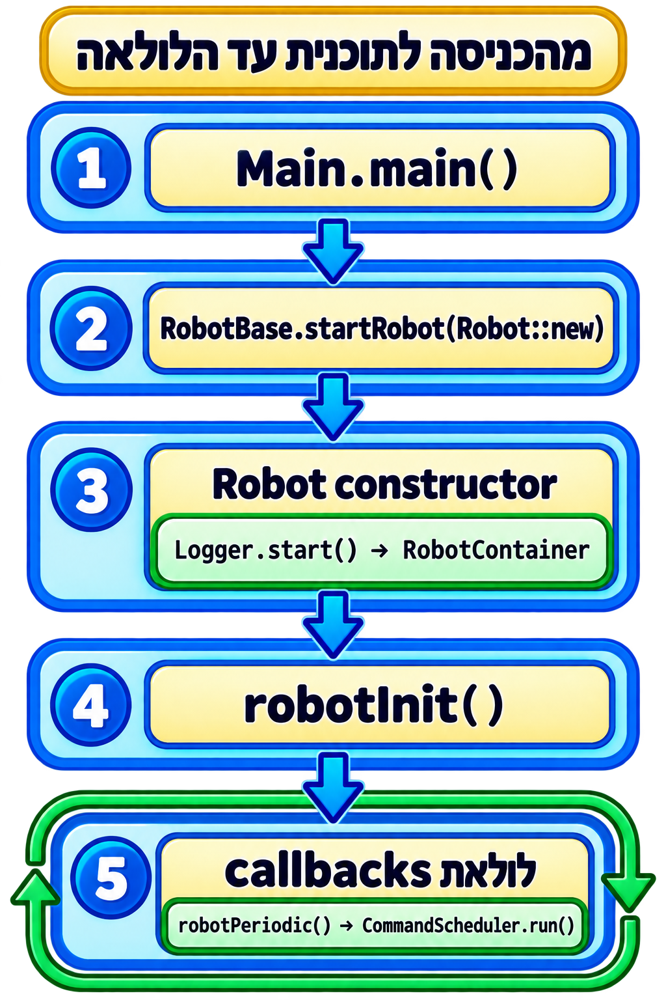

import ExerciseHelp from "@site/src/components/ExerciseHelp";

בתוכנית Java רגילה קראתם למתודות מתוך `main`. גם כאן יש `main`, אבל הוא מוסר את ניהול הריצה למסגרת. **לא נכתוב בתוכו לולאת נהיגה משלנו.**

## 1. הכניסה לתוכנית

הקוד הקיים ב־`Main.java`:

```java
public static void main(String... args) {
    RobotBase.startRobot(Robot::new);
}
```

`Robot::new` נותן למסגרת דרך ליצור `Robot`. זו הפניה לבנאי, לא קריאה למתזמן. המסגרת מכינה את סביבת הרובוט ומפעילה את תהליך הריצה של האובייקט שנוצר.



## 2. מה נוצר ומתי?

בתבנית `Robot extends LoggedRobot`. `LoggedRobot` של AdvantageKit מנהלת לולאת callbacks ותיעוד. בדוגמאות FRC רבות רואים `TimedRobot`: גם היא מציעה callbacks דומים ולולאה מחזורית, אבל **התבנית שלנו אינה מכריזה extends TimedRobot**, ואין להחליף את מחלקת האב.

בבנאי `Robot` נרשמים פרטי הבנייה, מתווספים מקבלי לוג, מתבצעת `Logger.start()`, ורק אחריה `RobotContainer.getInstance()`. בתוך ה־container נוצרים המערכות והמצב המשותף. הסדר חשוב: יצירת מערכות לפני הפעלת logger משנה את האתחול שעליו הקוד נשען.

אחרי הבנייה `RobotBase.startRobot` מפעילה את `startCompetition()` של הרובוט. המימוש ב־`LoggedRobot` מפעיל `robotInit()` פעם אחת, ואז `simulationInit()` אם זו סימולציה. לאחר מכן הוא קורא שוב ושוב ל־`loopFunc()` שירש מ־`IterativeRobotBase`; שם נבחרים callbacks לפי מצב Driver Station. גם `TimedRobot` מתבססת על `IterativeRobotBase`, אבל בתבנית משתמשים בלולאת `LoggedRobot`. כאן מאותחלים בחירת אוטונומי, bindings וכלים נוספים. אחר כך מתחילה הריצה המחזורית. `robotPeriodic()` מופעלת בכל מצב, והיא זו שקוראת למתזמן.

## 3. ניסוי: בנאי לעומת callback

בסימולציה בלבד הוסיפו `System.out.println("Training: constructor");` בסוף הבנאי, והדפסה `Training: robotInit` בסוף `robotInit()`. הפעילו מחדש, עברו מ־Disabled ל־Teleop וחזרה, ואז הפעילו מחדש פעם נוספת. נבאו מראש כמה פעמים כל שורה תופיע.

### מה לא נכון פה?

תלמיד כותב ״כל Enable יוצר Robot חדש״. איזו תצפית מפריכה את הטענה?

<ExerciseHelp
  hints={[
    "השוו מעבר מצב להפעלה מחדש של התהליך.",
    "בנאי פועל בעת new, לא בגלל שינוי מצב של Driver Station.",
  ]}
  solution={
    "באותו תהליך ההדפסות של הבנאי ושל robotInit מופיעות פעם אחת. Enable מפעיל מעבר מצב, למשל teleopInit, ולא יוצר Robot נוסף. הפעלה מחדש של הסימולציה יוצרת אובייקט חדש ומריצה שוב את האתחול."
  }
  solutionLanguage="text"
/>

## בדיקת סיום

ציירו חצים מ־Main אל יצירת Robot, אל אתחול container, אל callbacks ואל מתזמן. ציינו ליד כל חץ מי מבצע את הקריאה. הסירו הדפסות ניסוי מיותרות וקראו את ה־diff לפני commit.
