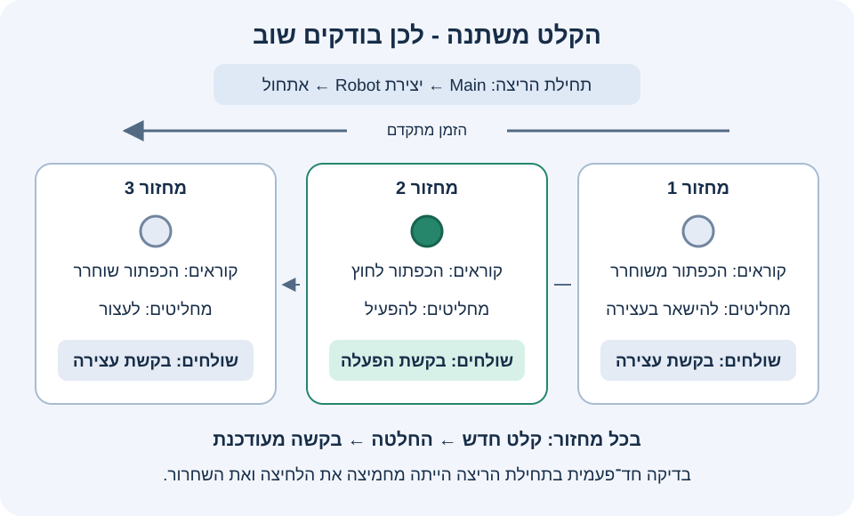

import ExerciseHelp from "@site/src/components/ExerciseHelp";

## מפת הפרויקט: מתחילים בשני קבצים

פתחו **View → Explorer** והרחיבו `src/main/java/frc/robot`. בשיעור הזה נכיר שני קבצים, לפי סדר הריצה:

| קובץ         | מה נלמד בו?                                           |
| ------------ | ----------------------------------------------------- |
| `Main.java`  | מאיפה התוכנית מתחילה?                                 |
| `Robot.java` | איך התוכנית נשארת פעילה ומי קורא למתודות בזמן המתאים? |

את שאר הקבצים נכיר כשנצטרך אותם בהמשך ההכשרה.

## הכניסה לתוכנית

פתחו ב־VS Code את `src/main/java/frc/robot/Main.java`: לחצו Ctrl + P והקלידו `Main.java`. מצאו את המתודה שכבר הכרתם בשיעורי Java:

```java
public static void main(String... args) {
    RobotBase.startRobot(Robot::new);
}
```

**גם תוכנת הרובוט מתחילה ב־main.** עד עכשיו קראתם מתוכה למתודות ובחרתם מה יקרה ובאיזה סדר. כאן `RobotBase.startRobot(Robot::new);` מתחילה את תוכנת הרובוט ומשאירה למסגרת הרובוט את ניהול הריצה. `Robot::new` נותנת לה דרך ליצור אובייקט מהמחלקה `Robot`. אין צורך ללמוד עכשיו את התחביר הזה או לשנות את Main.

## למה התוכנית צריכה לחזור על העבודה?

דמיינו שבתחילת ההרצה הנהג אינו נוגע בשלט. רגע אחר כך הוא לוחץ על כפתור, ואז משחרר. אם התוכנה תבדוק את השלט רק בתחילת ההרצה, היא לא תדע על הלחיצה או על השחרור. גם המנוע ממשיך לנוע והמדידות שלו משתנות בזמן שהתוכנית פועלת.

לכן צריך **לבדוק שוב מה השתנה, להחליט מה לעשות ולשלוח פקודות מעודכנות**. אחר כך עושים זאת שוב. החזרה הזאת נקראת **מחזור ריצה, או LOOP**. עוד לא צריך לדעת לכתוב לולאות ב־Java: מסגרת הרובוט כבר דואגת לחזרה בשבילנו.



למשל: במחזור אחד הכפתור משוחרר; במחזור הבא הוא לחוץ והמנוע מקבל בקשת הפעלה; בהמשך מזהים שחרור ושולחים בקשת עצירה. כך התוכנית מגיבה לשינוי בזמן שהיא ממשיכה לפעול.

בריצה רגילה המחזור חוזר בערך כל **20 מילישניות - כ־50 פעמים בשנייה**. התוכנית נשארת פעילה עד שמפסיקים אותה או מכבים את המחשב שמריץ אותה. מה קרה בסימולציה הקודמת כשבחרתם Disabled: האם התוכנית נסגרה, או שרק נמנעה הפעלת המנועים?

<ExerciseHelp
  hints={["האם הנתונים והחלון המשיכו להתעדכן?"]}
  solution="התוכנית לא נסגרה. Disabled מונע הפעלת מנועים, אך התוכנית ממשיכה לרוץ ולעדכן מידע. סגירת ההרצה היא פעולה נפרדת."
  solutionLanguage="text"
/>

## נכנסים ל־Robot.java

פתחו את `Robot.java`, שנמצאת ליד Main. חפשו:

```java
public class Robot extends LoggedRobot {
```

`LoggedRobot` היא מחלקת הבסיס בתבנית שלנו. היא והתשתית שעליה היא בנויה דואגות לתזמון. אנחנו כותבים עבודה בתוך מתודות של `Robot`, והמסגרת קוראת להן בזמן המתאים. למתודה שמסגרת קוראת לה כך קוראים גם **callback**.

| איפה מסתכלים?       | מתי הקוד מתבצע?                | מה קורה בתבנית?                                  |
| ------------------- | ------------------------------ | ------------------------------------------------ |
| הבנאי `Robot()`     | פעם אחת ביצירת האובייקט        | מתחיל רישום נתונים, ואז יוצר את `RobotContainer` |
| `robotInit()`       | פעם אחת בתחילת הריצה           | הכנות נוספות לתוכנית                             |
| `robotPeriodic()`   | בכל מחזור, בכל מצב             | מפעילה את המתזמן ומעדכנת מידע                    |
| מתודות של מצב מסוים | בכניסה למצב או במהלך העבודה בו | נבדוק אותן בשיעור הבא                            |

`RobotContainer` מחזיקה את המערכות ואת חיבורי השלט. היא נוצרת פעם אחת; לא יוצרים מנוע או Robot חדש בכל מחזור. בתבנית מתחילים את רישום הנתונים עם `Logger.start()` לפני יצירת ה־container. השאירו את סדר האתחול הקיים.

## תרגול: התחלה חדשה או מעבר מצב?

בסימולציה בלבד, הוסיפו בסוף הבנאי `Robot()`:

```java
System.out.println("Training: Robot created");
```

ובסוף `robotInit()`:

```java
System.out.println("Training: robotInit");
```

השאירו את הקוד הקיים. שמרו והפעילו סימולציה באמצעות F5. פתחו את טרמינל ההרצה דרך **View → Terminal**.

לפני כל שלב כתבו תחזית: אילו משתי ההודעות יופיעו, באיזה סדר וכמה פעמים? אחריו רשמו מה ראיתם בפועל.

1. התחילו את הסימולציה וחפשו את שתי ההודעות בטרמינל.
2. עברו מ־Disabled ל־Teleop וחזרה.
3. סגרו את הסימולציה והפעילו מחדש.

<ExerciseHelp
  hints={[
    "הבנאי ו־robotInit שייכים להתחלת התוכנית. האם מעבר מצב יוצר תוכנית חדשה?",
    "השוו בין מעבר ל־Teleop לבין סגירה והפעלה מחדש של הסימולציה.",
  ]}
  solutionLanguage="text"
  solution={
    "בתחילת כל הרצה מופיעה Training: Robot created פעם אחת, ואחריה Training: robotInit פעם אחת. במעבר Disabled → Teleop → Disabled אף אחת משתי ההודעות אינה מופיעה שוב. אחרי סגירת הסימולציה והפעלה מחדש שתיהן מופיעות שוב, פעם אחת ובאותו סדר. אם הודעה חוזרת בכל מחזור, בדקו שלא הוספתם אותה בטעות למתודת periodic; אם הסדר שונה, בדקו שהשורות נמצאות במתודות שהתבקשו."
  }
/>

## הסבירו ובדקו את עצמכם

מה Main מתחילה, ולמה תוכנת רובוט צריכה לחזור ולבדוק קלט? כתבו תשובה לפני פתיחת הפתרון.

<ExerciseHelp
  hints={[
    "מה עושה RobotBase.startRobot, ומי מנהלת את הריצה אחר כך?",
    "מה יקרה אם הנהג ילחץ על כפתור רק אחרי הבדיקה הראשונה, או ישחרר אותו אחרי שהמנוע התחיל לפעול?",
  ]}
  solutionLanguage="text"
  solution={
    "Main מפעילה את תוכנת הרובוט באמצעות RobotBase.startRobot(Robot::new). מסגרת הרובוט יוצרת את Robot ומנהלת את הקריאות למתודות בזמן המתאים. בדיקת קלט אחת אינה מספיקה: השלט והמדידות משתנים במהלך הריצה. לכן בכל מחזור קוראים קלט ומדידות מחדש, מחליטים ושולחים בקשות מעודכנות למנועים. למשל, מזהים לחיצה ומבקשים הפעלה, ובהמשך מזהים שחרור ומבקשים עצירה. בדקו שהתשובה שלכם מסבירה גם מי מנהלת את הריצה וגם למה צריך לבדוק שינויים שוב ושוב."
  }
/>
