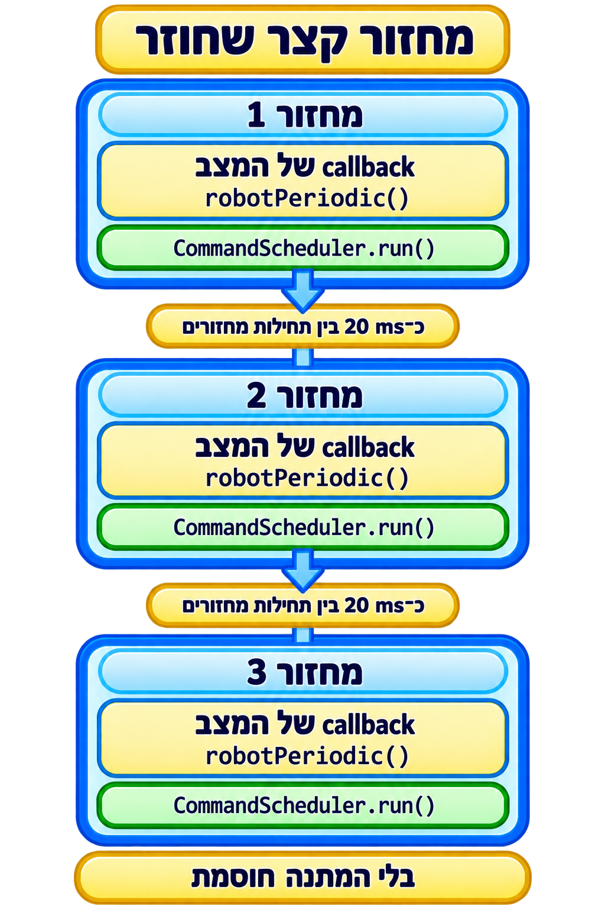

import ExerciseHelp from "@site/src/components/ExerciseHelp";

## 1. ארבעת מצבי הרובוט

הרובוט יכול להיות דלוק והתוכנית יכולה לרוץ גם כשהמנועים אינם מורשים לפעול. המצב שמתקבל מה־Driver Station קובע איזו עבודה התוכנית צריכה לבצע עכשיו:

| מצב                       | מתי הוא פעיל ברובוט?                                                   | מה עושים בו?                                                                                            |
| ------------------------- | ---------------------------------------------------------------------- | ------------------------------------------------------------------------------------------------------- |
| **Disabled - מושבת**      | לפני שמאפשרים לרובוט לפעול, בין קטעי הפעלה ולאחר לחיצה על Disable      | התוכנית ממשיכה לקרוא מדידות ולעדכן מידע, אבל אין אישור להפעיל מנועים. אפשר להכין בחירת פעולה אוטונומית. |
| **Autonomous - אוטונומי** | בקטע האוטונומי של המשחק, או כשבוחרים Autonomous ומפעילים Enable באימון | הרובוט מבצע פעולה שהתוכנית קבעה מראש, בלי שהנהג יכוון אותו בשלט.                                        |
| **Teleop - שליטת נהג**    | בקטע הנהיגה של המשחק, או כשבוחרים Teleop ומפעילים Enable באימון        | התוכנית קוראת את השלט ומפעילה את הרובוט לפי בקשות הנהג.                                                 |
| **Test - בדיקה**          | באימון או בתחזוקה, כשבוחרים Test ומפעילים Enable                       | מפעילים בדיקות ייעודיות שהוכנו בקוד כדי לבדוק חלק מסוים ברובוט. זה אינו שלב רגיל במשחק.                     |

בחירת Teleop, Autonomous או Test כשהרובוט עדיין Disabled אינה מפעילה אותם: רק לאחר Enable נכנסים למצב שנבחר. בתחרות מערכת המגרש מנהלת את המעבר בין חלקי המשחק.

## 2. לכל מצב: כניסה, עבודה חוזרת ויציאה

פתחו `Robot.java`. לכל אחד מארבעת המצבים יש שלוש מתודות שהמסגרת קוראת להן:

- **Init - כניסה:** נקראת פעם אחת בכל כניסה למצב. מתאימה להכנות שצריך לבצע בתחילתו.
- **Periodic - עבודה מחזורית:** נקראת שוב ושוב כל עוד נמצאים במצב, בדרך כלל בערך כל 20 מילישניות. מתאימה לעדכונים קצרים שחוזרים.
- **Exit - יציאה:** נקראת פעם אחת כשעוזבים את המצב, לפני הכניסה למצב הבא. מתאימה לסיום או לניקוי שקשורים למצב שעוזבים.

| מצב        | בכניסה             | בכל מחזור במצב         | ביציאה             |
| ---------- | ------------------ | ---------------------- | ------------------ |
| Disabled   | `disabledInit()`   | `disabledPeriodic()`   | `disabledExit()`   |
| Autonomous | `autonomousInit()` | `autonomousPeriodic()` | `autonomousExit()` |
| Teleop     | `teleopInit()`     | `teleopPeriodic()`     | `teleopExit()`     |
| Test       | `testInit()`       | `testPeriodic()`       | `testExit()`       |

למשל, כשעוברים מ־Disabled ל־Teleop, נקראת `disabledExit()`, אחריה `teleopInit()`, ואז `teleopPeriodic()` חוזרת בכל מחזור. כשחוזרים ל־Disabled, נקראת `teleopExit()`, אחריה `disabledInit()`, ואז חוזרות הקריאות ל־`disabledPeriodic()`.

אין צורך לקרוא למתודות האלה בעצמכם: המסגרת קוראת להן לפי מצב הרובוט. אם מתודה אינה מופיעה בתבנית, אפשר להוסיף אותה כשצריכים התנהגות עבורה. **`robotInit()` שייכת לתחילת התוכנית כולה; `teleopInit()` שייכת לכל כניסה ל־Teleop.** מעבר מצב אינו הפעלה מחדש של התוכנית.

## 3. ניסוי: מזהים כניסה למצב

ב־`Robot.java` מצאו באמצעות Ctrl + F את ארבע מתודות ה־Init של המצבים. הוסיפו לכל אחת את השורה המתאימה **בתוך המתודה, לפני הסוגר המסיים**, בלי למחוק את הקוד הקיים:

| מתודה              | השורה שמוסיפים                           |
| ------------------ | ---------------------------------------- |
| `disabledInit()`   | `System.out.println("disabled init");`   |
| `autonomousInit()` | `System.out.println("autonomous init");` |
| `teleopInit()`     | `System.out.println("teleop init");`     |
| `testInit()`       | `System.out.println("test init");`       |

שמרו והפעילו את הסימולציה. לפני כל מעבר כתבו איזו הודעה לדעתכם תופיע בטרמינל ההרצה, ואז תעדו את התוצאה:

1. התחילו הרצה חדשה ב־Disabled.
2. בחרו Teleop ולחצו Enable. המתינו כמה שניות.
3. לחצו Disable.
4. בחרו Autonomous ולחצו Enable. השתמשו בברירת המחדל `Stay in place`.
5. לחצו Disable.
6. בחרו Teleop ולחצו Enable.
7. לחצו Disable.
8. בחרו Test ולחצו Enable. אין צורך להפעיל מנגנון.
9. לחצו Disable.

השוו רק את ארבע ההודעות שהוספתם; ייתכנו בטרמינל גם הודעות אחרות מהתוכנית.

<ExerciseHelp
  hints={[
    "איזו מתודת Init שייכת למצב שאליו נכנסים בכל שלב?",
    "המתנה באותו מצב אינה כניסה נוספת אליו. חזרה ל־Disabled היא כן כניסה נוספת.",
  ]}
  solutionLanguage="text"
  solution={`רצף ההודעות של הניסוי צריך להיות:

\`\`\`text
disabled init
teleop init
disabled init
autonomous init
disabled init
teleop init
disabled init
test init
disabled init
\`\`\`

כל שורה מופיעה פעם אחת בכניסה המתאימה. בזמן ההמתנה ב־Teleop לא מתווספות הודעות teleop init. אם אותה הודעה מופיעה במצבים שונים, בדקו שהעתקתם לכל מתודה את הטקסט המתאים. אם הודעה חוזרת ללא מעבר מצב, בדקו שלא שמתם אותה במתודת Periodic.`}
/>

## 4. robotPeriodic: עבודה משותפת לכל המצבים

לצד ה־Periodic של המצב הפעיל, המסגרת קוראת גם ל־`robotPeriodic()` **בכל מחזור, בכל ארבעת המצבים**, כולל Disabled. כאן שמים עבודה שצריכה להמשיך בלי קשר למצב, למשל עדכון מידע.

בתבנית שלנו תמצאו בתוכה את השורה:

```java
CommandScheduler.getInstance().run();
```

`CommandScheduler` הוא **המתזמן**: הוא מעדכן את המערכות ומריץ את הפקודות הפעילות. `getInstance()` מחזירה את אובייקט המתזמן, ו־`run()` מבצעת את עבודתו במחזור הנוכחי. בהמשך נכיר מערכות ופקודות כשנכתוב אותן; כרגע מספיק להבין שהקריאה הזאת מאפשרת לעבודה שלהן להתקדם בכל מחזור.

לכן `teleopPeriodic()` יכולה להיות ריקה ובכל זאת הנהיגה עובדת: `robotPeriodic()` מפעילה את המתזמן, והוא ממשיך את הפעולות שהוגדרו. גם `autonomousPeriodic()` אינה חייבת להכיל את התנועה עצמה. ב־Disabled עדכוני המידע ממשיכים, אבל אין אישור להפעיל מנועים.



השאירו את שורת המתזמן ואת שאר הקריאות הקיימות ב־`robotPeriodic()` כפי שהן. בכל מחזור מבצעים עבודה קצרה ומסיימים כדי לאפשר למחזור הבא להגיע עם קלט ומדידות מעודכנים.

### תרגול: רואים שהמחזורים ממשיכים

בתוך מחלקת `Robot`, באזור השדות ולפני הבנאי, הוסיפו:

```java
private int trainingTicks = 0;
```

בסוף `robotPeriodic()`, בלי למחוק אף קריאה קיימת, הוסיפו:

```java
trainingTicks = trainingTicks + 1;
if (trainingTicks >= 50) {
    System.out.println("Training: another 50 updates");
    trainingTicks = 0;
}
```

המסגרת קוראת למתודה שוב ושוב. בכל קריאה מוסיפים אחד למונה; אחרי 50 קריאות מדפיסים ומאפסים אותו. השדה נמצא מחוץ למתודה כדי לשמור את הספירה בין הקריאות.

שמרו והחילו את השינוי דרך הברק בהרצת Debug. אם הוספתם שדה והעדכון אינו נתמך, הפעילו מחדש את הסימולציה. הישארו Disabled כמה שניות, עברו ל־Teleop עם Enable, חזרו ל־Disabled, ולבסוף הפסיקו את התוכנית. כתבו מתי הודעת המונה מופיעה והאם היא ממשיכה בכל אחד מהמצבים.

<ExerciseHelp
  hints={[
    "robotPeriodic נקראת גם כשאין אישור להפעיל מנועים.",
    "50 מחזורים של כ־20 מילישניות הם בערך שנייה אחת.",
  ]}
  solutionLanguage="text"
  solution={
    "ההודעה Training: another 50 updates מופיעה בערך פעם בשנייה, גם ב־Disabled וגם ב־Teleop. במעבר ל־Teleop מתווספת teleop init פעם אחת, ובחזרה ל־Disabled מתווספת disabled init פעם אחת. המונה ממשיך בין המצבים ואינו מתאפס במעבר; הוא מתאפס אחרי כל 50 קריאות. כשהתוכנית נעצרת ההודעות מפסיקות. אם המונה אינו מגיע ל־50, בדקו שלא הגדרתם אותו מחדש בתוך המתודה. אם אין הודעות, בדקו שהקוד נמצא ב־robotPeriodic ושהרצתם את הבנייה החדשה."
  }
/>

### תרגול המשך: משנים את הזמן בין ההודעות

1. שנו את התנאי מ־`trainingTicks >= 50` ל־`trainingTicks >= 250`, ואת טקסט ההודעה ל־`Training: another 250 updates`. השאירו את הגדלת המונה ואת האיפוס כפי שהם.
2. לפני ההרצה כתבו תחזית: כמה זמן יעבור בין שתי הדפסות? הפעילו מחדש את הסימולציה, מדדו את הזמן בין כמה הודעות ובדקו אם הוא מתאים לתחזית.
3. חזרו על הניסוי עם `500` בתנאי ועם ההודעה `Training: another 500 updates`. כתבו תחזית לפני ההרצה והשוו למדידה.

הסבירו: למה שינוי הסף משנה את הזמן בין ההודעות? האם `robotPeriodic()` עצמה נקראת עכשיו פחות פעמים בשנייה, או שרק ההדפסה מתרחשת פחות פעמים? איזה סף יגרום להדפסה בערך כל 5 שניות?

<ExerciseHelp
  hints={[
    "המסגרת עדיין קוראת ל־robotPeriodic בערך 50 פעמים בשנייה. כמה שניות צריך כדי לצבור 250 קריאות?",
    "הזמן בין ההודעות בשניות הוא בערך מספר המחזורים שמחכים להם חלקי 50.",
  ]}
  solutionLanguage="text"
  solution={
    "בסף 250 ההודעה מופיעה בערך כל 5 שניות: $\\frac{250}{50} = 5$. בסף 500 היא מופיעה בערך כל 10 שניות: $\\frac{500}{50} = 10$. robotPeriodic ממשיכה להיקרא בערך כל 20 מילישניות, והמונה עדיין גדל בכל קריאה. שינינו רק כמה קריאות צוברים לפני ההדפסה והאיפוס, ולכן שאר העבודה במתודה ממשיכה באותו קצב. כדי להדפיס בערך כל 5 שניות משתמשים בסף 250. המדידה יכולה לסטות מעט כי תזמון המחזורים הוא בקירוב."
  }
/>

### מה לא נכון פה?

תלמיד רוצה להדפיס הודעה **פעם אחת בכל כניסה ל־Teleop**. הוא כתב:

```java
public void teleopPeriodic() {
    System.out.println("teleop started");
}
```

האם הקוד ישיג את המטרה? הסבירו מה יופיע בטרמינל וכיצד תתקנו אותו. זו דוגמה לקריאה בלבד; אין להחליף בה את הקוד הקיים בפרויקט.

<ExerciseHelp
  hints={[
    "כמה פעמים נקראת teleopPeriodic כשנשארים ב־Teleop כמה שניות?",
    "איזו מתודה נקראת פעם אחת בכל כניסה ל־Teleop?",
  ]}
  solutionLanguage="text"
  solution={
    'ההודעה תודפס שוב ושוב, בערך 50 פעמים בשנייה בזמן Teleop, כי היא נמצאת ב־teleopPeriodic. כדי להדפיס פעם אחת בכל כניסה ל־Teleop, מוסיפים את System.out.println("teleop started"); בתוך teleopInit הקיימת, בלי למחוק את שאר הקוד שלה.'
  }
/>

## בדיקת סיום

הסבירו: מה ההבדל בין `teleopInit()`, `teleopPeriodic()`, `teleopExit()` ו־`robotPeriodic()`? למה התוכנית עדיין מעדכנת מידע ב־Disabled?

<ExerciseHelp
  solutionLanguage="text"
  solution={
    "teleopInit נקראת פעם אחת בכניסה ל־Teleop; teleopPeriodic חוזרת בכל מחזור כל עוד Teleop פעיל; teleopExit נקראת פעם אחת כשעוזבים אותו. robotPeriodic חוזרת בכל מחזור בכל המצבים. Disabled מונע הפעלת מנועים, אבל אינו סוגר את התוכנית, ולכן קריאת מדידות ועדכון מידע יכולים להמשיך."
  }
/>

בסיום הסירו את שדה המונה ואת ההדפסות שהוספתם במהלך התרגול.
