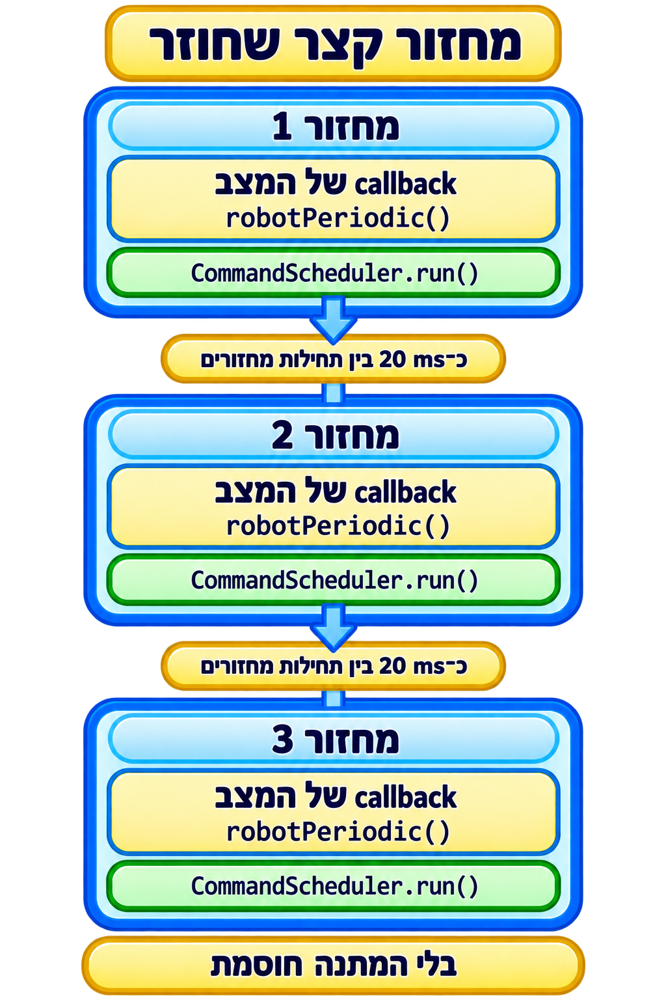

import ExerciseHelp from "@site/src/components/ExerciseHelp";

הרובוט צריך להגיב לשלט, לחיישנים ולבקשת Disable תוך כדי עבודה. לכן הוא מבצע בכל מחזור עבודה קצרה וחוזר למחזור הבא. התקופה הרגילה היא כ־**20 מילישניות**, כלומר כ־50 מחזורים בשנייה; זה יעד תזמון, לא הבטחה שכל פעולה תימשך בדיוק אותו זמן.



### מתזמן — מה זה לפני שקוראים את השם הארוך?

**המתזמן (CommandScheduler)** הוא האובייקט שעובר בכל מחזור על המערכות והפעולות הפעילות. הוא מזמין עדכון מדידות, בודק קלט ומפעיל פקודות. הוא אינו יוצר מנוע בכל מחזור ואינו קורא שוב לבנאי Robot.

**תת־מערכת (subsystem)** היא אובייקט שמייצג חלק של הרובוט, למשל מערכת הנהיגה. **פקודה (command)** היא פעולה שמשתמשת במערכת, למשל נהיגה לפי השלט. נבנה את הרעיונות האלה בפועל בהמשך; כרגע מספיק להבחין בין האובייקט לבין הפעולה שלו.

**VirtualSubsystem** היא מחלקת בסיס למערכות שבתבנית מעדכנים דרך רשימה נפרדת. בשם הזה תראו כאן את עיבוד הראייה. **bindings** הם חיבורים בין קלט לבין פעולות; אין צורך להוסיף אותם בניסוי המונה.

## 1. הסדר בתוך הקוד שלנו

ב־`Robot.robotPeriodic()` הסדר בפועל הוא:

1. `CommandScheduler.getInstance().run()` — עדכון תתי־מערכות רשומות, קריאת טריגרים והרצת פקודות.
2. עדכון מהירויות ב־`robotState2026`.
3. `VirtualSubsystem.runAllPeriodic()` — בין השאר עיבוד ראייה.
4. העברת מדידות ראייה ממתינות ל־swerve.
5. `Logger.runEveryN(4, ...logTelemetry)` ועדכון bindings.

ב־Disabled המתזמן ממשיך לעדכן תתי־מערכות; פקודות רגילות שאינן מותרות במצב זה אינן ממשיכות לפעול. בתוך `run()` הפקודות משתמשות במדידות שתת־המערכת עדכנה. עיבוד הראייה הווירטואלי בתבנית מתבצע **אחרי** המתזמן, למרות הערה כללית ב־VirtualSubsystem שמזכירה סדר אחר. קוראים את המימוש, לא מסתמכים רק על הערה.

## 2. סופרים במקום להציף פלט

הוסיפו שדה ב־`Robot`:

```java
private int trainingTicks = 0;
```

בסוף `robotPeriodic()` הוסיפו:

```java
trainingTicks++;
if (trainingTicks % 50 == 0) {
    System.out.println("Training ticks: " + trainingTicks);
}
```

השוו Enabled ו־Disabled. צפו להדפסה בערך בכל שנייה, גם כאשר אין נהיגה. בהפעלה מחדש המונה מתחיל מחדש. הסירו את הניסוי לאחר תיעוד התוצאה.

### בודקים שהמונה באמת חוזר

את `private int trainingTicks = 0;` מוסיפים באזור השדות של Robot — אחרי כותרת המחלקה ולפני הבנאי. את קוד ההגדלה מוסיפים בסוף `robotPeriodic`, לפני הסוגר שלה. אחרי שמירה, בנייה והפעלה, הסתכלו בפלט משימת הסימולציה:

```text
Training ticks: 50
Training ticks: 100
Training ticks: 150
```

צפו לשורה חדשה בערך בכל שנייה. בצעו Disabled בלי לסגור את החלון: המספרים אמורים להמשיך לגדול. סגרו והפעילו מחדש: המספר הראשון יהיה שוב 50. **אין פלט?** בדקו שה־println בתוך robotPeriodic ושהקוד החדש נבנה; **המספר תמיד 50?** בדקו אם אתחלתם את המונה מחדש בתוך המתודה במקום בשדה.

### מה לא נכון פה?

```java
while (!RobotContainer.getInstance().swerveSubsystem.isAtDriveToPointSetpoint()) {
    // Waiting
}
```

תלמיד שם את הלולאה בתוך callback. למה המדידה עלולה לא להשתנות?

<ExerciseHelp
  hints={[
    "מי צריך לקבל שוב זמן ריצה כדי לעדכן את המדידות?",
    "לולאה שמחכה אינה מחזירה שליטה למסגרת.",
  ]}
  solution={
    "הלולאה חוסמת את callbacks ואת המתזמן; העבודה שאמורה לקדם ולעדכן את המצב אינה רצה כרגיל. גם Timer.delay או Thread.sleep ב־periodic פוגעים בתגובה. בודקים תנאי פעם במחזור, או משתמשים בפקודה שמסתיימת לפי תנאי ועם timeout, כפי שנלמד בהמשך."
  }
  solutionLanguage="text"
/>

## בדיקת סיום

הסבירו מה ההבדל בין `robotPeriodic`, `Subsystem.periodic` ו־`Command.execute`. מי מזמין כל אחת, ומדוע `main` לא צריך לקרוא להן בעצמו?
