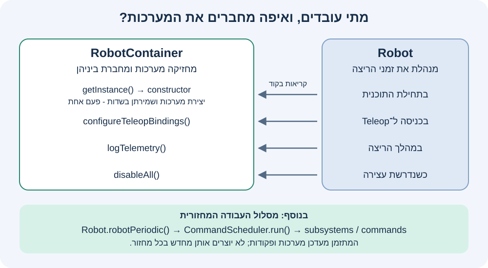

import ExerciseHelp from "@site/src/components/ExerciseHelp";

**RobotContainer מרכזת את יצירת הרכיבים בקוד ואת החיבורים ביניהם.** למשל, כאן יוצרים את אובייקט השלט ואת `SwerveSubsystem`, תת־המערכת ששולטת במערכת הנהיגה. גם `VisionSubsystem`, הרכיב של DELib שקורא מהמצלמות, נוצר כאן. Robot מנהלת את זמני הריצה וקוראת לפעולות של ה־container בזמן המתאים.

פתחו `RobotContainer.java` לצד `Robot.java` באמצעות Ctrl + P. בשיעור הזה קוראים את הקוד הקיים; עוד לא צריך לכתוב את התחביר החדש בעצמכם.

## לפני שמתחילים: קצת תחביר שאולי עוד לא למדתם

### final: שומרים את אותה הפניה

```java
public final SwerveSubsystem swerveSubsystem;
```

`final` אומר שלאחר ההשמה הראשונית לא ניתן להציב בשדה הזה הפניה לאובייקט אחר. אפשר עדיין לקרוא למתודות של תת־מערכת הנהיגה כדי להפעיל או לעצור את הנהיגה. **האובייקט אינו קפוא; ההפניה אליו נשארת קבועה.** השדה יכול לקבל את האובייקט בבנאי, כפי שקורה כאן.

כש־`final` מופיעה בהגדרת מתודה, למשל `public final void logTelemetry()`, המשמעות שונה: מחלקה שיורשת מהמחלקה הזאת אינה יכולה להחליף את המימוש של המתודה.

### הסימנים ? ו־: הם בחירה בין שני ערכים

```java
final SwerveIO swerveIO = isSim
    ? new SwerveIOSim(Constants.SwerveConstants.SWERVE_CONFIG)
    : new SwerveIOHardware(Constants.SwerveConstants.SWERVE_CONFIG);
```

קוראים כך: אם `isSim` היא true, משתמשים בערך שאחרי `?`; אחרת משתמשים בערך שאחרי `:`. כאן בוחרים חיבור לסביבת האימון או לחומרה. רק הצד שנבחר מתבצע. זו כתיבה קצרה של בחירה שאפשר לבטא גם בעזרת `if` ו־`else`.

`SwerveIO` הוא ממשק שמגדיר את הפעולות המשותפות למימושים של מערכת הנהיגה. לכן המשתנה `swerveIO` יכול להחזיק את המימוש שנבחר לפי סביבת ההרצה. [ממשקים ב־Java](../../java/10-enrichment/03-interfaces.mdx)

### Optional: יכול להיות שיש אובייקט, ויכול להיות שאין

```java
public final Optional<SimCoordinator> simCoordinator;
```

`Optional<SimCoordinator>` מציינת שהשדה יכול להכיל `SimCoordinator` או להיות ריק. `Optional.of(...)` עוטפת את האובייקט כשיצרנו אותו, ו־`Optional.empty()` מייצגת הרצה שבה הוא חסר. [המחלקה `Optional` ב־Java](../../java/10-enrichment/01-optional.mdx)

## 1. יוצרים פעם אחת, ומשתמשים לאורך הריצה

בתחילת המחלקה תראו את `getInstance()`. בקריאה הראשונה השדה `instance` עדיין מכיל `null`, ולכן נוצר `new RobotContainer()` ונשמר בשדה. בקריאות הבאות מוחזר **אותו אובייקט**, בלי להפעיל שוב את הבנאי. לצורה הזאת קוראים Singleton.

בתוך הבנאי נוצרים האובייקטים ומועברים אליהם החיבורים וההגדרות הדרושים. למשל, `SwerveSubsystem` מקבלת את השלט ואת הגדרות הנהיגה. השדות שומרים את האובייקטים כדי שאפשר יהיה להשתמש בהם לאורך הריצה. כדי ליצור אובייקט, קוראים לבנאי של המחלקה באמצעות `new`.



## 2. הפעולות ש־Robot מבקשת מה־container

המתודות הבאות הן מתודות רגילות: קוד אחר צריך לקרוא להן כדי שיפעלו. הן אינן נקראות אוטומטית רק בגלל השם שלהן.

| מתודה                       | התפקיד שלה                                                                                                             |
| --------------------------- | ---------------------------------------------------------------------------------------------------------------------- |
| `configureTeleopBindings()` | מחברת בין השלט לפעולות הרובוט ומגדירה את פעולת הנהיגה הרגילה לקראת Teleop. את הקוד שבתוכה נלמד כשנחבר כפתורים למנגנון. |
| `logTelemetry()`            | מרכזת פרסום מידע, למשל מדידות מהנהיגה ומהמצלמות, כדי שנוכל לראות מה קורה במהלך הריצה.                                    |
| `getAutonomousCommand()`    | מחזירה את הפקודה האוטונומית שנבחרה, כדי ש־Robot תוכל לבקש להפעיל אותה.                                                 |

`disableAll()` קיימת בתבנית כפעולת עצירה נוספת, ליתר ביטחון במקרי קיצון. אין חובה להוסיף אליה כל תת־מערכת: במצב Disabled מערכת הרובוט מונעת הנעת כל המנועים אוטומטית, גם בלי קריאה למתודה הזאת.

Robot מחליטה מתי לבקש את הפעולות האלה. בנפרד, הקריאה למתזמן מתוך `robotPeriodic()` מאפשרת לעבודה המחזורית של תתי־המערכות הרשומות אצל המתזמן ושל הפקודות להתקדם.

## 3. לוגים: רואים מה התוכנית והרובוט עשו

**לוג הוא תיעוד של מה שקרה לאורך זמן.** עד עכשיו ראינו הודעות טקסט עם `System.out.println`. ברובוט נרצה לראות גם מדידות, למשל מהירות גלגל, מיקום וכיוון, ולצדן בקשות שהתוכנית שלחה. כששומרים ערכים עם זמני המדידה שלהם, אפשר לבדוק לא רק מה הערך עכשיו, אלא גם מה השתנה לפני תקלה או אחרי פעולה.

**טלמטריה** היא המידע שהתוכנית מפרסמת על מצבה ועל מצב המערכות. אפשר לצפות בו בזמן אמת, ואם הוגדרה שמירה לקובץ לוג - לפתוח אותו גם אחרי שההרצה הסתיימה. **AdvantageKit** היא תשתית הרישום שבתוכנית; **AdvantageScope** היא התוכנה שבה מציגים ומנתחים את הנתונים.

ב־RobotContainer, המתודה `logTelemetry()` קוראת למתודות שמפרסמות את נתוני הנהיגה והראייה. `LoggingMode` הוא `enum` שמגדיר את רמות הפירוט האפשריות. [ערכים מוגדרים מראש עם `enum`](../../java/10-enrichment/02-enums.mdx)

- `BASIC` קוראת למתודות התיעוד הבסיסיות של הנהיגה והראייה.
- `EXTENDED` קוראת למתודות התיעוד המורחבות שלהן.
- `NONE` מדלגת על התיעוד שבמתודה הזאת; היא אינה מבטלת בהכרח מידע שנרשם במקומות אחרים בתוכנית.

לכן יצירת תת־מערכת חדשה אינה מספיקה כדי להוסיף את כל הנתונים שלה לתצוגה: בשיעור הבא נחבר גם את פרסום המידע שלה. פרסום נתון אינו מפעיל מנוע; הוא מאפשר לנו לראות מה קורה.

## 4. צופים בנתונים ב־AdvantageScope

### בזמן שהתוכנית רצה

1. הפעילו את סביבת האימון שכבר הכרתם ופתחו AdvantageScope. אם צריך, חזרו ל[שלבי פתיחת הכלי והחיבור](../01-getting-started/03-first-simulation.mdx#advantagescope).
2. בחרו **File → Connect to Simulator** ואת מקור הנתונים **NetworkTables (AdvantageKit)**. בחלק מהגרסאות הוא נקרא **NetworkTables 4 (AdvantageKit)**. המתינו לחיבור; `Searching` פירושו שעדיין מחפשים את המקור.
3. ברשימת הנתונים משמאל הרחיבו את הענפים או השתמשו בחיפוש. חפשו `Subsystems/Swerve`. ייתכן שהוא מופיע תחת ענף `AdvantageKit`.
4. הוסיפו לשונית **Line Graph** דרך `+`. בחרו נתון מספרי שקיים ברשימה, למשל מדידת מהירות, וגררו אותו לאזור **Left Axis** או **Right Axis**. נתון מורכב כמו Pose צריך להרחיב לרכיב מספרי, או להציג בלשונית 2D Field כפי שכבר עשינו.
5. קראו את הגרף: הציר האופקי הוא הזמן והציר האנכי הוא ערך המדידה. בדקו בשם הנתון או בהגדרותיו מה היחידות; ערך 5 לבדו אינו אומר אם זו מהירות, זווית או מתח.

בזמן חיבור חי התצוגה עוקבת בדרך כלל אחרי הזמן הנוכחי. אפשר לשחרר את הנעילה לזמן החי באמצעות כפתור החץ האדום בסרגל הניווט, ולבחון מידע שכבר התקבל. [הוראות החיבור והתצוגה החיה](https://docs.advantagescope.org/overview/live-sources/) ו[הסבר על Line Graph](https://docs.advantagescope.org/tab-reference/line-graph/).

### אחרי שההרצה הסתיימה

אם נשמר קובץ לוג מסוג `.wpilog`, אפשר לפתוח אותו ב־AdvantageScope באמצעות **File → Open Log(s)...** או לגרור את הקובץ לחלון. אין צורך שהתוכנית תמשיך לרוץ. בוחרים נתונים באותה רשימה ומשתמשים בציר הזמן כדי לחזור לרגע שמעניין אותנו. מיקום הקובץ נקבע בהגדרת רישום הנתונים ב־Robot; `logTelemetry()` לבדה אינה קובעת היכן הוא יישמר. [פתיחת נתונים מוקלטים](https://docs.advantagescope.org/overview/log-files/).

אם אין נתונים ברשימה, בדקו תחילה את החיבור ואת מקור הנתונים. אם הרשימה קיימת אבל מדידה מסוימת חסרה, ייתכן שהיא אינה מפורסמת או שרמת התיעוד שנבחרה אינה כוללת אותה. גרף שטוח יכול להיות תקין כשהמערכת אינה נעה - הוא אינו מוכיח שהחיבור נכשל.

## 5. תרגול קצר: מי אחראי למה?

ענו במילים, בלי לכתוב קוד חדש. נסו לענות לפני פתיחת הפתרון.

1. מה ההבדל בין הגדרת שדה לתת־מערכת לבין יצירת האובייקט שלה בבנאי?
2. איזו מתודה מרכזת את חיבורי השלט ואיזו את פרסום המידע?
3. האם הוספת תת־מערכת ל־RobotContainer גורמת אוטומטית לנתונים שלה להופיע ב־AdvantageScope?

<ExerciseHelp
  hints={[
    "שדה שומר הפניה לאובייקט; חפשו מה עושה new.",
    "קראו את הגוף של logTelemetry: האם הוא מגלה תתי־מערכות חדשות לבד?",
  ]}
  solutionLanguage="text"
  solution={
    "1. הגדרת השדה קובעת היכן נשמור את ההפניה לתת־המערכת ומה הסוג שלה. יצירת האובייקט באמצעות new מפעילה את הבנאי שלו; שומרים את האובייקט בשדה כדי להשתמש באותו מופע לאורך הריצה.\n\n2. configureTeleopBindings מרכזת את חיבורי השלט; logTelemetry מרכזת את פרסום המידע.\n\n3. לא. צריך לחבר במפורש את פרסום המידע של תת־המערכת ל־logTelemetry. המתודה אינה מגלה אוטומטית כל שדה חדש שהוספנו."
  }
/>

### מוסיפים רכיב חדש בקוד: מה צריך לחבר? {/* #מוסיפים-מערכת-חדשה-מה-צריך-לחבר */}

דמיינו שמוסיפים מנגנון של גלגל ממונע וחיישן מרחק. בקוד נשתמש בתת־מערכת לשליטה בגלגל ובאובייקט נפרד לקריאה מהחיישן. תארו מה צריך להוסיף ב־RobotContainer לכל אחד מהם:

- איפה מגדירים את השדה ואיפה יוצרים את האובייקט?
- איפה מחברים את פרסום המידע כדי לראות את הנתונים של כל רכיב?
- תלמיד הגדיר שדה ויצר את הגלגל, אבל לא רואה את הנתונים שלו ב־AdvantageScope. איזה חיבור כדאי לבדוק?

<ExerciseHelp
  hints={[
    "בשני המקרים נצטרך לשמור אובייקט ולפרסם מידע.",
    "יצירת האובייקט ופרסום הנתונים שלו הם שני צעדים נפרדים.",
  ]}
  solutionLanguage="text"
  solution={
    "לכל אובייקט מגדירים שדה ב־RobotContainer, יוצרים אותו פעם אחת בבנאי ושומרים אותו בשדה. מחברים את פרסום המדידות של הגלגל ושל החיישן בתוך logTelemetry לפי המתודות שיש לכל אובייקט. אם הנתונים חסרים, בודקים שהקריאה לפרסום המידע נוספה ושהחיבור ל־AdvantageScope פעיל."
  }
/>
