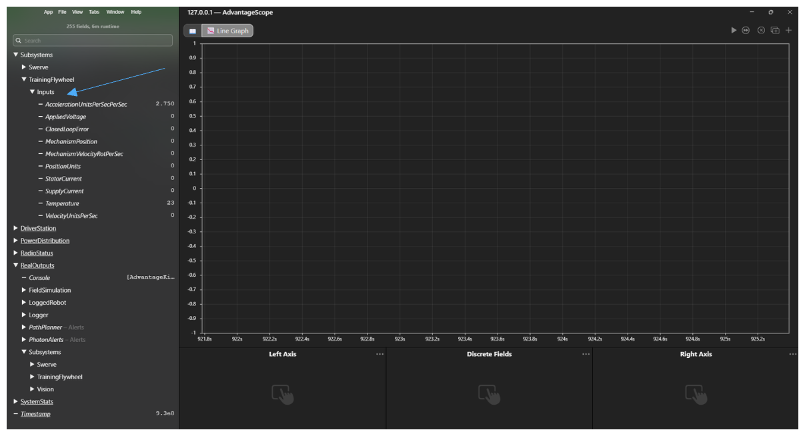

import ExerciseHelp from "@site/src/components/ExerciseHelp";

בשיעור הזה נחבר לרובוט תת־מערכת שכבר כתובה עבורנו: `TrainingFlywheel`, גלגל שמונע באמצעות מנוע אחד. לאחר החיבור נכתוב קוד שמפעיל אותה, נשנה את הפלט ונראה את התוצאה בסימולציה ובגרף.

**תת־מערכת (Subsystem)** היא מחלקה שאחראית על חלק מסוים ברובוט: הרכיבים שלו, המדידות שלו והפעולות שאפשר לבצע בו. למשל, תת־מערכת של גלגל מסתובב מחזיקה את החיבור למנוע ומאפשרת לבקש ממנו להסתובב או להפסיק להפעיל כוח.

## 1. מכירים את הקובץ הנתון

פתחו `TrainingFlywheel.java` באמצעות Ctrl + P. בתוך המחלקה תראו בנאי ומתודה בשם `createConfiguration()`:

```java
public final class TrainingFlywheel extends MotorSubsystemTalon {
    public TrainingFlywheel() {
        super(TrainingFlywheel.createConfiguration());
    }

    // createConfiguration() מופיעה בהמשך הקובץ הנתון.
}
```

זהו קטע לזיהוי המבנה, ולא קוד להחלפת הקובץ. כרגע מספיק להבין שלושה דברים:

- `TrainingFlywheel` היא תת־המערכת שנפעיל.
- `extends MotorSubsystemTalon` נותנת לה יכולות שכבר נכתבו בספרייה: הפעלת מנוע, קריאת מדידות וסימולציה.
- הבנאי מעביר למחלקת הבסיס הגדרות שמתקבלות מ־`createConfiguration()`.

**Configuration**, או תצורה, היא אוסף הגדרות של המנוע והמנגנון. ההגדרות כבר מוכנות לתרגיל. קפלו את המתודה בעורך והשאירו את הערכים שלה כפי שהם; נחזור אליהם בהכשרה נפרדת.

עדיין לא נוצר אובייקט של תת־המערכת. קיום הקובץ בפרויקט מגדיר סוג שאפשר ליצור, אבל אינו יוצר אותו בעצמו.

## 2. יוצרים מופע אחד ב־RobotContainer

איפה בפרויקט יוצרים את המערכות ושומרים אותן לאורך הריצה?

<ExerciseHelp
  hints={["חפשו את המקום שבו נוצרה מערכת הנהיגה."]}
  solution="ב־RobotContainer: השדות מחזיקים את המערכות, ובבנאי יוצרים את המופעים ושומרים אותם בשדות. בהמשך משתמשים באותם מופעים לאורך הריצה."
  solutionLanguage="text"
/>
פתחו את `RobotContainer.java` ומצאו את השדות ואת הבנאי שכבר הכרנו. ליד שורות
ה־import הוסיפו:

```java
import frc.robot.subsystems.training.TrainingFlywheel;
```

באזור השדות, ליד תתי־המערכות הקיימות, הוסיפו:

```java
public final Optional<TrainingFlywheel> trainingFlywheel;
```

בבנאי `private RobotContainer()`, אחרי יצירת `visionSubsystem`, הוסיפו:

```java
this.trainingFlywheel = isSim
    ? Optional.of(new TrainingFlywheel())
    : Optional.empty();
```

לפי מה שלמדנו על `Optional` ועל התנאי `? :`, מה יישמר בשדה בסימולציה ומה יישמר בהרצה על חומרה? הסבירו למה רק אחד משני צדי התנאי מתבצע.

<ExerciseHelp
  hints={["בדקו מה הערך של isSim בכל סביבת הרצה ואיזה צד הוא בוחר."]}
  solution="בסימולציה isSim היא true, ולכן נוצרת TrainingFlywheel ונשמרת בתוך Optional. בחומרה נבחרת Optional.empty(), ללא יצירת תת־המערכת. הביטוי בוחר ומחשב רק את הצד המתאים לתנאי."
  solutionLanguage="text"
/>
`Optional` כבר מיובאת בתבנית.

**נוצר מופע אחד, פעם אחת בעת האתחול.** לא יוצרים את המנוע או את תת־המערכת מחדש בכל מחזור.

## 3. מחברים לוגים

בתוך `logTelemetry()`, לפני הסוגר שמסיים את המתודה, הוסיפו:

```java
this.trainingFlywheel.ifPresent(TrainingFlywheel::logTelemetry);
```

`ifPresent` מבצעת פעולה אם התיבה מכילה אובייקט. הכתיבה `TrainingFlywheel::logTelemetry` מציינת איזו מתודה להפעיל עליו. השורה מפרסמת את המדידות כדי שנוכל לראות אותן. השאירו את החיבורים של שאר תתי־המערכות במקומם.

## 4. רואים את המערכת בלוגים

שמרו והפעילו את הסימולציה במצב Disabled.
התחברו עם AdvantageScope כפי שעשינו בשיעור הסימולציה וחפשו `TrainingFlywheel`
ברשימת הנתונים.

אמור להופיע הענף `Subsystems/TrainingFlywheel`, עם מדידות תחת `Inputs`.  אם הענף חסר, בדקו שהמופע נוצר בסימולציה, ששורת `logTelemetry()` נמצאת בתוך המתודה המתאימה ושאתם מחוברים להרצה הנוכחית.



### עצרו והסבירו

מה היה קורה אילו היינו כותבים `new TrainingFlywheel()` בתוך `robotPeriodic()` במקום בבנאי של `RobotContainer`?

<ExerciseHelp
  hints={[
    "כמה פעמים robotPeriodic רצה?",
    "האם אנחנו צריכים מנוע חדש בכל מחזור, או לשלוח הוראה לאותו מנוע?",
  ]}
  solution="היינו יוצרים שוב ושוב תתי־מערכות ובקרי מנוע במקום להשתמש במופע אחד. יוצרים פעם אחת בבנאי ושומרים שדה; בהמשך שולחים הוראות לאותו אובייקט."
  solutionLanguage="text"
/>

## לפני שממשיכים

הראו למנטור היכן מוגדרת המחלקה, היכן נוצר המופע והיכן מחוברים הלוגים. שמרו commit של החיבור. בשיעור הבא נכתוב ב־`Robot.teleopPeriodic()` את ההוראה הראשונה למנוע.
