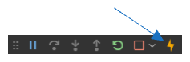

import ExerciseHelp from "@site/src/components/ExerciseHelp";
import TrainingFlywheelGraphScreenshot from "../assets/training-flywheel-advantagescope-graph-screenshot.png";

תת־המערכת מחוברת, אבל עוד לא ביקשנו מהמנוע להסתובב. עכשיו נוסיף לה הוראה שחוזרת בכל מחזור, ונראה איך שינוי בקוד משפיע על התנועה ועל המדידות.

## 1. נותנים למנוע הוראה

פתחו `TrainingFlywheel.java`. בתוך המחלקה, מעל הבנאי, הוסיפו קבוע בעל שם:

```java
public static final double TRAINING_OUTPUT = 0.15;
```

זה הערך שנשנה במהלך הניסוי. למה מתאים לשמור אותו בתת־המערכת? ומה `final` אומרת על ההשמה שלו?

<ExerciseHelp
  hints={["למי שייך ערך הפלט? האם רוצים להחזיק כמה עותקים שלו?"]}
  solution="הערך שייך למנגנון הלימודי, ולכן נשמר ב־TrainingFlywheel במקום אחד. final מונעת השמה מחדש לקבוע בקוד הרץ. עריכת קוד המקור והחלתו דרך כלי Debug היא שינוי הקוד, ולא השמה רגילה למשתנה."
  solutionLanguage="text"
/>

הקבוע מוגדר כ־`public static final`, ולכן אפשר לקרוא אותו דרך שם המחלקה: `TrainingFlywheel.TRAINING_OUTPUT`.

כעת פתחו `Robot.java` וחפשו את המתודה הקיימת `teleopPeriodic()` והוסיפו בתוכה את הקריאה למנוע, כך שתיראה כך. אל תיצרו מתודה נוספת באותו שם:

```java
@Override
public void teleopPeriodic() {
    RobotContainer.getInstance().trainingFlywheel.ifPresent(flywheel -> {
        flywheel.setPercentOutput(TrainingFlywheel.TRAINING_OUTPUT, false);
    });
}
```

לפני שממשיכים: איזו תת־מערכת מקבלים דרך `RobotContainer.getInstance().trainingFlywheel`? האם נוצר כאן אובייקט חדש? היעזרו בחיבור שכתבתם בשיעור הקודם.

<ExerciseHelp
  hints={["חזרו למקום שבו כתבנו new TrainingFlywheel()."]}
  solution="מגיעים לשדה שמחזיק את TrainingFlywheel שנוצרה בבנאי RobotContainer. getInstance מחזירה את ה־container הקיים, והגישה לשדה אינה יוצרת תת־מערכת חדשה."
  solutionLanguage="text"
/>

מה `ifPresent` עושה אם תת־המערכת אינה קיימת?

<ExerciseHelp
  hints={["מה מכילה Optional.empty()?"]}
  solution="אם ה־Optional ריקה, הפעולה אינה מתבצעת: לא שולחים בקשת פלט למנוע. אם יש בה תת־מערכת, הפעולה מתבצעת עליה."
  solutionLanguage="text"
/>
בתוך הפעולה, `TrainingFlywheel.TRAINING_OUTPUT` הוא ערך הפלט שהגדרנו בתת־המערכת,
ו־`flywheel.setPercentOutput(...)` מעבירה אותו למנוע.

הקריאה `flywheel.setPercentOutput(...)` מפעילה מתודה על אובייקט תת־המערכת. אנחנו משתמשים במנוע שכבר נוצר, ולא מגדירים או יוצרים אותו כאן. מכיוון שהקריאה נעשית מתוך `Robot`, משתמשים באובייקט `flywheel` כדי לגשת למתודה שלו.

### מתי הקוד הזה רץ?

לפי מה שראיתם בהכשרת מצבי הרובוט: מתי `teleopPeriodic()` רצה? האם היא רצה ב־Disabled? כתבו תחזית לפני ההפעלה: מה יקרה למנוע ומה יקרה ללוגים כשתעברו ל־Disabled?

<ExerciseHelp
  hints={["הבדילו בין מתודה של מצב Teleop לבין התוכנית כולה."]}
  solution="teleopPeriodic רצה בכל מחזור של Teleop מופעל, ואינה רצה ב־Disabled. במעבר ל־Disabled מערכת הרובוט מונעת הנעת מנועים אוטומטית, אך התוכנית והלוגים ממשיכים לפעול. הגלגל יכול להמשיך לנוע ולהאט במצב Coast."
  solutionLanguage="text"
/>

זהו ניסוי ראשון בהפעלת מנגנון. בהמשך הפרק נעביר את ההוראה מתוך `teleopPeriodic()` לפקודה, כדי לבחור מתי הפעולה מתחילה ומסתיימת. ערך הפלט נשאר ב־`TrainingFlywheel`; ההחלטה מתי לשלוח אותו נמצאת כרגע ב־`teleopPeriodic()`.

## 2. בוחרים כמה כוח להפעיל

`flywheel.setPercentOutput(0.15, false)` מבקשת **15% פלט**, ולא מהירות של 0.15 סיבובים לשנייה. הטווח הוא מ־`-1` עד `1`; הסימן קובע את כיוון הסיבוב. הפרמטר `false` משאיר את מגבלות התוכנה בתוקף.

הפלט משפיע על תנועת המנוע, אבל המהירות בפועל היא מדידה נפרדת. **אנקודר** הוא חיישן שמודד סיבוב; בסימולציה המדידה מחושבת באמצעות המודל המוכן.

{/* TODO: להוסיף צילום של TrainingFlywheel עם הקבוע TRAINING_OUTPUT, ולצדו Robot.teleopPeriodic עם הקריאה לתת־המערכת. */}

## 3. מפעילים ועוצרים

1. שמרו והפעילו את הסימולציה במצב Disabled.
2. עברו ל־Teleop והפעילו Enable. המנוע מתחיל לנוע בלי לחיצה על כפתור שלט.
3. חזרו ל־Disabled. מערכת הרובוט מפסיקה את ההנעה אוטומטית, `teleopPeriodic()` אינה רצה במצב הזה, אך התוכנית והלוגים ממשיכים להתעדכן.

במודל המוכן המנוע מוגדר במצב **Coast**: אחרי ביטול הפלט הגלגל יכול להמשיך להסתובב ולהאט בהדרגה. לכן עצירת הפלט אינה מבטיחה שמהירות הסיבוב תהיה אפס מיד.

## 4. רואים את התוצאה בגרף

ב־AdvantageScope התחברו דרך **File → Connect to Simulator → NetworkTables (AdvantageKit)**. פתחו לשונית **Line Graph** באמצעות `+` וחפשו `TrainingFlywheel` ברשימת הנתונים.

תחת `Subsystems/TrainingFlywheel/Inputs` מצאו:

- `AppliedVoltage` - המתח שהופעל בפועל.
- `MechanismVelocityRotPerSec` - מהירות המנגנון בסיבובים לשנייה, או RPS.

גררו את המהירות אל **Left Axis** ואת המתח אל **Right Axis**, כדי שלכל יחידה יהיה ציר משלה. הפעילו Teleop ואז Disabled ועקבו אחרי שני הקווים.

<a
  href={TrainingFlywheelGraphScreenshot}
  target="_blank"
  rel="noopener noreferrer"
>
  
</a>

הצילום מציג דוגמת ממשק של מנגנון אחר. אצלכם חפשו מתח שמופיע לאחר Enable ומהירות שעולה בעקבותיו. לאחר Disable פלט ההנעה מתבטל והמהירות דועכת. אם הקו נשאר באפס, בדקו את מצב הרובוט, החיבור ואת בחירת הנתון בגרף.

## 5. משנים ערך אחד ומשווים

לפני כל שינוי נחשו מה יקרה. ב־`TrainingFlywheel.java` שנו רק את `TRAINING_OUTPUT` ושמרו. כשהסימולציה רצה במצב Debug, לחצו על **אייקון הברק - Apply Code Changes** כדי להחיל את השינוי, והמתינו לסיום העדכון. אין צורך לסגור ולפתוח את הסימולציה בכל שינוי ערך.

לאחר החלת השינוי בדקו שהפלט השתנה בגרף. קבועי `static final` עשויים להשתלב בקוד שקורא אותם בזמן הקומפילציה; אם הערך נשאר כפי שהיה, הפעילו מחדש את הסימולציה. התחילו כל ניסוי כשהגלגל במנוחה והשוו אחרי אותו משך זמן ב־Enable. אם מתקבלת הודעה שלא ניתן להחיל שינוי מסוים, הפעילו מחדש את הסימולציה.



| ערך הקבוע | מה בודקים בתנועה ובגרף?                        |
| --------- | ---------------------------------------------- |
| `0.15`    | המתח מופיע והגלגל מאיץ. זו הרצת הבסיס להשוואה. |
| `0.25`    | איך השתנו המתח והמהירות לעומת הרצת הבסיס?      |
| `0.0`     | אין בקשת הנעה; גלגל שכבר נע עשוי להמשיך ולהאט. |
| `-0.15`   | איך רואים את שינוי כיוון הסיבוב במדידה?        |

חזרו ל־`0.15` בסיום. תעדו לכל ניסוי את הפלט שביקשתם, המתח והמהירות אחרי זמן קבוע. הוסיפו תצפית על מה שקורה אחרי Disable.

<ExerciseHelp
  hints={["השוו את הגודל ואת הסימן של המדידות, ולא רק את המספר ברגע אחד."]}
  solution="במודל התרגיל, 0.25 צפוי להפיק מתח ומהירות גדולים יותר לעומת 0.15 בתנאי התחלה וזמן זהים. בערך ‎-0.15 כיוון הסיבוב מתהפך, ולכן סימן המהירות מתחלף. בערך אפס אין בקשת הנעה, וגלגל שכבר נע עשוי להאט בהדרגה. אין מהירות מספרית אחת שחייבים לקבל; משווים את הגרפים בתנאים זהים."
  solutionLanguage="text"
/>

### עצרו והסבירו

תלמיד כתב `TRAINING_OUTPUT = 20.0` כדי לקבל 20% פלט. מה צריך לתקן, והאם הערך המתוקן אומר מה תהיה מהירות המנוע?

<ExerciseHelp
  hints={[
    "איזה ערך מייצג 100%?",
    "האם אחוז פלט וסיבובים לשנייה הם אותה יחידה?",
  ]}
  solution="20% נכתבים 0.20. זהו אחוז הפלט המבוקש, לא מהירות יעד. את המהירות בפועל קוראים מהמדידה או מהגרף."
  solutionLanguage="text"
/>

## למה לא להשאיר את זה ככה?

כרגע המנוע מקבל בקשת פלט בכל מחזור של Teleop מופעל. אם נשלח הוראת עצירה ממקום אחר, במחזור הבא `teleopPeriodic()` תבקש שוב להסתובב. אנחנו רוצים לבחור מתי להפעיל את המנגנון ומתי לסיים את הפעולה, בזמן שהמדידות ממשיכות להתעדכן.

**לשם כך נשתמש ב־Commands.** בשיעור הבא נעביר אל פקודה את האחריות להפעלה ולעצירה.
