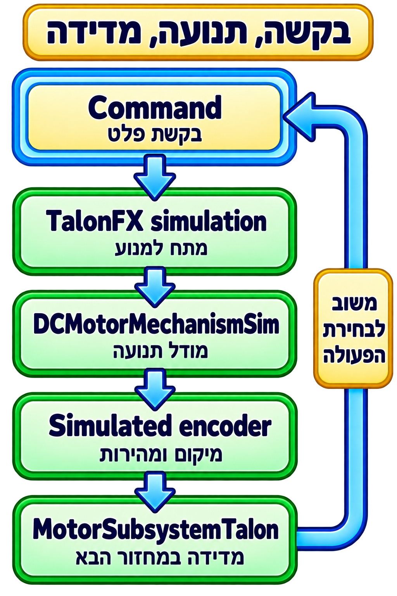

import ExerciseHelp from "@site/src/components/ExerciseHelp";

ראינו שהמנוע פועל כל עוד Teleop מופעל. עכשיו נרצה התנהגות אחרת: **לחיצה תתחיל את הפעולה ושחרור יסיים אותה.** תת־המערכת תמשיך להיות אחראית למנוע ולמדידות, והפקודה תהיה אחראית לפעולה שאנחנו רוצים לבצע איתה.

**Command**, או פקודה, היא פעולה שהמתזמן מנהל לאורך זמן. אפשר להתחיל אותה, להריץ אותה במחזורים ולסיים או לבטל אותה. **Binding** הוא החיבור בין אירוע בשלט לבין פקודה.

## 1. שומרים את הניסוי ומפנים את ההפעלה מתוך teleopPeriodic

לפני השינוי הריצו ובדקו את גרסת ההפעלה המחזורית, ושמרו commit עם תוצאות המדידה. הקוד הזה נשאר בהיסטוריה; החיבור, הקבוע והלוגים נשארים בקבצים הפעילים.

ב־`Robot.java`, הסירו מתוך `teleopPeriodic()` את הקריאה ל־`RobotContainer.getInstance().trainingFlywheel.setPercentOutput(...)` שהוספנו בניסוי. השאירו את המתודה עצמה ואת כל הקוד שהיה בה לפני התרגיל. המדידות והלוגים ממשיכים להתעדכן באמצעות התשתית המוכנה.

היכן שמרנו את `TRAINING_OUTPUT`, ואיך קראנו אותו מתוך `Robot`?

<ExerciseHelp
  hints={["חפשו את השדה TRAINING_OUTPUT בתוך TrainingFlywheel."]}
  solution="הקבוע נמצא בתוך TrainingFlywheel ונקרא דרך השדה הסטטי TrainingFlywheel.TRAINING_OUTPUT. גם הפקודה תקרא את אותו שדה; אין להעביר את הקבוע ל־Robot או ל־RobotContainer."
  solutionLanguage="text"
/>
השתמשו באותו שדה גם עבור הפקודה. הקבוע נשאר ב־`TrainingFlywheel`.

שמרו, עברו ל־Disabled והפעילו מחדש את הסימולציה כדי להתחיל בלי בקשת פלט שנשמרה מהרצת הניסוי הקודם. ב־Teleop, לפני חיבור הפקודה, המנוע אמור להישאר ללא בקשת הפעלה. אם הוא מתחיל להסתובב, בדקו שההוראה הישנה אכן הוסרה ושהשינוי הוחל בהרצה.

## 2. משתמשים בפקודה מוכנה

הספרייה כבר כוללת `MotorSubsystemSetPercentage`: פקודה שמבקשת אחוז פלט בכל מחזור שבו היא פעילה, ומבטלת את הפלט כשהיא מסתיימת או מבוטלת. לא נכתוב עדיין מחלקת פקודה משלנו.

ב־`RobotContainer` הוסיפו import:

```java
import frc.DELib26.subsystems.motorSubsystems.commands.MotorSubsystemSetPercentage;
```

בתוך `configureTeleopBindings()`, לצד החיבורים הקיימים, הוסיפו:

```java
this.driverController.northButton().whileTrue(
    new MotorSubsystemSetPercentage<>(
        this.trainingFlywheel, () -> TrainingFlywheel.TRAINING_OUTPUT)
    );
```

### קוראים את תחביר ה־lambda

למבדה היא פעולה קצרה שמעבירים לקוד אחר. משמאל ל־`->` כותבים את הפרמטרים, ומימין את הפעולה.

`() -> TrainingFlywheel.TRAINING_OUTPUT` היא הפעולה שהפקודה מקבלת כ־`DoubleSupplier`. היא מקבלת אפס פרמטרים ומחזירה את אחוז הפלט בכל פעם שהפקודה קוראת לה. [ביטויי למבדה ב־Java](../../java/09-lambdas/index.mdx)

### מה אומרות הסוגריים הזוויתיות?

`MotorSubsystemSetPercentage` היא מחלקה **גנרית** שמתאימה לכמה טיפוסים של תתי־מערכות שיורשות מ־`MotorSubsystemTalon`. אפשר לציין את הטיפוס במפורש, למשל `MotorSubsystemSetPercentage<TrainingFlywheel>`. כשכותבים `new MotorSubsystemSetPercentage<>(...)`, Java מסיקה את הטיפוס מהאובייקט `this.trainingFlywheel` שקיבל הבנאי. [טיפוסים גנריים ב־Java](../../java/08-generics/index.mdx)

### בדקו את עצמכם

למה `() -> TrainingFlywheel.TRAINING_OUTPUT` אינה מקבלת פרמטרים? איזה טיפוס Java מסיקה בתוך `<>` בדוגמה שלנו?

<ExerciseHelp
  hints={[
    "מה הפקודה צריכה לקבל מה־DoubleSupplier?",
    "מה הסוג של האובייקט שהעברנו כפרמטר הראשון לבנאי?",
  ]}
  solution="ה־DoubleSupplier מתבקשת להחזיר מספר ואינה צריכה לקבל פרמטר, ולכן נכתבים סוגריים ריקים. מתוך this.trainingFlywheel, Java מסיקה שסוג תת־המערכת של הפקודה הוא TrainingFlywheel."
  solutionLanguage="text"
/>

נקרא את החיבור בחלקים:

- `northButton()` הוא הכפתור העליון בקבוצת ארבעת הכפתורים: Triangle ב־PS5 או Y ב־Xbox.
- `whileTrue` מתזמנת את הפקודה בתחילת הלחיצה ומבטלת אותה בשחרור.
- `() -> TrainingFlywheel.TRAINING_OUTPUT` היא lambda שמחזירה את ערך השדה כשהפקודה מבקשת אותו. הסוגריים הריקים מציינים שאינה מקבלת פרמטרים.

לאיזה מופע מתייחס כאן השם `trainingFlywheel`? היכן יצרנו אותו?

<ExerciseHelp
  hints={["חזרו ליצירת המופע בבנאי ולחיבור הלוגים."]}
  solution="this.trainingFlywheel הוא אותו מופע שנוצר בבנאי RobotContainer ומשמש גם לפרסום המדידות. ה־lambda קוראת את אחוז הפלט מהשדה הסטטי TrainingFlywheel.TRAINING_OUTPUT, בלי צורך במתודת getter."
  solutionLanguage="text"
/>

הפקודה מצהירה שהיא משתמשת בתת־המערכת הזאת. כך המתזמן יכול לתאם בינה לבין פקודות נוספות שמצהירות על אותה תת־מערכת. נלמד בהמשך מה קורה כששתי פקודות מבקשות אותו משאב.

## 3. בודקים את ההתנהגות החדשה

ב־Disabled בצעו את [חיבור השלט לערוץ 0](../01-getting-started/03-first-simulation.mdx#controller) וודאו שלחיצה על הכפתור העליון משנה את החיווי בחלונית Joystick[0]. השתמשו בשלט `driverController` שכבר קיים; אין צורך ליצור שלט נוסף. הפעילו מחדש את הסימולציה אחרי הוספת החיבור, כדי שהקוד שמגדיר אותו ירוץ מחדש.

שמרו והפעילו את הסימולציה. פתחו את אותו גרף מתח ומהירות מהניסוי הקודם ובצעו:

| פעולה                       | תוצאה לבדיקה                                   |
| --------------------------- | ---------------------------------------------- |
| Enable ב־Teleop, בלי לחיצה  | אין בקשת הפעלה למנוע.                          |
| לחיצה והחזקה של North       | מופיע פלט והמהירות עולה.                       |
| שחרור הכפתור                | הפקודה מבוטלת, פלט ההנעה מתבטל והמהירות דועכת. |
| Disable בזמן לחיצה          | הפקודה אינה ממשיכה להפעיל את המנוע.            |
| שחרור ב־Disabled ואז Enable | המנוע נשאר ללא הפעלה עד לחיצה חדשה.            |

הסתכלו גם על `Subsystems/TrainingFlywheel/Command`: בזמן הפעולה אמורה להופיע הפקודה הנוכחית, ובסיומה `None`.

### עצרו והסבירו

למה חשוב להסיר את הוראת המנוע מתוך `teleopPeriodic()` לפני שמפעילים את הפקודה?

<ExerciseHelp
  hints={[
    "מה הפקודה עושה כשהיא מבוטלת?",
    "מה תבקש teleopPeriodic במחזור הבא אם ההוראה הישנה תישאר?",
  ]}
  solution="הפקודה תבטל את פלט המנוע בשחרור, אבל ההוראה הישנה ב־teleopPeriodic תבקש שוב פלט במחזור הבא. ההחלטה מתי לבצע את הפעולה צריכה להיות בפקודה; תת־המערכת ממשיכה לספק את פעולות המנוע והמדידות."
  solutionLanguage="text"
/>

## תרגול עצמאי

בחרו כפתור אחר, החליפו את החיבור ובדקו שוב לחיצה, החזקה, שחרור ו־Disable. אל תשתמשו ב־Options, שכבר משמש לאיפוס כיוון הנהיגה. הסבירו למנטור מה השתנה באחריות של `teleopPeriodic()` ומה הפקודה עושה עכשיו.

<ExerciseHelp
  hints={["מה צריך להפסיק לקרות בלי לחיצה, ומה צריך לקרות בשחרור?"]}
  solution="אפשר למשל להחליף northButton ב־southButton. בלי לחיצה אין הפעלה, בזמן ההחזקה הפקודה מבקשת פלט, ובשחרור היא מבוטלת ומפסיקה את הפלט. גם Disable מונע הנעה. teleopPeriodic כבר אינה שולחת פלט למנגנון; הפקודה מנהלת את ההפעלה והעצירה."
  solutionLanguage="text"
/>

### לחיצה מפעילה, לחיצה נוספת עוצרת

עכשיו שנו את החיבור כך שלא צריך להחזיק את הכפתור: לחיצה אחת תתחיל את הפקודה, שחרור ישאיר אותה פעילה ולחיצה נוספת תבטל אותה.

השתמשו ב־`toggleOnTrue` במקום `whileTrue`. הפעולה בודקת בכל תחילת לחיצה אם הפקודה פעילה: אם אינה פעילה היא מתזמנת אותה, ואם היא פעילה היא מבטלת אותה. שחרור הכפתור אינו מחליף את המצב.

החליפו את החיבור הקיים, בלי להוסיף חיבור נוסף לאותו כפתור. לפני הבדיקה כתבו מה צפוי לקרות אחרי לחיצה ראשונה, שחרור, לחיצה שנייה ו־Disable. בדקו גם את המתח והמהירות וגם את שם הפקודה בלוגים.

<ExerciseHelp
  hints={[
    "צריך לשנות את המתודה שמחברת את הכפתור לפקודה; הפקודה עצמה נשארת כפי שהיא.",
    "שחרור אינו לחיצה חדשה. איזו פעולה תבטל עכשיו את הפקודה?",
  ]}
  solution={`this.driverController.northButton().toggleOnTrue(
    new MotorSubsystemSetPercentage<>(
        this.trainingFlywheel, () -> TrainingFlywheel.TRAINING_OUTPUT
    )
  );`}
  solutionLanguage="java"
/>

<ExerciseHelp
  hints={["עקבו אחרי הפקודה הפעילה, ולא רק אחרי התנועה שיכולה לדעוך בהדרגה."]}
  solution="בלחיצה הראשונה הפקודה מתחילה ומבקשת פלט. בשחרור היא ממשיכה לפעול. בלחיצה השנייה היא מבוטלת ומימוש הסיום שלה מבטל את הפלט; המהירות יכולה לדעוך בהדרגה. גם מעבר ל־Disabled מבטל את הפקודה בתבנית שלנו ומונע הנעה. לאחר מכן שחררו את הכפתור וחזרו ל־Teleop: נדרשת לחיצה חדשה כדי להתחיל שוב."
  solutionLanguage="text"
/>

## 4. מסכמים: איך כל המערכת עובדת?

התחלנו עם מחלקה מוכנה, חיברנו אותה לרובוט, הפעלנו מנוע דרך `teleopPeriodic()` והעברנו את ההפעלה לפקודה. עכשיו נוודא שאנחנו יכולים להסביר את כל הדרך מהלחיצה על הכפתור ועד למדידות בגרף.



לחיצה על הכפתור מתחילה פקודה. הפקודה קוראת לפעולת המנוע של תת־המערכת. בקר המנוע מקבל את בקשת הפלט, ומודל הסימולציה המוכן מחשב תנועה. התשתית המוכנה מעדכנת את המדידות, והלוגים מאפשרים לראות אותן ב־AdvantageScope.

גם אחרי שחרור הכפתור, המדידות והלוגים ממשיכים להתעדכן. מה שמסתיים הוא פעולת ההנעה של הפקודה.

### בדיקת הבנה מעשית

החזירו את החיבור ל־`northButton().whileTrue(...)` ואת `TRAINING_OUTPUT` ל־`0.15`, והפעילו מחדש את הסימולציה.

הציגו למנטור הרצה אחת שבה רואים את כל הרצף:

1. ב־Teleop ללא לחיצה אין בקשת הנעה.
2. בלחיצה הפקודה מתחילה, מופיע מתח והמהירות עולה.
3. בשחרור הפקודה מבוטלת והגלגל מאט.
4. בלחיצה חדשה ואחריה Disable, הפלט מבוטל והמדידות ממשיכות להתעדכן.

### עצרו והסבירו

הגלגל ממשיך להסתובב לזמן קצר אחרי שחרור הכפתור, אבל כבר לא מוצגת פקודה פעילה. האם זה מוכיח שהפקודה לא עצרה את המנוע?

<ExerciseHelp
  hints={[
    "מה ההבדל בין ביטול פלט לבין מהירות אפס?",
    "איך הגלגל במצב Coast מתנהג אחרי שמפסיקים להניע אותו?",
  ]}
  solution="לא. ביטול הפלט מפסיק את ההנעה, אך גלגל במצב Coast יכול להמשיך לנוע ולהאט בהדרגה. בודקים יחד את הפקודה, המתח ומהירות הסיבוב לאורך זמן."
  solutionLanguage="text"
/>

### מסבירים את מה שבנינו

הראו בקוד היכן נמצא ערך הפלט, איך הפקודה קוראת אותו ומה גורם למנוע להפסיק לקבל פלט בשחרור.

אילו חלקים שיניתם בעצמכם ואילו חלקים כבר קיבלתם מוכנים?

<ExerciseHelp
  hints={[
    "עקבו אחרי TrainingFlywheel.TRAINING_OUTPUT, ה־lambda, whileTrue וסיום הפקודה.",
  ]}
  solution="ערך הפלט נמצא ב־TrainingFlywheel והפקודה קוראת אותו באמצעות ה־lambda שמחזירה את TrainingFlywheel.TRAINING_OUTPUT. whileTrue מבטלת את הפקודה בשחרור, ומימוש הסיום שלה מבטל את פלט המנוע. הוספנו חיבור ב־RobotContainer, לוגים, קבוע, ניסוי ב־teleopPeriodic ולבסוף binding לפקודה. מחלקת הבסיס, הגדרות המנוע, הפקודה ומודל הסימולציה הגיעו מוכנים."
  solutionLanguage="text"
/>

עד עכשיו השתמשנו בתת־מערכת שקיבלנו מוכנה. למדנו איך לחבר אותה לרובוט, להפעיל אותה באמצעות פקודה ולבדוק את ההתנהגות שלה.

**בפרק הבא נלמד איך מגדירים מנוע ומנגנון, וניצור תת־מערכת חדשה בעצמנו.**
