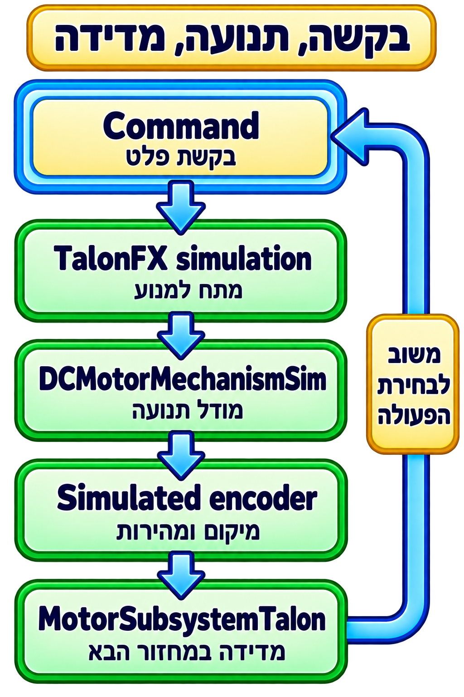

import ExerciseHelp from "@site/src/components/ExerciseHelp";

אין מנוע פיזי במחשב, אבל עדיין צריך קשר בין פלט לתנועה ולמדידה. התבנית כבר מספקת אותו. **נשתמש במודל הקיים ונבדוק את ההנחות שלו במקום לכתוב לולאת פיזיקה משלנו.**

**IO — קלט ופלט** הוא שם לשכבת הקוד שמדברת עם הבקר וקוראת ממנו מדידות. בסימולציה היא מדברת עם בקר מדומה; בחומרה עם הבקר הפיזי. **רוטור** הוא החלק המסתובב של המנוע. הוא לא תמיד מסתובב באותה מהירות כמו המנגנון, בגלל גלגלי שיניים; בדוגמת 1:1 שלנו המהירויות שוות.

**אינרציה** מתארת כמה קשה לשנות את מהירות הסיבוב. **חיכוך** מקשה על התנועה. לא צריך לחשב את הנוסחאות בשיעור הזה: נשנה ערך אחד ונבדוק מה קורה לגרף שכבר למדנו לפתוח.

## 1. שרשרת החישוב

`MotorSubsystemTalon` בוחרת `SimTalonFXIO` כאשר `RunMode.isSim()` מחזירה true. `mechanismSimConfig.create(...)` יוצרת `DCMotorMechanismSim`. היא נרשמת בתור custom simulation של `SimulatedArena`.

ב־`Robot.simulationPeriodic()` כבר קוראים `SimulatedArena.getInstance().simulationPeriodic()`. הזירה מפעילה תתי־צעדים של הסימולציה. `MechanismSim.simulationSubTick(...)` קוראת מתח מהבקר המדומה, מפחיתה חיכוך, מעדכנת את המודל ומחזירה position ו־velocity של הרוטור ל־Talon המדומה. זה קוד הריצה בפועל; הערות ישנות המזכירות Notifier אינן סיבה ליצור אחד נוסף.

`MotorSubsystemTalon.periodic()` קוראת את המדידות דרך IO במחזורי המתזמן. בחרנו יחס 1:1, לכן אין כרגע הבדל מספרי בין סיבובי הרוטור לסיבובי המנגנון.

## 2. ניסוי: אינרציה וחיכוך

שנו **רק** את האינרציה ב־`DCMotorMechanismSimConfig` מ־`0.002` ל־`0.004`. הפעילו מחדש ובדקו כמה זמן נדרש להתקרב לאותה מהירות תחת אותו פלט. החזירו לערך הקודם, ואז שנו חיכוך מ־`0.1` ל־`0.3`. לפני כל שינוי רשמו תחזית; אל תחליפו שני משתנים יחד.

זו אינה הדמיה של ירי כדורי משחק. `SimCoordinator.simulationPeriodic()` ריקה, ו־`FlywheelShotDropSim` אינה מחוברת למנגנון. בניסוי הזה מודדים גלגל מסתובב; אין הבטחה לתוצאה של שיגור.

### השוואה שאפשר לראות

פתחו TrainingFlywheel.java באמצעות Ctrl + P וחפשו `DCMotorMechanismSimConfig(0.002, 0.1)` עם Ctrl + F. המספר הראשון הוא אינרציה והשני חיכוך. שמרו את אותו אחוז פלט ואת אותו משך לחיצה; אחרי שינוי ערך, שמרו, בנו והפעילו מחדש.

| שינוי יחיד                          | ציפייה שיש לבדוק בגרף                                 |
| ----------------------------------- | ----------------------------------------------------- |
| אינרציה 0.002 → 0.004               | העלייה למהירות דומה אמורה להיות איטית יותר            |
| מחזירים אינרציה ואז חיכוך 0.1 → 0.3 | תחת אותו פלט, המהירות המתייצבת עשויה להיות נמוכה יותר |

בחרו רגע התחלה ברור — תחילת הלחיצה — והשוו זמן ועלייה, לא שתי נקודות בזמנים שונים. אם התוצאות זהות לגמרי, בדקו שההרצה הישנה נסגרה ושהקוד החדש נבנה.

### מה לא נכון פה?

תלמיד מוסיף קריאה ידנית ל־`simulationSubTick()` ב־`robotPeriodic()` כדי ״לזרז״ את המנוע. למה צריך להסיר אותה?

<ExerciseHelp
  hints={["המודל כבר רשום בזירה.", "מי אחראי על זמני תתי־הצעדים?"]}
  solution={
    "הזירה כבר מקדמת את המודל. קריאה נוספת יכולה ליצור עדכון כפול וזמני dt לא תקינים. משאירים את simulationPeriodic הקיימת ומשנים פרמטרי מודל בלבד. אין להריץ את periodic של המנגנון ידנית."
  }
  solutionLanguage="text"
/>

## 3. כלי קלט מדומה שכבר נמצא במאגר

לבדיקות מתקדמות קיימת `GenericSimController`. היא נבנית מתוך `GenericController` הקיים, ומאפשרת `setLeftY`, `setUpButton` ו־`notifyNewData`. האחרונה מעבירה את הנתונים החדשים ל־DriverStationSim. זה כלי להזרקת קלט בבדיקת סימולציה, לא מיפוי מקלדת מוכן ולא תחליף לבחירת Alliance ו־Enable. בחלק הראשון משתמשים בשלט האמיתי ובחלון הסימולציה כדי לראות קלט ותנועה; בהמשך המנטור יכול לבנות בדיקה אוטומטית בעזרת המחלקה הקיימת, בלי להמציא API חדש.

## בדיקת סיום ו־Git

בדקו `git diff`, שמרו כל ניסוי בנפרד ורשמו איזה ערך חזרתם להשתמש בו. הסבירו מה הסימולציה יכולה לבדוק כאן ומה דורש מדידה אמיתית: חיכוך, יחס העברה, זרם ותגובה לעומס עשויים להשתנות בחומרה.
