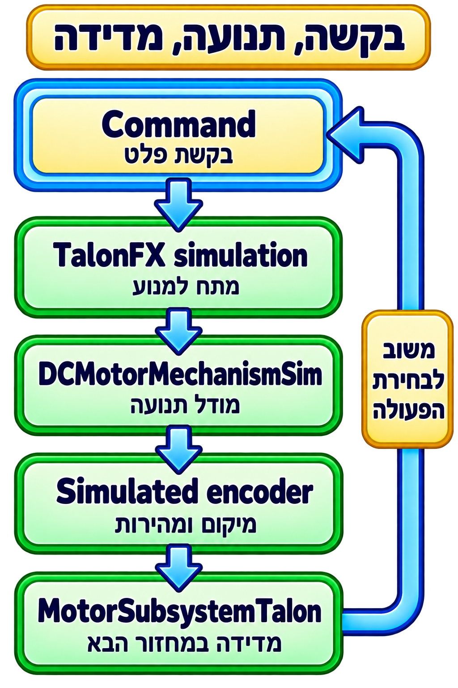

import ExerciseHelp from "@site/src/components/ExerciseHelp";

התחלנו עם מחלקה מוכנה, חיברנו אותה לרובוט, הפעלנו מנוע דרך `teleopPeriodic()` והעברנו את ההפעלה לפקודה. עכשיו נוודא שאפשר להסביר את כל הדרך מהקוד אל הגרף.

## 1. עוקבים אחרי הפעולה

לחיצה על הכפתור מתחילה פקודה. הפקודה קוראת לפעולת המנוע של תת־המערכת. בקר המנוע מקבל את בקשת הפלט, ומודל הסימולציה המוכן מחשב תנועה. התשתית המוכנה מעדכנת את המדידות, והלוגים מאפשרים לראות אותן ב־AdvantageScope.

גם אחרי שחרור הכפתור, המדידות והלוגים ממשיכים להתעדכן. מה שמסתיים הוא פעולת ההנעה של הפקודה.

## 2. בדיקת הבנה מעשית

הציגו למנטור הרצה אחת שבה רואים את כל הרצף:

1. ב־Teleop ללא לחיצה אין בקשת הנעה.
2. בלחיצה הפקודה מתחילה, מופיע מתח והמהירות עולה.
3. בשחרור הפקודה מבוטלת והגלגל מאט.
4. בלחיצה חדשה ואחריה Disable, הפלט מבוטל והמדידות ממשיכות להתעדכן.

לאחר מכן שנו בתת־המערכת את `TRAINING_OUTPUT`, שמרו והחילו את השינוי דרך הברק בהרצת Debug. הראו כיצד השתנתה התגובה והסבירו למה הערך בקוד אינו מהירות נמדדת. החזירו את הערך שבחרתם לשמור בסיום.

### עצרו והסבירו

הגלגל ממשיך להסתובב לזמן קצר אחרי שחרור הכפתור, אבל כבר לא מוצגת פקודה פעילה. האם זה מוכיח שהפקודה לא עצרה את המנוע?

<ExerciseHelp
  hints={[
    "מה ההבדל בין ביטול פלט לבין מהירות אפס?",
    "איך הגלגל במצב Coast מתנהג אחרי שמפסיקים להניע אותו?",
  ]}
  solution="לא. ביטול הפלט מפסיק את ההנעה, אך גלגל במצב Coast יכול להמשיך לנוע ולהאט בהדרגה. בודקים יחד את הפקודה, המתח ומהירות הסיבוב לאורך זמן."
  solutionLanguage="text"
/>

## 3. מסבירים את מה שבנינו

הראו בקוד היכן נמצא ערך הפלט, איך הפקודה קוראת אותו ומה גורם למנוע להפסיק לקבל פלט בשחרור. אילו חלקים שיניתם בעצמכם ואילו חלקים כבר קיבלתם מוכנים?

<ExerciseHelp
  hints={[
    "עקבו אחרי TrainingFlywheel.TRAINING_OUTPUT, ה־lambda, whileTrue וסיום הפקודה.",
  ]}
  solution="ערך הפלט נמצא ב־TrainingFlywheel והפקודה קוראת אותו באמצעות ה־lambda שמחזירה את TrainingFlywheel.TRAINING_OUTPUT. whileTrue מבטלת את הפקודה בשחרור, ומימוש הסיום שלה מבטל את פלט המנוע. הוספנו חיבור ב־RobotContainer, לוגים, קבוע, ניסוי ב־teleopPeriodic ולבסוף binding לפקודה. מחלקת הבסיס, הגדרות המנוע, הפקודה ומודל הסימולציה הגיעו מוכנים."
  solutionLanguage="text"
/>

{/* TODO: להוסיף צילום מהרצת התרגיל: גרף מתח ומהירות לצד הנתון Command, עם סימון לחיצה, שחרור ו־Disable. */}

## מסיימים ושומרים

בדקו `git diff` וודאו שנוצר רק מופע אחד, שהלוגים מחוברים ושאין הוראת הפעלה שנותרה ב־`teleopPeriodic()`. שמרו commit של ההפעלה באמצעות הפקודה, עם תיאור קצר של הבדיקות שעשיתם.
