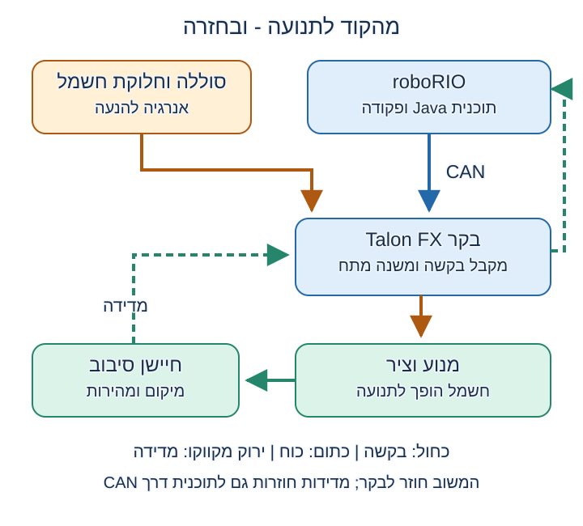
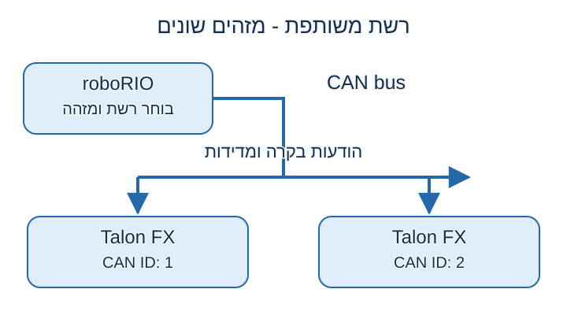
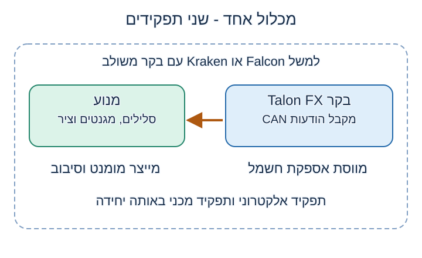
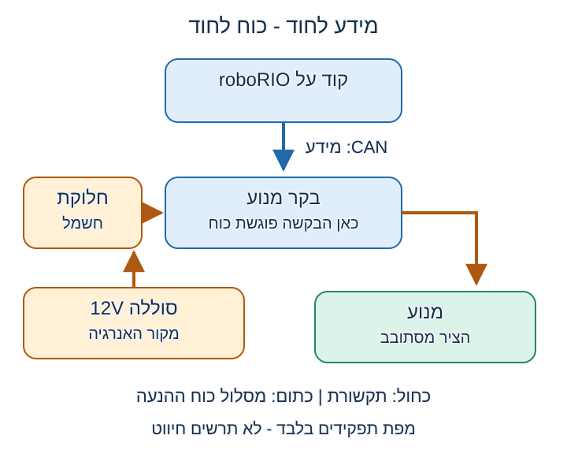
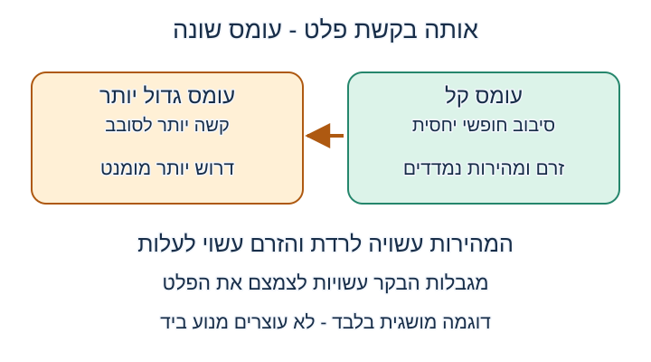
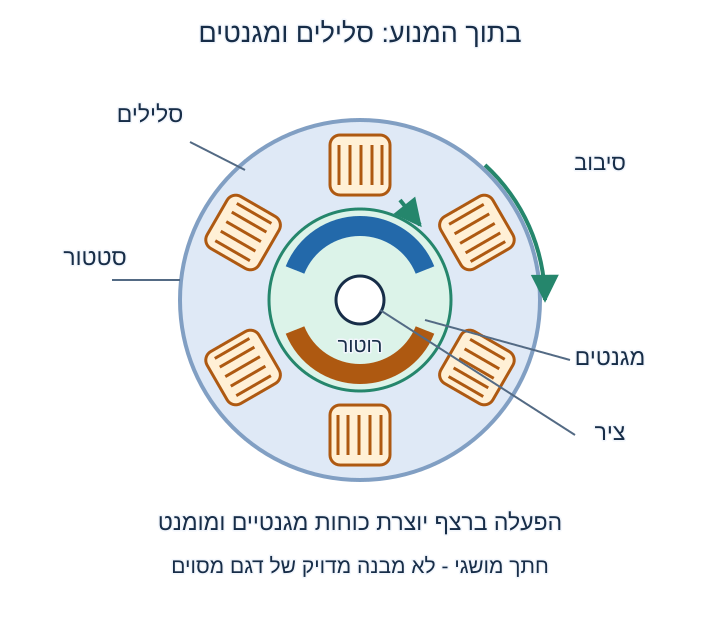
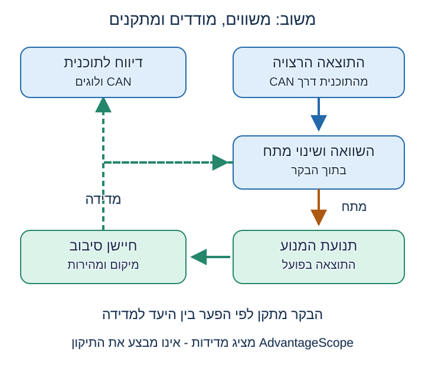

import ExerciseHelp from "@site/src/components/ExerciseHelp";

בשיעור הקודם למדנו לבקש מהמנוע להסתובב באמצעות `setPercentOutput`. **איך בקשה בתוכנית Java הופכת לתנועה של מנוע בעולם האמיתי?**

אחרי שהפעלנו את גלגל התנופה ולפני שנבנה תת־מערכת בעצמנו, נעצור להבין מה קורה בין שורת הקוד לבין הציר שמסתובב. נעקוב אחרי הבקשה אל בקר המנוע, נבדיל בין תקשורת לחשמל, ונכיר את המשמעות של מתח וזרם. לא צריך ידע קודם בחשמל.

בהמשך הפרק נחבר את ההפעלה לכפתורים בשלט ונלמד לבדוק את תנועת המנגנון בסימולציה. כאן נתמקד במה שקורה ברובוט אמיתי.



## 1. הכול מתחיל בבקשה בקוד

נחזור לקריאה מהסוג שהכרנו בשיעור המנועים:

```java
flywheel.setPercentOutput(0.3, false);
```

המספר `0.3` מבקש מהבקר להפעיל על המנוע **כ־30% ממתח הסוללה הזמין לו**. כותבים את האחוז כשבר עשרוני: `0.3` עבור 30%, ו־`0.15` עבור 15%. סימן שלילי מבקש להפעיל מתח בכיוון ההפוך, לפי הגדרת המנוע.

אם מגיעים לבקר 12V, בקשה של 30% מתאימה בקירוב ל־3.6V על המנוע. מתח הסוללה משתנה, ומגבלות הבקר יכולות להפחית את המתח בפועל. **זו בקשת מתח יחסי, לא בקשת מהירות:** 30% אינם 30 סיבובים בדקה וגם אינם הבטחה ל־30% מהמהירות המרבית. את הפרמטר השני נשאיר כפי שהשתמשנו בו בשיעור הקודם.

ה־**roboRIO** הוא המחשב שעל הרובוט. הוא מריץ את תוכנית ה־Java שלנו ושולח לבקר המנוע הודעה עם הבקשה. הוא אינו מספק בעצמו את החשמל שמסובב את המנוע.

**עוצרים לחשוב:** למה אי אפשר פשוט לשלוח את קריאת ה־Java לתוך המנוע?

<ExerciseHelp
  hints={[
    "איפה רצה תוכנית ה־Java?",
    "מה הבקר צריך לקבל כדי לדעת איזו פעולה לבצע?",
  ]}
  solution="ה־Java רצה על ה־roboRIO. המנוע אינו מריץ את המחלקות שלנו. שכבות התוכנה מתרגמות את הקריאה להודעת בקרה; בקר המנוע מקבל אותה ומפעיל את החומרה."
  solutionLanguage="text"
/>

## 2. הבקשה יוצאת דרך CAN

**CAN bus** הוא רשת תקשורת בין התקנים ברובוט. אפשר לחבר לאותה רשת כמה בקרי מנועים וחיישנים. הם מעבירים בה הודעות: בקשות בכיוון אחד ומדידות גם בכיוון השני.



**CAN ID** הוא מספר לזיהוי התקן ברשת הרלוונטית. אם רוצים לפנות לבקר מסוים, הגדרת התוכנה צריכה להתאים למזהה שלו. עבור בקרי Talon FX על אותה רשת משתמשים במזהים שונים.

אם יש ברובוט כמה רשתות CAN, צריך לבחור גם את הרשת שאליה הבקר מחובר. כרגע מספיק להבין שהבקשה צריכה להגיע לבקר הנכון ברשת הנכונה.

אם המזהה או הרשת שגויים, הבקשה לא תגיע לבקר שהתכוונו אליו. ייתכן שלא יהיה שם התקן, או שנפנה לבקר אחר. לא מנחשים מזהים על חומרה פעילה: בודקים עם המנטור כשהרובוט ב־Disabled.

**מה יקרה אם המנוע מחובר לחשמל, אבל הקוד פונה ל־CAN ID שגוי?**

<ExerciseHelp
  hints={["אספקת חשמל והגעת הבקשה הן שתי דרישות שונות."]}
  solution="עצם קיום החשמל אינו מבטיח שהבקשה הגיעה. הבקר המיועד לא יקבל את הבקשה הזאת דרך הכתובת השגויה. בודקים התאמה בין הבקר, המזהה והרשת; מזהה של בקר אחר עלול לפנות למנוע אחר."
  solutionLanguage="text"
/>

## 3. מי מקבל את הבקשה ומי מסובב את הציר?

**בקר מנוע** הוא התקן אלקטרוני שמקבל בקשות ומווסת את אספקת החשמל למנוע. הוא מקבל כוח ממערכת חלוקת החשמל, קורא מדידות, ובהמשך נראה שהוא יכול גם להשוות בין מדידה ליעד ולתקן את הפלט בעצמו.

בקבוצה משתמשים ב־**Talon FX**, בין השאר במנועים ממשפחות Falcon ו־Kraken. בחומרה כזו הבקר משולב במכלול המנוע. מבחוץ רואים יחידה אחת, אבל יש בה שני תפקידים שונים:



הבקר מבצע את ההוראה החשמלית. החלק המכני של המנוע מייצר **מומנט**, כלומר השפעה מסובבת על הציר. כדי שזה יקרה דרוש מקור אנרגיה - הודעת CAN לבדה אינה מספיקה.

## 4. החשמל מגיע מהסוללה

**מערכת חלוקת החשמל** מקבלת חשמל מהסוללה ומפזרת אותו לענפים המזינים את ההתקנים ברובוט. בקר המנוע מקבל ממנה הזנה, ומווסת את החשמל שמגיע למנוע.



החצים הם מפת תפקידים, לא הוראות חיווט. גם ל־roboRIO דרושה הזנת חשמל משלו, שאינה מפורטת כאן. **CAN מעביר מידע; הוא אינו מספק את כוח ההנעה למנוע.** הבקר הוא נקודת המפגש בין הבקשה לבין האנרגיה שמאפשרת לבצע אותה.

### מה לא נכון פה?

״ה־roboRIO שולח 30% מהחשמל שלו בכבל CAN, ולכן המנוע מסתובב ב־30 RPM.״

<ExerciseHelp
  hints={[
    "מאיפה מגיע כוח ההנעה?",
    "איזו יחידה יש למספר 0.3? האם הוא בכלל מהירות?",
  ]}
  solution="CAN מעביר הודעת בקרה. כוח ההנעה מגיע מהסוללה דרך חלוקת החשמל והבקר. 0.3 הוא בקשת פלט ללא יחידת מהירות, ולא יעד של 30 RPM. המהירות בפועל תלויה גם בעומס, במתח ובהגדרות."
  solutionLanguage="text"
/>

## 5. מה אומרים מתח וזרם?

הבקשה כבר הגיעה לבקר, והוא מספק חשמל למנוע. עכשיו נבין שתי מדידות שנראה בגרפים.

### מתח - Voltage

אפשר לחשוב על **מתח** כעל ה״דחיפה״ החשמלית שגורמת לזרם לזרום. זו דרך לדמיין את התפקיד שלו, ולא דחיפה מכנית בציר. מודדים מתח ב־**וולט**, המסומן `V`.

**הבקר משנה את המתח שהוא מפעיל על המנוע כדי להשפיע על מה שהמנוע עושה.** בהמשך נוכל לבקש תוצאות שונות - למשל מהירות, מיקום או זרם מסוים. גם אז הבקר מווסת את המתח כדי להתקרב לתוצאה הרצויה. אין צורך ללמוד כרגע איך הוא מחשב את השינוי.

ב־`setPercentOutput` אנחנו בוחרים בעצמנו איזה חלק מהמתח הזמין לבקש. יותר מתח בכיוון הסיבוב מאפשר בדרך כלל להגיע למהירות גבוהה יותר בתנאים דומים, אבל המהירות תלויה גם במה שמחובר למנוע ובכמה קשה לסובב אותו. **המתח משפיע על התנועה; הוא אינו מספר שאומר מה תהיה המהירות.**

סוללת הרובוט נקראת סוללת **12V**, אבל המתח שלה אינו קבוע: הוא משתנה לפי הטעינה והעומס. `AppliedVoltage` הוא המתח שהבקר מפעיל על המנוע בפועל, שיכול להיות נמוך ממתח הסוללה.

### זרם - Current

**זרם** הוא זרימה של מטען חשמלי. מודדים אותו ב־**אמפר**, המסומן `A`. הזרם במנוע נוצר בהתאם למתח המופעל ולמצב המנוע - למשל כמה מהר הוא מסתובב וכמה קשה לסובב את המנגנון שמחובר אליו.

הזרם בסלילי המנוע קשור ישירות ל־**מומנט** שהמנוע מפיק: ה״כוח המסובב״ שהוא מפעיל על הציר. באותו מנוע, יותר זרם שמייצר מומנט פירושו יותר השפעה מסובבת. אבל **יותר מומנט אינו מבטיח יותר מהירות**: הוא יכול לשמש להאצה, להתגברות על עומס, או להחזקת מנגנון במקום.

לדוגמה, בתחילת הסיבוב דרוש מומנט כדי להאיץ את המנוע ואת מה שמחובר אליו, ולכן הזרם עשוי להיות גבוה. כשהמנוע כבר מסתובב בקצב יציב עם עומס קל, דרוש פחות מומנט והזרם בדרך כלל נמוך יותר.

### מה משתנה כשקשה יותר לסובב?

דמיינו שהסמן הקל מוחלף במנגנון שקשה יותר לסובב. באותה בקשת אחוזים, המנוע עשוי להאט. כשהוא מאט באותו מתח, הזרם יכול לעלות, והמנוע מפיק יותר מומנט כדי להתמודד עם ההתנגדות. עדיין ייתכן שלא יצליח להתגבר עליה.



גם מנוע שהציר שלו תקוע יכול לצרוך זרם גבוה ולהפיק מומנט בלי להסתובב. לכן מהירות אפס אינה אומרת שהמנוע אינו מתאמץ. **זו דוגמה למחשבה בלבד: לא מעמיסים ולא עוצרים את מנוע ההדגמה ביד.**

**מגבלת זרם** היא גבול שהמנטור מגדיר בבקר. כשהזרם מגיע לגבול, הבקר יכול להפחית את המתח המופעל כדי להגביל אותו. כך עוזרים לצמצם חימום ועומס על החומרה, אבל גם מגבילים את המומנט שהמנוע יכול להפיק.

| מדידה            | מה היא אומרת לנו?                              |
| ---------------- | ---------------------------------------------- |
| מתח הסוללה       | כמה מתח זמין ממקור החשמל                       |
| `AppliedVoltage` | איזה מתח מופעל על המנוע בפועל                  |
| `SupplyCurrent`  | כמה זרם הבקר צורך מצד הסוללה                   |
| `StatorCurrent`  | הזרם בצד סלילי המנוע - קשור למומנט ולחימום שלו |
| מהירות           | כמה מהר המנוע או המנגנון מסתובבים              |

יש שני ערכי זרם כי יש שני צדדים לבקר: הצד שמקבל חשמל מהסוללה והצד שמפעיל את המנוע. **הם אינם חייבים להראות אותו מספר.** כשרוצים להבין את המאמץ של המנוע מסתכלים על זרם המנוע; כשרוצים להבין את העומס על הסוללה מסתכלים על זרם ההזנה.

**למה הזרם עשוי לעלות כשקשה יותר לסובב את המנגנון? האם זה מבטיח שהמהירות תישאר קבועה?**

<ExerciseHelp
  hints={[
    "מה יכול לקרות למהירות כשמוסיפים עומס באותו מתח?",
    "מה הקשר בין זרם במנוע למומנט?",
  ]}
  solution="באותו מתח, עומס גדול יותר יכול להאט את המנוע. הזרם יכול לעלות כשהמנוע מאט, וכך גדל המומנט שהוא מפיק. אין הבטחה שהמומנט יספיק כדי לשמור על המהירות, ומגבלת זרם יכולה להגביל אותו."
  solutionLanguage="text"
/>

## 6. איך החשמל הופך לסיבוב?

בתוך מנוע ללא מברשות יש **סטטור** - החלק הנייח ובו סלילים, שהם חוטים המלופפים סביב ליבה; ויש **רוטור** - החלק שמסתובב, ובו מגנטים. הרוטור מחובר לציר שמסובב את המנגנון.



כאשר זרם עובר בסליל, הוא יוצר שדה מגנטי. הבקר מפעיל את הסלילים ברצף מתוזמן. כך נוצרים שדות מגנטיים משתנים, שפועלים על המגנטים ברוטור ומייצרים מומנט. הרוטור והציר מתחילים להסתובב.

האיור הוא חתך מושגי, ולא המבנה המדויק של Falcon או Kraken. הרעיון החשוב: **הבקר מתזמן את ההפעלה החשמלית, והכוחות המגנטיים הופכים אנרגיה חשמלית לתנועה מכנית.**

חוזרים לשאלה שלנו: שורת הקוד לא ״דחפה״ את הציר. היא ביקשה מהבקר להפעיל את המנוע, והבקר השתמש באנרגיה מהסוללה כדי לעשות זאת.

## 7. איך יודעים מה באמת קרה?

במכלול יש גם **חיישן סיבוב**, המכונה **Encoder**. הוא מודד את מיקום הרוטור במהלך הסיבוב. מהשינוי במיקום לאורך זמן אפשר לקבל גם מהירות סיבוב.

המדידות חוזרות דרך CAN לתוכנית הרובוט, ומשם אפשר להציג אותן ב־**AdvantageScope**, תוכנה להצגת מדידות וגרפים, שכבר הכרנו. כך רואים מה קרה בפועל בעקבות הבקשה.

הבקר יכול גם להשתמש במדידה בעצמו: להשוות בין מה שרצינו לבין מה שקרה ולשנות את המתח בהתאם. ההשוואה והתיקון נקראים **משוב**.



למשל, אם נבקש בהמשך מהירות מסוימת, הבקר יוכל לבדוק אם המנוע הגיע אליה ולהתאים את המתח. כרגע מספיק להכיר את הרעיון: **בקשה, תנועה, מדידה ותיקון**. את השימוש ביעדי מהירות ומיקום נלמד בהמשך ההכשרה. בבקשת האחוזים שהכרנו אנחנו קובעים את הפלט; הבקר אינו מנסה לשמור על מהירות מסוימת.

**איך הבקר יודע אם המנוע הגיע למהירות שהתבקשה?**

<ExerciseHelp
  hints={[
    "בקשה ומדידה אינן אותו הדבר.",
    "איזה רכיב נותן מידע על התנועה בפועל?",
  ]}
  solution="חיישן הסיבוב מספק מידע על המיקום, וממנו מתקבלת גם מהירות. הבקר משווה את המהירות שנמדדה ליעד. פלט של 30% לבדו אינו הוכחה להגעה למהירות כלשהי."
  solutionLanguage="text"
/>

## 8. הדגמה עם המנטור: רואים את השרשרת בעמדה

:::warning[הדגמה בהשגחת מנטור בלבד]
המנטור מכין מראש פלט בטוח ומגבלות מתאימות לעמדה. הסמן המסתובב חייב להיות מקובע היטב ומוגן במגן, וכולם נשארים מחוץ לטווח החלקים הנעים. אין לשנות חיווט, לגעת בסמן, להעמיס את המנוע או לעצור אותו. `0.3` הוא דוגמת קוד בשיעור, ולא הוראה להריץ ערך זה על חומרה.
:::

1. **ב־Disabled**, זהו עם המנטור את ה־roboRIO, הסוללה, חלוקת החשמל, חיבורי ההזנה וחיבורי ה־CAN. הצביעו גם על הבקר המשולב במנוע. עקבו בעיניים בלבד אחרי מסלול המידע ואחרי מסלול הכוח.
2. לפני הפעלה, כתבו תחזית: מה ישתנה במתח המופעל, בזרם ובמהירות? המנטור מפעיל את הבקשה הבטוחה שהכין; צפו בתגובה להפעלת הקוד. אין צורך לחבר כפתור בשלט לצורך ההדגמה.
3. המנטור מציג ב־AdvantageScope את המתח המופעל, זרם ההזנה, זרם המנוע והמהירות. זהו יחד מה מייצג כל ערך ואיך הוא משתנה בתחילת הסיבוב ובהמשך. היעזרו בדרך פתיחת הגרף מהשיעור הקודם; כאן המנטור בוחר את נתוני העמדה הפיזית.
4. חזרו ל־**Disabled**. צפו בהפסקת פלט ההנעה ובהאטת המנוע. ב־Coast הוא עשוי להמשיך להסתובב לזמן מה; אופן ההאטה תלוי בהגדרת הנטרול ובמנגנון. אל תניחו שכל ערכי הזרם יתאפסו מיד. הבקר יכול להישאר מוזן ולדווח מדידות גם כשההנעה מנוטרלת.
5. תארו שינוי אחד שראיתם והשוו לתחזית. הבחינו בין הבקשה בקוד, הפלט החשמלי והתנועה בפועל.

## 9. המנוע לא זז - איפה מחפשים?

התוכנית רצה, אבל הסמן נשאר במקום. הציעו סדר בדיקות שכולל את מסלול הבקשה, מסלול הכוח והמדידות. מה תבדקו לפני שתשנו את ערך הפלט?

<ExerciseHelp
  hints={[
    "האם הרובוט במצב שמאפשר הנעה, וששורת הפעלת המנוע אכן מתבצעת?",
    "אילו ראיות יבדילו בין בקשה שלא הגיעה לבין מגבלה פעילה?",
    "האם מדידה ישנה או חסרה יכולה להטעות?",
  ]}
  solution={`מתחילים ב־Disabled ומתייעצים עם המנטור לפני כל הפעלה נוספת.
בודקים שהקוד פונה לתת־המערכת הנכונה, ששורת setPercentOutput אכן מתבצעת ושלא נשלחת מיד אחריה בקשת אפס ממקום אחר בקוד.
בודקים עם המנטור מצב רובוט, תקשורת, CAN ID ורשת מתאימים, ושמדידות הבקר מתעדכנות.
המנטור בודק את ההזנה לבקר, תקלות ומגבלות פעילות. משווים מתח מופעל, זרם ומהירות; נתון אחד לבדו אינו אבחנה.
אם מופיע מאמץ ללא תנועה, מפסיקים את ההפעלה והמנטור בודק את המנגנון בבטחה. לא מעלים פלט כדי להתגבר על תקלה ולא נוגעים בחלקים הנעים.`}
  solutionLanguage="text"
/>

## עכשיו מסבירים את כל המסלול

בלי להסתכל באיור הראשון, הסבירו לחבר: **״הקוד קרא ל־setPercentOutput, והמנוע התחיל להסתובב. איך בדיוק זה קרה?״**

שלבו בתשובה את התוכנית וה־roboRIO, הודעת CAN, בקר המנוע, הסוללה, מתח וזרם, סלילים ומגנטים, והחיישן שמדווח על התנועה.

<ExerciseHelp
  hints={[
    "בנו קודם את מסלול המידע, אחריו את מסלול האנרגיה, ולבסוף את מסלול המדידה.",
  ]}
  solution="התוכנית שעל ה־roboRIO קוראת ל־setPercentOutput ושולחת בקשה דרך CAN לבקר המתאים. הבקר מקבל הזנה מהסוללה דרך חלוקת החשמל ומפעיל על המנוע את חלק המתח שביקשנו, בכפוף למגבלות. הזרם תלוי גם בתנועה ובעומס, והוא קשור למומנט שהמנוע מפיק. הפעלת הסלילים ברצף יוצרת כוחות מגנטיים ומומנט שמסובבים את הרוטור והציר. החיישן מודד סיבוב והבקר מדווח לתוכנית. בבקשת מהירות הבקר גם משווה את המדידה ליעד ומתקן את הפלט, בגבולות היכולת והמגבלות שהוגדרו."
  solutionLanguage="text"
/>
