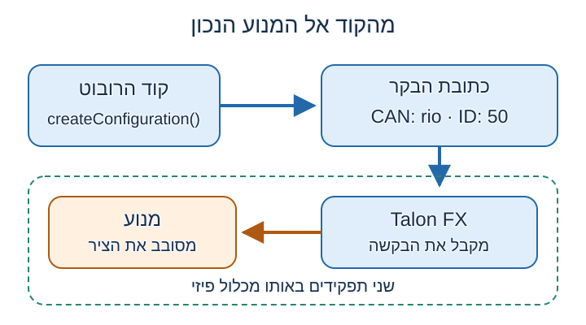

import ExerciseHelp from "@site/src/components/ExerciseHelp";

בשיעור ״איך הקוד שלנו מזיז מנוע?״ עקבנו אחרי בקשת ההפעלה: הקוד קורא לפעולה של תת־המערכת, והבקשה מגיעה לבקר שמפעיל את המנוע. אבל איך תת־המערכת יודעת **לאיזה מנוע לפנות ואיך הוא צריך להתנהג? איפה מגדירים את כל זה בקוד?**

עד עכשיו השתמשנו ב־`TrainingFlywheel` עם הגדרות מוכנות. עכשיו נחזור אל `createConfiguration()` ונבין מה היא מכינה עבור תת־המערכת. את `TrainingRoller`, הרולר של מנגנון האיסוף, ניצור בשיעור הבא בעזרת אותו מבנה.

## 1. מעבירים את ההגדרות בזמן יצירת תת־המערכת

פתחו את `TrainingFlywheel.java` ומצאו את הבנאי:

```java
public TrainingFlywheel() {
    super(createConfiguration());
}
```

`createConfiguration()` יוצרת ומחזירה אובייקט מסוג **`MotorSubsystemConfiguration`**: אובייקט שמרכז את ההגדרות של תת־המערכת. הקריאה `super(...)` מעבירה אותו לבנאי של מחלקת הבסיס, `MotorSubsystemTalon`. מחלקת הבסיס משתמשת בהגדרות כדי ליצור את החיבור למנוע ולהכין את המערכת לעבודה.

בתוך אותה מחלקה אפשר לקרוא למתודה הסטטית בשם `createConfiguration()` בלי להוסיף לפניו `TrainingFlywheel.`. זו עדיין אותה מתודה.

ההכנה הזאת מתרחשת בזמן יצירת תת־המערכת. בהמשך, כשנקרא ל־`setPercentOutput()`, נשלח בקשת הפעלה למנוע שכבר הוגדר. **יצירת התצורה אינה מפעילה את המנוע**, והיא אינה מתבצעת מחדש בכל בקשת פלט.

### עצרו והסבירו

מה ההבדל בין ״המנוע נמצא בכתובת הזאת״ לבין ״הפעל עכשיו פלט חיובי״?

<ExerciseHelp
  hints={[
    "איזה מידע צריך להיות ידוע כבר בזמן יצירת תת־המערכת?",
    "מה יכול להשתנות בכל הפעלה בלי להחליף את המנוע שאליו פונים?",
  ]}
  solution="הכתובת היא חלק מהתצורה שמועברת למחלקת הבסיס בזמן יצירת תת־המערכת. בקשת פלט היא הוראה בזמן הריצה לאותו מנוע שכבר הוגדר. אפשר לשנות את הפלט בלי ליצור מחדש את תת־המערכת."
  solutionLanguage="text"
/>

## 2. מה יש בתצורה של המערכת?

כך נראית המתודה הקיימת ב־`TrainingFlywheel`:

```java
private static MotorSubsystemConfiguration createConfiguration() {
    return new MotorSubsystemConfiguration()
        .withName("TrainingFlywheel")
        .withMaster(
            new MasterMotorConstants(50, "rio", true, new TalonFXConfiguration())
        ).withMechanismType(MotorSubsystemConfiguration.MechanismType.ANGULAR)
        .withMechanismSimConfig(
            new DCMotorMechanismSimConfig(0.002, 0.1)
        );
}
```

אפשר לחלק את המידע בתצורה לשתי קבוצות:

- **הגדרות המנועים שבמערכת:** לאילו מנועים פונים ואיך כל אחד מהם צריך להתנהג. כאן יש מנוע אחד, שמוסיפים באמצעות `withMaster(...)`.
- **הגדרות של המערכת כולה:** השם שלה, סוג התנועה, היחידות ותיאור הפעולה שלה בסימולציה. למשל, `withName(...)` קובעת את השם שמופיע גם בלוגים, ו־`withMechanismType(...)` בוחרת כאן תנועה סיבובית.

`MotorSubsystemConfiguration` מכילה את שתי הקבוצות יחד. הגדרת המנוע היא חלק מהתצורה הכוללת שמועברת למחלקת הבסיס.

הקריאות שמתחילות ב־`with` מעדכנות את אובייקט התצורה ומחזירות אותו, ולכן אפשר לשרשר אותן. בסוף, `return` מחזירה את האובייקט שהכנו.

בשיעור הזה נשאיר את סוג התנועה, היחידות וערכי הסימולציה כפי שקיבלנו אותם. מספיק כרגע לדעת שהם מתארים את המערכת שסביב המנוע. נתמקד בשורה שמגדירה את המנוע עצמו.

## 3. הגדרת המנוע: איזה מנוע ואיך הוא מתנהג?

```java
new MasterMotorConstants(50, "rio", true, new TalonFXConfiguration())
```

`MasterMotorConstants` מחזיקה את הגדרת המנוע הראשי של תת־המערכת. בדוגמה שלנו זה המנוע היחיד. גם כאן יש שני חלקים:

| השאלה | הפרטים בדוגמה |
| --- | --- |
| **על איזה מנוע מדברים?** | מזהה `50` ברשת CAN בשם `"rio"`. |
| **איך רוצים שהמנוע יתנהג?** | `true` קובע את הכיוון החיובי, ו־`TalonFXConfiguration` מכילה הגדרות בקר כמו מצב נטרול ומגבלות זרם. |

### על איזה מנוע מדברים? רשת CAN ומזהה

שני הפרמטרים הראשונים מזהים את הבקר שאליו התוכנית תפנה:

- `50` הוא ה־**Device ID**, מזהה הבקר ברשת CAN.
- `"rio"` בוחר את **רשת ה־CAN של ה־roboRIO**. ברובוט עם CANivore עשויה להיבחר רשת אחרת לפי השם שהוגדר לה.



כמו שראינו בשיעור הקודם, צריך גם רשת נכונה וגם מזהה נכון. שינוי `50` בקוד משנה את הכתובת שהתוכנית מנסה לפנות אליה; הוא אינו משנה את המזהה ששמור בבקר עצמו.

כשהעמדה ב־Disabled, בדקו עם המנטור את הרשת והמזהה ב־[Phoenix Tuner X](https://v6.docs.ctr-electronics.com/en/stable/docs/tuner/device-details-page.html), והשוו לקוד. לא מחפשים את המנוע באמצעות ניסוי במזהים שונים.

### איך המנוע מתנהג? כיוון חיובי ו־inversion

הפרמטר השלישי, `true`, נקרא **`counterClockwisePositive`**. הוא קובע איזה כיוון סיבוב ייחשב חיובי, במבט אל חזית המנוע מצד הציר:

| ערך | הכיוון החיובי |
| --- | --- |
| `true` | נגד כיוון השעון: `CounterClockwise_Positive` |
| `false` | עם כיוון השעון: `Clockwise_Positive` |

זו בחירת ה־**inversion** בגרסה הזאת של DELib. הספרייה משתמשת בערך כדי לקבוע את `MotorOutput.Inverted` בתצורת הבקר. לכן כדאי לקרוא את שם הפרמטר: `true` כאן אומר ״נגד כיוון השעון נחשב חיובי״.

אם נשאיר בקשת פלט חיובית ונחליף את הערך, כיוון הסיבוב הפיזי של אותו מנוע יתהפך. ברולר של מנגנון איסוף נרצה, למשל, שפלט חיובי יכניס את המשחק פנימה. כיוון ההרכבה של המנוע והמנגנון יקבע איזה ערך מתאים לכך.

**שינינו inversion. האם מדידת המהירות חייבת להפוך לשלילית בזמן בקשה חיובית?**

<ExerciseHelp
  hints={[
    "ההגדרה משנה גם מה נחשב כיוון חיובי.",
    "הבדילו בין כיוון פיזי שרואים בעיניים לבין סימן במדידה לפי מוסכמת הבקר.",
  ]}
  solution="לא. הכיוון הפיזי יכול להתהפך והמדידה עדיין להיות חיובית לפי הכיוון החיובי החדש. בודקים את תנועת המנגנון ביחס לפעולה הרצויה, ולא מסיקים את כיוונו הפיזי מסימן המדידה בלבד."
  solutionLanguage="text"
/>

### איך המנוע מתנהג? מצב נטרול

הפרמטר האחרון הוא אובייקט מסוג `TalonFXConfiguration`. בתוכו אפשר להגדיר את התנהגות הבקר. אחת ההגדרות היא **מצב הנטרול**, שנמצאת ב־`MotorOutput.NeutralMode`:

- **Coast** מאפשר למנוע להמשיך להסתובב ולהאט בגלל החיכוך והעומס.
- **Brake** יוצר התנגדות חשמלית לסיבוב, ולכן באותם תנאים עשוי להאט את המנגנון מהר יותר.


**Brake אינו נעילה מכנית או פקודה לשמור על מיקום.** הוא אינו מבטיח עצירה מיידית או החזקת זרוע כנגד כוח הכבידה.

בדוגמה כתוב רק `new TalonFXConfiguration()`, ולכן לא בחרנו מצב נטרול במפורש. בהמשך התרגיל נגדיר אותו בעצמנו ונשווה בין המצבים.

בתצורת הבקר יש גם הגדרות מנוע נוספות, כמו מגבלות זרם ויחס התמסורת שמשמש לקשר בין סיבובי המנוע לסיבובי המנגנון. אין צורך לפרט אותן עכשיו. חשוב לזהות שהן שייכות להגדרת המנוע ולקבל ערכים מתאימים לעמדה לפני שמשנים אותן.

## 4. קוראים את כל הדרך מהתצורה למנוע

חזרו לבנאי ול־`createConfiguration()` וענו מתוך הקוד:

1. איזו מתודה מכינה את התצורה, ומה הסוג שהיא מחזירה?
2. איך התצורה מגיעה למחלקת הבסיס?
3. איזו קריאה מוסיפה לתצורה את המנוע היחיד שלנו?
4. מהם הרשת והמזהה שלו, ואיזה כיוון נחשב חיובי?
5. היכן הייתם מחפשים את מצב הנטרול? האם הוא נבחר במפורש בדוגמה?
6. האם `withName("TrainingFlywheel")` משנה את כתובת הבקר?

<ExerciseHelp
  hints={[
    "התחילו ב־super(createConfiguration()) ועברו אל הערך שהמתודה מחזירה.",
    "בתוך withMaster, הפרידו בין זיהוי הבקר לבין הגדרות ההתנהגות שלו.",
    "השם בלוגים והכתובת ברשת משמשים למטרות שונות.",
  ]}
  solution={`createConfiguration מחזירה MotorSubsystemConfiguration. הבנאי מעביר את האובייקט לבנאי של MotorSubsystemTalon דרך super(...).
withMaster מוסיפה את הגדרת המנוע הראשי. הוא מוגדר עם מזהה 50 ברשת rio, ו־true בוחר נגד כיוון השעון כחיובי.
מצב הנטרול נמצא ב־MotorOutput.NeutralMode בתוך TalonFXConfiguration. בדוגמה לא בוחרים אותו במפורש, ולכן הוא מגיע מברירת המחדל של גרסת Phoenix בפרויקט.
withName קובעת את שם תת־המערכת בתוכנה ובלוגים; היא אינה משנה את כתובת הבקר.`}
  solutionLanguage="text"
/>

לפני התאמת התצורה לרולר חדש, נברר עם צוות החשמל את הרשת והמזהה, עם צוות המכונאות את כיוון הפעולה הרצוי, ועם המנטור את הגדרות המנוע המתאימות. לא צריך לזכור בעל פה את כל אפשרויות הספרייה כדי לדעת היכן לחפש כל פרט.

## 5. משנים הגדרה אחת ובודקים מה קרה

הניסויים משתמשים ב־`TrainingFlywheel` הקיימת ובאמצעי ההפעלה שכבר הכרתם. לא יוצרים תת־מערכת או פקודה חדשה.

:::warning הכנת העמדה עם המנטור
משתמשים בעמדת האימון בעלת המנוע היחיד, עם סמן מקובע ומוגן. המנטור מכין חיבור פעיל לחומרה, כתובת נכונה, פלט נמוך ומגבלות זרם מאושרות. החיבור שיצר את TrainingFlywheel בסימולציה בלבד אינו מספיק להפעלה פיזית. שומרים את הגדרות העמדה שהמנטור סיפק, לא נוגעים בחלקים הנעים ולא עוצרים אותם ביד.
:::

### תרגיל 1: אותו פלט, כיוון חיובי אחר

1. כשהעמדה ב־Disabled, שמרו את התצורה המקורית. כתבו מאיזה צד מסתכלים ואיזה כיוון צפוי בבקשת פלט חיובית.
2. הפעילו עם המנטור לזמן קצר את הפלט המאושר. תעדו את הכיוון הפיזי, עברו ל־Disabled והמתינו לעצירה.
3. שנו **רק** את `counterClockwisePositive` מ־`true` ל־`false`, בארגומנט השלישי של `MasterMotorConstants`. השאירו את הרשת, המזהה והפלט כפי שהיו.
4. שמרו, בנו והפעילו מחדש את תוכנית הרובוט בתהליך העבודה של העמדה עם המנטור. התצורה נקראת בזמן יצירת המופע; Apply Code Changes לבדו אינו יוצר אותו מחדש.
5. חזרו על אותה הפעלה והשוו לתחזית. החזירו את הערך המקורי והפעילו מחדש לפני הניסוי הבא.

<ExerciseHelp
  hints={[
    "מה השתנה במשמעות של פלט חיובי, ומה נשאר זהה בבקשת ההפעלה?",
    "אם לא רואים שינוי, בדקו שהתוכנית החדשה עלתה ושהמופע נוצר מחדש.",
  ]}
  solution="אותה בקשת פלט חיובית אמורה לסובב את המנוע הפיזי בכיוון ההפוך לאחר שינוי ההגדרה. הכתובת והפלט לא השתנו. בתיעוד כותבים גם את נקודת המבט ואת כיוון הפעולה שנצפה; סימן המהירות בלוג אינו מספיק לבדו."
  solutionLanguage="text"
/>

### תרגיל 2: בוחרים מצב נטרול במפורש

במתודה המקורית, הביטוי `new TalonFXConfiguration()` יוצר תצורת בקר ללא התאמות משלנו. כדי לבחור מצב נטרול במפורש, אפשר להחליף אותו בביטוי הבא:

```java
new TalonFXConfiguration()
    .withMotorOutput(new MotorOutputConfigs()
        .withNeutralMode(NeutralModeValue.Coast))
```

ליד ה־imports הקיימים הוסיפו:

```java
import com.ctre.phoenix6.configs.MotorOutputConfigs;
import com.ctre.phoenix6.signals.NeutralModeValue;
```

אם המנטור סיפק תצורה מותאמת לעמדה, הוסיפו אליה את בחירת מצב הנטרול ושמרו את מגבלות הזרם ושאר ההגדרות הקיימות. אם כבר יש בה הגדרות תחת `MotorOutput`, שנו בהן רק את `NeutralMode`.

1. הפעילו מחדש אחרי השינוי. התחילו ממנוחה, הפעילו עם המנטור את אותו פלט מאושר למשך זמן קבוע, ואז עברו ל־Disabled. תעדו ב־AdvantageScope את דעיכת `MechanismVelocityRotPerSec` תחת `Subsystems/TrainingFlywheel/Inputs`.
2. אחרי עצירה מלאה, שנו רק `Coast` ל־`Brake`, הפעילו מחדש וחזרו על אותם תנאי התחלה וזמן הפעלה.
3. השוו את זמן ההאטה לתחזית שלכם. החזירו את תצורת העמדה המקורית בסיום והפעילו מחדש.

<ExerciseHelp
  hints={[
    "השוו את ההאטה אחרי ביטול ההנעה, ולא רק את המהירות בזמן ההפעלה.",
    "אם כמעט אין הבדל, בדקו עם המנטור שההגדרה הוחלה וחשבו על החיכוך בעמדה.",
  ]}
  solution="באותם תנאים מצפים ש־Brake יוסיף התנגדות לסיבוב ויקצר את ההאטה לעומת Coast. גודל ההבדל תלוי במנגנון. גם עצירה מהירה אינה אומרת שהמנוע נעול מכנית או שהבקר שומר על מיקומו."
  solutionLanguage="text"
/>

### אם אין עמדה זמינה

בצעו בסימולציה את קריאת הקוד ואת שתי עריכות התצורה, עם הפעלה מחדש אחרי כל שינוי. בדקו ב־Debugger את `configuration.master.counterClockwisePositive` ואת `configuration.master.getTalonFXConfig().MotorOutput.NeutralMode`, וודאו שהערכים תואמים למה שכתבתם.

המודל הנתון אינו מבחן מלא לשינוי הכיוון הפיזי או להבדל בבלימה בין Brake ל־Coast. כתבו תחזית לעמדה אמיתית, ואל תסיקו מגרפים דומים שההגדרה לא השתנתה. את התצפית הפיזית תשלימו עם המנטור כשעמדה תהיה זמינה.

## לפני שממשיכים

הראו למנטור את הבנאי ואת התצורה, והסבירו את הרצף:

1. `createConfiguration()` מכינה `MotorSubsystemConfiguration`.
2. בתוך התצורה נמצאות הגדרת המנוע וההגדרות של המערכת כולה.
3. הגדרת המנוע קובעת **לאיזה בקר פונים ואיך הוא מתנהג**.
4. `super(...)` מעבירה את התצורה למחלקת הבסיס בזמן יצירת תת־המערכת.
5. בקשות ההפעלה בהמשך משתמשות במנוע שכבר הוגדר.

הציגו תצפית אחת מהניסוי, או תחזית אם עבדתם בסימולציה, ופרט אחד שתצטרכו לברר לפני הגדרת הרולר. בדקו את השינויים, ודאו ששחזרתם את תצורת ההתחלה ושמרו commit של עבודתכם.

בשיעור הבא נשתמש באותו מבנה כדי ליצור את `TrainingRoller` ולהעביר למחלקת הבסיס את התצורה שלה.

<details>
<summary>קוד המקור של הדוגמה</summary>

המתודה מובאת מתוך [TrainingFlywheel בתבנית ההכשרות, בגרסה 79e3bab](https://github.com/Desert-Eagles-6104/robot-training-template/blob/79e3babd4735d0bae10f88a5536e067a938a44a3/src/main/java/frc/robot/subsystems/trainingFlywheel/TrainingFlywheel.java).

לחקירה בעורך התחילו ב־[MasterMotorConstants](https://github.com/Desert-Eagles-6104/DELib26/blob/f33453b202678269dd3cc10422c2ff3a79f958a3/motors/MasterMotorConstants.java) וב־[MotorSubsystemConfiguration](https://github.com/Desert-Eagles-6104/DELib26/blob/f33453b202678269dd3cc10422c2ff3a79f958a3/subsystems/motorSubsystems/motorBase/MotorSubsystemConfiguration.java). אם הקוד אצלכם שונה, השוו עם המנטור לגרסת הפרויקט לפני העתקת שינוי.

</details>
