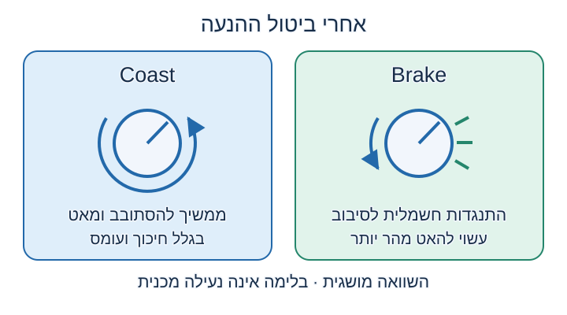

import ExerciseHelp from "@site/src/components/ExerciseHelp";

בשיעור ״איך הקוד שלנו מזיז מנוע?״ עקבנו אחרי בקשת ההפעלה. אבל איך תת־המערכת יודעת **לאיזה מנוע לפנות ואיך הוא צריך להתנהג? איפה מגדירים את כל זה בקוד?**

עד עכשיו השתמשנו ב־`TrainingFlywheel` מוכנה. הפעם נבנה בעצמנו את `TrainingRoller`: תת־מערכת ששולטת ברולר של מערכת איסוף. **היא אינה קיימת בתבנית — אתם יוצרים גם את המחלקה וגם את התצורה שלה.** בפרק הזה נבנה את התצורה ונבדוק אותה בסימולציה.

## 1. מפרידים בין הגדרות לפעולות

פתחו את `src/main/java/frc/robot/constants/Constants.java`. בתוך `Constants` כבר יש מחלקות כמו `SwerveConstants` ו־`VisionConstants`. נוסיף לידן מחלקה פנימית בשם `TrainingRollerConstants`.

**בקובץ ההגדרות מתארים את המנוע ואת התנועה של המנגנון. מחלקת תת־המערכת מספקת את הפעולות שאפשר לבצע בו.**

| מקום | האחריות שלו |
| --- | --- |
| `Constants.TrainingRollerConstants` | שם תת־המערכת, פרטי המנוע, הגדרות הבקר והסימולציה, וקבועי הפעלה |
| `TrainingRoller` | שליטה ברולר באמצעות פעולות המנוע שמתקבלות בירושה |
| `RobotContainer` | יצירת מופע אחד, חיבור פקודות לכפתורים וחיבור המדידות |

כך ייראה המקום שבו נשמור את `CONFIG` אחרי שנלמד איך מרכיבים את התצורה:

```java
public static final class TrainingRollerConstants {
    public static final MotorSubsystemConfiguration CONFIG = /* התצורה שנבנה בסעיף 4 */;
}
```

בגרסת הספרייה שבתבנית שם הטיפוס הוא `MotorSubsystemConfiguration`. `TrainingRollerConstants` היא המחלקה שלנו שמרכזת קבועים; `CONFIG` הוא אובייקט התצורה שנשמור בה.

- `public` מאפשרת להשתמש במחלקה ובשדה מקבצים אחרים.
- `static` מאפשרת לגשת אליהם דרך שם המחלקה, בלי ליצור `new Constants()` או `new TrainingRollerConstants()`.
- `final` על המחלקה מונעת ירושה ממנה. `final` על השדה מונעת החלפת ההפניה שלו באובייקט אחר; היא אינה הופכת את תוכן האובייקט לבלתי ניתן לשינוי.

התצורה נוצרת פעם אחת ומשמשת לאתחול תת־המערכת. **יצירת תצורה אינה מפעילה מנוע**, ואין ליצור אותה מחדש בכל מחזור. בהמשך נעביר את `TrainingRollerConstants.CONFIG` לבנאי של מחלקת הבסיס באמצעות `super(...)`.

## 2. ממה בונים את CONFIG?

פתחו את `TrainingFlywheel.java` ומצאו את `createConfiguration()` כדי לראות דוגמה לתצורה קיימת. נלמד מה כל חלק בתצורה מגדיר, ובסעיף 4 נשתמש בזה כדי לבנות את תצורת הרולר בתוך `Constants`.

`MotorSubsystemConfiguration` מרכזת שתי קבוצות מידע:

- **הגדרות המנועים:** לאילו בקרים פונים ואיך מגדירים אותם. בתרגיל יש מנוע אחד שמוסיפים באמצעות `withMaster(...)`.
- **הגדרות כלליות:** שם תת־המערכת, סוג התנועה של המנגנון והמודל שלו בסימולציה.

| קריאה | מה היא מגדירה? | הבחירה בתרגיל |
| --- | --- | --- |
| `withName(...)` | שם תת־המערכת בתוכנה ובלוגים | `TrainingRoller` |
| `withMaster(...)` | הגדרת המנוע הראשי | אובייקט `MasterMotorConstants` שתבנו |
| `withMechanismType(...)` | סוג התנועה של המנגנון | `MotorSubsystemConfiguration.MechanismType.ANGULAR`, כי הרולר מסתובב |
| `withMechanismSimConfig(...)` | המודל לחישוב התנועה בסימולציה | `DCMotorMechanismSimConfig` שתבנו |

הקריאות שמתחילות ב־`with` מעדכנות את האובייקט ומחזירות אותו. לכן אפשר לכתוב שרשרת: ליצור אובייקט עם `new`, לקרוא ל־`with...` ולהמשיך על אותו אובייקט. הסדר בשורה אינו סדר הפעלת המנוע — זו הכנת הגדרות.

למודל `DCMotorMechanismSimConfig` יש שני פרמטרים:

| פרמטר | משמעות | ערך התחלתי לסימולציה |
| --- | --- | --- |
| `momentOfInertia` | מומנט התמד בק״ג·מ״ר: כמה קשה לשנות את מהירות הסיבוב | `0.002` |
| `frictionVoltage` | מתח חיכוך בוולט: פרמטר במודל שמייצג התנגדות לתנועה | `0.1` |

אלה ערכי ניסוי למודל לימודי, ולא מדידה של הרולר האמיתי. אין צורך לחשב אותם עכשיו. שינוי בהם משנה את **הסימולציה**, ואינו משנה את החיכוך או המסה של המנגנון הפיזי.

את היחידות ויחס התמסורת נשאיר כברירות המחדל בתרגיל הזה, עם הנחת חיבור ישיר. אין צורך להוסיף מנועים עוקבים, יעדי מיקום או הגדרות PID.

## 3. הגדרת המנוע: איזה מנוע ואיך הוא מתנהג?

```java
new MasterMotorConstants(50, "rio", true, new TalonFXConfiguration())
```

`MasterMotorConstants` מחזיקה את הגדרת המנוע הראשי של תת־המערכת. בדוגמה שלנו זה המנוע היחיד. גם כאן יש שני חלקים:

| השאלה | הפרטים בדוגמה |
| --- | --- |
| **על איזה מנוע מדברים?** | מזהה `50` ברשת CAN בשם `"rio"`. |
| **איך רוצים שהמנוע יתנהג?** | `true` קובע את הכיוון החיובי, ו־`TalonFXConfiguration` מכילה הגדרות בקר כמו מצב נטרול ומגבלות זרם. |

### על איזה מנוע מדברים? רשת CAN ומזהה

שני הפרמטרים הראשונים מזהים את הבקר שאליו התוכנית תפנה:

- `50` הוא ה־**Device ID**, מזהה הבקר ברשת CAN.
- `"rio"` בוחר את **רשת ה־CAN של ה־roboRIO**. ברובוט עם CANivore עשויה להיבחר רשת אחרת לפי השם שהוגדר לה.


כמו שראינו בשיעור הקודם, צריך גם רשת נכונה וגם מזהה נכון. שינוי `50` בקוד משנה את הכתובת שהתוכנית מנסה לפנות אליה; הוא אינו משנה את המזהה ששמור בבקר עצמו.

### איך המנוע מתנהג? כיוון חיובי ו־inversion

הפרמטר השלישי, `true`, נקרא **`counterClockwisePositive`**. הוא קובע איזה כיוון סיבוב ייחשב חיובי, במבט אל חזית המנוע מצד הציר:

| ערך | הכיוון החיובי |
| --- | --- |
| `true` | נגד כיוון השעון: `CounterClockwise_Positive` |
| `false` | עם כיוון השעון: `Clockwise_Positive` |

זו בחירת ה־**inversion** בגרסה הזאת של DELib. הספרייה משתמשת בערך כדי לקבוע את `MotorOutput.Inverted` בתצורת הבקר. לכן כדאי לקרוא את שם הפרמטר: `true` כאן אומר ״נגד כיוון השעון נחשב חיובי״.

אם נשאיר בקשת פלט חיובית ונחליף את הערך, כיוון הסיבוב הפיזי של אותו מנוע יתהפך. ברולר של מנגנון איסוף נרצה, למשל, שפלט חיובי יכניס את המשחק פנימה. כיוון ההרכבה של המנוע והמנגנון יקבע איזה ערך מתאים לכך.

**שינינו inversion. האם מדידת המהירות חייבת להפוך לשלילית בזמן בקשה חיובית?**

<ExerciseHelp
  hints={[
    "ההגדרה משנה גם מה נחשב כיוון חיובי.",
    "הבדילו בין כיוון פיזי שרואים בעיניים לבין סימן במדידה לפי מוסכמת הבקר.",
  ]}
  solution="לא. הכיוון הפיזי יכול להתהפך והמדידה עדיין להיות חיובית לפי הכיוון החיובי החדש. בודקים את תנועת המנגנון ביחס לפעולה הרצויה, ולא מסיקים את כיוונו הפיזי מסימן המדידה בלבד."
  solutionLanguage="text"
/>

### איך המנוע מתנהג? מצב נטרול

הפרמטר האחרון הוא אובייקט מסוג `TalonFXConfiguration`. בתוכו אפשר להגדיר את התנהגות הבקר. אחת ההגדרות היא **מצב הנטרול**, שנמצאת ב־`MotorOutput.NeutralMode`:

- **Coast** מאפשר למנוע להמשיך להסתובב ולהאט בגלל החיכוך והעומס.
- **Brake** יוצר התנגדות חשמלית לסיבוב, ולכן באותם תנאים עשוי להאט את המנגנון מהר יותר.



**Brake אינו נעילה מכנית או פקודה לשמור על מיקום.** הוא אינו מבטיח עצירה מיידית או החזקת זרוע כנגד כוח הכבידה.

### איך מגדירים את מצב הנטרול בקוד?

יוצרים `MotorOutputConfigs`, בוחרים בה את מצב הנטרול באמצעות `withNeutralMode(...)`, ומעבירים אותה ל־`withMotorOutput(...)` של תצורת הבקר:

```java
TalonFXConfiguration motorConfig = new TalonFXConfiguration()
    .withMotorOutput(
        new MotorOutputConfigs()
            .withNeutralMode(NeutralModeValue.Coast)
    );
```

את `motorConfig` מעבירים כפרמטר האחרון של `MasterMotorConstants`, במקום `new TalonFXConfiguration()` הריקה שראינו קודם. כך מצב הנטרול הוא חלק מהתצורה שמחלקת הבסיס מקבלת בעת יצירת תת־המערכת. כדי לבחור בלימה, מחליפים את `NeutralModeValue.Coast` ב־`NeutralModeValue.Brake`.

שימו לב למבנה: `withNeutralMode(...)` שייכת ל־`MotorOutputConfigs`, ואילו `withMotorOutput(...)` שייכת ל־`TalonFXConfiguration`. שבירת השורות וההזחה מדגישות איזה אובייקט נמצא בתוך איזה אובייקט; הן אינן משנות את משמעות הקוד. בסוף יצירת `motorConfig` סוגרים את הקריאות ומוסיפים נקודה־פסיק אחת.

### שתי דרכים לתאר אותה הגדרה

בתצורת Phoenix אפשר לשרשר מתודות `with...`, ואפשר גם ליצור אובייקט ולשנות את השדות הציבוריים שלו. לדוגמה, שני הקטעים הבאים בוחרים אותו מצב נטרול:

```java
MotorOutputConfigs output = new MotorOutputConfigs()
    .withNeutralMode(NeutralModeValue.Coast);
```

```java
MotorOutputConfigs output = new MotorOutputConfigs();
output.NeutralMode = NeutralModeValue.Coast;
```

בחרו דרך אחת והסבירו מה נוצר ומה משתנה בה. אם בחרתם להשתמש במשתני עזר ובכמה פקודות, אפשר לכתוב בתוך `TrainingRollerConstants` מתודה פרטית וסטטית שמכינה ומחזירה את התצורה, ולאתחל את `CONFIG` באמצעותה. **גם במקרה הזה ההגדרות נשארות ב־Constants.**

## 4. בונים בעצמנו את התצורה

פתחו את `Constants.java` והוסיפו בתוך `Constants` את המחלקה `TrainingRollerConstants` לפי המבנה שבסעיף 1. בנו את תצורת הרולר לפי הדרישות הבאות ושמרו אותה בשדה `CONFIG` של המחלקה.

1. שם תת־המערכת יהיה `TrainingRoller` וסוג התנועה יהיה סיבובי.
2. הגדירו מנוע ראשי אחד. לסימולציה השתמשו במזהה `51` וברשת `"rio"`; אל תשתמשו שוב ב־`50` של `TrainingFlywheel`. הרשת והמזהה כאן הם חלק מהתרגיל בסימולציה.
3. התחילו עם נגד כיוון השעון ככיוון חיובי ועם `Coast` שנבחר במפורש בתצורת הבקר.
4. הוסיפו מודל סימולציה עם ערכי ההתחלה מהטבלה בסעיף 2.
5. הוסיפו באותה מחלקת קבועים שדה `public static final double` בשם `TRAINING_OUTPUT`, עם ערך התחלתי `0.15` לניסוי בסימולציה.
6. הוסיפו ל־`Constants.java` את ה־imports הדרושים. מצאו אותם בקובץ `TrainingFlywheel` ובדוגמאות שכבר נמצאות ב־`Constants`; השתמשו בהשלמה האוטומטית של העורך.

<ExerciseHelp
  hints={[
    "התחילו ביצירת MotorSubsystemConfiguration, וחפשו בטבלה אילו ארבע קריאות צריך להוסיף אליה.",
    "withMaster מקבלת אובייקט MasterMotorConstants. הפרמטר האחרון שלו הוא אובייקט TalonFXConfiguration, ובתוכו מגדירים MotorOutputConfigs.",
    "withMechanismSimConfig מקבלת אובייקט DCMotorMechanismSimConfig עם שני המספרים שבטבלה. את כל התוצאה שומרים בשדה CONFIG.",
  ]}
  solution="בדקו שיש לתצורה שם ייחודי, מנוע ראשי עם כתובת וכיוון שבחרתם, מצב Coast מפורש, סוג ANGULAR ומודל סימולציה. הסבירו למנטור איזה אובייקט מכיל כל פרט. התצורה כולה צריכה להימצא בתוך מחלקת הקבועים, ולא במתודה בתוך TrainingRoller."
  solutionLanguage="text"
/>

## 5. יוצרים את TrainingRoller

צרו תיקייה בשם `trainingRoller` בתוך `src/main/java/frc/robot/subsystems`, ובתוכה צרו קובץ חדש בשם `TrainingRoller.java`.

כתבו בעצמכם מחלקה לפי הדרישות:

1. ה־package יהיה `frc.robot.subsystems.trainingRoller`.
2. המחלקה תהיה ציבורית, תיקרא `TrainingRoller` ותירש מ־`MotorSubsystemTalon`.
3. הוסיפו בנאי ציבורי ללא פרמטרים.
4. בתחילת הבנאי העבירו ל־`super(...)` את `TrainingRollerConstants.CONFIG`.
5. ייבאו את מחלקת הבסיס ואת `frc.robot.constants.Constants.TrainingRollerConstants`.

אין צורך ליצור כאן בקר Talon FX נוסף או להעתיק את מימוש `setPercentOutput`. מחלקת הבסיס כבר מספקת את יכולות ההפעלה והמדידה לפי התצורה שנתתם לה.

<ExerciseHelp
  hints={[
    "היעזרו במבנה המחלקה של TrainingFlywheel, אבל החליפו את שם המחלקה ואת המקור שממנו הבנאי מקבל את ההגדרות.",
    "במקום super(createConfiguration()), הבנאי צריך להעביר את השדה CONFIG מתוך מחלקת הקבועים.",
  ]}
  solution="TrainingRoller יורשת מ־MotorSubsystemTalon. הבנאי שלה קורא ל־super(TrainingRollerConstants.CONFIG). מחלקת הבסיס מקבלת את התצורה ומאתחלת את תת־המערכת; יכולות המנוע מגיעות בירושה."
  solutionLanguage="text"
/>

### בדיקת הבנה

למה מחלקה עם בנאי קצר כל כך כבר יכולה להפעיל מנוע? האם `final` על `CONFIG` מונעת עריכה של ערכי התצורה בקוד המקור?

<ExerciseHelp
  hints={["איזו מחלקה מספקת את היכולות בירושה? הבדילו בין השמה בזמן ריצה לבין עריכה ובנייה מחדש."]}
  solution="היכולות כבר ממומשות במחלקת הבסיס. TrainingRoller בוחרת תצורה עבור המנגנון שלה ומשתמשת בהן. final מונעת השמה מחדש לשדה בזמן הריצה, אך אפשר לערוך את קוד המקור, לבנות ולהפעיל מחדש. היא גם אינה מונעת שינוי בשדות של אובייקט התצורה."
  solutionLanguage="text"
/>

## 6. מחברים לרובוט ובודקים

בנו את הפרויקט ותקנו שגיאות לפני ההרצה. כעת חזרו לדרך החיבור של `TrainingFlywheel` בפרק הקודם ובצעו בעצמכם את אותם שלבים עבור הרולר:

1. הוסיפו ב־`RobotContainer` את השדה `public final Optional<TrainingRoller> trainingRoller;`. בבנאי צרו בו מופע אחד כש־`isSim` הוא `true`, ובכל מצב אחר שמרו `Optional.empty()`.
2. חברו את `logTelemetry()` של אותו מופע ל־`logTelemetry()` של ה־container.
3. חברו פקודת `MotorSubsystemSetPercentage` מוכנה לכפתור פנוי באמצעות `whileTrue`. השתמשו ב־`TrainingRollerConstants.TRAINING_OUTPUT`. אם משתמשים בכפתור של הגלגל הקודם, הסירו ממנו את החיבור הישן.
4. אל תוסיפו הפעלה מקבילה מתוך `teleopPeriodic()`.
5. הפעילו מחדש סימולציה, מצאו `Subsystems/TrainingRoller/Inputs` ב־AdvantageScope והציגו מתח ומהירות, כל אחד בציר המתאים.
6. בדקו: ללא לחיצה אין בקשת הנעה; בלחיצה הרולר מאיץ; בשחרור הפלט מתבטל והרולר יכול להמשיך להאט.

<ExerciseHelp
  hints={[
    "השדה והיצירה דומים לחיבור TrainingFlywheel, עם סוג ושם חדשים. לא יוצרים מופע נוסף לצורך הלוגים או הכפתור.",
    "ב־ifPresent מקבלים את אותו מופע ומעבירים אותו לפקודה. ה־supplier מחזירה את קבוע הפלט מתוך TrainingRollerConstants.",
    "אם לא רואים מדידות, בדקו יצירת מופע, חיבור לוגים וחיבור להרצה הנוכחית. אם אין תגובה לכפתור, בדקו גם את מצב הרובוט וחיבור השלט.",
  ]}
  solution="שלושת החיבורים — יצירה, מדידות וכפתור — צריכים להתייחס לאותו מופע של TrainingRoller. לוגים לבדם אינם מפעילים מנוע, וקיום הקובץ לבדו אינו יוצר מופע. שחרור הכפתור מבטל את הפקודה שמבטלת את הפלט."
  solutionLanguage="text"
/>

## 7. משנים ערך אחד ומשווים

לפני כל ניסוי כתבו תחזית. התחילו ממנוחה, הפעילו למשך אותו זמן ותעדו מתח ומהירות. החזירו את ערך הבסיס לפני הניסוי הבא. **אחרי שינוי תצורה הפסיקו והפעילו מחדש את התוכנית**, כדי שה־CONFIG והמופע ייווצרו מחדש; Apply Code Changes לבדו אינו מספיק לכך.

### תרגיל 1: פלט חיובי, שלילי ואפס

בסימולציה נסו בקבוע הפלט `0.15`, `0.25`, `0.0` ו־`-0.15`. מה אומר הגודל ומה אומר הסימן? האם `0.25` מבטיח מהירות של 25 סיבובים לשנייה? האם אפס פלט מבטיח אפס מהירות מיד?

<ExerciseHelp
  hints={["הפלט הוא אחוז עשרוני. מהירות היא תוצאה שנמדדת בנפרד."]}
  solution="הגודל קובע את אחוז הפלט והסימן את הכיוון לפי מוסכמת המנוע. בתנאים דומים 0.25 צפוי לתת מתח ומהירות גדולים יותר מ־0.15, אך אינו יעד מהירות. פלט שלילי הופך את כיוון הבקשה. באפס מבטלים הנעה, אך מנגנון נע יכול להמשיך ולהאט."
  solutionLanguage="text"
/>

### תרגיל 2: אותו פלט, כיוון חיובי אחר

שנו רק את `counterClockwisePositive` מ־`true` ל־`false`. חזרו על בקשת פלט חיובית. כתבו מה אמור לקרות **במנוע פיזי**, ומאיזה צד אתם מסתכלים. האם זה אותו שינוי כמו להשאיר את התצורה ולהפוך את סימן הפלט? מתי מתאים כל שינוי?

<ExerciseHelp
  hints={["אחד השינויים מגדיר את מוסכמת הכיוון של המנגנון; השני בוחר פעולה בכיוון ההפוך בזמן הריצה."]}
  solution="שינוי התצורה הופך את הכיוון הפיזי שנחשב חיובי. שינוי סימן הפלט מבקש תנועה הפוכה לפי התצורה הקיימת. מגדירים את הכיוון כך שפעולה חיובית תתאים למנגנון, ומשתמשים בפלט הפוך כדי לבצע למשל פליטה במקום איסוף. סימן המדידה אינו חייב להתהפך בעקבות שינוי מוסכמת הכיוון."
  solutionLanguage="text"
/>

### תרגיל 3: Coast לעומת Brake

בחרו `Coast` במפורש. הריצו, שחררו את הכפתור ותעדו את ההאטה. החליפו רק ל־`Brake`, הפעילו מחדש והשוו באותם תנאים. הסבירו מה כל מצב מסמל ולמה Brake אינו פקודת שמירת מיקום.

<ExerciseHelp
  hints={["משווים את ההאטה אחרי ביטול ההנעה. התנגדות לסיבוב אינה נעילה מכנית."]}
  solution="Coast מאפשר האטה כתוצאה מהחיכוך והעומס; Brake מוסיף התנגדות חשמלית לתנועה ועשוי לקצר אותה בחומרה. הוא אינו מבטיח עצירה מיידית או שמירת זווית. גודל ההבדל תלוי במנגנון ובמודל."
  solutionLanguage="text"
/>

**מגבלת הסימולציה:** המודל הנתון אינו מבחן מלא לכיוון הפיזי או להבדל בבלימה. בדקו גם את ערכי התצורה ב־Debugger, כתבו תחזית לחומרה ואל תסיקו מגרפים דומים שההגדרה לא השתנתה.

### תרגיל 4: רולר שקשה יותר להאיץ — בסימולציה בלבד

השאירו אותו פלט ואותו חיכוך. שנו רק את `momentOfInertia` מ־`0.002` ל־`0.008`. האם המהירות אחרי זמן קצר תשתנה? האם פירוש הדבר שהמהירות הסופית חייבת להיות קטנה פי ארבעה?

<ExerciseHelp
  hints={["מומנט התמד מתאר התנגדות לשינוי מהירות, ולא יעד מהירות."]}
  solution="מצפים להאצה אטית יותר ולזמן ארוך יותר להתקרבות למהירות היציבה. הגדלת מומנט ההתמד פי ארבעה אינה אומרת שהמהירות הסופית קטנה פי ארבעה. משווים את צורת העלייה בגרף ואת המהירות אחרי אותו זמן."
  solutionLanguage="text"
/>

### תרגיל 5: יותר חיכוך — בסימולציה בלבד

החזירו את מומנט ההתמד. השוו בין `frictionVoltage` של `0.1` ושל `0.5`, באותו פלט. מה אתם מצפים שיקרה בתחילת התנועה ובהאטה? האם הפרמטר הזה שולח לבקר בקשת מתח חדשה?

<ExerciseHelp
  hints={["זו הגדרה של המודל שמחשב את התנועה, ולא ערך הפלט שביקשה הפקודה."]}
  solution="הערך הגדול מייצג יותר התנגדות לתנועה במודל, ולכן עשוי להקשות על תחילת התנועה, להפחית מהירות ולהאיץ האטה לאחר ביטול ההנעה. הוא אינו פקודת מתח נוספת ואינו משנה את החיכוך של חומרה אמיתית. את התוצאה בודקים בגרף."
  solutionLanguage="text"
/>

### תרגיל 6: שם לעומת כתובת

ללא הפעלה פיזית, הסבירו מה משתנה בכל מקרה:

| שינוי | מה צריך לבדוק? |
| --- | --- |
| `withName("RollerTest")` | מה יהיה שם ענף הלוגים? האם כתובת הבקר השתנתה? |
| CAN ID מ־`51` ל־`52` | לאיזה בקר תנסה התוכנית לפנות? האם המזהה בבקר עצמו השתנה? |
| רשת מ־`"rio"` ל־`"Canivore"` | האם הבקר באמת מחובר לרשת הזאת? האם עצם שינוי המחרוזת מעביר אותו אליה? |

<ExerciseHelp
  hints={["שם תוכנתי, רשת ומזהה הם שלושה פרטים שונים. הצלחה בסימולציה אינה מאשרת כתובת בחומרה."]}
  solution="השם משנה זיהוי בתוכנה ובלוגים. הרשת והמזהה משנים את היעד שהתוכנית מנסה לפנות אליו; הם אינם משנים את החיווט או את המזהה ששמור בבקר. בודקים את פרטי החומרה עם המנטור, ולא מחפשים מנוע באמצעות הפעלה של מזהים אקראיים."
  solutionLanguage="text"
/>

## לפני שממשיכים

החזירו את ערכי הבסיס, בנו והפעילו מחדש. הראו למנטור:

- קובץ `TrainingRoller.java` שיצרתם בתוך `robot/subsystems/trainingRoller`.
- `TrainingRollerConstants` בתוך `Constants.java`, עם `CONFIG` שאתם הרכבתם.
- איך הבנאי מעביר את `CONFIG` למחלקת הבסיס, והיכן נוצר מופע אחד של תת־המערכת.
- הפעלה בכפתור, ביטול פלט בשחרור וגרף מדידות של הרולר.
- תחזית ותוצאה משני ניסויים לפחות, והסבר למשמעות הערכים ששיניתם.

שמרו commit של השינוי. כעת יש לכם תת־מערכת חדשה שבניתם וחיברתם בעצמכם. בשיעור הבא [נבנה פקודות לתת־מערכת](./03-building-commands.mdx); נמשיך לעבוד באחוזי פלט. שיטות בקרה נוספות יגיעו בהמשך ההכשרה.

<details>
<summary>קוד מקור לעיון</summary>

היעזרו ב־[Constants בתבנית](https://github.com/Desert-Eagles-6104/robot-training-template/blob/main/src/main/java/frc/robot/constants/Constants.java) כדי לראות את ארגון מחלקות הקבועים, וב־[TrainingFlywheel](https://github.com/Desert-Eagles-6104/robot-training-template/blob/main/src/main/java/frc/robot/subsystems/trainingFlywheel/TrainingFlywheel.java) כדי לחקור את סוגי התצורה. בדוגמה הישנה ההגדרות בתוך תת־המערכת; בתרגיל שלנו הן ב־Constants.

ה־API נבדק מול גרסת DELib שבתבנית: [MotorSubsystemConfiguration](https://github.com/Desert-Eagles-6104/DELib26/blob/c2f1da1144b7fd30dfcf94f30e850993be5d03aa/subsystems/motorSubsystems/motorBase/MotorSubsystemConfiguration.java), [MasterMotorConstants](https://github.com/Desert-Eagles-6104/DELib26/blob/c2f1da1144b7fd30dfcf94f30e850993be5d03aa/motors/MasterMotorConstants.java) ו־[מודל הסימולציה](https://github.com/Desert-Eagles-6104/DELib26/blob/c2f1da1144b7fd30dfcf94f30e850993be5d03aa/subsystems/motorSubsystems/motorBase/mechanismSim/DCMotorMechanismSim.java).

</details>
