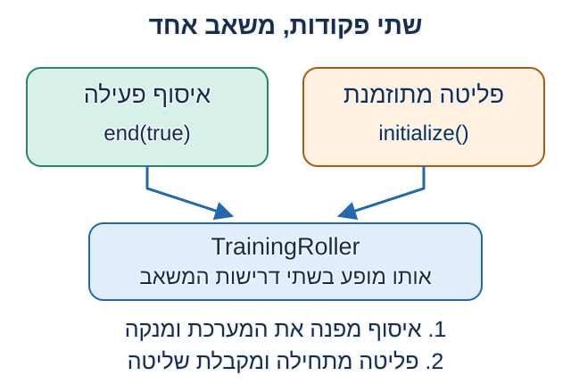

import CommandLifecycleDemo from "@site/src/components/CommandLifecycleDemo";
import ExerciseHelp from "@site/src/components/ExerciseHelp";
import { rollerLifecycleDemo } from "./demos/roller-lifecycle";

בשיעור הקודם בנינו את `TrainingRoller`. עכשיו אנחנו רוצים להפעיל את הרולר כדי לאסוף, לפלוט ולנסות איסוף שמסתיים אחרי שנייה. בפרק «מפעילים מנגנון ראשון» השתמשנו בפקודה המוכנה `MotorSubsystemSetPercentage` מהספרייה כדי להפעיל מנוע בלחיצת כפתור, ובאותה דרך חיברנו גם את הרולר. מה בעצם קורה כשאותה פקודה פועלת? [חיבור ראשון לכפתור](../03-first-subsystem/03-controller-input.mdx) · [בניית הרולר](./02-configure-motor-and-subsystem.mdx)

בסיום תוכלו לבחור פקודה מתאימה, להסביר מתי הקוד שלה רץ ומה עוצר אותה, ולכתוב פקודה כשנדרשת התנהגות נוספת. ממשיכים באותו מאגר ובאחוזי פלט.

## 1. מהי פקודה?

תת־המערכת `TrainingRoller` נותנת לנו פעולות כמו בקשת פלט באמצעות `setPercentOutput()` וביטול הפלט באמצעות `disableMotors()`. את המתודות האלה היא יורשת מ־`MotorSubsystemTalon`. **פקודה (`Command`) מתארת מה הרובוט עושה בפעולה מסוימת.** למשל, פקודת איסוף יכולה לבקש מהרולר פלט קבוע בזמן שהיא פעילה ולבטל אותו כשהיא מסתיימת.

**מתזמן הפקודות (`CommandScheduler`)** מנהל את ההפעלה. כשכפתור מחובר באמצעות `whileTrue`, הלחיצה מבקשת מהמתזמן להתחיל את הפקודה והשחרור מבקש לבטל אותה. `new` יוצרת את אובייקט הפקודה בזמן חיבור הכפתור. רק בקשת תזמון שאושרה מתחילה את הריצה. למשל, כשהרובוט במצב Disabled, הפקודות שנכתוב בשיעור לא יתחילו.

## 2. מה קורה מתחילת הפקודה ועד סופה?

בכל קריאה ל־`Robot.robotPeriodic()` התבנית כבר מריצה מחזור אחד של המתזמן באמצעות `CommandScheduler.getInstance().run()`. המתזמן בודק אם התקבלה בקשה מהכפתורים ומקדם את הפקודות הפעילות. רצף הקריאות שהפקודה מקבלת מהתחלת הריצה ועד סופה נקרא **מחזור החיים של הפקודה**.

| מקום בפקודה                 | מתי הוא רץ ומה מתאים לשים בו?                                                       |
| --------------------------- | ---------------------------------------------------------------------------------- |
| הבנאי                       | רץ כשקוראים ל־`new`. כאן מכינים את הנתונים שהפקודה תשתמש בהם.                        |
| `initialize()`              | רצה פעם אחת בכל התחלה שאושרה. כאן אפשר לאפס מונה או להתחיל מדידת זמן.                |
| `execute()`                 | מבצעת צעד קצר בכל מחזור עבודה. למשל, היא יכולה לשלוח בקשת פלט לרולר.                 |
| `isFinished()`              | נבדקת אחרי `execute()` ומחזירה `true` אם הפקודה השלימה את הפעולה.                     |
| `end(boolean interrupted)` | רצה פעם אחת בסיום. `interrupted` הוא `false` בהשלמה ו־`true` בביטול. כאן מבטלים פלט. |

[](./assets/command-lifecycle.svg)

את קוד ההפעלה שמים ב־`initialize()` או ב־`execute()`, לפי מתי הוא צריך לרוץ. הבנאי רץ כבר בחיבור הכפתור, ובלחיצה נוספת `initialize()` תרוץ שוב על אותו אובייקט. כל צעד ב־`execute()` צריך לחזור מהר כדי שהמתזמן יוכל לקדם גם את שאר הפקודות. ביטול יכול לקרות מיד אחרי `initialize()`, עוד לפני מחזור העבודה הראשון.

במחלקת הבסיס `Command`, המתודות `initialize()` ו־`execute()` ריקות, ו־`isFinished()` מחזירה `false`. פקודה שנכתוב היא מחלקת Java שיורשת מ־`Command`. דורסים את המתודות הדרושות למשימה ומסמנים אותן ב־`@Override`.

`MotorSubsystemSetPercentage` היא הפקודה שהפעלנו בלחיצה כדי לסובב את הרולר. גם פקודת האיסוף בהדגמה מתחילה בלחיצה, ויש לה מגבלת זמן של שנייה.

בחרו אם להחזיק את כפתור האיסוף לשתי שניות או לשחרר אחרי חצי שנייה. התקדמו צעד־צעד כדי לראות מה קורה לפקודה ולרולר.

<CommandLifecycleDemo {...rollerLifecycleDemo} />

### תרגיל: מנבאים לפני שמריצים

פקודה סופרת את הקריאות ל־`execute()` ומסיימת אחרי שלוש. המונה מתאפס ב־`initialize()`. באיזה סדר נקראות המתודות בכל מקרה?

1. יוצרים אובייקט, אבל לא מתזמנים אותו.
2. מתזמנים אותו ומאפשרים לו להשלים שלושה מחזורים.
3. מתזמנים שוב את אותו אובייקט ומבטלים אחרי מחזור אחד.

<ExerciseHelp
  hints={[
    "הפרידו בין חיי האובייקט לבין ריצה אחת של הפקודה.",
    "בכל מחזור עבודה רגיל מגיע execute ואחריו בודקים isFinished. ביטול אינו צריך להמתין לתשובה true.",
  ]}
  solution={`1. רק הבנאי.
2. הבנאי כבר רץ. המתזמן קורא ל־\`initialize()\`, מריץ \`execute()\` ובודק \`isFinished()\` שלוש פעמים, ואז קורא ל־\`end(false)\`.
3. \`initialize()\` מאפסת את המונה. המתזמן קורא ל־\`execute()\` ול־\`isFinished()\` פעם אחת, ואז קורא ל־\`end(true)\`.`}
  solutionLanguage="text"
/>

## 3. איך המתזמן מחלק את השליטה בתת־מערכת? {/* #3-איך-המתזמן-מחלק-את-השליטה-במערכת */}

מה יקרה אם פקודת איסוף ופקודת פליטה ינסו לשלוח פלט לאותו רולר? כדי שהמתזמן יוכל לתאם ביניהן, כל פקודה מצהירה על תת־המערכת שהיא צריכה לשלוט בה. הצהרה כזאת נקראת **Requirement**. רושמים אותה באמצעות `addRequirements(...)`, בדרך כלל בבנאי, ומעבירים למתודה את המופע שהפקודה תפעיל.

המתזמן מזהה התנגשות לפי המופע עצמו. בברירת המחדל, אם מבקשים לתזמן פליטה בזמן שאיסוף פעילה, המתזמן קורא ל־`end(true)` של האיסוף ורק אז ל־`initialize()` של הפליטה.

[](./assets/requirement-conflict.svg)

כדי שהתיאום יעבוד, שתי הפקודות צריכות להשתמש באותו מופע של `TrainingRoller` שיצרנו ב־`RobotContainer`. אם יוצרים שני מופעים לאותו CAN ID, המתזמן מתייחס אליהם כשתי תתי־מערכות נפרדות. באותו אופן, קריאה ישירה להפעלת מנוע מתוך `teleopPeriodic()` עוקפת את התיאום של המתזמן.

`RobotContainer` הוא **Singleton**. `RobotContainer.getInstance()` מחזירה את המופע היחיד שלו. ניצור את הפקודות בשלב חיבור הכפתורים, אחרי שה־container סיים ליצור את תתי־המערכות. פקודה שמיועדת לרולר ניגשת לשדה `trainingRoller` דרך ה־container. השדה הוא `Optional<TrainingRoller>`, ולכן נבדוק שהוא מכיל רולר לפני יצירת הפקודה. הבנאי שולף את הרולר באמצעות `orElseThrow()`, שמחזירה את המופע כשהוא קיים וזורקת חריגה כשהתוצאה ריקה. [בדיקה ושליפה מתוך `Optional`](../../java/10-enrichment/01-optional.mdx)

לפקודות שנכתוב נותנים שם בתבנית `<שם תת־המערכת><מה הפקודה עושה>`. לדוגמה, `TrainingRollerSetPercentage` מתאים לפקודה שקובעת אחוז פלט לרולר.

## 4. כותבים פקודה ראשונה: איסוף כל עוד הפקודה פעילה

נתחיל מפלט קבוע, בלי שעון ובלי חישוב שמשתנה בזמן. צרו תיקייה `commands` בתוך `src/main/java/frc/robot/subsystems/trainingRoller`, ובתוכה צרו `TrainingRollerHoldCollect.java`. זהו **הקובץ המלא לדוגמה**:

```java
package frc.robot.subsystems.trainingRoller.commands;

import edu.wpi.first.wpilibj2.command.Command;
import frc.robot.RobotContainer;
import frc.robot.constants.Constants.TrainingRollerConstants;
import frc.robot.subsystems.trainingRoller.TrainingRoller;

public class TrainingRollerHoldCollect extends Command {
    private final TrainingRoller roller;

    public TrainingRollerHoldCollect() {
        this.roller = RobotContainer.getInstance().trainingRoller.orElseThrow();
        addRequirements(roller);
    }

    @Override
    public void execute() {
        roller.setPercentOutput(TrainingRollerConstants.TRAINING_OUTPUT, false);
    }

    @Override
    public void end(boolean interrupted) {
        roller.disableMotors();
    }
}
```

הבנאי שולף את הרולר מ־`RobotContainer`, שומר אותו ומצהיר עליו כ־requirement. `execute()` שולחת את הפלט בכל מחזור. הפרמטר `false` משאיר את בדיקת מגבלות התוכנה פעילה. אין כאן מצב זמני שצריך לאפס, לכן אין צורך לדרוס `initialize()`. גם `isFinished()` אינה נדרסת: ברירת המחדל שלה היא `false`, ולכן הפקודה פועלת עד שמבטלים אותה. `end(...)` מבטלת פלט גם אם הפקודה הופרעה.

### מחברים ובודקים את הפקודה שכתבנו

ב־`RobotContainer.configureTeleopBindings()` החליפו את החיבור הקודם לרולר בקטע הבא. `isPresent()` בודקת שיש רולר לפני יצירת הפקודה:

```java
if (this.trainingRoller.isPresent()) {
    this.driverController.northButton().whileTrue(new TrainingRollerHoldCollect());
}
```

הוסיפו import של `frc.robot.subsystems.trainingRoller.commands.TrainingRollerHoldCollect`. `whileTrue` מתזמנת בלחיצה ומבטלת בשחרור. בנו והפעילו סימולציה: ודאו שהמתח והמהירות מגיבים בלחיצה ושבשחרור הפלט מתבטל. מהירות יכולה לדעוך גם אחרי ביטול הפלט.

### תרגיל 1: צרו פקודת פליטה בעצמכם

הוסיפו ל־`TrainingRollerConstants` את הקבוע `public static final double EJECT_OUTPUT = -0.10;` לניסוי בסימולציה. צרו `TrainingRollerHoldEject.java` שיורשת ישירות מ־`Command`:

1. כתבו בנאי ששולף את הרולר דרך `RobotContainer.getInstance()`, שומר אותו ומצהיר עליו כ־requirement.
2. כתבו `execute()` ששולחת את קבוע הפליטה.
3. כתבו `end(...)` שמבטלת פלט בכל סיום. הפקודה אינה מסתיימת מעצמה.
4. החליפו זמנית את הפקודה בכפתור ב־`new TrainingRollerHoldEject()`, בנו ובדקו לחיצה ושחרור.

<ExerciseHelp
  hints={[
    "היעזרו בבנאי של TrainingRollerHoldCollect. שתי הפקודות שולפות את אותו מופע של הרולר.",
    "ב־execute משתמשים ב־setPercentOutput עם EJECT_OUTPUT ועם false; ב־end משתמשים ב־disableMotors.",
    "אין צורך לדרוס isFinished אם רוצים להמשיך עד הביטול בשחרור הכפתור.",
  ]}
  solution="בדקו שהמתח המבוקש שלילי בזמן ההחזקה ושהפלט מתבטל בשחרור. הבנאי אינו מפעיל מנוע. המתזמן קורא ל־execute, ושחרור הכפתור גורם ל־end(true)."
  solutionLanguage="text"
/>

### תרגיל 2: צרו פקודת עצירה שמסתיימת מעצמה

צרו `TrainingRollerStop.java` שיורשת מ־`Command`. הדרישה: בהתחלה היא מבטלת פלט פעם אחת, ואז מסתיימת בלי להמתין לשחרור כפתור.

כתבו בנאי ששולף את הרולר מ־`RobotContainer` ורושם עליו requirement, `initialize()` שמבטלת פלט ו־`isFinished()` שמחזירה `true`. אין צורך בעבודה מחזורית. החליפו זמנית את חיבור הכפתור לפקודה הזאת, בנו ובדקו בלוג הפקודות שהיא אינה נשארת פעילה. הסבירו למה אין צורך ב־`execute()` בדוגמה הזאת.

<ExerciseHelp
  hints={[
    "פעולה חד־פעמית בתחילת הריצה שייכת ל־initialize, ולא לבנאי.",
    "isFinished רק מחזירה תשובה; פעולת העצירה עצמה כבר בוצעה ב־initialize.",
  ]}
  solution="בעת תזמון initialize קוראת ל־roller.disableMotors(). במחזור המתזמן הראשון isFinished מחזירה true והפקודה מסתיימת. אין משימה שצריך לבצע בכל מחזור. ברירת המחדל של end ריקה, וכאן הפלט כבר בוטל בהתחלה."
  solutionLanguage="text"
/>

## 5. מוסיפים תנאי סיום פשוט: איסוף למשך שנייה

כעת נוסיף סיום לפי זמן לדוגמת האיסוף. הפקודה תבקש פלט קבוע במשך שנייה. נשתמש ב־`Timer` למדידת הזמן שחלף מתחילת הריצה.

הוסיפו ל־`TrainingRollerConstants`:

```java
public static final double TIMED_COLLECT_SECONDS = 1.0;
```

צרו באותה תיקיית פקודות `TrainingRollerCollectForTime.java`. זהו **הקובץ המלא לדוגמה**:

```java
package frc.robot.subsystems.trainingRoller.commands;

import edu.wpi.first.wpilibj.Timer;
import edu.wpi.first.wpilibj2.command.Command;
import frc.robot.RobotContainer;
import frc.robot.constants.Constants.TrainingRollerConstants;
import frc.robot.subsystems.trainingRoller.TrainingRoller;

public class TrainingRollerCollectForTime extends Command {
    private final TrainingRoller roller;
    private final Timer timer = new Timer();

    public TrainingRollerCollectForTime() {
        this.roller = RobotContainer.getInstance().trainingRoller.orElseThrow();
        addRequirements(roller);
    }

    @Override
    public void initialize() {
        timer.restart();
    }

    @Override
    public void execute() {
        roller.setPercentOutput(TrainingRollerConstants.TRAINING_OUTPUT, false);
    }

    @Override
    public boolean isFinished() {
        return timer.hasElapsed(TrainingRollerConstants.TIMED_COLLECT_SECONDS);
    }

    @Override
    public void end(boolean interrupted) {
        timer.stop();
        roller.disableMotors();
    }
}
```

`Timer` מודדת זמן בשניות. `restart()` מאפסת ומתחילה מדידה, `hasElapsed(...)` שואלת אם עבר הזמן הנתון, ו־`stop()` עוצרת את המדידה. השעון נוצר פעם אחת עם האובייקט, אבל מתאפס ב־`initialize()` בכל ריצה מחדש.

החליפו זמנית את הפקודה ב־North ב־`new TrainingRollerCollectForTime()` והוסיפו import מתאים. השאירו `whileTrue`, בנו והפעילו סימולציה. בדקו שני מסלולי סיום:

1. החזקה של יותר משנייה: הפקודה מסיימת בעצמה ומקבלת `end(false)`. היא אינה מתחילה שוב כל עוד הכפתור נשאר לחוץ; שחררו ולחצו מחדש.
2. שחרור לפני שעברה שנייה: הפקודה מתבטלת ומקבלת `end(true)`. גם במקרה הזה הפלט מתבטל.

אפשר להוסיף זמנית ב־`end` את `System.out.println("Timed collect interrupted=" + interrupted);` כדי לראות איזה מסלול התרחש. הסירו את ההדפסה אחרי הבדיקה. בדקו גם לחיצה נוספת: בכל הפעלה צריכה להימדד שנייה חדשה.

### תרגיל 3: צרו פקודת פליטה לזמן קבוע

צרו `TrainingRollerEjectForTime.java` שיורשת מ־`Command`, ללא העתקה של הקובץ המלא. הוסיפו בקבועים `TIMED_EJECT_SECONDS = 0.5` מסוג `public static final double`.

הפקודה צריכה לשלוף את הרולר מ־`RobotContainer`, להצהיר עליו כ־requirement, להפעיל את `EJECT_OUTPUT` ולסיים אחרי חצי שנייה. כתבו את הבנאי ואת ארבע מתודות מחזור החיים. בדקו השלמה, ביטול מוקדם והפעלה חוזרת של אותו חיבור. לפני כל בדיקה כתבו איזה ערך יקבל `interrupted`.

<ExerciseHelp
  hints={[
    "ענו מה שומרים בבנאי, מה מאפסים בתחילת כל ריצה, מה שולחים בכל מחזור, מהו תנאי הסיום ומה מנקים.",
    "השתמשו ב־Timer ובקבועי הפליטה. אל תפעילו או תאפסו את השעון בבנאי.",
    "הניקוי צריך לעצור את השעון ולבטל פלט גם כשהזמן הושלם וגם כשהכפתור שוחרר מוקדם.",
  ]}
  solution="initialize מתחילה מדידה חדשה; execute שולחת EJECT_OUTPUT; isFinished בודקת TIMED_EJECT_SECONDS; end עוצרת את השעון ומבטלת פלט. אחרי חצי שנייה מתקבל end(false), ובביטול מוקדם end(true). בריצה חוזרת השעון מתחיל מאפס."
  solutionLanguage="text"
/>

### תרגיל 4: תכננו וצרו פקודה נוספת

צרו `TrainingRollerGentleCollect.java` שיורשת מ־`Command`. הגדירו בקבועים פלט איסוף חלש של `0.08` ומשך של `2.0` שניות, עם שמות ברורים. הפקודה תפעיל את הפלט הקבוע ותסיים בתום הזמן.

ענו מה הפקודה צריכה לעשות בבנאי ובכל שלב של מחזור החיים. אחר כך ממשו את הפקודה. חברו זמנית לכפתור ובדקו השלמה, ביטול והפעלה חוזרת. השוו את המתח המבוקש לזה של האיסוף הרגיל, והסבירו למה פלט חלש יותר אינו מבטיח מהירות מסוימת.

<ExerciseHelp
  hints={[
    "ההתנהגות דומה לפקודת זמן שכבר כתבתם; ההבדל נמצא בקבועים שבחרתם.",
    "האם יש addRequirements? האם השעון מתאפס בכל התחלה? האם כל סיום מבטל פלט?",
  ]}
/>

## 6. קוראים את פקודת האחוזים מהספרייה

עכשיו, אחרי שמימשנו הפעלה, תנאי סיום וניקוי, נראה מה הספרייה מספקת. פתחו ב־VS Code את `MotorSubsystemSetPercentage.java` ואת מחלקת הבסיס שלה `MotorDoubleSupplierCommand`. שתיהן נמצאות תחת `src/main/java/frc/DELib26/subsystems/motorSubsystems/commands/`.

בבנאי, `MotorDoubleSupplierCommand` שומרת את המופע שקיבלה ומצהירה עליו באמצעות `addRequirements(motorSubsystem)`. היא שומרת גם `DoubleSupplier`, פעולה שאפשר לקרוא לה כדי לקבל מספר. בחיבור לכפתור השתמשנו ב־lambda שמחזירה את אחוז הפלט הרצוי.

בכל מחזור עבודה, `MotorSubsystemSetPercentage` קוראת לספק הערך ומעבירה את התוצאה לתת־המערכת. זהו קטע מ־`execute()` בספרייה:

```java
this.motorSubsystem.setPercentOutput(
    this.valueSupplier.getAsDouble(), ignoreSoftLimits);
```

`ignoreSoftLimits` קובע אם לעקוף את מגבלות התנועה שמוגדרות בתוכנה. החיבור שעשינו משתמש בברירת המחדל `false`. שני השדות `motorSubsystem` ו־`valueSupplier` מוגדרים `protected` במחלקת הבסיס, ולכן המחלקה היורשת יכולה להשתמש בהם.

הסימון `T extends MotorSubsystemTalon` מגביל את הפקודה לטיפוס `MotorSubsystemTalon` ולתתי־מערכות שיורשות ממנו, ובהן `TrainingRoller`. [מגבלות על טיפוס גנרי](../../java/08-generics/index.mdx#type-bounds)

את הסיום הפקודה יורשת מ־`MotorDoubleSupplierCommand`:

- `isFinished()` מחזירה תמיד `false`. בחיבור שלנו הכפתור מבטל את הפקודה בשחרור.
- `end(boolean interrupted)` קוראת ל־`disableMotors()` בכל סיום. במצב `Coast` ההנעה נפסקת והרולר יכול להמשיך להסתובב עד שיאט.

לעצירה יש בספרייה את `MotorSubsystemDisableMotors`. זו פעולה חד־פעמית מסוג `InstantCommand`. היא דורשת את תת־המערכת, מבטלת את הפלט ב־`initialize()` ומסתיימת במחזור המתזמן הראשון שלה.

### משתמשים ישירות בפקודה מוכנה

כדי להפעיל אחוז פלט בזמן החזקת כפתור, אפשר להמשיך להשתמש בפקודה מהספרייה. היא כללית, ולכן מקבלת את תת־המערכת שתפעיל ואת הפעולה שמספקת את אחוז הפלט. כדי להשוות לפקודה שכתבתם, החליפו את חיבור הרולר לכפתור North בתוך `RobotContainer.configureTeleopBindings()` בקטע הבא:

```java
this.trainingRoller.ifPresent(roller -> {
    this.driverController.northButton().whileTrue(
        new MotorSubsystemSetPercentage<>(
            roller, () -> TrainingRollerConstants.TRAINING_OUTPUT));
});
```

ה־imports הם `frc.DELib26.subsystems.motorSubsystems.commands.MotorSubsystemSetPercentage` ו־`frc.robot.constants.Constants.TrainingRollerConstants`. הקריאה ל־`ifPresent` מחברת את הכפתור רק אם נוצר רולר, כלומר בסימולציה.

### מתמחים בפקודה קיימת

אם ״איסוף״ היא פעולה שחוזרת בכמה מקומות, אפשר לתת לה שם משלה ולקבוע פעם אחת באיזה פלט היא משתמשת. נקרא לגרסה שנעזרת בספרייה `TrainingRollerCollect`.

[](./assets/command-inheritance.svg)

צרו את הקובץ `src/main/java/frc/robot/subsystems/trainingRoller/commands/TrainingRollerCollect.java`:

```java
package frc.robot.subsystems.trainingRoller.commands;

import frc.DELib26.subsystems.motorSubsystems.commands.MotorSubsystemSetPercentage;
import frc.robot.RobotContainer;
import frc.robot.constants.Constants.TrainingRollerConstants;
import frc.robot.subsystems.trainingRoller.TrainingRoller;

public class TrainingRollerCollect extends MotorSubsystemSetPercentage<TrainingRoller> {
    public TrainingRollerCollect() {
        super(RobotContainer.getInstance().trainingRoller.orElseThrow(),
            () -> TrainingRollerConstants.TRAINING_OUTPUT);
    }
}
```

הקריאה ל־`super(...)` מעבירה לבנאי של הספרייה את הרולר ואת קבוע האיסוף באמצעות ה־lambda. הפקודה מקבלת בירושה את הביצוע, את רישום ה־requirement ואת ביטול הפלט בסיום.

ב־`RobotContainer` ייבאו את `frc.robot.subsystems.trainingRoller.commands.TrainingRollerCollect` והחליפו את החיבור הקודם בקטע הבא. `isPresent()` בודקת שהרולר קיים לפני יצירת הפקודה, ואת המופע עצמו הפקודה מקבלת מה־container.

```java
if (this.trainingRoller.isPresent()) {
    this.driverController.northButton().whileTrue(new TrainingRollerCollect());
}
```

בנו והפעילו מחדש. בדקו לחיצה ושחרור. בזמן שהפקודה רצה, בלוג `Subsystems/TrainingRoller/Command` יופיע `TrainingRollerCollect`.

### תרגיל 5: כותבים גרסת פליטה שמשתמשת בספרייה

השתמשו ב־`EJECT_OUTPUT` שהוספתם בתרגיל הראשון. צרו באותה תיקיית פקודות את `TrainingRollerEject.java`. התמחו באותה פקודה מהספרייה והשתמשו בקבוע הפליטה.

החליפו זמנית את `new TrainingRollerCollect()` בכפתור ב־`new TrainingRollerEject()` והוסיפו import מתאים. נבאו את סימן המתח והמהירות, ואז בנו והריצו כדי לבדוק לחיצה ושחרור. השוו ל־`TrainingRollerHoldEject`. מאיפה מגיעים הביצוע והניקוי בגרסה הזאת? בסיום החזירו את `TrainingRollerCollect` לכפתור ושמרו את שתי גרסאות הפליטה.

<ExerciseHelp
  hints={[
    "לפקודה כבר יש מימוש ששולח אחוז פלט ומנקה אותו בסיום.",
    "המחלקה החדשה יורשת מ־MotorSubsystemSetPercentage<TrainingRoller>. הבנאי ניגש לרולר דרך RobotContainer כמו בבנאי של TrainingRollerCollect.",
    "ה־lambda מחזירה TrainingRollerConstants.EJECT_OUTPUT. את execute ואת end מקבלים בירושה.",
  ]}
  solutionLanguage="text"
  solution="בבנאי TrainingRollerEject() קוראים ל־super עם RobotContainer.getInstance().trainingRoller.orElseThrow() ועם lambda שמחזירה את TrainingRollerConstants.EJECT_OUTPUT. בזמן החזקה execute שולחת בקשת פלט שלילית. בשחרור whileTrue מבטלת את הפקודה ו־end מבטלת את הפלט."
/>

## 7. מתי ה־supplier קוראת את הערך?

בפקודה של הספרייה, הקריאה ל־`getAsDouble()` נמצאת ב־`execute()`, ולכן מתבצעת בכל מחזור עבודה. `() -> TRAINING_OUTPUT` מחזירה כרגע קבוע, אבל supplier יכולה לקרוא ערך שמשתנה בזמן הריצה.

לדוגמה, **שני קטעים חלופיים לקריאה בלבד**, בתוך חיבור שבו `roller` כבר מוגדר:

```java
double captured = this.driverController.getRightY()
    * TrainingRollerConstants.TRAINING_OUTPUT;
new MotorSubsystemSetPercentage<>(roller, () -> captured);
```

```java
new MotorSubsystemSetPercentage<>(
    roller, () -> this.driverController.getRightY()
        * TrainingRollerConstants.TRAINING_OUTPUT);
```

הראשון שומר את ערך הציר בזמן יצירת החיבור ויחזיר שוב את אותו מספר. השני קורא את הציר בכל הפעלה של הלמבדה ומכפיל את הערך בקבוע. [מתי גוף הלמבדה רץ](../../java/09-lambdas/index.mdx)

ענו לפי שתי הדוגמאות. האם עצם השימוש ב־lambda מבטיח קריאה עדכנית מהשלט? איפה צריך להיות הביטוי שקורא את הציר?

<ExerciseHelp
  hints={[
    "ה־lambda יכולה לקרוא משתנה שכבר מכיל תוצאה ישנה. חפשו איפה מופיעה הקריאה ל־getRightY בכל חלופה.",
  ]}
  solution="לא. בחלופה הראשונה getRightY נקראת פעם אחת לפני יצירת הפקודה. בשנייה היא בתוך גוף ה־supplier, ולכן נקראת מחדש מתוך execute. הבנאי של הספרייה דורש DoubleSupplier; העברת מספר double ישירות לא תתקמפל."
  solutionLanguage="text"
/>

### בוחרים כמה קוד באמת צריך

לכל פעולה, בחרו דרך מימוש. אפשר להשתמש בפקודה מוכנה, להתמחות בה או לכתוב `Command` חדשה.

- הפעלת הרולר ב־15% כל עוד מחזיקים כפתור.
- פעולת פליטה בעלת קבוע ושם משותפים לכמה חיבורים.
- איסוף בפלט קבוע למשך שנייה, עם שעון שמתאפס בכל הפעלה.
- ביטול פלט מיידי.

<ExerciseHelp
  hints={[
    "חפשו קודם מימוש קיים. שם פעולה לבדו אינו מחייב מחלקה, וגם מדידת מנוע שכבר קיימת אינה סיבה לממש אותה מחדש.",
  ]}
  solution={`- **החזקה** - משתמשים ישירות ב־\`MotorSubsystemSetPercentage\`.
- **פליטה** - \`TrainingRollerEject\` נותנת לפעולה שם ופלט משותפים לכמה חיבורים.
- **איסוף למשך שנייה** - \`TrainingRollerCollectForTime\` מודדת זמן ומסיימת כשהשנייה עוברת.
- **עצירה** - משתמשים ב־\`MotorSubsystemDisableMotors\` מהספרייה.`}
  solutionLanguage="text"
  multipleSolutions={true}
/>

## בדיקת סיום

הראו את הפקודות שכתבתם בעצמכם: `TrainingRollerHoldEject`, `TrainingRollerStop`, `TrainingRollerEjectForTime` ו־`TrainingRollerGentleCollect`. לכל פקודה הסבירו איך היא מקבלת את הרולר מה־container, מה היא דורשת, מתי היא מסיימת ומה מבטל את הפלט שלה. הראו גם השלמה וביטול מוקדם של פקודת זמן, והרצה חוזרת שמתחילה מדידה חדשה.

השוו בין `TrainingRollerHoldCollect` לבין `TrainingRollerCollect` הקצרה שנעזרת בספרייה. הסבירו את ההבדל בין בנאי ל־`initialize()`, היכן קוראים את ה־supplier, ומאיפה מתקבלים הביצוע והניקוי בגרסה שיורשת מהספרייה.

שמרו בפרויקט את הפקודות שיצרתם ואת הקבועים שלהן ב־`Constants`. לפרקים הבאים נשתמש ב־`TrainingRollerCollect`, ב־`TrainingRollerEject` וב־`TrainingRollerCollectForTime`. בכפתור North השאירו רק `TrainingRollerCollect` ב־`whileTrue`. שמרו commit. בשיעור הבא [נרכז את הבדיקות במצב Test ונפעיל אותן דרך Elastic](./04-elastic-testing.mdx).

<details>
<summary>מקורות להעמקה</summary>

המימוש שנקרא כאן הוא [MotorDoubleSupplierCommand](https://github.com/Desert-Eagles-6104/DELib26/blob/c2f1da1144b7fd30dfcf94f30e850993be5d03aa/subsystems/motorSubsystems/commands/MotorDoubleSupplierCommand.java), [MotorSubsystemSetPercentage](https://github.com/Desert-Eagles-6104/DELib26/blob/c2f1da1144b7fd30dfcf94f30e850993be5d03aa/subsystems/motorSubsystems/commands/MotorSubsystemSetPercentage.java) ו־[MotorSubsystemDisableMotors](https://github.com/Desert-Eagles-6104/DELib26/blob/c2f1da1144b7fd30dfcf94f30e850993be5d03aa/subsystems/motorSubsystems/commands/MotorSubsystemDisableMotors.java), בגרסה שה־submodule של התבנית מצמיד. [מבנה Command ב־WPILib](https://docs.wpilib.org/en/stable/docs/software/commandbased/commands.html) ו[עבודת המתזמן](https://docs.wpilib.org/en/stable/docs/software/commandbased/command-scheduler.html) מפרטים את מחזור החיים.

</details>
