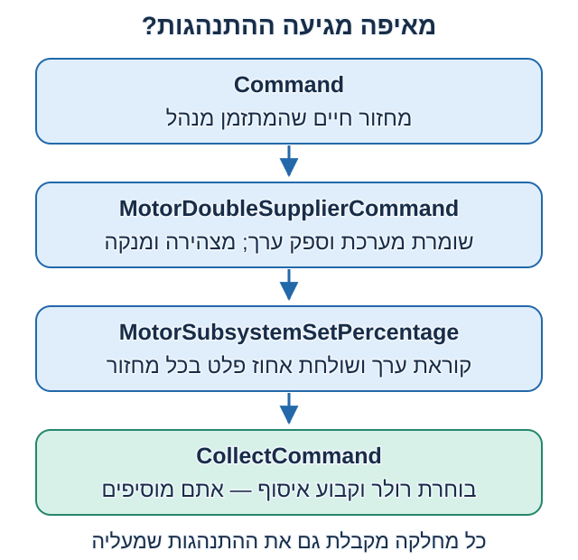
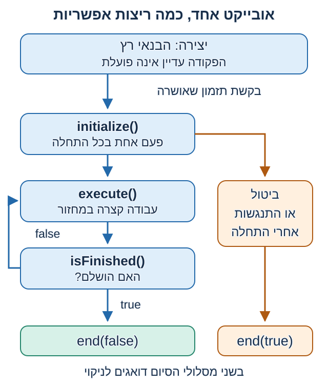

import ExerciseHelp from "@site/src/components/ExerciseHelp";

הרולר שבניתם כבר מגיב לכפתור. עכשיו נרצה לתת לפעולות שלו משמעות: **איסוף, פליטה וניסוי שבו הפלט יורד בהדרגה.** איך בוחרים מה לכתוב בעצמנו ומה כבר קיים בספרייה?

בסיום תוכלו לבחור פקודה מתאימה, להסביר מתי הקוד שלה רץ ומה עוצר אותה, ולכתוב פקודה כשנדרשת התנהגות נוספת. ממשיכים באותו מאגר ובאחוזי פלט.

## 1. מה כבר יש לנו?

התחילו מהתוצאה של [בניית TrainingRoller](./02-configure-motor-and-subsystem.mdx): אתם יצרתם את `TrainingRoller.java`, את `Constants.TrainingRollerConstants.CONFIG`, את `TRAINING_OUTPUT` ואת השדה `Optional<TrainingRoller> trainingRoller` ב־`RobotContainer`. המופע נוצר בסימולציה בלבד, והלוגים שלו מחוברים. הרולר אינו מגיע מוכן בתבנית.

| חלק                                                                               | מה שייך אליו?                                                        |
| --------------------------------------------------------------------------------- | -------------------------------------------------------------------- |
| `TrainingRollerConstants` בתוך `src/main/java/frc/robot/constants/Constants.java` | התצורה וקבועי המנגנון                                                |
| `TrainingRoller`                                                                  | פעולות ומדידות של המנגנון, שרובן כבר מתקבלות מ־`MotorSubsystemTalon` |
| פקודה                                                                             | מתי ואיך להשתמש בפעולות האלה, מתי לסיים ומה לעשות בסיום              |

אין צורך להוסיף לרולר מתודות שעוטפות מחדש את `setPercentOutput`, את `disableMotors` או את מדידות המנוע. חזרו בקצרה ל[הורשה](../../java/07-inheritance-and-polymorphism/inheritance.mdx) אם לא ברור למה הן כבר זמינות.

## 2. מתחילים מהפקודה הקיימת

ב־VS Code פתחו את `MotorSubsystemSetPercentage.java`, ואז עברו להגדרת מחלקת הבסיס שלה, `MotorDoubleSupplierCommand`. שתיהן נמצאות תחת `src/main/java/frc/DELib26/subsystems/motorSubsystems/commands/`. קוראים את הספרייה; אין לערוך אותה בתרגיל.

[](./assets/command-inheritance.svg)

הבנאי של `MotorDoubleSupplierCommand` שומר הפניה למערכת ול־`DoubleSupplier`, וקורא ל־`addRequirements(motorSubsystem)`. הוא אינו מפעיל את המנוע. `MotorSubsystemSetPercentage.execute()` עושה את העבודה הבאה; זהו **קטע מתוך הספרייה, לעיון בלבד**:

```java
this.motorSubsystem.setPercentOutput(
    this.valueSupplier.getAsDouble(), ignoreSoftLimits);
```

`protected` מאפשרת למחלקה היורשת להשתמש בשדות האלה. הסימון הגנרי `T extends MotorSubsystemTalon` מגביל את סוג המערכת למחלקות שיורשות מבסיס המנוע. כבר פגשנו את `<>` ואת ה־lambda ב[חיבור הראשון לכפתור](../03-first-subsystem/03-controller-input.mdx#קוראים-את-תחביר-הlambda).

שתי התנהגויות נוספות מתקבלות ממחלקת הבסיס:

- `isFinished()` מחזירה תמיד `false`. פקודת האחוזים אינה מסתיימת מעצמה.
- `end(boolean interrupted)` קוראת ל־`disableMotors()`, גם בסיום רגיל וגם בביטול. היא מפסיקה הנעה; מהירות המנגנון יכולה עדיין לדעוך ב־Coast.

לעומתה, `MotorSubsystemDisableMotors` יורשת מ־`InstantCommand`: היא מבטלת פלט ב־`initialize()` ומסיימת במחזור המתזמן הראשון שלה. גם היא דורשת את תת־המערכת. בקשת עצירה אינה דורשת כתיבת פקודה חדשה.

## 3. יצירה, התחלה, עבודה וסיום

הקריאה ל־`CommandScheduler.getInstance().run()` כבר נמצאת ב־`Robot.robotPeriodic()`. ברמת העבודה שלנו, המתזמן מעדכן את המערכות, בודק triggers ומקדם פקודות פעילות. **`new` יוצרת פקודה; תזמון שלה מבקש להתחיל אותה.** התזמון עשוי להידחות, למשל כשהרובוט Disabled.

[](./assets/command-lifecycle.svg)

| מקום בפקודה                | מתי הוא רץ ומה מתאים לשים בו?                                                     |
| -------------------------- | --------------------------------------------------------------------------------- |
| הבנאי                      | ביצירת האובייקט: שמירת הפניות ו־requirements. הוא יכול לרוץ הרבה לפני ההפעלה.     |
| `initialize()`             | פעם אחת בכל התחלה מאושרת, גם כשהשתמשנו שוב באותו אובייקט: איפוס מצב זמני או שעון. |
| `execute()`                | עבודה קצרה בכל מחזור שבו הפקודה פעילה. אין להמתין כאן בלולאה או בעזרת `sleep`.    |
| `isFinished()`             | שאלה: האם הפעולה הושלמה? מחזירה `boolean`, בלי לבצע את פעולת הסיום בעצמה.         |
| `end(boolean interrupted)` | ניקוי פעם אחת בסיום הריצה: `false` כשהפקודה הושלמה, `true` כשבוטלה או הופרעה.     |

פקודה שבוטלה יכולה לקבל `end(true)` גם בלי שהספיקה להגיע ל־`execute()` הראשון. אין להסתמך על כך שהסיום מגיע רק אחרי עבודה. מימושי ברירת המחדל של `initialize()` ושל `execute()` ב־`Command` ריקים, ו־`isFinished()` מחזירה `false`; דורסים רק מה שנחוץ.

**למה לא להפעיל מנוע בבנאי?** האובייקט יכול להיווצר בעת חיבור כפתורים, בלי שביקשנו לבצע פעולה ובלי שהמתזמן העניק לו את המערכת. בנוסף, בתזמון חוזר הבנאי לא רץ שוב. קוד ההפעלה שייך למחזור החיים.

### תרגיל: מנבאים לפני שמריצים

עקבו על נייר אחרי פקודה דמיונית שמסיימת אחרי שלוש קריאות ל־`execute()`. המונה מתאפס ב־`initialize()`. כתבו את סדר הקריאות במקרים הבאים:

1. יוצרים אובייקט, אבל לא מתזמנים אותו.
2. מתזמנים אותו ומאפשרים לו להשלים שלושה מחזורים.
3. מתזמנים שוב את אותו אובייקט ומבטלים אחרי מחזור אחד.

<ExerciseHelp
  hints={[
    "הפרידו בין חיי האובייקט לבין ריצה אחת של הפקודה.",
    "בכל מחזור עבודה רגיל מגיע execute ואחריו בודקים isFinished. ביטול אינו צריך להמתין לתשובה true.",
  ]}
  solution="1. רק הבנאי. 2. initialize, ואז execute ובדיקת isFinished שלוש פעמים, ולבסוף end(false). 3. initialize מאפסת את המונה, execute ובדיקה אחת, ואז end(true). הבנאי אינו רץ שוב."
  solutionLanguage="text"
/>

## 4. Requirements: מי משתמש ברולר עכשיו?

Requirement היא הצהרה שהפקודה צריכה שליטה בתת־מערכת מסוימת. המתזמן משווה **מופעי אובייקטים**, לא שמות מחלקות ולא מספרי CAN. פקודת איסוף ופקודת פליטה לא צריכות לשלוח בו־זמנית בקשות לאותו רולר.

בפקודות שבהן נשתמש, ברירת המחדל היא שהפקודה הפעילה מפנה את המערכת: כשמתזמנים פקודה מתחרה, הראשונה מקבלת `end(true)` ואחריה השנייה מקבלת `initialize()`. קיימת גם מדיניות שדוחה פקודה נכנסת; איננו משנים אותה כאן.

[](./assets/requirement-conflict.svg)

ההצהרה אינה עוצרת קוד שמפעיל מנוע ישירות מ־`teleopPeriodic()`. לכן כבר הסרנו את ההפעלה הישנה. גם יצירת שני אובייקטים שפונים לאותו CAN ID אינה פתרון: המתזמן יראה שתי מערכות שונות שאינן מתחרות, אף שהן פונות לאותה חומרה.

## 5. שלוש דרכים לממש פעולה

### משתמשים ישירות בפקודה מוכנה

אם כל הדרישה היא להפעיל אחוז פלט בזמן החזקה, החיבור הבא מספיק. זהו **קטע מלא להחלפת חיבור הרולר הקודם בתוך `RobotContainer.configureTeleopBindings()`**, ולא מתודה או קובץ שלמים:

```java
this.trainingRoller.ifPresent(roller -> {
    this.driverController.northButton().whileTrue(
        new MotorSubsystemSetPercentage<>(
            roller, () -> TrainingRollerConstants.TRAINING_OUTPUT));
});
```

ה־imports הם `frc.DELib26.subsystems.motorSubsystems.commands.MotorSubsystemSetPercentage` ו־`frc.robot.constants.Constants.TrainingRollerConstants`. השלט והמופע כבר קיימים. **לא כל פעולה בעלת שם מחייבת מחלקה חדשה.**

### מתמחים בפקודה קיימת

אם ״איסוף״ היא פעולה שחוזרת בכמה מקומות, מחלקה קצרה יכולה לבחור עבורם את הסוג והקבוע. צרו `src/main/java/frc/robot/subsystems/trainingRoller/commands/CollectCommand.java`. זהו **הקובץ המלא**:

```java
package frc.robot.subsystems.trainingRoller.commands;

import frc.DELib26.subsystems.motorSubsystems.commands.MotorSubsystemSetPercentage;
import frc.robot.constants.Constants.TrainingRollerConstants;
import frc.robot.subsystems.trainingRoller.TrainingRoller;

public class CollectCommand extends MotorSubsystemSetPercentage<TrainingRoller> {
    public CollectCommand(TrainingRoller roller) {
        super(roller, () -> TrainingRollerConstants.TRAINING_OUTPUT);
    }
}
```

המחלקה בוחרת מדיניות של פעולה, ומשאירה לבסיס את הביצוע, ה־requirement והניקוי. אין צורך לדרוס כאן `end()`. דריסה שתשכח את `super.end(interrupted)` עלולה להסיר את הניקוי שקיבלנו.

לבדיקה, החליפו **רק את יצירת הפקודה** בחיבור הקודם ב־`new CollectCommand(roller)` והוסיפו import של המחלקה החדשה. אחרי בנייה והפעלה מחדש, לחיצה ושחרור צריכים להפיק אותה התנהגות. בלוג `Subsystems/TrainingRoller/Command` יופיע עכשיו `CollectCommand`.

### תרגיל: כותבים את פעולת הפליטה

בתוך `Constants.TrainingRollerConstants` הוסיפו `public static final double EJECT_OUTPUT = -0.10;`, ערך לניסוי בסימולציה. צרו באותה תיקיית פקודות את `EjectCommand.java`. השתמשו באותה פקודת ספרייה, אבל בחרו את קבוע הפליטה.

החליפו זמנית את `CollectCommand` בכפתור ב־`EjectCommand`, בנו והריצו. שנו רק את בחירת הפקודה: השאירו את `whileTrue` ואת תצורת הרולר. נבאו את סימן המתח והמהירות, בדקו לחיצה ושחרור והסבירו מה קיבלתם בירושה. בסיום החזירו את האיסוף לכפתור ושמרו את שתי המחלקות.

<ExerciseHelp
  hints={[
    "לפקודה כבר יש מימוש ששולח אחוז פלט ומנקה אותו בסיום.",
    "המחלקה החדשה יורשת מ־MotorSubsystemSetPercentage<TrainingRoller>; הבנאי מעביר roller ו־supplier ל־super.",
    "ה־supplier מחזירה TrainingRollerConstants.EJECT_OUTPUT. אין צורך לשמור שדה roller נוסף או לכתוב execute ו־end מחדש.",
  ]}
  solutionLanguage="text"
  solution="בדקו שם קובץ ומחלקה זהים, package של תיקיית commands, בנאי שמקבל את הרולר הקיים ושימוש בקבוע הפליטה. בזמן החזקה מתקבלת בקשה שלילית; בשחרור whileTrue מבטלת את הפקודה והבסיס מבטל פלט."
/>

## 6. מתי ה־supplier קוראת את הערך?

בפקודה של הספרייה, הקריאה ל־`getAsDouble()` נמצאת ב־`execute()`, ולכן מתבצעת בכל מחזור עבודה. `() -> TRAINING_OUTPUT` מחזירה כרגע קבוע, אבל supplier יכולה לקרוא ערך שמשתנה בזמן הריצה.

לדוגמה, **שני קטעים חלופיים לקריאה בלבד**, בתוך חיבור שבו `roller` כבר מוגדר:

```java
double captured = this.driverController.getRightY()
    * TrainingRollerConstants.TRAINING_OUTPUT;
new MotorSubsystemSetPercentage<>(roller, () -> captured);
```

```java
new MotorSubsystemSetPercentage<>(
    roller, () -> this.driverController.getRightY()
        * TrainingRollerConstants.TRAINING_OUTPUT);
```

הראשון שומר צילום של הציר בזמן יצירת החיבור; ה־supplier תחזיר שוב את אותו מספר. השני קורא את הציר בזמן הביצוע, ומגביל כאן את בקשת הניסוי באמצעות הכפלה בקבוע. המשתנה המקומי `captured` יכול להילכד ב־lambda כי איננו משנים אותו לאחר ההשמה.

**עצרו והסבירו:** האם עצם קיומה של lambda מבטיח קריאה עדכנית מהשלט? איפה צריך להיות הביטוי שקורא את הציר? אין להריץ את שתי החלופות יחד; זהו תרגיל מעקב קוד.

<ExerciseHelp
  hints={[
    "ה־lambda יכולה לקרוא משתנה שכבר מכיל תוצאה ישנה. עקבו אחר המקום שבו getRightY עצמה נקראת.",
  ]}
  solution="לא. בחלופה הראשונה getRightY נקראת פעם אחת לפני יצירת הפקודה. בשנייה היא בתוך גוף ה־supplier, ולכן נקראת מחדש מתוך execute. הבנאי של הספרייה דורש DoubleSupplier; העברת מספר double ישירות לא תתקמפל."
  solutionLanguage="text"
/>

## 7. כותבים Command כשיש התנהגות נוספת

לניסוי הבא רוצים שהפלט המבוקש ירד בקו ישר מ־`TRAINING_OUTPUT` לאפס במשך שנייה, ושהניסוי יתחיל מחדש בכל הפעלה. זו בקשת פלט לפי זמן, בלי יעד מהירות ובלי חיישן חדש. הפקודה תחזיק שעון ששייך לריצה שלה; פקודת האחוזים לבדה אינה מנהלת שעון כזה.

הוסיפו ל־`Constants.TrainingRollerConstants`:

```java
public static final double FADE_SECONDS = 1.0;
```

צרו `src/main/java/frc/robot/subsystems/trainingRoller/commands/FadeCollectCommand.java`. זהו **קובץ מלא**, שנועד לתרגול מחזור החיים וגם מממש את ניסוי הפלט המשתנה:

```java
package frc.robot.subsystems.trainingRoller.commands;

import edu.wpi.first.wpilibj.Timer;
import edu.wpi.first.wpilibj2.command.Command;
import frc.robot.constants.Constants.TrainingRollerConstants;
import frc.robot.subsystems.trainingRoller.TrainingRoller;

public class FadeCollectCommand extends Command {
    private final TrainingRoller roller;
    private final Timer timer = new Timer();

    public FadeCollectCommand(TrainingRoller roller) {
        this.roller = roller;
        addRequirements(roller);
    }

    @Override
    public void initialize() {
        timer.restart();
    }

    @Override
    public void execute() {
        double fraction = Math.max(
            0.0, 1.0 - timer.get() / TrainingRollerConstants.FADE_SECONDS);
        roller.setPercentOutput(
            TrainingRollerConstants.TRAINING_OUTPUT * fraction, false);
    }

    @Override
    public boolean isFinished() {
        return timer.hasElapsed(TrainingRollerConstants.FADE_SECONDS);
    }

    @Override
    public void end(boolean interrupted) {
        timer.stop();
        roller.disableMotors();
    }
}
```

`Timer` מודדת שניות. `restart()` מאפסת ומתחילה מדידה, `get()` קוראת זמן שעבר ו־`hasElapsed(...)` מחזירה אם הגענו למשך הנתון. `Math.max` בוחרת את הגדול מבין שני מספרים, וכאן מונעת פלט שלילי אם המחזור הגיע מעט אחרי סוף השנייה. השאירו משך חיובי. לא מממשים כאן מחדש פעולות מנוע, אלא משתמשים בפעולות שכבר קיימות.

החליפו זמנית את הפקודה ב־North ב־`new FadeCollectCommand(roller)`, עם import מתאים, והשאירו `whileTrue`. בנו והפעילו מחדש. לפני ההרצה כתבו תחזית לשני ניסויים:

1. החזקה של יותר משנייה: הפקודה משלימה ומקבלת `end(false)`. היא אינה מתחילה שוב רק מפני שהכפתור עדיין לחוץ; שחררו ולחצו מחדש.
2. שחרור אחרי כחצי שנייה: הפקודה מבוטלת ומקבלת `end(true)`. גם הפעם הפלט מתבטל.

הציגו מתח ומהירות ב־AdvantageScope. כדי לראות את ערך `interrupted` בפועל אפשר להוסיף זמנית בתוך `end` את `System.out.println("Fade interrupted=" + interrupted);`. אל תדפיסו בכל `execute()`. הריצו שוב את שני הניסויים, ואז הסירו את ההדפסה והחזירו `CollectCommand` לחיבור הבסיסי.

### תרגיל: משלימים בלי להעתיק את כל הקובץ

כתבו לעצמכם ארבע דרישות לניקוי ולאתחול של `FadeCollectCommand`, ואז הסתירו את הקוד וכתבו מחדש רק את `initialize()`, את `isFinished()` ואת `end(...)`. בדקו בנייה והרצה שנייה של **אותו חיבור**: האם הניסוי באמת מתחיל שוב משנייה אפס? הסבירו למה שעון שהופעל בבנאי היה נכשל בבדיקה הזאת.

<ExerciseHelp
  hints={[
    "השעון שייך לריצה, אבל שדה השעון שייך לאובייקט שנוצר פעם אחת.",
    "בהתחלה מאפסים ומתחילים; תנאי הסיום רק שואל על הזמן; בסיום עוצרים את השעון ומבטלים פלט בכל ערך של interrupted.",
  ]}
/>

### בוחרים כמה קוד באמת צריך

איזו דרך תבחרו לכל דרישה: פקודה מוכנה, התמחות או `Command` חדשה?

- הפעלת הרולר ב־15% כל עוד מחזיקים כפתור.
- פעולת פליטה בעלת קבוע ושם משותפים לכמה חיבורים.
- ניסוי שמחשב פלט לפי הזמן שחלף מהתחלתו, ומאפס את השעון בכל הפעלה.
- ביטול פלט מיידי.

<ExerciseHelp
  hints={[
    "חפשו קודם מימוש קיים. שם פעולה לבדו אינו מחייב מחלקה, וגם מדידת מנוע שכבר קיימת אינה סיבה לממש אותה מחדש.",
  ]}
  solution="להחזקה מספיקה MotorSubsystemSetPercentage ישירות. פליטה יכולה להשתמש ב־EjectCommand כהתמחות קצרה, או ישירות בספרייה אם יש רק מקום שימוש אחד. לניסוי הפלט והשעון כתבנו FadeCollectCommand. לעצירה קיימת MotorSubsystemDisableMotors. בשיעור השילובים נראה שגם פעולה מוגבלת בזמן אינה מחייבת פקודה חדשה."
  solutionLanguage="text"
  multipleSolutions={true}
/>

## בדיקת סיום

הראו הרצת איסוף ופליטה, הרצת דעיכה שהושלמה והרצה שבוטלה. הסבירו במילים שלכם את ההבדל בין בנאי ל־`initialize()`, היכן קוראים את ה־supplier, מי מצהיר על הרולר כ־requirement, ולמה אותו ניקוי דרוש בשני מסלולי הסיום.

השאירו את `CollectCommand`, את `EjectCommand` ואת `FadeCollectCommand` בפרויקט, עם קבועיהן ב־`Constants`, ובכפתור North השאירו רק איסוף ב־`whileTrue`. שמרו commit. בשיעור הבא [נרכז את הבדיקות במצב Test ונפעיל אותן דרך Elastic](./04-elastic-testing.mdx).

<details>
<summary>מקורות להעמקה</summary>

המימוש שנקרא כאן הוא [MotorDoubleSupplierCommand](https://github.com/Desert-Eagles-6104/DELib26/blob/c2f1da1144b7fd30dfcf94f30e850993be5d03aa/subsystems/motorSubsystems/commands/MotorDoubleSupplierCommand.java), [MotorSubsystemSetPercentage](https://github.com/Desert-Eagles-6104/DELib26/blob/c2f1da1144b7fd30dfcf94f30e850993be5d03aa/subsystems/motorSubsystems/commands/MotorSubsystemSetPercentage.java) ו־[MotorSubsystemDisableMotors](https://github.com/Desert-Eagles-6104/DELib26/blob/c2f1da1144b7fd30dfcf94f30e850993be5d03aa/subsystems/motorSubsystems/commands/MotorSubsystemDisableMotors.java), בגרסה שה־submodule של התבנית מצמיד. [מבנה Command ב־WPILib](https://docs.wpilib.org/en/stable/docs/software/commandbased/commands.html) ו[עבודת המתזמן](https://docs.wpilib.org/en/stable/docs/software/commandbased/command-scheduler.html) מפרטים את מחזור החיים.

</details>
