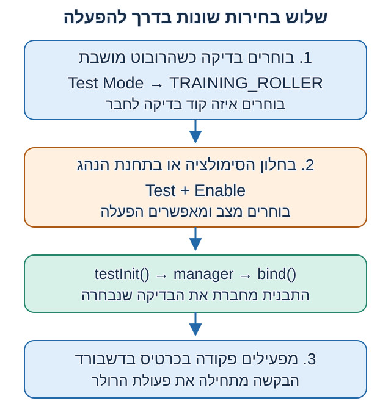

import ExerciseHelp from "@site/src/components/ExerciseHelp";

יש לנו פקודות איסוף ופליטה. כדי לבדוק אותן, לא נרצה להחליף בכל פעם את הפקודה שמחוברת לכפתור. **נרכז את הפעולות בבדיקת רולר, נבחר אותה בבורר הקיים ונפעיל את הפקודות מ־Elastic.**

בסיום תוכלו להוסיף בדיקה לתשתית של הפרויקט ולעקוב אחרי שלושה דברים נפרדים: מה ביקשנו להריץ, איזו פקודה מחזיקה במנגנון ומה המנוע עושה בפועל. המשיכו עם `TrainingRoller` ועם שלוש הפקודות מהשיעור הקודם.

## 1. Binding הוא חיבור להפעלה

עד עכשיו חיברנו trigger של כפתור לפקודה. בתבנית יש גם מחלקות בדיקה שמפרסמות פקודות לדשבורד. פתחו, לקריאה בלבד:

- `src/main/java/frc/robot/TestModeBindings.java` — ה־`enum` שמרכז את הבדיקות.
- `src/main/java/frc/robot/BindingsManager.java` — יוצר את הבורר ומבקש מהבדיקה שנבחרה לפעול.
- `src/main/java/frc/DELib26/bindings/Bindings.java` — מחלקת הבסיס.
- `src/main/java/frc/DELib26/subsystems/swerve/swerveBindings/SwerveGeneralBindings.java` — דוגמה אמיתית לפרסום פקודות בעזרת `DashboardUtils.setData`.

`enum` הוא סוג עם רשימת ערכים מוגדרת מראש; כאן כל ערך הוא בחירה בבדיקות. בבסיס `Bindings` יש שלוש מתודות רלוונטיות:

| מתודה        | מה היא עושה בפועל?                                                          |
| ------------ | --------------------------------------------------------------------------- |
| `bind()`     | מתודה `final` שקוראת ל־`binding()` בכל קריאה. היא אינה מבטיחה ״רק פעם אחת״. |
| `binding()`  | מתודה `protected` שנדרוס כדי לפרסם פקודות או לחבר triggers בעת ההפעלה.      |
| `periodic()` | נקודת עדכון מחזורית, ריקה בבסיס. כאן לא יוצרים שוב commands או bindings.    |

יצירת מופע `Bindings` אינה קוראת אוטומטית ל־`bind()`. אין בבסיס גם `unbind()` שמוחקת פרסומים מהדשבורד.

## 2. יוצרים בדיקה לרולר

צרו `src/main/java/frc/robot/subsystems/trainingRoller/TrainingRollerTestBindings.java`. זהו **הקובץ המלא**; הוא משתמש ב־`CollectCommand` וב־`EjectCommand` שיצרתם, ובפקודת העצירה מהספרייה:

```java
package frc.robot.subsystems.trainingRoller;

import edu.wpi.first.wpilibj2.command.Command;
import frc.DELib26.bindings.Bindings;
import frc.DELib26.subsystems.motorSubsystems.commands.MotorSubsystemDisableMotors;
import frc.DELib26.util.dashboard.DashboardUtils;
import frc.robot.subsystems.trainingRoller.commands.CollectCommand;
import frc.robot.subsystems.trainingRoller.commands.EjectCommand;

public class TrainingRollerTestBindings extends Bindings {
    private final Command collect;
    private final Command eject;
    private final Command stop;

    public TrainingRollerTestBindings(TrainingRoller roller) {
        collect = new CollectCommand(roller);
        eject = new EjectCommand(roller);
        stop = new MotorSubsystemDisableMotors<>(roller);
        stop.setName("Roller Stop");
    }

    @Override
    protected void binding() {
        DashboardUtils.setData("Training Roller/Commands/Collect", collect);
        DashboardUtils.setData("Training Roller/Commands/Eject", eject);
        DashboardUtils.setData("Training Roller/Commands/Stop", stop);
    }
}
```

הבנאי יוצר פקודות, בלי לתזמן אותן ובלי להניע את המנוע. `setName` בוחרת שם לזיהוי פקודת העצירה; היא אינה מפעילה אותה. ה־requirements כבר נמצאות בפקודות. `DashboardUtils.setData` עם `Command` מעבירה אותה ל־`SmartDashboard.putData`, כפי שעושות הבדיקות הקיימות.

אין כאן דריסה של `periodic()`: אין לנו עדכון נוסף. המתזמן כבר מריץ את הפקודות, ופרסום מדידות הרולר כבר מחובר ל־`RobotContainer.logTelemetry()`. אין להוסיף קריאת `setPercentOutput` למחלקת הבדיקה.

### רושמים ב־TestModeBindings

ב־`src/main/java/frc/robot/TestModeBindings.java` הוסיפו import:

```java
import frc.robot.subsystems.trainingRoller.TrainingRollerTestBindings;
```

בתוך רשימת ערכי ה־`enum`, **לפני `NONE`**, הוסיפו את הערך הבא, כולל הפסיק. זהו קטע להוספה, לא קובץ מלא:

```java
TRAINING_ROLLER((RobotContainer container) -> container.trainingRoller
    .map(TrainingRollerTestBindings::new)
    .orElse(null)),
```

`map` מפעילה את פעולת היצירה רק אם ה־`Optional` מכילה רולר. `TrainingRollerTestBindings::new` היא דרך קצרה לכתוב `roller -> new TrainingRollerTestBindings(roller)`. `orElse(null)` מחזירה כאן `null` אם אין רולר; בתשתית הזאת זו הדרך לסמן שבדיקה אינה זמינה. `isBindingsAvailable()` בודקת בדיוק זאת, וה־manager לא מוסיף לבורר בדיקה שאינה זמינה.

מאחר שיצרנו את הרולר בסימולציה בלבד, **`TRAINING_ROLLER` תופיע כרגע רק בסימולציה**. אין לשנות את תנאי יצירת החומרה כדי לגרום לאפשרות להופיע בעמדה פיזית בלי התאמת התצורה עם המנטור.

הסירו מ־`RobotContainer.configureTeleopBindings()` רק את חיבור North הזמני של הרולר. שאר החיבורים נשארים. כך מסיימים את ניסוי הכפתור ועוברים לבדיקת Test אחת, בלי להוסיף manager או chooser חדשים. בנו את הפרויקט והפעילו מחדש את הסימולציה; הוספת ערך ל־`enum` דורשת אתחול חדש.

### עצרו והסבירו

היכן נוצרה תת־המערכת, היכן נוצרו הפקודות והיכן הן מתפרסמות? מדוע פתיחת הדשבורד או פרסום פקודה אינם אמורים להתחיל איסוף?

<ExerciseHelp
  hints={[
    "יש שלוש פעולות שונות: new TrainingRoller, יצירת אובייקט Command ופרסום שלו.",
    "חפשו איזו פעולה עדיין חסרה כדי להתחיל את מחזור החיים של Command.",
  ]}
  solution="RobotContainer יוצר רולר אחד. בנאי TrainingRollerTestBindings מקבל אותו ויוצר פקודות. binding מפרסמת אותן. רק בקשת תזמון שאושרה מתחילה פקודה; בנאים ופרסום אינם בקשת הנעה."
  solutionLanguage="text"
/>

## 3. מי מפעיל את הבדיקה ומתי?

קראו את הקריאות הקיימות, בלי לשנות את `Robot` או את `BindingsManager`:

1. `Robot.robotInit()` קוראת ל־`BindingsManager.init()`.
2. ה־manager עובר על `TestModeBindings.values()`, מוסיף אפשרויות לפי `mode.name()` ומגדיר `NONE` כברירת המחדל. `configureTestMode()` מפרסמת את הבורר בשם **`Test Mode`**.
3. בכניסה ל־Test, `Robot.testInit()` מבטלת פקודות קיימות ומנקה את לולאת הכפתורים. אחר כך `testModeInit()` מתאימה את מיפוי השלט וקוראת `getSelected().getBindings().bind()`.
4. במהלך Test, `testModePeriodic()` קוראת ל־`periodic()` של הבחירה שהבורר מחזיר באותו רגע. במקביל `robotPeriodic()` ממשיכה להריץ מתזמן ולוגים.

[](./assets/test-activation.svg)

**הבחירה נקראת מחדש ב־periodic, אבל `bind()` נקראת רק בכניסה ל־Test.** אם מחליפים בחירה בזמן Test, ה־periodic עשויה כבר להשתייך לבדיקה החדשה בעוד החיבורים שייכים לקודמת. לכן משתמשים תמיד ברצף: **Disable → בחירת בדיקה → Test → Enable**. אל תנסו להחליף בדיקות בזמן הפעלה.

### מה קורה בהפעלה חוזרת וביציאה?

ב־`TestModeBindings` נשמר מופע הבדיקה שנוצר באתחול. בכניסה חוזרת ל־Test נקראת שוב `binding()` על אותו מופע. בדוגמה שלנו היא מפרסמת שוב את אותם שלושה אובייקטי פקודות; היא אינה מוסיפה פקודות פעילות או שכבות של חיבורי כפתורים.

ב־`Robot.disabledInit()` כבר יש `cancelAll()`, ניקוי של לולאת הכפתורים ו־`disableAll()`. גם `testInit()` ו־`teleopInit()` מבטלות פקודות ומנקות את הלולאה; `teleopExit()` עושה ניקוי דומה. לעומתן, **`testExit()` ריקה**: אין בה פעולת ניקוי מיוחדת. בפרט, אין להסיק שמעבר ישיר מ־Test ל־Autonomous מבצע אותו ניקוי. בניסויים עוברים דרך Disabled.

הפרסומים של `SmartDashboard` אינם נמחקים כשמנקים את לולאת הכפתורים. כרטיסי פקודות מבדיקה קודמת יכולים להישאר בדשבורד, וגם `NONE` אינה מוחקת אותם. **הבורר בוחר קוד חיבור; הוא אינו מגביל הרשאות להרצת כרטיס Command במצבים מופעלים אחרים.** מפעילים את כרטיסי האימון רק אחרי בחירת הבדיקה וכניסה ל־Test. ב־Disabled פקודות המנוע שלנו אינן מורשות להתחיל.

## 4. מחברים Elastic להרצה הנוכחית {#connect-elastic}

**Elastic** היא דשבורד: היא מציגה נתוני NetworkTables ויכולה לשלוח בקשות דרך כרטיסים שתוכנית הרובוט מפרסמת. `SmartDashboard` היא טבלת נתונים/API בקוד; איננו צריכים לפתוח את תוכנת SmartDashboard הישנה.

בתוכנית שלנו יש שני מקורות רלוונטיים: `SmartDashboard.putData` מפרסמת בורר ופקודות; AdvantageKit מפרסמת מדידות ושמות פקודות דרך `NT4Publisher`, שנוספה כבר ב־`Robot`. Elastic מציגה את מה שהקוד שולח, ואינה מחשבת בעצמה מהירות מנוע.

1. השאירו סימולציה רצה ב־Disabled. פתחו **Elastic (WPILib) 2026** דרך כלי WPILib או מתפריט ההתחלה. אם אינה מותקנת, היעזרו במנטור וב[הוראות ההתקנה הרשמיות](https://frc-elastic.gitbook.io/docs/getting-started/installation).
2. פתחו **Settings** ובשיטת החיבור בחרו **localhost** לסימולציה באותו מחשב. חכו לחיווי ירוק **Network Tables: Connected**. מספר קבוצה לבדו אינו חיבור לסימולטור.
3. בחומרה, אחרי הכנת העמדה עם המנטור, מתחברים לרשת הרובוט ומשתמשים בשיטת **Driver Station**, או בכתובת/מספר הקבוצה המתאימים לעמדה. [אפשרויות החיבור הרשמיות](https://frc-elastic.gitbook.io/docs/getting-started/connecting-to-your-robot).

אם כבר פתוחה פריסה של רובוט אחר, הוסיפו לשונית אימון במקום לשנות את כרטיסי המנגנונים שלו. בתבנית האימון שנבדקה אין קובץ פריסת Elastic מוכן לרולר; נבנה תצוגה משלנו.

### מוסיפים את הבורר

לחצו **Add Widget**, הרחיבו את `SmartDashboard` וגררו את **`Test Mode` כטבלה שלמה** ללשונית. הנתיב הוא `/SmartDashboard/Test Mode`. היא מזוהה כ־`String Chooser`; אין לגרור רק את `selected` או את `options`.

בסימולציה יופיעו `NONE`, `CONTROLLER_DIAGNOSTICS`, `SWERVE_PID_CALIBRATIONS`, `SWERVE_GENERAL` והאפשרות שהוספנו, `TRAINING_ROLLER`. בחרו `TRAINING_ROLLER` כשהרובוט Disabled. התוויות הן שמות ערכי ה־`enum`, לא שמות המחלקות.

**הבחירה הזאת לא משנה את מצב הרובוט ולא עושה Enable.** בחלון **Robot Simulation**, באזור **Robot State** שכבר הכרתם, בחרו **Test** והפעילו אותו. בחומרה, בחירת Test ו־Enable נעשות ב־**Driver Station**. [תזכורת לממשק הסימולציה](../01-getting-started/03-first-simulation.mdx#robot-state).

אין צורך ללחוץ עדיין על פקודת מנוע. הכניסה הראשונה מפרסמת את שלושת הכרטיסים. חזרו ל־Disabled כדי להכין את שאר התצוגה.

### מוסיפים פקודות ומדידות

פתחו שוב **Add Widget**. גררו כל טבלת פקודה שלמה לכרטיס מסוג **Command**:

| נתיב NetworkTables                                 | השימוש                            |
| -------------------------------------------------- | --------------------------------- |
| `/SmartDashboard/Training Roller/Commands/Collect` | התחלת איסוף וביטול שלו            |
| `/SmartDashboard/Training Roller/Commands/Eject`   | התחלת פליטה וביטול שלה            |
| `/SmartDashboard/Training Roller/Commands/Stop`    | בקשת עצירה מיידית שדורשת את הרולר |

כרטיס `Command` משתמש בשדה `running` של הפקודה. בקשת הפעלה מתזמנת אותה ובקשת ביטול מבטלת אותה. זה שונה מכפתור שלט עם `whileTrue`: אין צורך להחזיק את העכבר לחוץ, ופקודת האיסוף ממשיכה עד ביטול או פקודה מתחרה.

כעת גררו גם את הערכים הבאים. אלו **נתיבים מלאים ל־Elastic בהרצה חיה**, בתצורת `NT4Publisher` הקיימת:

| נתיב                                                                        | מה מציגים?                             |
| --------------------------------------------------------------------------- | -------------------------------------- |
| `/AdvantageKit/RealOutputs/Subsystems/TrainingRoller/Command`               | שם הפקודה שמחזיקה כעת ברולר, או `None` |
| `/AdvantageKit/Subsystems/TrainingRoller/Inputs/AppliedVoltage`             | מתח המנוע, בוולט                       |
| `/AdvantageKit/Subsystems/TrainingRoller/Inputs/MechanismVelocityRotPerSec` | מהירות המנגנון ב־RPS                   |

לשם הפקודה בחרו תצוגת טקסט, ולמדידות תצוגה מספרית. אפשר לשנות כותרת דרך לחיצה ימנית ו־**Edit Properties**, למשל ״מתח רולר [V]״. מדידות כאן מיועדות לצפייה; אין לשנות את ערכן דרך שדה עריכה. ההבדל בנתיבים נובע מכך ש־`Inputs` נרשמים ב־`Logger.processInputs`, ושם הפקודה נרשם ב־`Logger.recordOutput` תחת `RealOutputs`. [הוספה והתאמת כרטיסים](https://frc-elastic.gitbook.io/docs/customizing-your-dashboard/adding-and-customizing-widgets) ו[סוגי הכרטיסים](https://frc-elastic.gitbook.io/docs/additional-features-and-references/widgets-list-and-properties-reference).

אם ערך חסר, חפשו תחילה `TrainingRoller` וודאו חיבור להרצה החדשה ואת הקריאה ל־`trainingRoller.ifPresent(TrainingRoller::logTelemetry)` ב־`RobotContainer.logTelemetry()`. אם כרטיסי הפעולות חסרים, בדקו שנכנסתם פעם אחת ל־Test עם הבחירה הנכונה. פרסום המדידות בתבנית מתרחש בכל ארבעה מחזורים, ולכן ייתכן עיכוב קצר, ופקודת העצירה הקצרה יכולה להסתיים בין שתי דגימות.

## 5. ניסוי: בקשה, פקודה ומדידה

בכל ניסוי כתבו תחזית, הפעילו, צפו ורשמו הסבר קצר. אחרי שהכרטיסים מוכנים, חזרו לרצף **Disabled → בחירת `TRAINING_ROLLER` → Test → Enable**.

| פעולה                         | מה בודקים?                                                           |
| ----------------------------- | -------------------------------------------------------------------- |
| בלי להפעיל Command            | שם הפקודה `None`, ואין בקשת הנעה.                                    |
| הפעלת Collect                 | הכרטיס מראה שהפקודה רצה; השם `CollectCommand`; המתח והמהירות מגיבים. |
| ביטול Collect באותו כרטיס     | הפקודה אינה רצה, השם חוזר ל־`None`, ופלט ההנעה מתבטל.                |
| התחלת Collect ואז התחלת Eject | איסוף מתבטלת בגלל requirement משותפת; פליטה הופכת לפקודה הנוכחית.    |
| הפעלת Stop במהלך פליטה        | פליטה מבוטלת והפלט מתבטל. Stop עצמה מסתיימת במהירות.                 |
| התחלת Collect ואז Disable     | פקודת האיסוף מבוטלת; המדידות ממשיכות להתעדכן.                        |

מהירות אינה חייבת להתאפס מיד בסיום. Elastic עוזרת לזהות את המצב הנוכחי; כדי לראות **מתי** המתח בוטל ואיך המהירות דעכה, הוסיפו אותם לגרף ב־AdvantageScope בדרך שכבר למדתם. שם מקור AdvantageKit עשוי להציג את העץ בלי התחילית המלאה של NetworkTables. חפשו את אותם שמות שדות, והציגו מתח ומהירות בצירים נפרדים.

### תרגיל: מי ניצח בהתנגשות?

הפעילו Collect, ורק אחר כך Eject. אל תשנו את הפלטים או את התצורה. שמרו צילום של שם הפקודה וגרף של ההחלפה. הסבירו איזה `end` נקרא לאיסוף, מי ביטל את פלטה ומי שלח את הבקשה החדשה. מדוע כתיבה ישירה למנוע מחוץ לפקודה הייתה מקשה להסביר את הניסוי?

<ExerciseHelp
  hints={[
    "שתי הפקודות קיבלו בבנאי את אותו אובייקט roller.",
    "הבסיס של איסוף קורא disableMotors ב־end(true), ואחריו הפקודה החדשה מתחילה לבקש פלט שלילי ב־execute.",
  ]}
  solution="במדיניות ברירת המחדל, איסוף מפנה את ה־requirement ומקבלת end(true). הניקוי שלה מבטל פלט, ואז פליטה רצה על אותו רולר. השם הנוכחי הוא EjectCommand. קוד חיצוני ששולח שוב פלט אינו מתואם על ידי requirements ועלול לדרוס את הבקשות."
  solutionLanguage="text"
/>

### תרגיל: הפעלה חוזרת והחלפת בדיקה

1. עצרו פעולה באמצעות כרטיס הביטול, ואז הפעילו אותה שוב. בדקו שהמנוע מגיב פעם נוספת.
2. עברו ל־Disabled, בחרו `NONE`, וחזרו ל־Test. אל תלחצו על כרטיסי הרולר שנשארו. הסבירו למה עצם הופעתם אינה מוכיחה שהרולר הוא הבדיקה שנבחרה.
3. עברו שוב ל־Disabled, בחרו `TRAINING_ROLLER`, וחזרו ל־Test. הפעילו איסוף פעם אחת ובטלו אותה. ודאו שאינה מתחילה מחדש מעצמה.
4. הוסיפו לבדיקה גם כרטיס ל־`FadeCollectCommand` מהשיעור הקודם. צרו לו שדה פקודה בבנאי ופרסום ב־`binding()`, עם מפתח חדש `Training Roller/Commands/Fade`. השוו השלמה של שנייה לביטול מוקדם.

<ExerciseHelp
  hints={[
    "ה־enum שומר את אובייקט הבדיקה; bind נקראת שוב, אבל הכרטיסים אינם מתנקים אוטומטית.",
    "לכרטיס החדש צרו Command פעם אחת בבנאי, והשתמשו ב־DashboardUtils.setData ב־binding. שימו לב ל־import של FadeCollectCommand.",
    "ב־Fade, הסיום בזמן מגיע מ־isFinished; ביטול מוקדם מגיע מבקשת הביטול בכרטיס. בשניהם end צריכה לבטל פלט.",
  ]}
/>

## בדיקת סיום

הציגו למנטור את הבורר, את שלוש פקודות הבסיס ואת כרטיס הדעיכה שהוספתם, לצד שם הפקודה, המתח והמהירות. הראו התנגשות, ביטול, השלמה וחזרה ל־Test דרך Disabled. הסבירו בנפרד **בחירת בדיקה**, **בחירת מצב הרובוט** ו־**Enable**, והראו היכן כל אחת מתבצעת.

שמרו את פריסת האימון דרך **File → Save As** בתיקיית המאגר האישי, בשם למשל `dashboards/training-roller.json`; צרו את התיקייה אם צריך. שמירת הפריסה אינה משנה קוד או מעבירה את הרובוט למצב אחר. שמרו commit של הקוד ושל הפריסה שבחרתם להוסיף. בשיעור הבא [נשלב את הפעולות להתנהגות אחת](./05-command-composition.mdx), ונבדוק אותה באותו מסלול.

<details>
<summary>החיבורים שנבדקו בתבנית</summary>

הזרימה מבוססת על [Robot](https://github.com/Desert-Eagles-6104/robot-training-template/blob/79e3babd4735d0bae10f88a5536e067a938a44a3/src/main/java/frc/robot/Robot.java), [BindingsManager](https://github.com/Desert-Eagles-6104/robot-training-template/blob/79e3babd4735d0bae10f88a5536e067a938a44a3/src/main/java/frc/robot/BindingsManager.java), [TestModeBindings](https://github.com/Desert-Eagles-6104/robot-training-template/blob/79e3babd4735d0bae10f88a5536e067a938a44a3/src/main/java/frc/robot/TestModeBindings.java), ועל [Bindings](https://github.com/Desert-Eagles-6104/DELib26/blob/c2f1da1144b7fd30dfcf94f30e850993be5d03aa/bindings/Bindings.java) ו־[DashboardUtils](https://github.com/Desert-Eagles-6104/DELib26/blob/c2f1da1144b7fd30dfcf94f30e850993be5d03aa/util/dashboard/DashboardUtils.java) מהספרייה המוצמדת. שינוי מקומי בתשתית מחייב לבדוק שוב את מסלול ההפעלה.

</details>
