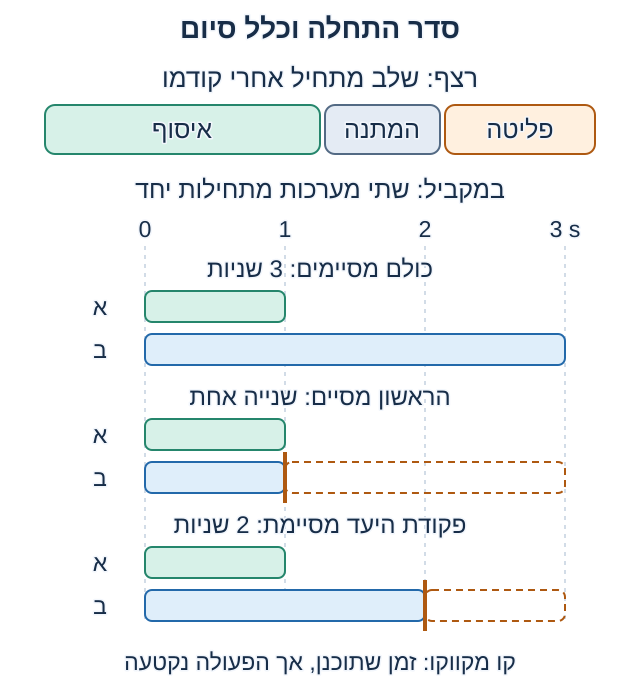

import ExerciseHelp from "@site/src/components/ExerciseHelp";

בדיקת הרולר כבר מאפשרת איסוף ופליטה בנפרד. עכשיו הדרישה היא: **אספו למשך זמן קבוע, המתינו, פלטו לזמן קצר וסיימו בלי בקשת הנעה.** אחר כך נרצה לתאם רולר עם מנגנון מדומה נוסף. האם צריך לכתוב שוב `execute()` גדול שמנהל את כל השלבים?

בסיום תוכלו להרכיב התנהגות מפקודות קיימות, לבחור מי קובע את סופה ולנבא מה יקרה בביטול. נבדוק אותה דרך [בדיקת הרולר ו־Elastic](./04-elastic-testing.mdx) שכבר בניתם. כל הדוגמאות נשארות באחוזי פלט.

## 1. רצף מתקדם רק כששלב מסתיים

**Composition**, או שילוב פקודות, היא בעצמה פקודה. המתזמן מפעיל את השילוב החיצוני; הוא מפעיל את מחזור החיים של הפקודות שבתוכו. ב־`Commands.sequence(...)` מתחילים את השלב הבא רק אחרי שהשלב הנוכחי הסתיים.

`TrainingRollerCollect` ו־`TrainingRollerEject` יורשות `isFinished() == false`. הרצף ״איסוף, המתנה, פליטה״ **ייתקע באיסוף** אם לא נגדיר מתי הוא מסיים. `Commands.waitSeconds(...)` אינה יכולה לעצור שלב שנמצא לפניה.

### נותנים לפעולה מגבלת זמן

הביטוי הבא יוצר איסוף עם מגבלת זמן. משתמשים בו אחרי שבדקנו שהרולר קיים:

```java
new TrainingRollerCollect().withTimeout(1.5)
```

`withTimeout` מחזירה פקודה משולבת שמסיימת כשהפקודה המקורית מסיימת, או כשהזמן עובר. כאן המקורית אינה מסיימת בעצמה, ולכן אחרי כ־1.5 שניות היא מקבלת `end(true)`: מגבלת הזמן הפריעה לה. השילוב שמסביבה יכול בכל זאת להשלים כרגיל ולהעביר את הרצף לשלב הבא. זה ההבדל בין **השלמת השלב החיצוני** לבין סיבת סיום הפקודה שבתוכו.

`Commands.waitSeconds(0.5)` היא פקודת המתנה: היא בודקת זמן במחזורים ומסיימת אחרי כחצי שנייה. היא אינה חוסמת את תוכנית הרובוט, ואינה שולחת בקשת עצירה למנוע. לא משתמשים ב־`Thread.sleep` בתוך פקודה. [ההמתנה ומגבלות הזמן בתיעוד WPILib](https://docs.wpilib.org/en/stable/docs/software/commandbased/command-compositions.html).

## 2. בונים מחזור עבודה לרולר

בתוך `Constants.TrainingRollerConstants`, ב־`src/main/java/frc/robot/constants/Constants.java`, הוסיפו:

```java
public static final double COLLECT_SECONDS = 1.5;
public static final double PAUSE_SECONDS = 0.5;
public static final double EJECT_SECONDS = 0.4;
```

צרו `src/main/java/frc/robot/subsystems/trainingRoller/commands/RollerCommands.java`. זהו **קובץ מלא לשלב הזה**:

```java
package frc.robot.subsystems.trainingRoller.commands;

import edu.wpi.first.wpilibj2.command.Command;
import edu.wpi.first.wpilibj2.command.Commands;
import frc.robot.constants.Constants.TrainingRollerConstants;

public final class RollerCommands {
    private RollerCommands() {}

    public static Command cycle() {
        return Commands.sequence(
            new TrainingRollerCollect()
                .withTimeout(TrainingRollerConstants.COLLECT_SECONDS),
            Commands.waitSeconds(TrainingRollerConstants.PAUSE_SECONDS),
            new TrainingRollerEject()
                .withTimeout(TrainingRollerConstants.EJECT_SECONDS)
        ).withName("Roller Cycle");
    }
}
```

זו מחלקת עזר שמחזירה פקודות: `cycle` היא מתודה סטטית, וכל קריאה לה בונה שילוב חדש. הבנאי הפרטי מונע יצירת אובייקט עזר שאין לנו צורך בו. `withName` בוחרת שם לשילוב החיצוני כדי לזהות אותו בלוגים ובדשבורד.

מה צפוי ביחס לרגע ההתחלה? הזמנים מקורבים לפי מחזורי המתזמן:

| זמן מתחילת המחזור | התנהגות                                     |
| ----------------- | ------------------------------------------- |
| 0 עד 1.5 שניות    | איסוף בפלט `TRAINING_OUTPUT`                |
| 1.5 עד 2.0 שניות  | האיסוף כבר ניקה את הפלט; פקודת ההמתנה פעילה |
| 2.0 עד 2.4 שניות  | פליטה בפלט `EJECT_OUTPUT`                   |
| בסיום             | הפליטה מנקה פלט, והשילוב מסתיים             |

אין צורך להוסיף לרצף פקודת עצירה כדי לתקן את סיום שלבי האחוזים: `end()` שלהם כבר מבטלת פלט. **פקודת עצירה בשורה האחרונה אינה תחליף לניקוי** — בביטול באמצע הרצף השורה הזאת כלל לא הייתה מגיעה לביצוע.

### מחברים לבדיקה הקיימת

ב־`src/main/java/frc/robot/subsystems/trainingRoller/TrainingRollerTestBindings.java` הוסיפו import של `frc.robot.subsystems.trainingRoller.commands.RollerCommands`. לצד המפתחות הקיימים הוסיפו את המפתח לרצף:

```java
private static final String CYCLE_KEY = COMMANDS_FOLDER + "Cycle";
```

בתוך `binding()` הוסיפו את פרסום הרצף:

```java
DashboardUtils.setData(CYCLE_KEY, RollerCommands.cycle());
```

בנו והפעילו מחדש. בחרו את הבדיקה דרך Disabled ו־Test כבשיעור הקודם, והוסיפו ב־Elastic כרטיס Command מהטבלה `/SmartDashboard/Training Roller/Commands/Cycle`. בלוג הפקודה הנוכחית יופיע **`Roller Cycle` לאורך הרצף**, גם בזמן ההמתנה; השילוב החיצוני מחזיק ב־requirement. ילדים של שילוב אינם מתוזמנים בפני עצמם, ולכן `isScheduled()` על ילד אינו דרך למדוד איזה שלב רץ.

### תרגיל: מנבאים ואז משווים

1. ציירו גרף של הפלט המבוקש לפי טבלת הזמנים, ואז הריצו Cycle ושמרו גרף מתח ומהירות ב־AdvantageScope. האם קטע ההמתנה מוכיח שהרולר כבר במנוחה?
2. שנו **רק** את `PAUSE_SECONDS` מ־`0.5` ל־`1.0`, בנו והפעילו מחדש. נבאו את זמן הפליטה ואת משך הרצף והשוו למדידה. החזירו את הערך בסיום.
3. בטלו דרך כרטיס Cycle פעם בזמן איסוף, פעם בהמתנה ופעם בזמן פליטה. האם שלב מאוחר יותר התחיל אחרי הביטול? מי ניקה פלט בכל מקרה?

<ExerciseHelp
  hints={[
    "המתנה אינה מודדת מהירות; ב־Coast המנגנון יכול להמשיך לנוע אחרי ביטול ההנעה.",
    "הוספנו חצי שנייה רק לשלב האמצעי. זמן תחילת הפליטה יזוז באותה תוספת.",
    "בביטול, הרצף קורא end(true) לילד שעדיין פעיל. ילדים שהושלמו אינם רצים מחדש, וילדים עתידיים אינם מתחילים.",
  ]}
  solution="בזמן ההמתנה אין בקשת הנעה, אך ייתכן שהמהירות עדיין דועכת. עם הפסקה של שנייה הפליטה מתחילה סביב 2.5 שניות והרצף מסיים סביב 2.9. בביטול בזמן פעולה, הפקודה הפעילה מנקה את פלטה; בהמתנה האיסוף כבר ניקה. אף שלב עתידי אינו מתחיל אחרי ביטול."
  solutionLanguage="text"
/>

## 3. סיום לפי תנאי

לפעמים יודעים מתי לסיים לפי ערך שמשתנה בזמן הריצה. `until(...)` מקבלת `BooleanSupplier`: פעולה שמחזירה `true` או `false`, בדומה ל־`DoubleSupplier` שהחזירה מספר. היא בודקת את התנאי לאורך הריצה ומסיימת את השילוב אם הוא מתקיים. הפקודה שבתוכו מקבלת אז `end(true)`.

נשתמש ב**בקשת סיום ידנית בדשבורד**, בלי חיישן חדש. ב־`TrainingRollerTestBindings.java` הוסיפו imports של `edu.wpi.first.wpilibj.smartdashboard.SmartDashboard`, של `edu.wpi.first.wpilibj2.command.Command` ושל `frc.robot.subsystems.trainingRoller.commands.TrainingRollerCollect` אם הם חסרים. לצד שאר המפתחות הוסיפו:

```java
private static final String CONDITIONAL_COLLECT_KEY = COMMANDS_FOLDER + "Conditional Collect";
private static final String FINISH_REQUEST_KEY = DASHBOARD_FOLDER + "/Finish Requested";
```

ובתוך `binding()` הוסיפו:

```java
SmartDashboard.putBoolean(FINISH_REQUEST_KEY, false);
Command conditionalCollect = new TrainingRollerCollect()
    .until(() -> SmartDashboard.getBoolean(FINISH_REQUEST_KEY, false))
    .withTimeout(3.0)
    .withName("Conditional Collect");
DashboardUtils.setData(CONDITIONAL_COLLECT_KEY, conditionalCollect);
```

הוסיפו ב־Elastic כרטיס Command לטבלת הפקודה וכרטיס **Boolean Toggle** לערך `/SmartDashboard/Training Roller/Finish Requested`. שלוש השניות מגבילות את משך הניסוי גם אם לא תישלח בקשת סיום. האיפוס ב־`binding()` מתרחש בכל כניסה לבדיקה, **לא בכל הרצת הפקודה**.

### תרגיל: משנים רק את רגע הבקשה

התחילו כל ניסיון עם `Finish Requested = false`. הפעילו Conditional Collect, ואחרי כחצי שנייה שנו את הבקשה ל־`true`. חזרו על הניסוי עם בקשה אחרי כשתי שניות, בלי לשנות את הפלט. לבסוף נסו בלי בקשה, ונבאו איזה תנאי יסיים.

לפני ניסיון נוסף החזירו `false`. אם התנאי כבר `true` בהתחלה, אין להסיק שהפקודה לא תתחיל כלל: `until` הוא תנאי סיום, ובמחזור הראשון ייתכן שכבר יבוצע `execute()`. אין להשתמש בו כתחליף לבדיקת אישור לפני הפעלה.

<ExerciseHelp
  hints={[
    "ה־supplier קוראת את הערך שוב בזמן הריצה, ולא שומרת רק את ערכו בבנאי.",
    "הפעולה מסיימת כשאחד משני הדברים קורה קודם: בקשת סיום או מגבלת שלוש השניות.",
  ]}
  solution="בשני הניסויים הראשונים בקשת הסיום קוטעת את האיסוף; בניסוי בלי בקשה מגבלת הזמן קוטעת אותו. בשניהם הפקודה הפנימית מנקה פלט באמצעות end(true), והשילוב החיצוני מסיים. אין כאן מדידה או הוכחה שנאסף חפץ."
  solutionLanguage="text"
/>

## 4. עובדים במקביל: מי קובע מתי מסיימים?

ברצף אפשר להשתמש באותו רולר בשלבים שונים. בשילוב מקביל, שתי פקודות אינן יכולות לדרוש בנפרד **את אותו מופע**: לשילוב לא תהיה דרך להעניק לכל אחת שליטה בלעדית. WPILib דוחה שילוב כזה בעת בנייתו. שינוי שמות הפקודות אינו פותר את ההתנגשות.

כדי להתנסות בתיאום, נוסיף **מופע מערכת שני בסימולציה בלבד**. אין צורך במנוע פיזי נוסף או במחלקת subsystem שעוטפת שוב את כל פעולות הבסיס.

### מכינים את המופע השני

ב־`src/main/java/frc/robot/constants/Constants.java` הוסיפו לצד `TrainingRollerConstants` מחלקה פנימית חדשה. זהו **כל תוכן המחלקה החדשה**, בתוך `Constants`:

```java
public static final class TrainingPartnerConstants {
    public static final double TRAINING_OUTPUT = 0.12;
    public static final MotorSubsystemConfiguration CONFIG =
        new MotorSubsystemConfiguration()
            .withName("TrainingPartner")
            .withMaster(new MasterMotorConstants(52, "rio", true,
                new TalonFXConfiguration().withMotorOutput(
                    new MotorOutputConfigs().withNeutralMode(NeutralModeValue.Coast))))
            .withMechanismType(MotorSubsystemConfiguration.MechanismType.ANGULAR)
            .withMechanismSimConfig(new DCMotorMechanismSimConfig(0.002, 0.1));
}
```

ה־imports הדרושים כבר שימשו בתצורת הרולר; ודאו שקיימים:

```java
import com.ctre.phoenix6.configs.MotorOutputConfigs;
import com.ctre.phoenix6.configs.TalonFXConfiguration;
import com.ctre.phoenix6.signals.NeutralModeValue;
import frc.DELib26.motors.MasterMotorConstants;
import frc.DELib26.subsystems.motorSubsystems.motorBase.MotorSubsystemConfiguration;
import frc.DELib26.subsystems.motorSubsystems.motorBase.mechanismSim.DCMotorMechanismSim.DCMotorMechanismSimConfig;
```

ל־TrainingFlywheel מזהה `50`, לרולר שבנינו `51`, ולשותף המדומה `52`. שם השותף שונה גם בלוגים. אין לשתף בין המופעים את אובייקט `CONFIG` ולשנות את שמו או את כתובתו: כל תצורה נבנית בנפרד.

ב־`src/main/java/frc/robot/RobotContainer.java` הוסיפו imports של `frc.DELib26.subsystems.motorSubsystems.motorBase.MotorSubsystemTalon` ושל `frc.robot.constants.Constants.TrainingPartnerConstants`. הוסיפו את השדה:

```java
public final Optional<MotorSubsystemTalon> trainingPartner;
```

בבנאי, ליד יצירת הרולר ולאחר הגדרת `isSim`, הוסיפו:

```java
this.trainingPartner = isSim
    ? Optional.of(new MotorSubsystemTalon(TrainingPartnerConstants.CONFIG))
    : Optional.empty();
```

ובתוך `logTelemetry()`, ליד לוג הרולר:

```java
this.trainingPartner.ifPresent(MotorSubsystemTalon::logTelemetry);
```

### שלוש בחירות סיום

נדמיין פעולה A על הרולר שמסתיימת אחרי שנייה, ופעולה B על השותף שמסתיימת אחרי שלוש. אפשר להתחיל אותן באותו מחזור ולבחור כלל סיום:

| שילוב                                                      | מתי השילוב מסיים?             | מה קורה לפעולות?                   |
| ---------------------------------------------------------- | ----------------------------- | ---------------------------------- |
| `Commands.parallel(...)`                                   | כשכולן מסיימות: כ־3 שניות     | A מסיימת קודם; B ממשיכה עד סופה.   |
| `Commands.race(...)`                                       | כשהראשונה מסיימת: כ־1 שנייה   | B נקטעת.                           |
| `Commands.deadline(...)` עם המתנה של 2 שניות כפרמטר הראשון | כשה־deadline מסיים: כ־2 שניות | A כבר סיימה; B נקטעת בסיום ההמתנה. |

ה־deadline הוא פקודה רגילה שנבחרה לקבוע את סיום השילוב. הוא לא חייב להיות שעון; כאן המתנה מאפשרת לראות את ההבדל בבירור. שלוש האפשרויות אינן חוסמות את עדכון הרובוט.

[](./assets/composition-timing.svg)

### מממשים בדיקת תיאום אחת

ב־`RollerCommands.java` הוסיפו imports:

```java
import frc.DELib26.subsystems.motorSubsystems.commands.MotorSubsystemSetPercentage;
import frc.DELib26.subsystems.motorSubsystems.motorBase.MotorSubsystemTalon;
import frc.robot.constants.Constants.TrainingPartnerConstants;
```

בתוך המחלקה, לצד `cycle`, הוסיפו את **המתודה המלאה**:

```java
public static Command coordinated(MotorSubsystemTalon partner) {
    return Commands.deadline(
        Commands.waitSeconds(2.0),
        new TrainingRollerCollect().withTimeout(1.0),
        new MotorSubsystemSetPercentage<>(
            partner, () -> TrainingPartnerConstants.TRAINING_OUTPUT)
            .withTimeout(3.0)
    ).withName("Two Motor Test");
}
```

כל ענף דורש מערכת אחרת; פקודת ההמתנה אינה דורשת מערכת. לשילוב החיצוני יש **איחוד ה־requirements**: הוא שומר את שתי המערכות לאורך כל השילוב, גם אחרי שענף הרולר סיים. כך גם רצף שומר requirements של שלבים עתידיים, כולל במהלך המתנה.

## 5. מחברים את התיאום לאותה בדיקה

ב־`TrainingRollerTestBindings.java` הוסיפו import של `MotorSubsystemTalon` מהחבילה שבדוגמה הקודמת. לצד שאר השדות הוסיפו:

```java
private static final String COORDINATED_KEY = COMMANDS_FOLDER + "Coordinated";
private final MotorSubsystemTalon partner;
```

החליפו את הבנאי כך שישמור את שני המנגנונים הקיימים:

```java
public TrainingRollerTestBindings(TrainingRoller roller, MotorSubsystemTalon partner) {
    this.roller = roller;
    this.partner = partner;
}
```

בתוך `binding()` הוסיפו את פרסום הפקודה:

```java
DashboardUtils.setData(COORDINATED_KEY, RollerCommands.coordinated(partner));
```

שינוי החתימה מחייב לעדכן את הקוד הקורא לה. ב־`src/main/java/frc/robot/TestModeBindings.java` החליפו **רק את ערך `TRAINING_ROLLER`** בקטע הבא:

```java
TRAINING_ROLLER((RobotContainer container) -> container.trainingRoller
    .flatMap(roller -> container.trainingPartner.map(partner ->
        new TrainingRollerTestBindings(roller, partner)))
    .orElse(null)),
```

`flatMap` מחברת כאן שתי בדיקות קיום: אם חסר רולר או שותף, אין בדיקה זמינה. אם שניהם קיימים, מעבירים לבדיקה את שני המופעים שכבר נוצרו. לא יוצרים מנועים במחלקת ה־bindings.

בנו והפעילו מחדש. הוסיפו ב־Elastic כרטיס Command מהטבלה `/SmartDashboard/Training Roller/Commands/Coordinated`. הוסיפו גם את מדידות השותף: באותם נתיבי טלמטריה מהשיעור הקודם החליפו `TrainingRoller` ב־`TrainingPartner`. בשמות הפקודות של שתי המערכות יופיע `Two Motor Test` בזמן שהשילוב מחזיק בהן.

### תרגיל: משווים כללי סיום

הריצו את שלוש הגרסאות הבאות. בכל השוואה שנו **רק את פונקציית השילוב** בתוך `coordinated`, ובנו והפעילו מחדש:

1. `Commands.deadline` כפי שנכתב: נבאו סיום סביב שתי שניות.
2. `Commands.parallel` עם אותם שלושה ארגומנטים: נבאו מי מחכה למי.
3. `Commands.race` עם אותם שלושה ארגומנטים: נבאו מי יסיים ראשון ומי ייקטע.

שמרו גרף של מתחי שני המנועים בכל גרסה, והסבירו גם את תפקיד המתנת שתי השניות. החזירו בסיום את גרסת ה־deadline.

<ExerciseHelp
  hints={[
    "הענפים מסיימים אחרי 2, 1 ו־3 שניות. רק ב־deadline יש משמעות מיוחדת לארגומנט הראשון.",
    "parallel מחכה גם לענף הארוך ביותר. race מסיימת כשהענף הקצר ביותר מסיים.",
  ]}
  solution="deadline מסיימת סביב 2 שניות וקוטעת את ענף השותף. parallel מסיימת סביב 3 שניות. race מסיימת סביב שנייה וקוטעת גם את ההמתנה וגם את השותף. פקודת האחוזים שבתוך כל timeout מקבלת הפרעה כשהזמן שלה מסתיים; הענף העוטף אותה יכול להיחשב מושלם מבחינת השילוב החיצוני."
  solutionLanguage="text"
/>

### תרגיל: בקשת עצירה של מערכת אחת

הפעילו Coordinated ובמהלך השנייה הראשונה הפעילו את כרטיס Stop של הרולר. נבאו תחילה מה יקרה **גם לשותף**, ואז בדקו. חזרו על הניסוי עם ביטול בכרטיס Coordinated עצמו ועם Disable, בכל פעם בהרצה חדשה.

<ExerciseHelp
  hints={[
    "למתזמן יש פקודה חיצונית אחת שדורשת את שתי המערכות.",
    "פקודת Stop מתחרה על הרולר עם כל השילוב. בביטול השילוב, גם ענפים פעילים של מערכות אחרות מקבלים ניקוי.",
  ]}
  solution="Stop מבטלת את כל השילוב בגלל requirement משותפת. הענפים שעדיין פועלים מקבלים end(true) ומבטלים את פלט שני המנגנונים. כך גם בביטול השילוב וב־Disabled. פעולות שכבר הסתיימו אינן מתבטלות לאחור."
  solutionLanguage="text"
/>

## 6. למי שייך אובייקט הפקודה?

כשפקודה נכנסת לשילוב, השילוב מנהל את חייה. **אי אפשר לתזמן את אותו ילד בנפרד או להכניס אותו לשילוב אחר.** זה חל גם על `withTimeout`, `until` ו־`withName`, שבונים עטיפה/שילוב. השתמשו בתוצאה המוחזרת.

כרטיס Collect והרצף Cycle מקבלים כל אחד מופע משלו של `TrainingRollerCollect`. שתי הפקודות משתמשות באותו רולר, והמתזמן מתאם ביניהן לפי ה־requirements שלהן.

אפשר להריץ שוב **את אותה פקודה חיצונית** אחרי שסיימה או בוטלה, כפי שעושים כרטיסי הבדיקה. היא מאתחלת את ריצתה מחדש. אם צריך שני שילובים נפרדים, קוראים לפונקציית היצירה פעמיים, וכל קריאה יוצרת ילדים חדשים. [כללי בעלות ושילוב ב־WPILib](https://docs.wpilib.org/en/stable/docs/software/commandbased/command-compositions.html#command-instance-reuse).

**עצרו והסבירו:** מה ההבדל בין אותו _מופע רולר_ שמשותף לפקודות, לבין אותו _מופע פקודה_ שמנסים להכניס לשני שילובים? למה יצירת רולר חדש לאותה כתובת אינה מתקנת שימוש חוזר שגוי בפקודה?

<ExerciseHelp
  hints={[
    "מערכת היא המשאב; Command היא פעולה עם מצב ומחזור חיים. לשני מנהלים אסור לנהל במקביל את אותו מחזור חיים.",
  ]}
  solution="מופע הרולר צריך להיות משותף כדי ש־requirements יזהו התנגשות. לעומת זאת, ילד בשילוב שייך למנהל מחזור החיים שלו ואינו פנוי לשימוש עצמאי נוסף. יוצרים Command חדשה עבור השילוב האחר, ולא subsystem חדשה שמסתירה התנגשות על אותה חומרה."
  solutionLanguage="text"
/>

## בדיקת סיום

הציגו Cycle שמסיים, איסוף שמסתיים לפי בקשה, ותיאום של שני מנועים מדומים בעלי כתובות ושמות נפרדים. הראו תחזית מול גרף, ביטול באמצע ועצירה עקב requirement מתחרה. בחרו במילים מתי מתאים רצף, מתי מחכים לכולם ומתי פעולה אחת צריכה לקבוע את הסוף.

השאירו את ערכי הזמנים המקוריים ואת גרסת ה־deadline, בנו ושמרו commit עם תיאור המדידות. כעת אפשר לעבור מבעיה נתונה להחלטות משלכם: [בונים מערכת עצמאית מדרישות](./06-independent-mechanism.mdx). מהירות, מיקום וכיוונון בקרה אינם דרושים לפרויקט הבא.
